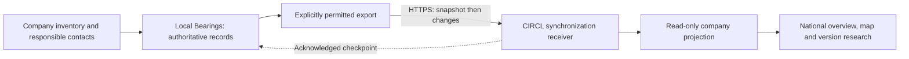

# Company-operated Bearings synchronization — proposed next increment

Status: proposal for discussion, 2026-11-18. This document adds no synchronization behavior or new data-sharing permission.

## Existing implementation

The [read-only federation pilot](../integrations/federation.md) already supports explicit company-admin export grants, pinned HTTPS receiver connections, hashed bearer credentials, receiver-client binding, manual `pull_company`, complete-snapshot validation and source-locked atomic imports. It exports at most 500 issues and optionally 500 assets / 1.5 MB. Errors preserve last-known reports; disabling a local source hides them. The company controls the grant, its inventory scope and expiry.

It does **not** yet synchronize contacts, company profiles/addresses, scope declarations or installed software/version records, and no periodic pull scheduler is built in. Imported reports appear in **Company instances**; they do not become authoritative local Asset/Finding/Installation records and are not included in National Overview, map/version research or outreach. A pull succeeding once does not establish continuous synchronization. A real two-instance operational pilot remains to validate; existing automated tests do not replace it.

## Recommended ownership and transport

Keep the company's own installation authoritative for reported inventory, contacts, locations and declarations. CIRCL keeps a separately identified read-only projection plus its own analyst assessments. Central edits must not silently overwrite company facts; remote status must not silently overwrite CIRCL decisions. Preserve one authoritative source per organization rather than manufacturing competing NetBox/federation identities.

The data direction is company → CIRCL. Transport can initially retain the implemented CIRCL-initiated pull where the company can expose an approved HTTPS endpoint. For sites behind firewalls, prefer a **company-side outbound publisher** to a pinned CIRCL receiver: no public incoming company port, only allowed outbound HTTPS. Both transports should use the same versioned resource contract, consent model, stable IDs and import rules. Outbound push is a proposal; it is not currently implemented. An identity-provider/SSO session is not a synchronization credential.

## Contract and resource permissions

A version-2 contract should identify installation UUID, company UUID, resource kind, stable object UUID, monotonic resource revision, operation (upsert/tombstone), observation time and schema version. Stable installation/business identities must survive token rotation; the current grant-UUID export namespace alone is insufficient for that. Never use a numeric database PK or IP address as global identity. Mapping to an existing CIRCL company requires explicit operator review; a matching company name/address/domain never grants access or merges inventories.

Make resource sharing explicit:

| Resource | Proposed minimum | Trust boundary |
| --- | --- | --- |
| Company profile/location | Name, address and optional company point | Self-reported location; not physical asset location or identity proof |
| Contacts | Responsibility/team mailbox, channel status with method/time | Separate opt-in; remote channel/role assertions do not automatically authorize CIRCL outreach |
| Scope | IP/prefix/domain/context, validity and supporting provenance | Remote declaration is not CIRCL-verified authority |
| Assets/software | Stable source IDs, current inventory, exact product/version/build, unknowns | Preserve source ownership; no name/version guess becomes confirmed affectedness |
| Reviews/issues | Shareable summaries and explicit local decisions | Raw restricted intelligence/TLP material excluded unless separately authorized; decisions retain origin/history |

Do not export login passwords, sessions, connector credentials, arbitrary local URLs or raw private advisory bodies. Recheck grant/account/resource policy at every export/delivery. Operator endpoints and TLS trust are configured centrally; public signup never becomes an arbitrary outbound fetcher. Prefer scoped client credentials or mTLS with rotation/revocation, without inventing a second unrelated authentication mechanism for each transport.

## Reliable synchronization

Start with a consistent paginated snapshot bound to one snapshot revision; then export only changes since the last acknowledged cursor. Choose bounded pages/batches rather than silently truncating the current 500-record pilot limit. Receipt validation and projection changes/checkpoint advancement must commit together. Duplicate batches are idempotent by installation/company/resource/object/revision; an older revision cannot overwrite a newer one.

Use an outbox and background sender, exponential retry with jitter, bounded queue/batches, resumable checkpoints and an explicit full-resync path if a cursor expires. Push acknowledgments carry the committed checkpoint only. Partial snapshots, outages, reduced grants and HTTP errors never imply deletion. Actual deletion needs an authorized tombstone or verified complete-snapshot reconciliation, retaining provenance/history.

Define conflict rules by field ownership: local inventory/contact facts belong to the company; CIRCL annotations/assessment belong to CIRCL. Return operational tasks or requests on a separate explicit channel if later needed. Do not implement bidirectional database replication or a last-writer-wins merge of vulnerability decisions.

Record last successful sync, latest source revision, backlog, last error and freshness. A disconnected company is **stale/unknown**, not newly safe. Grant withdrawal stops new transfers but cannot remotely erase already received copies; agree retention/access withdrawal procedures explicitly. Heartbeat/sync success does not replace the periodic human data-correctness/reactivity test.

## Practical sequence

1. Validate the existing grant/pull pilot against two real isolated Bearings installations with retained TLS and explicit scope/revocation tests.
2. Define/version the company/profile/contact/scope/software contract and stable identity mapping, including opt-in and remote-assertion handling.
3. Add pagination, durable cursors/outbox, scheduled transport, retry/resync and observability; offer outbound publishing for closed company networks.
4. Add a clearly sourced read-only projection to national views, with unknown/freshness/coverage counts, deduplication policy and permission-safe drilldowns. Test token rotation, outages, deletion, revocation, replay and mixed hosted/federated companies before operational rollout.
