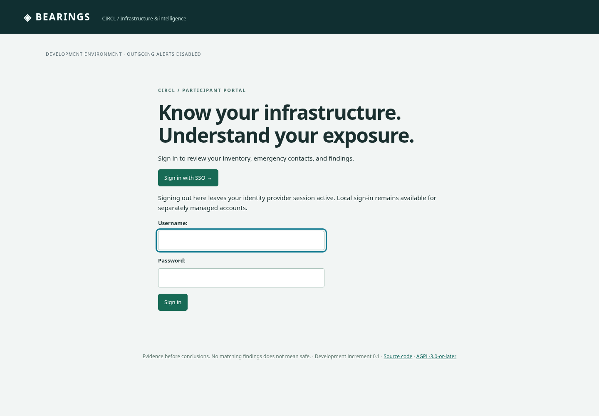

# Optional SSO: Bearings and NetBox

Implemented first increment: OIDC authorization-code sign-in for Bearings and the bundled NetBox, with a shared optional Keycloak lab. Login uses PKCE S256, signed RS256 ID tokens, issuer/audience/expiry/nonce checks and explicit issuer+subject account bindings. Application roles remain local. FlowIntel and RT retain separate sign-in in this increment; their deployment-specific account/role and session integration remains open.

## Start the synthetic lab

```sh
git pull
python3 scripts/dev.py up --sso
python3 scripts/dev.py trust
python3 scripts/dev.py credentials
python3 scripts/dev.py sso-smoke
```

The starter remembers `--sso` for later `up`, `down`, `status`, `manage` and smoke calls. `--no-sso` stops the optional IdP and retains its data; local Bearings/NetBox authentication remains available. The profile works with `--flowintel`, but does not enable FlowIntel SSO. External NetBox mode never provisions or rewrites an external installation; configure its identity integration separately.

The browser issuer is **https://localhost:9444/realms/bearings-lab**, Bearings uses loopback port **8000**, NetBox **8443**. Trust the public lab CA exported by `trust` in your OS/browser before signing in. The gateway reuses the NetBox lab certificate and verifies backchannel TLS; there is no disabled-verification option. Existing legacy lab CA certificates gain the key-usage extension required by Python 3.14, with the existing CA private/public key retained. Re-export the public certificate after updating. No private CA key is exported.

In Bearings choose **Sign in with SSO** and enter the generated demo password once as `company-admin` or `circl-analyst`. Then open NetBox, choose its **OpenID Connect** sign-in button: the same IdP session signs you in without another password prompt. Each application has its own session and client secret.

- Bearings maps to the **existing** local company/CIRCL accounts and preserves their memberships, operator policies, passwords and privilege flags.
- NetBox uses separate `sso-company-admin` / `sso-circl-analyst` human accounts. The company demo has read-only inventory access to the RW lab tenant; CIRCL's demo can read both synthetic tenants. These permissions are explicit NetBox object permissions; the humans do not inherit API service-account keys or write capability.
- `unassigned-demo` exists only in Keycloak to test default denial. Its valid IdP login cannot create an application account or grant access.
- `platform-admin` and `netbox-admin` remain separately managed local emergency accounts; no IdP identity is assigned to them by the fixture.

Keycloak **26.8.1** runs as a local-only development service with a separate persistent H2 data volume, private import/client/bootstrap inputs and a 768 MiB container limit. Realm imports skip existing realms. Password/role changes in a retained realm are preserved. This profile is not a production IdP deployment; use a managed IdP with its own database, backups, availability and MFA policy. Allow additional Docker memory/disk beyond the existing NetBox/FlowIntel lab; 8 GB of Docker memory is recommended for the combined stack.

## Use an operator-managed OIDC provider

Bearings supports one configured issuer per installation. Keycloak can broker additional company identity providers. Configure the following server-side values using your approved provider's metadata, with separate client credentials for each application:

```dotenv
BEARINGS_SSO_ENABLED=1
OIDC_ISSUER=https://idp.example.org/realms/example
OIDC_CLIENT_ID=bearings
# OIDC_CLIENT_SECRET belongs in private runtime secret storage, never Git.
OIDC_AUTHORIZATION_URL=https://idp.example.org/realms/example/protocol/openid-connect/auth
OIDC_TOKEN_URL=https://idp.example.org/realms/example/protocol/openid-connect/token
OIDC_USERINFO_URL=https://idp.example.org/realms/example/protocol/openid-connect/userinfo
OIDC_JWKS_URL=https://idp.example.org/realms/example/protocol/openid-connect/certs
OIDC_SESSION_SECONDS=1800
```

The explicit endpoints are Keycloak examples; other OIDC providers can supply different approved HTTPS paths. Runtime requests use only configured endpoints, reject redirects and bound responses to 1 MB with a ten-second timeout. Optional `OIDC_CA_BUNDLE` selects an approved CA file; TLS verification remains enabled. Production callbacks use HTTPS. Register the exact Bearings `/oauth/complete/oidc/` URL; no wildcard redirects, implicit flow or password grant is needed. Local HTTP callbacks are confined to the DEBUG development lab. Enabling the bundled profile overrides its app endpoints with guarded lab settings; it does not change external IdP configuration.

A platform administrator explicitly links a verified immutable subject to an existing local account:

```sh
uv run python manage.py link_oidc_identity --actor existing-platform-admin --username existing-user --subject IMMUTABLE-IDP-SUBJECT
```

Email, preferred username and group claims do not link accounts or grant roles. The stored identity hashes both issuer and subject, so changing providers cannot reuse another issuer's subject. The command refuses reassignment to another local account and audits changes. It changes no password, company membership, staff/superuser flag or CIRCL group. Revocation is explicit:

```sh
uv run python manage.py link_oidc_identity --actor existing-platform-admin --username existing-user --subject IMMUTABLE-IDP-SUBJECT --revoke
```

Revocation leaves a disabled binding; the lab bootstrap preserves it. A later explicit relink rotates the binding generation, so old Bearings sessions cannot become valid again. Bearings checks the binding/account on each request and enforces an absolute configured SSO session lifetime, default 30 minutes. Local account deactivation and membership changes apply through the existing authorization rules. IdP-side revocation without backchannel notifications takes effect at reauthentication; automatic account synchronization is not implemented.

For an independently operated NetBox, configure its supported OIDC backend, a distinct client and explicit local permission/identity mapping through its operator. The bundled example uses the same approved backend module, an issuer+subject-derived `UserSocialAuth` UID and a pipeline without user creation, email association, role claims or token persistence. Its read permissions and existing account/permission changes are preserved on restart. Bindings can be disabled in their local metadata or the account disabled; NetBox uses its own session policy with a 30-minute verification limit. Production NetBox versions/extensions require separate compatibility and revocation acceptance.

## Sign-out, MFA and recovery boundaries

**Sign out here** closes the current Bearings session. It leaves the IdP and other application sessions active; choosing SSO again can sign in without another prompt. Global/frontchannel/backchannel logout, cross-application session termination, SCIM and automated group provisioning are separate work. Close/sign out of the IdP as well when changing users on a shared browser.

MFA is controlled by the IdP. Existing local passwords are preserved, so enabling SSO alone does not make MFA mandatory for those local logins. After testing SSO, operators can separately restrict participant password access while retaining audited emergency accounts. An IdP outage does not remove local accounts or data. API connectors continue using their own scoped server-side credentials.

The pinned FlowIntel deployment has an identity/role model that needs additional review and hardening before sharing these login guarantees; its native Keycloak switch remains off. RT/RTIR authentication depends on the selected installation and frontend. Neither is advertised as SSO-enabled here.

The guarded `sso-smoke` uses Python's standard library, private generated credentials in memory and normal CA/hostname verification. It exercises the real IdP/code exchange, a single company password prompt across both apps, permitted/foreign NetBox inventory and unapproved identity denial; it prints no secrets or callback URLs. See [validation](../validation.md).

## Synthetic login view


