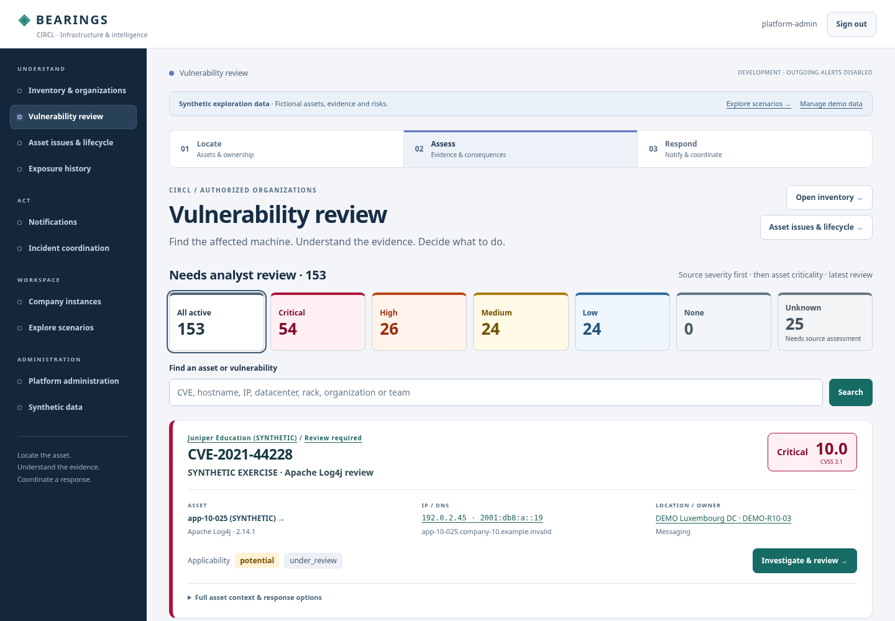
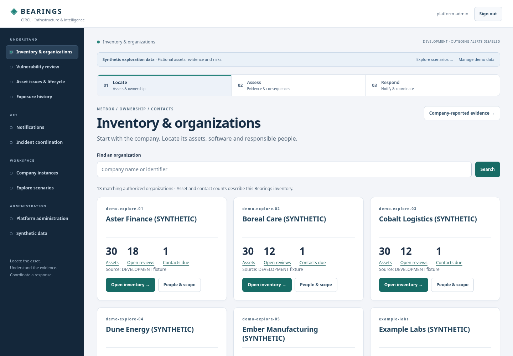
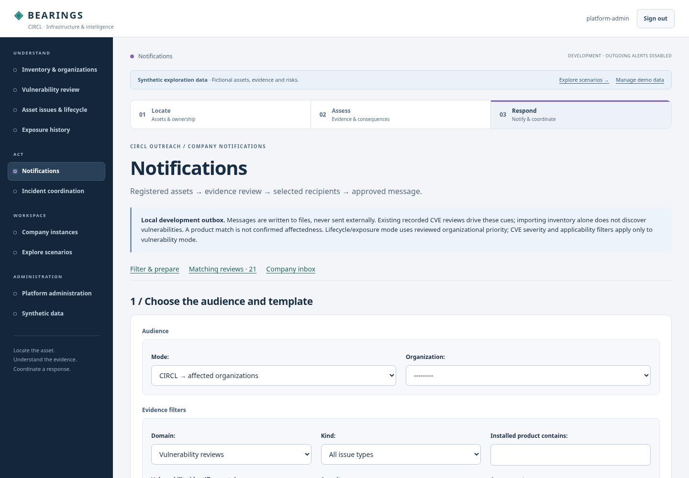
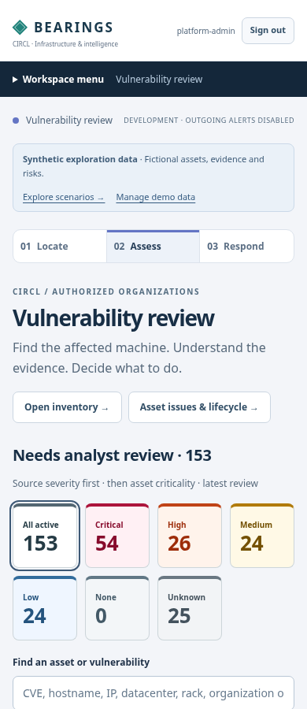

# Workspace structure and visual review

Reviewed and updated on 22 October 2026 against the running synthetic lab, as a platform administrator, company administrator and CIRCL analyst. The review covers Bearings; native NetBox, FlowIntel, Keycloak and RT/RTIR interfaces keep their own designs.

## Findings and delivered changes

| Finding | Effect on an analyst | Delivered improvement |
| --- | --- | --- |
| One long header link row, without an active destination | Hard to distinguish the current workspace from the next action | Grouped desktop sidebar, active-page marker, area breadcrumb and expandable mobile menu; separate platform administration for superusers |
| Inventory was below up to 25 detailed finding cards; company pages started with contacts and scope | Finding the machine required unnecessary scrolling | Direct **Inventory & organizations** entry with organization search, scoped counts and links; inventory first in company workspaces |
| Detailed findings repeated all location facts and actions | Difficult to compare the queue quickly | Scan cards retain CVE/severity, machine, IP/DNS, datacenter/rack, owner, product/version and analyst applicability; full facts and response options expand on demand |
| Several equally prominent actions competed in the review heading | The natural next step was unclear | **Investigate & review** is the primary action per finding; inventory and lifecycle destinations are secondary |
| Navigation, informational notices and urgency lacked a shared visual hierarchy | Demonstration data could appear as urgent as an actual warning | Neutral surfaces, cool area accents, informational synthetic banner, consistent semantic priority/severity badges |
| Notification subscription name appeared before the audience and evidence | An optional automation feature looked like the start of ordinary outreach | Separate **Audience** and **Evidence filters** fieldsets; subscriptions under **Automatically prepare future drafts** |
| Many per-company creation/import buttons appeared before the results | Large example datasets produced walls of buttons | Expandable organization selection for recording issues and importing observations |
| Generic document titles and weak keyboard orientation | Browser tabs and keyboard traversal gave little context | Workspace/organization titles, skip link, focus indicators, named navigation, fieldset legends, current-page/current-step semantics and reduced-motion support |

## Visual system

A dark slate navigation surface anchors the workspace. Inventory uses a teal area accent, vulnerability review indigo, exposure blue and notifications violet. These accents locate the user; they do not claim health, completion or risk.

Critical/high/medium/low source severity and organizational priority retain explicit labels and strong pink/orange/amber/blue markers. Unknown evidence remains gray and uses a dashed border where supported. Severity, analyst applicability, organizational priority and deadline remain separately named facts. Zero overdue/due-soon counters use neutral surfaces. Synthetic data is visibly labeled without taking the warning color used for deadlines and required review.

Buttons, cards, form fields, typography, tables, focus states and spacing share a common stylesheet. No remote fonts, icon libraries, scripts or browser trackers were introduced.

## Recognizable workflow

**Locate → Assess → Respond** appears above operational workspaces and marks the current activity, never a completed process. In an organization, links retain that organization's context where applicable.

1. **Locate:** Inventory & organizations → company inventory → asset. Read IP/DNS, datacenter/rack, authoritative NetBox source and responsibility.
2. **Assess:** A vulnerability review opens asset → Vulnerability-Lookup evidence → selected MOSP/MONARC scenario. Lifecycle and exposure issues retain their own evidence, deadlines and consequences. Missing data is explicit.
3. **Respond:** Prepare stakeholder messages through recipient/evidence filtering and an approval preview, or use the existing scoped FlowIntel / RT / RTIR hand-off. CIRCL incident coordination remains visible to authorized operator roles.

The layout does not grant privileges, confirm applicability, approve outreach or mark a risk remediated. Disabled connections, retained evidence, uncertain exports, local recovery accounts and SSO behavior keep their existing semantics.

## Screenshots

All shown organizations and observations are synthetic.

## Validation and remaining work

Real Chromium checks cover nine main routes plus asset, intelligence and issue details at widths **320, 390, 768, 1024, 1280 and 1440 px**. They verify menu behavior, current-page marking, filter submissions, expandable detail, the asset-to-evidence path, organization ordering and role-dependent navigation. No document-level horizontal overflow or JavaScript errors was observed. Actual endpoint authorization, current sharing policy, empty inventory and restricted aggregate counts have regression coverage.

Computed foreground/background contrast checks on visible text in the first desktop viewport of review, inventory, issues, exposure and notifications found weak workflow-step text; those colors were darkened. The repeated sample checks pass the 4.5:1 normal-text / 3:1 large-text thresholds. This is a targeted check, not a complete WCAG or assistive-technology certification. The shared real Keycloak SSO smoke still passes for Bearings, NetBox, FlowIntel and RT/RTIR.

Next UX acceptance should use timed tasks with company and CIRCL users: identify the machine, understand uncertain evidence, find an owner, prepare a message and locate the response hand-off. A unified cross-product response inbox, richer saved worklists, a persistent organization switcher and a time-based exposure visualization remain follow-ups. Detailed history/evidence screens still favor completeness; this increment does not replace all long tables or JSON evidence with new visualizations. Production-size performance, large fleets and independently deployed backends need their own acceptance.
