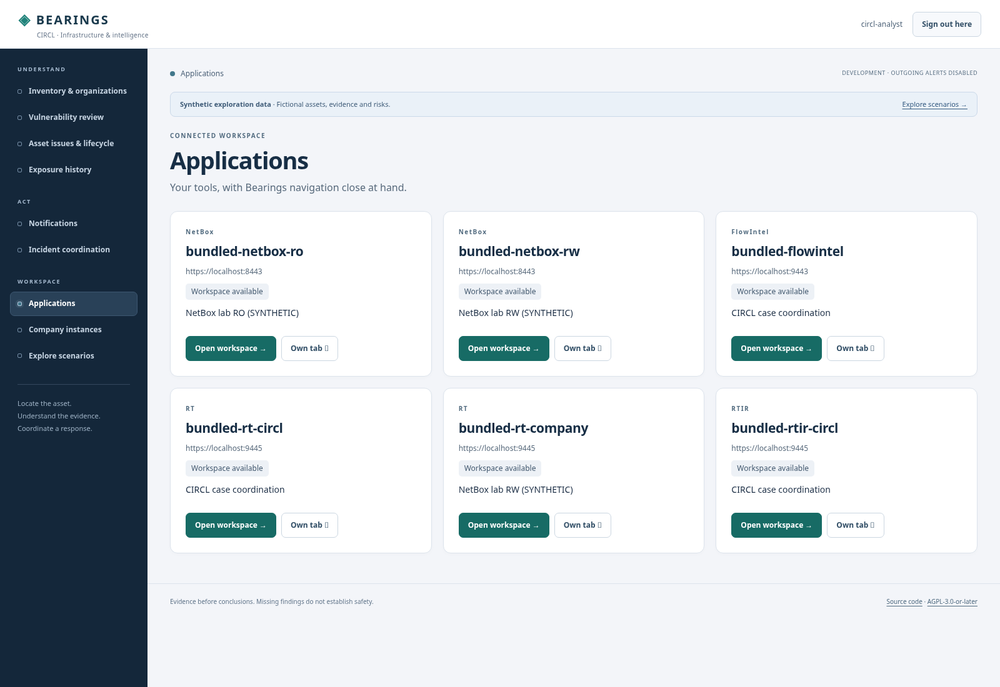
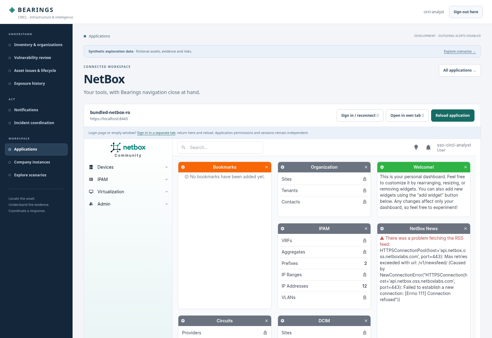
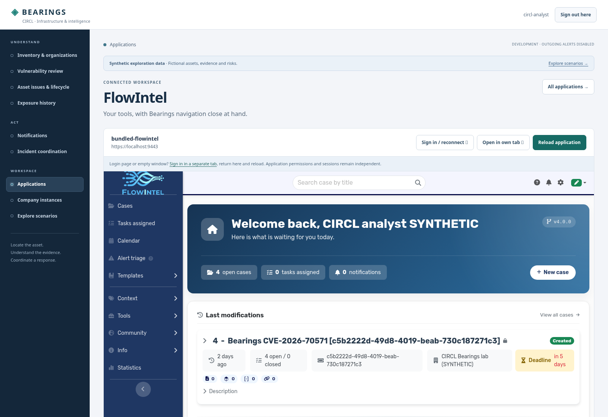
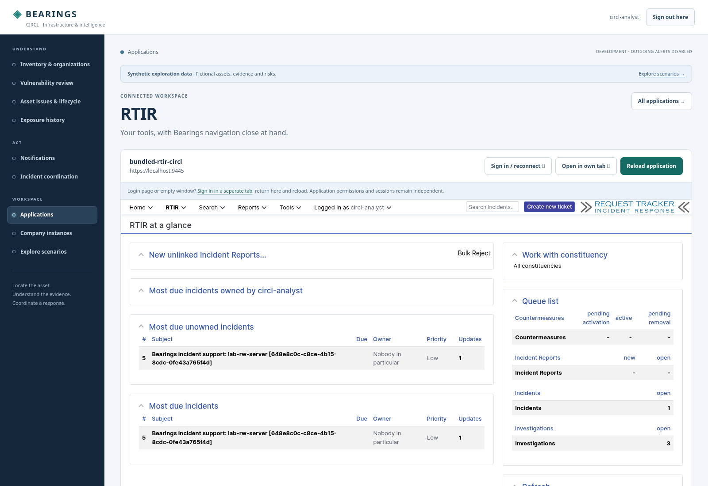

# Connected application workspaces

**Applications** in Bearings' workspace navigation opens NetBox, FlowIntel and RT/RTIR in a common Bearings frame. The original application keeps its own interface, identity, permissions and session. The canvas is a browser hand-off, not an API-token proxy or a merged authorization system.

## Start the bundled SSO lab

```sh
git pull
python3 scripts/dev.py up --sso --flowintel --rtir
python3 scripts/dev.py trust
```

Trust the exported **public** lab CA in your OS/browser, then open **https://localhost:9441/applications/**. This HTTPS entry is started automatically by `--sso`, including when only Bearings/NetBox are selected. `BEARINGS_CANVAS_PORT` optionally changes its loopback port. The original HTTP entry remains available; the application directory redirects to the configured HTTPS workspace. The same generated lab CA covers this entry; private keys are not exported.

Sign in to Bearings using SSO. `circl-analyst` can use the CIRCL FlowIntel and RTIR workspaces as well as visible NetBox/RT connections. `company-admin` sees its visible NetBox and company RT destinations; CIRCL FlowIntel/RTIR entries are omitted. Native application permissions still decide what the person can read or change. Bearings cannot redact the native interface by its own organization policies; accept embedding only when the native account's object/tenant permissions match its intended access. A read/write API connector does not grant that capability to the human browser account. The local `platform-admin` remains a separately managed recovery account, without an automatic native SSO binding.

1. Choose a named application connection.
2. Use **Sign in / reconnect** to open its ordinary authentication in a separate tab. Choose its SSO entry; an existing Keycloak session avoids another password prompt. RT/RTIR redirects through its OIDC boundary automatically.
3. Return to Bearings and choose **Show in workspace**. Existing native sessions can be shown immediately.
4. Use **Reload application** after reconnecting. **Open in own tab** remains available for a larger workspace or native features requiring their own window.

Asset records also link to the NetBox workspace; FlowIntel case and RT/RTIR ticket pages link to their corresponding workspaces. The original links to exact native records are retained. Workspace launch currently opens the application's home, not the exact record or a remembered native navigation position. Switching workspaces recreates the frame: save native forms before leaving. Bearings cannot inspect a cross-origin application's unsaved changes, current route, login result or health. A workspace approval label is not a live availability check.

## Browser and security boundaries

- The HTTPS parent and lab children use the same scheme and site, with different ports/origins. Existing `SameSite=Lax`, secure native session cookies and separate cookie names remain intact. No `SameSite=None`, shared password, service key, automatic identity creation or native role grant is introduced.
- Login, OIDC callback and recovery flows remain top-level. NetBox and FlowIntel login screens and RT's `NoAuth` boundary deny framing. Keycloak's original protections are retained. If a frame becomes empty after session expiry, reconnect in a separate tab and reload.
- The child iframe is sandboxed. It may run its own scripts/forms and open popups/downloads, but cannot navigate the top-level Bearings window. Camera, microphone and geolocation are disabled. Full-page native tools remain the fallback for browser/sandbox restrictions.
- The Bearings canvas itself denies framing and permits only the selected, explicitly approved child origin. Same-origin children are rejected, preserving isolation when scripts and native sessions are enabled. Caller-provided `url`, `next` or redirect destinations cannot choose a frame source.
- Native pages accept only their own origin and the exact configured Bearings HTTPS origin as ancestors. Native login boundaries continue to deny embedding. These policies require modern CSP-capable browsers. The lab applies them only to bundled SSO services; independently operated servers are not rewritten.
- FlowIntel's pinned native CSP keeps its non-framing directives. An unexpected framing policy fails closed. NetBox's SSO edge replaces its incompatible X-Frame-Options header with the explicit CSP ancestor policy; it retains DENY on authentication routes. RT's native frame-killing is replaced on the synthetic SSO listener by the explicit CSP. RT's separate local recovery listener retains its original DENY protection.
- Bearings organization/source visibility and enabled-connection policies are reapplied on directory/frame requests; operator source reads and launches are audited. Native app sessions and actions remain independently governed and audited. Removing a Bearings link alone does not revoke a native application account/session.

**Sign out here** signs out of Bearings; it does not terminate the embedded native session or Keycloak session. Shared/global logout remains separate work. Use the native application's and IdP's sign-out when changing users on a shared browser.

The retained lab Bearings OIDC client still uses its original loopback HTTP callback; the new HTTPS entry reuses that callback without adding redirect URIs or resetting client/identity policy. The override is limited to the DEBUG bundled lab and approved loopback hosts. Existing localhost and 127.0.0.1 HTTP sign-ins remain valid. Production callbacks must use the installation's reviewed HTTPS OIDC configuration.

## Independently operated applications

An operator configures each connection's credential-free HTTPS **browser URL**. The directory does not fall back to an internal API URL. Connections without approved embedding policy open in a separate tab. Native SSO must already be configured and accepted for each application.

To enable framing in an independently deployed Bearings instance, configure these server-side values:

```dotenv
BEARINGS_CANVAS_ORIGIN=https://bearings.example.org
BEARINGS_CANVAS_FRAME_ORIGINS=["https://netbox.example.org","https://flowintel.example.org","https://rt.example.org"]
```

The allowlist contains exact HTTPS origins, without paths, wildcards, credentials, query strings or fragments (maximum 50). It enables a Bearings frame; it cannot override a child's refusal to be embedded. The native application's operator must independently configure an equivalent `frame-ancestors 'self' https://bearings.example.org` policy, resolve conflicting frame options through a reviewed deployment configuration, and keep authentication/recovery routes protected. Existing unrelated CSP directives must remain intact. Do not add Bearings to a child's CSRF trusted origins: native forms submit from the child's own origin.

Prefer distinct origins under the same controlled site with HTTPS throughout. Applications on unrelated sites may lose third-party cookies under browser policy; use their separate-tab view instead of weakening cookie policy. Existing version-specific native frame-killing, browser/sandbox behavior and SSO acceptance need review for external servers. The starter makes no external server changes.

The Bearings edge must overwrite forwarded scheme headers, verify its upstream/network boundary and prevent untrusted direct upstream access. Only then enable `DJANGO_TRUST_PROXY_SSL=1`. Without that switch, use the installation's independently reviewed trusted-proxy settings. Set the normal allowed host, secure session/CSRF cookies and HTTPS OIDC callback policy. The lab's loopback HTTP callback exception is not a production configuration.

## Verification and synthetic screenshots

```sh
python3 scripts/dev.py sso-smoke
python3 scripts/dev.py smoke
```

The SSO smoke now checks the HTTPS directory, scoped company/CIRCL entries, sandbox and exact frame destinations/CSP in addition to the real shared-provider flows. The integration smoke retains real API/import/queue tests. A separate Chromium exercise verified one password prompt across Bearings, NetBox, FlowIntel and RTIR, rendered native pages inside the frame, blocked an unapproved HTTP parent and blocked native login inside the approved frame. Its lab TLS transport was CA/hostname-verified; browser redirects were replayed through that transport because the cloud Chromium profile does not contain the private lab CA. Normal user browsers must trust the CA directly. No native actions, operational notifications or scans were initiated by the browser exercise.

The large Bearings showcase is offline: its additional 300 assets and case previews do not automatically exist in the native backends. The canvas shows native data, including the separately provisioned real lab fixtures; it does not synchronize or export offline examples.

All data shown below is synthetic.








