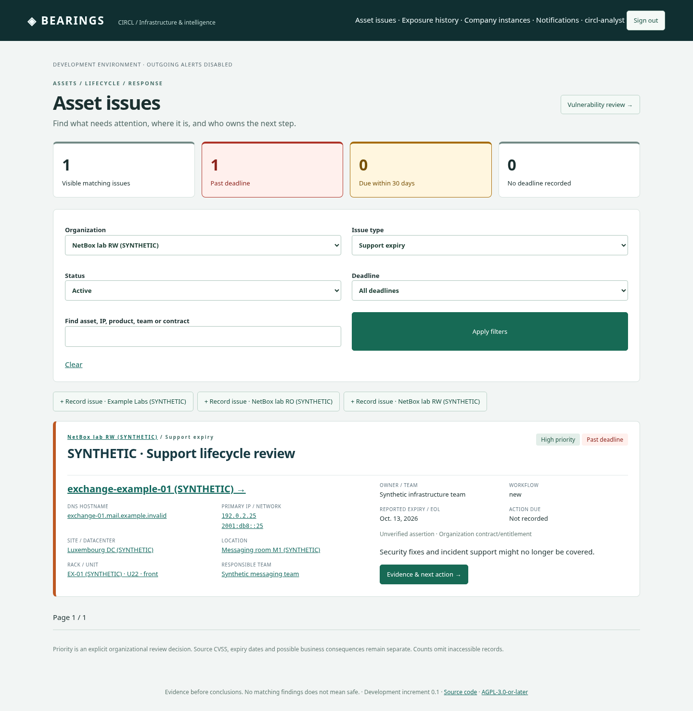
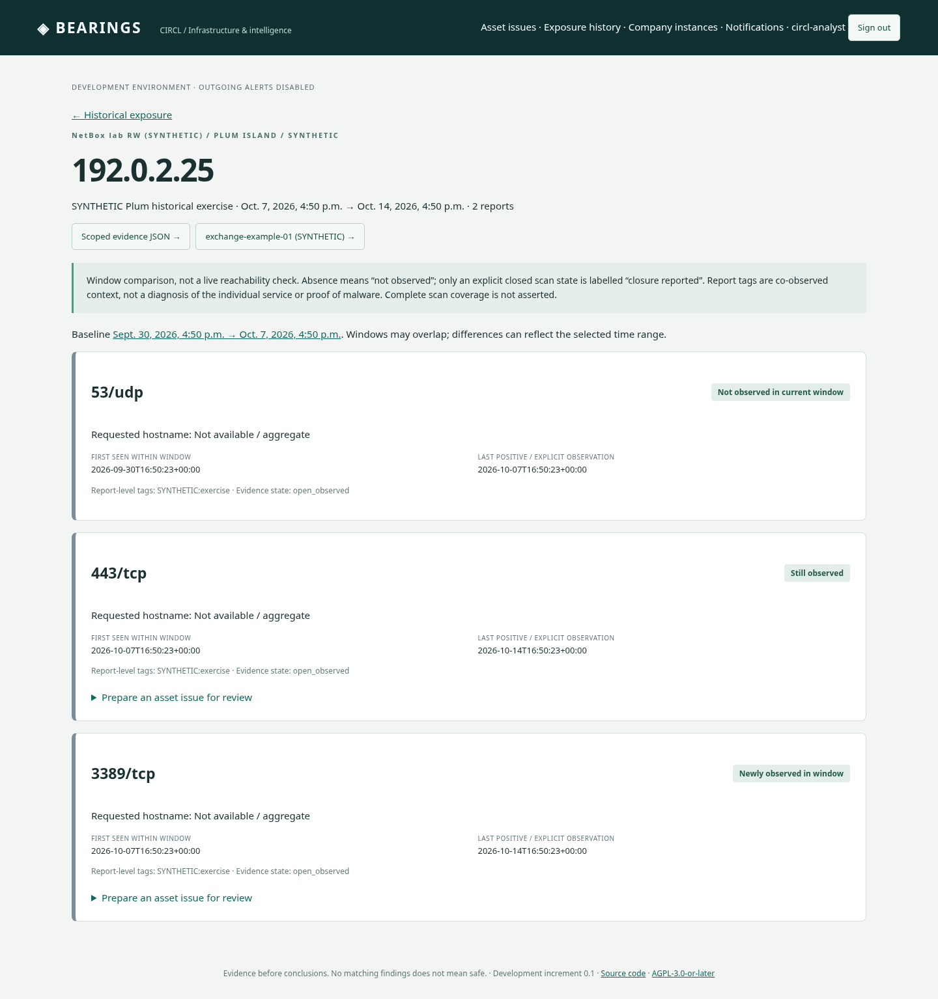

# Asset issues, lifecycle and exposure

Open **Asset issues** for the authorized company/CIRCL queue. Filter by organization, kind, state, deadline or asset name. Cards show organizational priority, current workflow, event/action dates, asset links and available IP/DNS/site/rack context. Unknown dates remain unknown; CVSS is vulnerability source severity, not organizational priority. Software installations can be identified as software or firmware.

Company editors and authorized CIRCL analysts can record EOL, support, license, warranty, maintenance, exposure or other issues on an existing asset, optionally an installation. Record the evidence/source, observation time, validity, uncertainty, owner and next action. Vendor/product lifecycle facts and company contract entitlements are distinct scopes. An expiring contract is not evidence of a vulnerability. Event dates and treatment deadlines are separate. Updates require a reason and retain evidence revisions/history.

Existing CVE findings are linked into the queue by migration without replacing their IDs, evidence, assessments or FlowIntel cases. Their original vulnerability review controls applicability and workflow. Use its link to review source evidence and risk scenarios. For other issue types, attach a current MOSP/MONARC catalog scenario with a reason; the link pins both issue and catalog revisions. Withdrawal preserves the record. A scenario is possible consequence context, not a calculated MONARC assessment.

Issue sharing is off by default. Operator-only issues remain hidden from company participants. Company/CIRCL bulk outreach includes only eligible, explicitly shareable issues; current source/organization/scope restrictions are rechecked before approval and I/O. An RT ticket requires its own exact preview and approval. RT status never resolves the source issue.

## Repeatable synthetic exercise

After updating and starting the bundled lab:

```sh
python3 scripts/dev.py example-exchange
python3 scripts/dev.py manage seed_asset_issues --bundled
```

The first command prepares the existing synthetic Exchange inventory/location and live public CVE/MOSP example. The second adds **invented** support, license, warranty and EOL issues. It adds two **synthetic**, historical Plum windows only when the existing mapped device has a documentation IP in 192.0.2.0/24. There are no network scans or Plum reads. The second window shows a newly observed 3389/tcp and an absent 53/udp; absence is not closure. Open **Exposure history**, compare windows, then create a reviewed exposure issue if useful. Existing decisions, policies and passwords remain unchanged on repeats. The seed creates no tickets or messages.

The JSON evidence links expose only currently authorized evidence. Revoking a Plum source grant or changing its verified historical scope hides its raw and derived exposure reviews, including queue counts. Imported observations do not create authoritative NetBox machines.

## Synthetic screenshots





## Empty Exposure history after an update

A Git update/rebuild does not insert optional historical examples into your database. Run `python3 scripts/dev.py manage seed_asset_issues --bundled`. The command now reports the exact retained/visible snapshot counts, target asset/IP and observation windows. If it prints **Exposure example SKIPPED**, the selected device has no imported primary IPv4 in the exercise range. For an existing Exchange case run `python3 scripts/dev.py example-exchange --inventory-only`, then repeat the seed. Otherwise import the current bundled inventory with `python3 scripts/dev.py manage sync_netbox --all` and repeat. A retained count with zero visible snapshots indicates current source/historical-scope policy; the seed preserves those decisions rather than granting access again. These are synthetic observations, separate from live Plum data.
