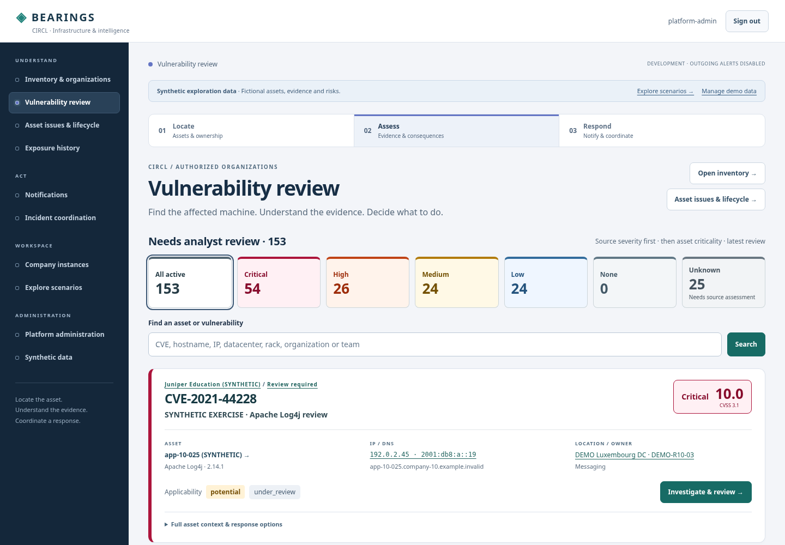

# Locate the machine and assess the evidence

The start page's **Vulnerability review** queue places source severity next to the affected inventory asset. Critical, High, Medium, Low, None and Unknown have distinct labels, contrast-tested colors and filter counts. Critical/High cards have a strong colored edge; Unknown uses a neutral dashed edge and explicitly says **Score missing**. A missing score does not establish low risk. Color is supplemented by text, a CVSS version and a numeric score when supported.

Source severity determines the first sort key, followed by local asset criticality and latest evaluation. This is a technical review order, not a calculated organizational risk ranking. Severity filters and counts apply across the complete authorized active-review set before pagination. Search matches CVE, inventory name, organization, software, team and the imported address/location context. Search and severity selection remain applied across pages. Closed/accepted records remain accessible in their workspaces.

## Verified views

The screenshots show the current synthetic exploration dataset after an authenticated lab login:



[Mobile asset review](../images/workspace-mobile.png).

## Asset identity and navigation

Each review immediately shows the inventory name, IP/DNS, site/rack, owner, product/version and applicability. Open **Full asset context & response options** for the extended facts and response links. The asset card shows primary IPv4/IPv6, VRF when supplied, site/datacenter, location, rack/unit/face, responsible team, source instance and inventory observation time. Facts absent from the approved source are labeled **Not recorded**. The source's site is not assumed to be a building, and an inventory name is not assumed to be a resolvable DNS name. No DNS queries, reachability checks or scans are performed.

Click the asset name or **Asset details** to open its organization-scoped record: location/network, hardware, source identity/freshness, software/builds, visible findings and local responsibility. Click IPs/DNS, sites, rooms, racks, platforms and related reference data to open their NetBox records when a validated source-local identity is available. No upstream response URL is used. An IP or hostname is never turned into an HTTP/SSH/RDP connection to the machine itself. Browser/API bases remain distinct, and the user must have their own NetBox access and trust the lab's public CA.

CVE/title and severity link to the exact evidence view; software/builds link to the asset's software section; assessment/workflow link to the selected finding's review form. Scenario entities link to the pinned catalog/evidence. The page keeps source severity, analyst applicability, workflow and business risk separate. Company editors may update local team/criticality/lifecycle; authorized CIRCL analysts may review findings. Local edits never submit NetBox writes and share the importer source lock to preserve concurrent inventory updates. Restricted evidence does not appear in asset finding counts or review links.

## Verified Exchange placement

After updating/rebuilding the bundled lab, for a new exercise:

```sh
python3 scripts/dev.py up
python3 scripts/dev.py example-exchange
```

This runs the existing live-CVE/MOSP exercise, then places only its confirmed owned synthetic NetBox device. For an existing Exchange example, without another public CVE/MOSP retrieval:

```sh
python3 scripts/dev.py example-exchange --inventory-only
```

The guarded lab fixture records these facts in real NetBox, then refreshes Bearings using its GET-only importer:

| Fact | Synthetic value |
| --- | --- |
| Inventory name | exchange-example-01 (SYNTHETIC) |
| DNS hostname | exchange-01.mail.example.invalid |
| Primary IPv4 | 192.0.2.25/24 |
| Primary IPv6 | 2001:db8::25/64 |
| Site/datacenter | Luxembourg DC (SYNTHETIC) |
| Location | Messaging room M1 (SYNTHETIC) |
| Rack | EX-01 (SYNTHETIC), U22, front |
| Platform | Windows Server (SYNTHETIC) |

These are documentation address ranges and an intentionally non-resolving example domain. They do not describe operational infrastructure or prove reachability. The command is opt-in, refuses external mode/changed lab capabilities, validates the expected Bearings UUID and tenant before placing anything, and refuses conflicting nonempty placement/IP/DNS/platform values. Empty initial fixture placement is filled. It does not grant additional service-account permissions or enable NetBox writes for a read-only source. It provisions only the local synthetic example through the bundled backend, never an external server. The application importer remains GET-only. It creates no Exchange software service, sends no notifications and performs no scans.

Primary DNS is resolved from the complete authorized IP snapshot by source-local primary-IP ID and matching canonical address. An equal address in another VRF, source or instance is not evidence of the hostname. Only primary-IP DNS is currently projected; additional interfaces, all secondary addresses, service topology and reachability remain separate work. See [synchronization](../operations/synchronization.md) for failure/retention guarantees and the [Exchange exercise](exchange-example.md) for CVE/applicability assumptions.

Apply migration 0009 when running natively. It backfills a source-severity cache from existing supported CNA CVSS records so ordering and filters work for older findings too. Normal evidence ingestion maintains it; it does not rewrite evidence snapshots, analyst decisions or sharing policy. Unsupported or malformed scores stay Unknown.

Individual asset reviews and Asset → Vulnerability → Risk default to **Critical → High → Medium → Low → None → Unknown**, then newest evaluation and stable identity. Sorting is applied to the authorized database query before pagination; missing severity remains explicit and never becomes a low-risk assertion.


## Installed software versus CVE reviews

Company inventory and machine software tables list reported installations, not detected vulnerabilities. Package/product identity and reported version identify the software. Supported distribution packages display the same recognition and automatic matching status as the discovery page: ready, queued, missing metadata, stale, disabled or unsupported. No per-package configuration is needed for supported Ubuntu/Debian/RHEL package matching. Follow **Automatic matching status & coverage** for the exact product and vendor-rule details.

**Recorded CVE reviews** links to the exact installation and counts only findings currently visible to you, including retained reviews. It is not a count of confirmed vulnerabilities. Zero reviews neither proves safety nor means that a complete check succeeded. Other software retains its explicit product-mapping workflow.

Manual CVE retrieval is available to authorized editors under the collapsed **Investigate a known CVE (optional)** section on the machine's software row. Enter a CVE identifier you already know, then fetch its details for manual review. There is no prefilled/example CVE beside every package. Retrieval creates review evidence without confirming applicability; automatic package checks run independently. Viewing these tables makes no external CVE requests and sends no mail.


### Reading a package check

The result headline answers whether the evaluated package rules require review. **Review required** means a potential match or unresolved vendor condition. **No package-rule alert in the evaluated results** means neither was found in the rules actually evaluated; the adjacent coverage label still applies. **Current package result unavailable** means the check cannot presently support a current conclusion, including new reports waiting for processing. Missing rules are explicitly shown as missing coverage.

Open **Automatic matching status & coverage** for the evaluated report time, successful check time and vendor-data time. Results requiring review appear first. **Fixed by installed package version** is collapsed by default and includes CVE, compared binary/source version, vendor fixed-version threshold and rule provenance. **Other vendor rules not matched** is a separate result and must not be read as “patched” or an explicit “not affected” manufacturer statement. Each outcome lists up to ten recent examples with its total count; it is not a full historical list. The separate human-review section can remain outstanding after package updates.


## Compact company inventory

The company workspace shows a workflow-count summary instead of loading every CVE and review history. Open **CVE reviews, evidence & assessments** for the complete authorized, paginated queue and review actions. These are retained workflow counts, not a count of currently vulnerable software. Contacts and scope declarations have independent pages; changing one section preserves the others. Inventory shows at most fifty assets and ten software previews per asset.

Agent hosts without an external NetBox identity are explicitly labeled **Recorded in Bearings only**. A read-only connector or observed-only fleet does not create the host in NetBox. After an operator enables managed inventory, new managed codes can register the host and the confirmed NetBox link appears after UUID reconciliation; pending registration is explicitly labeled. A NetBox application link alone is not evidence of a confirmed host binding.
