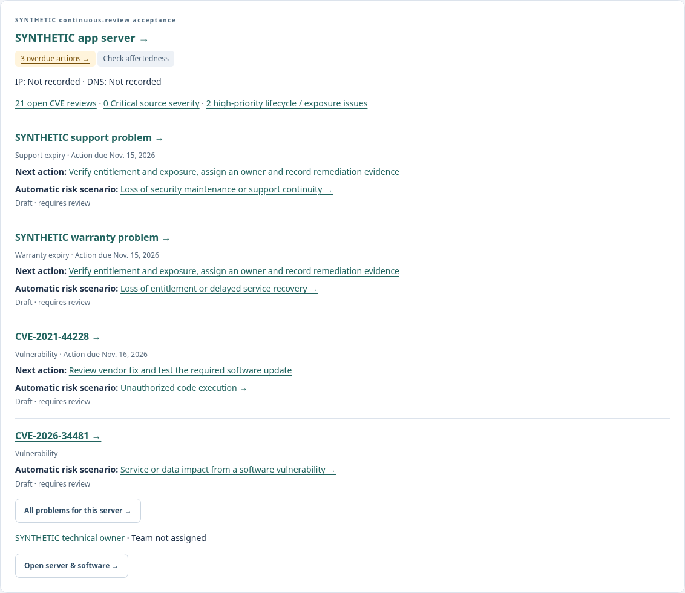
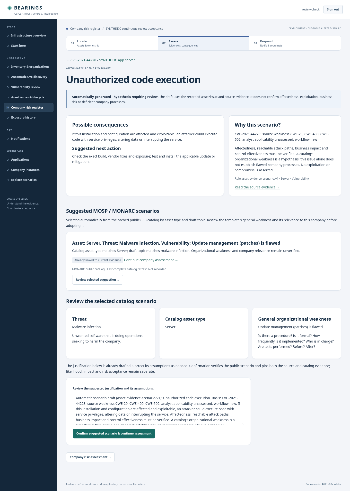

# From a server card to the actual problem and risk scenario

## Direct problem links

On **Infrastructure overview → Servers and assets needing attention**, each card now provides:

- **Overdue actions:** the exact active problems on that asset whose recorded action deadline is past. Contract expiry/EOL dates remain separate.
- **Confirmed affected / open CVE / critical reviews:** the exact asset-scoped vulnerability queue with the corresponding assessment/severity filter.
- **High-priority lifecycle/exposure issues:** the matching non-CVE issues for the exact asset.
- **Named problem titles:** direct links to each issue's evidence/workflow, date and next action. Repeated action text is attached to its own titled problem.
- **Automatic risk scenario:** the generated draft for that particular issue, with recommended catalog scenarios.
- **All problems for this server:** the active scoped issue list using an asset UUID, independent of duplicate server names. Older reviews without a common issue still have their exact CVE evidence deep link.

Asset/attention filters are retained while filtering and paging. Current company/source visibility is applied before badges, links, issue text or drafts are built. The same URL cannot be reused to read another company's asset. Existing manual finding/workflow identities are unchanged.

## Automatic scenario draft

The draft appears immediately on the issue and infrastructure card without a write or external request. It describes possible consequences, evidence/rule basis, uncertainty and a proposed next action. It is **a conditional hypothesis**, separate from an assessed company risk:

| Recorded evidence | Draft topic |
| --- | --- |
| Supported source CWE/English description indicating code execution | Unauthorized code execution and possible service/data consequences |
| Supported source weakness indicating data access/authentication/injection | Unauthorized access to or alteration of data |
| Source denial-of-service/availability weakness | Interruption of the hosted service |
| CVE mention without supported outcome evidence | General service/data impact; do not infer an attack from a product name |
| EOL/support issue | Loss of security maintenance or support continuity, if applicable |
| Exposure observation | Possible unintended access; a port observation does not prove compromise |
| License/warranty/maintenance issue | Entitlement or recovery continuity, subject to actual company coverage |

Unknown builds/versions and closed/not-affected assessments remain visible assumptions. No draft asserts exploitation, definite affectedness or a deficient company process. A draft does not overwrite a recorded consequence, measure, assessment or risk acceptance.

## Review a suggested MOSP/MONARC scenario

1. Open **Automatic risk scenario** beside a problem, or **Review suggested scenario & MOSP matches** on its detail page.
2. Read the generated consequences and why the topic was selected. Up to three cached public catalog candidates match the inventory asset type and draft topic. Recommendations are bounded lexical rules, not a full semantic/AI risk assessment.
3. Choose **Preview this suggestion**. Missing public definition details may be retrieved only after this explicit selection. Check threat, asset type and general organizational weakness. A patch-management weakness in the catalog remains an assumption to investigate.
4. The justification is already drafted and editable. Choose **Confirm suggested scenario & continue assessment** after checking its relevance. Confirmation verifies the public bundle and pins catalog plus issue/CVE evidence, actor and reason. It does not send inventory or the justification upstream.
5. The company-risk page is prepared with business consequences/assumptions, suggested or already recorded measures, accountable asset contact and any existing action deadline. Supply your business process, controls and qualitative likelihood/impact/residual judgments. Numeric choices start blank, and administrator-only expiring acceptance remains separate.

The public CC0 catalog suggestion is never silently adopted. Confirmed links retain the original protected evidence/history; repeat confirmation is idempotent. Changed issue/CVE/product inputs or a changed catalog revision require reviewing the updated preview. Already linked current revisions are marked. A withdrawn mapping is not recommended again for unchanged evidence; deliberate manual catalog search remains available.

## Missing catalog or source outage

The local draft remains available even with no compatible cached template or an unavailable MOSP source. No catalog identity or score is invented. An operator can refresh the approved catalog; CVE reviewers can also search the full named catalog. Disabled/missing sources, unsupported licenses and fixture objects are excluded from automatic recommendations. Older company assessments and manual decisions are preserved.

Draft generation and dashboard reads are local. Only explicit public-scenario preview/confirmation performs the existing bounded, verified-TLS catalog GETs; company names, IPs, evidence and justifications stay local. This feature enables no notification, scan, remote MONARC assessment write or automatic risk acceptance.

## Browser examples

These examples use fictional infrastructure/contact/action data and real public CVE/MOSP evidence. Confirmation pins a local synthetic-company mapping; no company-risk assessment or message was submitted by the browser exercise.

