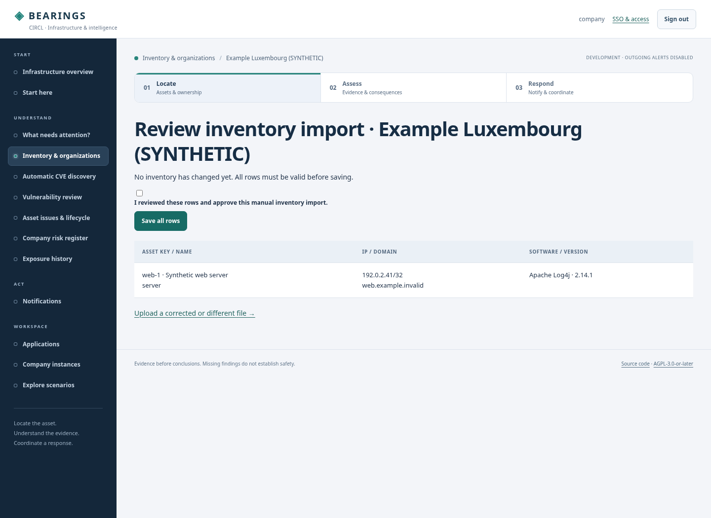

# Start small, import inventory and take action

Implemented company workflows; no native MISP/NetBox account is required to use these Bearings screens. Existing registration commitments, separate CIRCL approval, contact/channel verification and optional detailed configuration remain unchanged.

## First useful setup

From **Infrastructure overview → Start / complete company details**, or **Company configuration → Start with one domain or network**, check the existing contact and add one domain, static IP, CIDR or address range. The editor adds a declaration; it preserves existing claims and never asserts verified responsibility. Saved work remains available through the existing individual editors and resumable configuration. Software, public keys, AIL preferences and further scope can follow later. Guided setup completion remains a separate reviewed state; the minimal entry does not award completion of all sections.

Company administrators can use this fast path before CIRCL sharing approval in their private company area. Editors/readers retain their existing permissions. Import links are available only to writers of an authoritative **manual** source; NetBox/development/read-only sources retain their established import/edit tools.

## Reviewed CSV import

Open **Import inventory CSV**, download the template, upload a UTF-8 file and review the rows/errors. Both comma and semicolon delimiters are accepted. Required headers are `asset_key,name`; optional headers are `kind,ip,domain,software,version,software_key`. Files are bounded to 1 MB/500 rows. Do not add arbitrary columns or server URLs/credentials. This is a manual local inventory import; it creates no NetBox submissions or scans.

Use stable asset keys (letters/digits/`.`/`_`/`:`/`-`) across later imports. One row can contain one software installation; repeat consistent asset metadata for additional installations. Use stable software keys if more than one installation could have the same software name; otherwise the exact software name is the default software key. Blank versions remain unknown. Known public products reuse the existing conservative product-watch setup; manual mappings and paused watches are preserved. Vendor/product identity assistance is not proof of affectedness.

The preview makes no inventory changes. It is private to the uploader and requires an explicit checkbox/POST before saving. Invalid or conflicting rows block the entire batch; there is no successful-looking partial import. A later inventory change requires a new preview. Current membership/source authorization is checked again under the authoritative source lock. Concurrent submissions of one preview return one committed result. Reuploading the same keys updates/reuses the same imported assets/installations, never adopts an existing asset by name, and never deletes omitted inventory. Local changes since the previous import block overwrites and must be reconciled in individual editors. Existing assessments/history are not reset or closed by changed versions.

Previews expire after 24 hours. The normal worker clears expired upload rows/errors in bounded passes, while retaining small actor/source/result receipts and stable import bindings. Expiry never deletes inventory. Infrastructure owner confirmation uses the resulting inventory snapshot, not the import preview or a successful upload as evidence of data quality.

## A short action list

**What needs attention?** groups active authorized reviews by company/software, and other issues by their existing title/kind context. It ranks Critical/High first and then overdue/earlier deadlines, with explicit unassigned teams and unknown applicability. Each group opens its exact currently authorized issue set; evidence and decisions remain per asset. Closed/accepted-risk work stays in its existing full review views. No open actions is not evidence of complete inventory, installed patches or safety; use Infrastructure overview to inspect coverage gaps.

Open a problem and choose **Acknowledge / assign / record evidence**. This short form reuses the existing issue ownership/deadline/history and original CVE review. Acknowledging a new review changes it to `under_review`; applicability stays unchanged. Record a person/team label, deadline and a required explanatory note. Evidence notes are preserved in the existing immutable history. They do not automatically resolve a review or change affectedness. Use the full existing evidence/review workflow for resolution, false-positive or risk-acceptance decisions. Forms reject stale issue state and recheck current visibility/write rights.

The action page uses bounded, paginated local queries with a private/no-store response and explicit unavailable state on query timeout. It makes no connector request, introduces no new task database and sends no notification.

### Add MISP or another application to a host

Open the host, choose **Add software or OS**, then use **Find software in the
public product catalog**. Search `misp`, choose manufacturer `misp`, search its
products and choose `misp` (the main application, separately from modules).
Enter the MISP version actually installed on that host, leave Edition/Build
empty when unknown, keep Component type Software and leave Operating system
unchecked. Save queues automatic vendor/product CVE monitoring.

The saved-product dropdown contains only products already in this organization.
It is not the public CPE dictionary. The public search uses the operator-approved
Vulnerability-Lookup manufacturer/product catalog and sends only submitted
public search terms; the organization, host and installed version stay local.
It does not load the complete NVD CPE/version dictionary. Products/aliases such
as MISP Modules are separate choices, not automatic aliases of the main MISP
application.

Without JavaScript or when the catalog is unavailable, enter product name
`MISP`, product identifier `cpe:2.3:a:misp:misp:*:*:*:*:*:*:*:*`, and the installed
version separately. The exact MISP name is also recognized automatically.
MISP's canonical vendor/product identity was independently checked in NVD;
other public vendor/product keys are not automatically asserted to be NVD CPE
entries. Unverified catalog selections can still create an explicit monitoring
mapping without inventing a CPE. Existing mappings, approved source endpoints
and paused watches are retained. Conflicting selections require correction.

A product/CPE selection asserts identity, not affectedness. CVE evaluation uses
the installed version and available source evidence. A manual application entry
has a manually maintained version; the package client does not automatically
attest to a Git/application deployment version just because MISP is listed.
