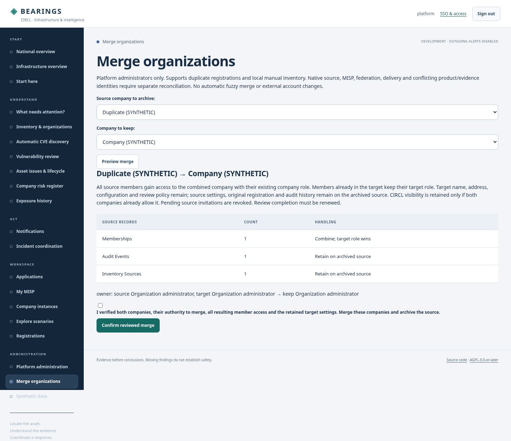

# Company members and reviewed organization merges

## Join an existing company

The first email-confirmed registrant remains the new company's administrator. Registration creates a new company; it now points existing-company participants to `/join/` instead. There is no public company directory, fuzzy membership assignment or automatic joining based on an email domain.

A current active **Organization administrator** opens **Company inventory → Company members & invitations** (or company configuration), enters an email address and chooses **Organization administrator**, **Inventory editor** or **Reader**. Only company administrators can delegate membership, and only within their own company. Editors/readers and CIRCL operator visibility alone cannot invite. Platform administrators retain their separate backend membership controls.

The service email contains a random one-use code/link, expiring after 72 hours. Only its digest is stored. Opening the link does not join; the fragment is removed from the browser URL and acceptance requires a CSRF-protected POST. Existing users sign in with the account matching the invited mailbox; the invitation never resets a password or changes an existing member's role. New users choose their username, personal names and password. Acceptance creates membership in the invited company without creating another company, copying company inventory or granting staff/CIRCL/native application roles. Ambiguous duplicate-email accounts and inactive accounts require operator assistance. The code is mailbox proof for this invitation, not infrastructure authority, emergency reachability or contact-role review.

Re-inviting rotates/revokes the previous code. Administrators can revoke outstanding invitations, change member roles and remove company memberships, while retaining at least one active company administrator. The inviter must still be an active administrator at acceptance. Sending is limited to 30 invitations per company/hour and one per recipient per five minutes; public acceptance uses the existing public-attempt limit. Mail preparation errors are visible and do not grant access. Default file mail is inspectable under the platform-only **Service mail & local outbox**; production delivery still needs operator SMTP configuration. Prepared mail is not delivery or acceptance evidence.

Membership changes apply to Bearings access, including membership-gated personal MISP caches. They do **not** provision, change or revoke independent NetBox/MISP/IdP/RT/FlowIntel accounts or sessions. Operators must manage native permissions separately. Invited users are not silently linked to existing SSO accounts by email.

## Merge duplicate companies or consolidate a merger

A platform administrator opens **Bearings administration → Merge organizations** at `/operator/organizations/merge/`. Select the source company to archive and the target to keep, then prepare a preview. No merge is inferred from similar names, addresses, domains or MISP UUIDs.

The preview shows source record counts, retained settings/history, overlapping members and blocking conflicts. Source-only members retain their company role in the target; members already in the target keep their target role, even when their source role was higher. Explicit confirmation acknowledges that members will gain access to the combined company's data. An active administrator must remain after resolving duplicate memberships.

Supported transfers are local **manual inventory**, assets/installations, unique software products, evidence/finding/issue records, contacts and infrastructure claims. Their object IDs and dependent evidence/history remain intact; records are not silently deduplicated by name or overwritten. Target name/address/configuration/review policy stay in place. Original registrations, source settings and audit history remain attached to the archived source for operator inspection; no company is hard-deleted. The merge audit retains transferred object IDs and original membership roles for provenance. Pending source invitations are revoked. CIRCL visibility survives only when both companies allowed it. The target data review becomes due again. A signed actor-bound preview expires after 15 minutes; changed data/access requires a fresh preview, and a failed transaction transfers nothing.

This initial merge deliberately **blocks transferring source-side** native/external inventory bindings, personal MISP connections, federation/remote company bindings, outbound delivery/subscription state, native cases/tickets, pending inventory writes, stable CSV bindings, unresolved source AIL/key configuration/drafts, differing attested MISP identities and conflicting product/evidence identities. An empty/manual duplicate can merge its members and contacts into an existing native target without repointing the target's connections. Source assets cannot be adopted into a target with a native authoritative inventory. These require an operator-led reconciliation/migration before using the merge. The preview names the blocker; it never repoints a tenant, credential, native identity or mail audience. Existing archived merge chains require separate review. The per-related-table review limit is 5,000 rows. This is a conservative local consolidation workflow, not a native cross-application corporate-merger engine or automatic rollback facility.

