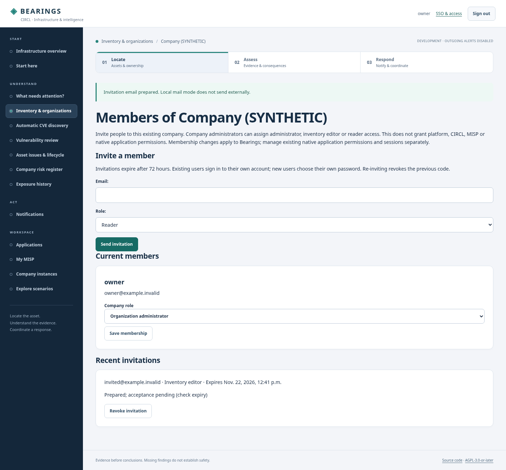

# Company members and reviewed organization merges

## Join an existing company

The first email-confirmed registrant remains the new company's administrator. Registration creates a new company; it now points existing-company participants to `/join/` instead. There is no public company directory, fuzzy membership assignment or automatic joining based on an email domain.

A current active **Organization administrator** opens **Company inventory → Company members & invitations** (or company configuration), enters an email address and chooses **Organization administrator**, **Inventory editor** or **Reader**. Only company administrators can delegate membership, and only within their own company. Editors/readers and CIRCL operator visibility alone cannot invite. Platform administrators retain their separate backend membership controls. The backend membership list shows separate user, company and role columns, supports searching by username/email/personal name/company and filtering by role. Membership labels also include the username, company and role.

The service email contains a random one-use code/link, expiring after 72 hours. Only its digest is stored. Opening the link does not join; the fragment is removed from the browser URL and acceptance requires a CSRF-protected POST. Existing users sign in with the account matching the invited mailbox; the invitation never resets a password or changes an existing member's role. New users choose their username, personal names and password. Acceptance creates membership in the invited company without creating another company, copying company inventory or granting staff/CIRCL/native application roles. Ambiguous duplicate-email accounts and inactive accounts require operator assistance. The code is mailbox proof for this invitation, not infrastructure authority, emergency reachability or contact-role review.

Re-inviting rotates/revokes the previous code. Administrators can revoke outstanding invitations, change member roles and remove company memberships, while retaining at least one active company administrator. The inviter must still be an active administrator at acceptance. Sending is limited to 30 invitations per company/hour and one per recipient per five minutes; public acceptance uses the existing public-attempt limit. Mail preparation errors are visible and do not grant access. Default file mail is inspectable under the platform-only **Service mail & local outbox**; production delivery still needs operator SMTP configuration. Prepared mail is not delivery or acceptance evidence.

Membership changes apply to Bearings access, including membership-gated personal MISP caches. They do **not** provision, change or revoke independent NetBox/MISP/IdP/RT/FlowIntel accounts or sessions. Operators must manage native permissions separately. Invited users are not silently linked to existing SSO accounts by email.

## Merge duplicate companies or consolidate a merger

A platform administrator opens **Bearings administration → Merge organizations** at `/operator/organizations/merge/`. Search by name, slug or ID, select the source company to archive and the target to keep, then prepare a preview. Labels include the stable company ID, slug and inventory mode; the selectors show at most 50 matches plus the submitted selections. No merge is inferred from similar names, addresses, domains or MISP UUIDs.

The preview shows source record counts, retained settings/history, overlapping members and blocking conflicts. Source-only members retain their company role in the target; members already in the target keep their target role, even when their source role was higher. Explicit confirmation acknowledges that members will gain access to the combined company's data. An active administrator must remain after resolving duplicate memberships.

Supported transfers are local **manual inventory**, assets/installations, unique software products, evidence/finding/issue records, contacts and infrastructure claims. Their object IDs and dependent evidence/history remain intact; records are not silently deduplicated by name or overwritten. Target name/address/configuration stay in place. The target review schedule stays; a missing schedule is copied from the source, and recorded mandatory email-review consent remains effective. Original registrations, source settings and audit history remain attached to the archived source for operator inspection; no company is hard-deleted. The merge audit retains transferred object IDs and original membership roles for provenance. Pending source invitations are revoked. CIRCL visibility survives only when both companies allowed it. The target data review becomes due again. A signed actor-bound preview expires after 15 minutes; changed data/access requires a fresh preview, and a failed transaction transfers nothing.

This initial merge deliberately **blocks transferring source-side** native/external inventory bindings, federation/remote company bindings, outbound delivery/subscription state, native cases/tickets, pending inventory writes, stable CSV bindings, unresolved source AIL/key configuration/drafts, differing attested MISP identities and conflicting product/evidence identities. An empty/manual duplicate can merge its members and contacts into an existing native target without repointing the target's connections. Source assets cannot be adopted into a target with a native authoritative inventory. These require an operator-led reconciliation/migration before using the merge. Personal MISP connections block by default. With the explicit retirement checkbox, their encrypted keys and cache remain on the archived source, disabled and unavailable to the combined company. Owners reconnect using their own keys under the retained company. Active MISP refreshes and non-personal connections still block. The preview names other blockers; it never repoints a tenant, credential or native identity. Busy inventory/MISP/review row locks cause a retryable refusal before partial changes. Existing archived merge chains require separate review. The per-related-table review limit is 5,000 rows. This is a conservative local consolidation workflow, not a native cross-application corporate-merger engine or automatic rollback facility.

## CIRCL as infrastructure owner and platform operator

CIRCL needs one canonical company for its own infrastructure. Membership roles on that company and the user's CIRCL/platform privileges are independent. Creating a second company does not grant platform powers and is not needed for that separation.

Use **Platform overview** and **Company workspace** in the account header, or `/account/workspaces/`. Search for and explicitly open a company; the remembered company is checked against current access on every request. Its infrastructure overview is filtered to that company. The chooser shows at most 25 matches; refine the search when necessary.

This is navigation between tasks with the account's existing permissions. It does not impersonate another user, reduce a platform administrator to a company member, grant membership, or change NetBox/MISP/FlowIntel/SSO rights. Other pages retain their existing authorization and scope selectors. For customer-level acceptance, use an account with an explicit company membership and no platform role. Only eligible operators see the national entry point; ordinary company users cannot open it through the switcher.

For the CIRCL duplicate beside the native pilot, keep **CIRCL · circl · #1 · Central NetBox** (verify your actual IDs), archive the newly registered manual duplicate, and explicitly retire its personal MISP connections if required. Preview the member roles and visibility policy before confirming. NetBox endpoint, tenant and service credential stay with the retained company. The archived original remains available for administrative history, and native pilot retries ignore archived duplicate names.

### If a merge confirmation fails

A stale/expired preview, busy background source or data-identity conflict is shown as an operation error; no data is transferred by the refused transaction. Prepare a fresh preview. Append-only audit events and background source health/review scheduling do not invalidate the review, while data, membership, credential and source-policy changes do. A real active refresh/row lock still requires waiting and retrying.

An earlier error handler could itself raise `AttributeError` while showing a refused confirmation. If an unexpected 500 occurs, inspect the current active/archived company IDs and the `organization.merged` audit before repeating a merge: a redirect destination may fail after a commit. Native production request diagnostics are written to the systemd journal as exception types/code positions, without request bodies, raw exception messages or local variables. Keep DEBUG disabled.

### Active company versus archived source in administration

A merge archives the source rather than deleting it. Django administration therefore still lists both records. Organization administration now shows ID, name, slug, **Active** or **Archived (merged)**, and a clickable **Merged into** destination; use the merge-status filter to show active or archived records. The same status and destination are read-only fields on the detail page, and archived labels include `Archived → #ID` in other selectors. Company-facing lists continue to omit archived organizations.

For a synthetic example, source #2 with `merged_into_id=1` is archived into active target #1. Seeing two rows in administration is not evidence of a failed merge. Preserve the archived source's original registration, audit and disabled connection history; use the retained company for current infrastructure and new personal MISP connections. Do not repeat the merge or delete the archived record.
