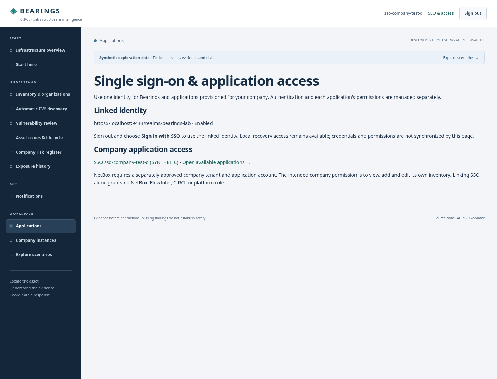

# Company SSO and native inventory access

A registration initially creates a local Bearings account. Email confirmation (or a recorded platform activation override) opens private company access; CIRCL approval separately enables sharing and the configuration wizard. Approval alone does not create an identity-provider or NetBox account.

## Link an existing SSO identity

After CIRCL approval, the registered responsible person can open **SSO & access** in the account menu, or from the configuration guide's contact section. Sign in locally, confirm the current local Bearings password and the explicit linking statement, then authenticate at the installation's configured identity provider. The five-minute linking attempt requires the normal signed OIDC/PKCE/nonce checks. Matching names or email addresses never link accounts. Ten attempts per account per ten-minute window limit password guessing.

The verified issuer and subject identify the person. The account's existing company membership, local recovery password and application roles remain. Sign out and choose **Sign in with SSO** to use the linked identity. A revoked or already-linked identity requires operator review; this screen cannot restore it or move it to another account. Pending, inactive, staff, CIRCL and platform accounts use the separate operator-managed process.

Linking does not grant native NetBox, FlowIntel or CIRCL access. Each application needs its own explicit identity binding and scoped permissions. The Applications page remains the entry point; Bearings also exposes company inventory through its own interface.



## Provision an approved company in the bundled SSO lab

The platform operator can create a company IdP identity and a dedicated native NetBox tenant using the retained local stack. This is a development-lab provisioner, not an external-service provisioning API. Run it on the host; privileged credentials stay in the isolated operator jobs, outside web forms and Git.

```sh
python3 scripts/dev.py up --no-build
# Read-only plan first:
python3 scripts/dev.py enroll-company-sso --username=company-owner
# Apply that company's current plan:
python3 scripts/dev.py enroll-company-sso --username=company-owner --apply
```

This requires the remembered bundled SSO profile, an active platform superuser actor (default `platform-admin`), an approved registered owner with company-admin membership and current CIRCL visibility. The registration review shows the plan command to platform administrators. It does not execute privileged remote provisioning from the browser. An external installation must have its operator configure the provider/native accounts, tenant permissions and explicit issuer/subject bindings independently; the self-service linking flow above remains available with the configured provider.

The operator receives the new IdP username and an initial temporary password, which must be changed **at the identity provider** on first login. The local Bearings password is neither copied nor reset. Share the initial credential through a trusted channel; do not paste command output into issues. An existing IdP username is never adopted by name/email. Existing verified bindings or private creation receipts are used to resume owned provisioning; disabled accounts/bindings and changed permission policies require explicit review.

With native NetBox enabled, the new human account can **view, add and change its own company inventory**. It has no delete permission, global tenant administration, other-company access or platform role. The provisioner creates a dedicated tenant, site, manufacturer/device type/role and constrained device/VM/IP/prefix/interface/inventory-item/rack/VRF/location permissions. Unmanaged cross-company reference relationships are restricted; global taxonomy, VLAN/cabling and additional topology configuration need operator review. The company's server-side API identity/token is separate from the human account and constrained to its own inventory. Existing demonstration accounts retain their previous permissions.

A new NetBox source can replace only an **empty manual inventory** under the source writer lock. Existing assets, assessments and upstream source bindings are not moved or reassigned. To enable SSO while keeping a populated manual inventory or another authoritative source:

```sh
python3 scripts/dev.py enroll-company-sso --username=company-owner --without-netbox
python3 scripts/dev.py enroll-company-sso --username=company-owner --without-netbox --apply
```

A populated manual-to-NetBox migration remains separate work. For a new native source, an isolated company credential is loaded into web/worker processes before the source is exposed for normal GET-only imports. The operator can open NetBox and choose **OpenID Connect**; an existing provider session avoids another password prompt.

## Retry and lifecycle boundaries

The read-only plan does not change accounts or policies. Apply consists of multiple provider/application stages, not a distributed transaction. An incomplete attempt can leave an owned provider account or native tenant without complete application access. Retained private receipts permit a reviewed retry; unknown objects, revoked grants, changed passwords and nonstandard permission policies are never silently reset. A crash between provider creation and recording its receipt needs operator reconciliation. Preserve `.local/dev-stack/company-sso/` and the private Docker secrets volume; they contain sensitive provisioning receipts/initial credentials. The credentials directory lists managed native account names and URLs, not current self-chosen passwords. A reprinted initial password may already have been changed.

Revocation remains application-specific: administrators must manage Bearings, native NetBox and the IdP consistently. There is no global logout, SCIM synchronization or automatic cross-application deprovisioning in this increment. Disabling a managed binding/account or changing its grants causes repeat provisioning to refuse restoration. Production IdP availability, MFA, lifecycle operations, egress restrictions and recovery acceptance remain operator responsibilities.

## MISP organization UUID

A platform administrator may record an optional, unique **MISP organization UUID** in the Bearings organization administration. Bearings records the attesting actor/time and audits changes. It displays this correlation reference only within the company's existing visibility scope.

This is a useful stable company reference for a future MISP/federation mapping. It is distinct from the person's OIDC issuer/subject and the local registration/NetBox tenant identity. An entered UUID does not prove company ownership, grant membership, merge companies or cause a live MISP lookup. Applicants cannot self-assign it. Automatic MISP discovery, synchronization and trust verification remain unimplemented.
