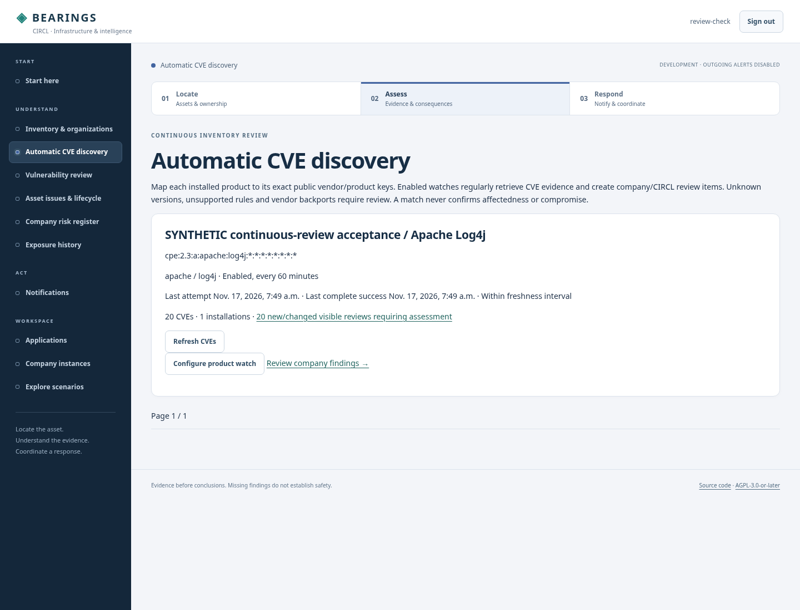
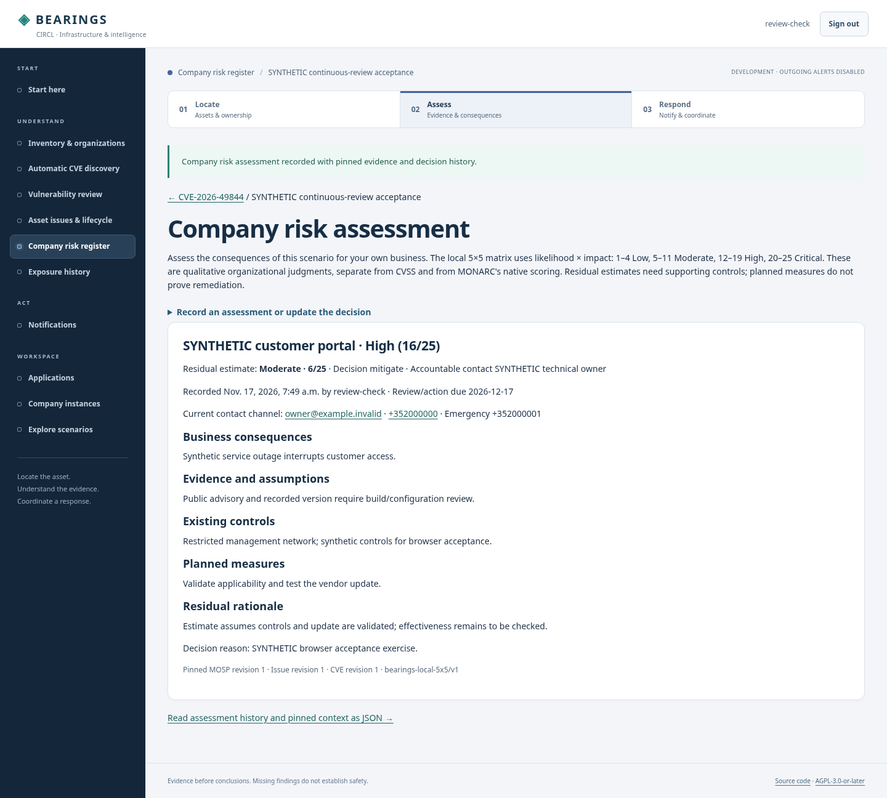
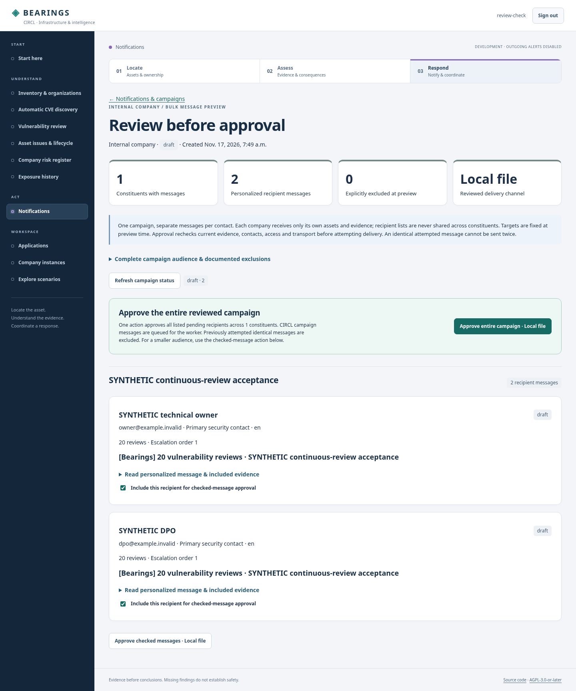

# Continuous inventory review, responsible contacts and company risk

The supported chain is **registered installation → public CVE discovery → evidence review → justified MOSP scenario → company risk decision → reviewed outreach → timed follow-up**. Company and CIRCL views use the same current organization/evidence visibility rules. A technical match is never proof of compromise, and CVSS is not business risk.

## Update and start

```sh
git pull
python3 scripts/dev.py up
```

The starter applies migrations and runs the worker. Retained inventories, identities, passwords, source policies and existing findings remain intact. Recognized installed products now enroll active watches automatically during bundled initialization and the vulnerability worker. Unknown/conflicting identities remain visible setup gaps. Existing explicitly paused/configured watches and outreach policies are preserved; an update does not enable external mail. Existing contact records migrate to the Security function, retaining their descriptive role. There is no guess that an existing role string means DPO or Management.

Without Docker, use the existing native environment:

```sh
uv sync --frozen
DJANGO_DEBUG=1 uv run python manage.py migrate
DJANGO_DEBUG=1 uv run python manage.py sync_vulnerabilities --due
DJANGO_DEBUG=1 uv run python manage.py prepare_notifications --due
DJANGO_DEBUG=1 uv run python manage.py prepare_followups
DJANGO_DEBUG=1 uv run python manage.py process_notifications --limit 25
```

Those native commands run once; the deployment operator must schedule them repeatedly. The bundled development worker includes them. PostgreSQL supports multiple workers; SQLite is a single-worker fallback. No production scheduler or production transport is enabled by these commands. Older unattempted previews without the new role/policy fingerprints require a fresh reviewed preview; historical messages and receipts remain retained.

## 1. Automatically discover CVEs for installed software

1. Record the installed product, version, edition/build when known. Open the asset's **Installed software → Configure automatic CVE discovery**, or the navigation entry **Automatic CVE discovery**.
2. Known products are prefilled; recognized installed products are enrolled automatically with auto-refresh enabled. For an unknown product, use **Find manufacturer**, then **Find product** and select the exact result. You can also supply public Vulnerability-Lookup keys directly, for example `apache` / `log4j`. This is an explicit product identity assertion, not a name similarity search. A CPE 2.3 or exact package URL on the product can substantiate a source's differently worded affected-product entry.
3. Auto-refresh is enabled by default. Choose its interval (minimum 15 minutes, default 60). Saving queues a refresh. **Refresh CVEs** queues an earlier refresh; pausing stops future reads. Source URLs remain operator-owned and pinned.
4. Review the last attempt, last complete success, errors, freshness and new/changed **visible** reviews. Missing configuration and stale/failed coverage are explicit. Ordinary inventory imports alone do not identify software or enroll watches.
5. Open the changed-review link. Review applicability with a reason. Automated match inputs, source evidence revisions and explanations are preserved separately from analyst decisions.

Watches send only the selected public vendor/product keys and pagination; company names, hosts, IPs, versions and contacts stay local. Results are bounded complete product listings, not a national CVE stream or aliases feed. The supported release-SemVer/exact-version rules yield **potential** applicability when a structured affected-release rule matches; unknown versions, unsupported ordering, conflicting statuses, backports and configuration remain review work. No automatic confirmed affectedness is generated.

Repeating identical refreshes creates no duplicate finding or discovery revision. New evidence or installation inputs create a changed-review cue, including for a previously closed finding; its analyst decision/workflow remains retained. A missing upstream record never deletes/resolves a finding. Outages and partial/oversized pages retain the last complete projection and report an error. See [adapter contract and limits](../integrations/vulnerability-lookup.md#scheduled-product-discovery).

**Update installed version** queues another evaluation. Until that completes, an existing automatic result is explicitly marked as evaluated against older inputs. Existing manual findings are reused and keep their original rule/assessment; discovery adds its separate evidence history.

## 2. Reach accountable people and optionally include the DPO

Company administrators manage contacts under **Emergency contacts**. Select a structured function: Security, Technical owner, Management or Data protection officer. Descriptive role, channel reachability, substantive role review and declared/confirmed emergency availability remain separate. Assign a higher escalation order to management contacts who should receive escalations. A verified email is not proof of 24/7 availability.

On an asset, choose **Edit local assessment → Responsible contact**. The selector is limited to that company. Both company staff and authorized CIRCL analysts see the accountable person's current email/phone/emergency number and review/availability status in the asset view. Team ownership remains available and inventory refresh preserves these local assignments. Company-risk assessments additionally select an accountable contact for that particular decision.

In **Notifications**, ordinary new previews include eligible Security/Technical contacts. **Also notify the DPO** adds eligible DPOs; **Also notify management now** adds management to the initial outreach. The company administrator's **DPO, reminders & escalation** policy can require DPO inclusion by default. Contacts still need opt-in, verified email, no invalid-delivery marker and current substantive review. Requested DPO inclusion with no eligible DPO is a visible preparation blocker; CIRCL's existing explicit blocked-constituent exclusion option remains available.

Every recipient receives a separate private company message with its own preview and approval. Changing a structured role, company policy, consent or evidence can invalidate an older preview. No new company or DPO address is contacted merely because a role or policy was saved. File delivery remains the default; existing explicitly configured TLS SMTP still requires review/approval and operational acceptance.

## 3. Configure reminders and escalation

The same company policy accepts **reminder days** and **escalation days**, measured since the original local filing or SMTP relay acceptance. Zero disables a stage; enabled escalation must follow an enabled reminder.

- At most one reminder draft is prepared for the original contact.
- At most one escalation draft is prepared for opted-in, reachable, currently reviewed Management contacts whose escalation order is higher than the original recipient's.
- Both contain only the original message's still-active/currently redistributable reviews, rendered from current evidence. They never add other companies or unrelated new reviews.
- The original active creator must still have the relevant company/CIRCL rights. Missing recipients, revoked rights or inactive evidence retain a blocker under **Reminder & escalation follow-ups**.
- Every new draft requires separate approval. Neither the timer nor a subscription grants permission to send. Original and follow-up fingerprints are distinct; repeated worker runs do not create repeated stage drafts.

Acknowledging the original cancels unapproved follow-up drafts and blocks already queued follow-up transport. Current scheduling policy and acknowledgment are checked again before approval/I/O. Already delivered history remains subject to current source visibility. Interrupted/uncertain deliveries are not automatically retried. These are reminder/escalation **drafts**, not verified delivery, bounce processing, a repeated escalation ladder or an emergency paging service.

## 4. Record the company's business risk

1. Open a CVE review and justify a MOSP/MONARC scenario, or link a scenario to a lifecycle/exposure issue. Review changed/withdrawn scenario mappings first.
2. Open **Company risk assessment** from the issue or CVE review. Name the business service/process, concrete business consequences and assumptions/uncertainty. Document the likelihood and impact rationale independently of CVSS.
3. Select likelihood and impact on the documented qualitative 1–5 scales. Record existing controls, planned measures, residual likelihood/impact and the evidence supporting the residual estimate. Planned patches do not prove controls are already effective.
4. Choose review, mitigate, avoid, transfer or accept; assign an accountable company contact and an action/review date. Treatment decisions need measures. **Accept** requires company-administrator authority (or trusted platform administration), a reason and an acceptance-expiry date; CIRCL analyst status alone cannot accept risk on a company's behalf.
5. Saving creates an immutable revision with its actor, previous revision, issue/CVE/catalog revisions and the exact reviewed context. Concurrent or stale submissions must reload/review rather than overwrite another decision.

The method `bearings-local-5x5/v1` calculates likelihood × impact: **1–4 Low, 5–11 Moderate, 12–19 High, 20–25 Critical**. Residual likelihood × impact uses the same bands. This is an explicitly local qualitative matrix, separate from CVSS, source likelihood/EPSS, MONARC's native method and any claim of regulatory compliance. No private business assessment is sent upstream or synchronized to a MONARC server.

**Company risk register** shows only the latest assessment for each currently visible issue, with decision filtering, evidence-change/review-deadline/acceptance-expiry flags and current contact links. Company users see their organizations; CIRCL sees permitted constituents. Changed source evidence, installation/context/workflow or scenario references make older assessments require review. Expired acceptance is flagged; no silent extension or automatic issue remediation occurs. Full assessment history and pinned context are available as JSON from each assessment page. Current source restrictions apply to both raw evidence and derived risk/history/counts.

## Validation and remaining boundaries

Tests exercise real application views, isolated synthetic upstream contracts, failure retention, DPO role/consent changes, follow-up acknowledgment/policy checks, private company routing, risk acceptance permissions and PostgreSQL concurrency. Live API and bundled-stack verification are recorded separately in [validation](../validation.md). Tests and fixtures do not establish real customer reachability or production delivery.

Remaining work includes broader ecosystem version/backport/configuration evaluation, full alias consolidation and incremental scalability, native MONARC assessment synchronization, verified bounce ingestion/automatic escalation delivery, production methodology acceptance and the production scheduler/security/recovery gate.

## Browser examples

These screenshots show a fictional company, `.invalid` contacts and a synthetic business scenario/assessment. Discovery uses real public Log4j CVE evidence. No message was approved or delivered during the browser exercise.







The [infrastructure overview](infrastructure-overview.md) is now the login landing page. The vulnerability review queue remains available at `/reviews/`.


### MISP release ranges and active issues

The product watch recognizes the MISP GitHub CNA's explicit upper bounds
and CIRCL CNA's structured SemVer intervals when the record references the
MISP repository and supports a definite version decision. CIRCL records that
name affected modules and link a tagged MISP patch can establish that a release
exceeds their upper version bounds. For example, CVE-2026-103655 affects
versions before 2.5.48 and CVE-2026-90961 versions before 2.5.46.
CVE-2026-44381 concerns releases before 2.5.37 and CVE-2026-10868 concerns
releases through 2.5.38. MISP 2.5.51 is outside these published ranges. Missing
versions, unsupported ranges and ambiguous evidence remain technical review
work. A change in inventory or source evidence invalidates the old exclusion.

Automatically created catalogue-only rows with unknown or non-affected
results stay available in the evidence views. They do not appear as open
Asset issues or Grouped actions unless someone has recorded operational
work. Existing manual assessments, tasks and evidence history are retained.
After updating, open **Automatic CVE discovery**, find the MISP product and
choose **Refresh CVEs** to queue a fresh evaluation of stored and current
public advisory data for the configured product watch.

The shared review classifier supplies the current category for Vulnerability
review, infrastructure and machine counts, national review records and
software cases. Asset issue filtering and notification eligibility use the
same current version proof. Open workflow totals and retained history record
analyst work. They are not counts of affected installations.

The MISP refresh also replays saved reviews for the exact watched product,
organization and advisory source when their evaluation inputs changed.
An advisory can be available by CVE ID while missing from the product index.
The local replay can still use previously retained publisher evidence. It
keeps the original source observation date, analyst assessment and sharing
policy. A failed product-index request is still shown as a source error.
The refresh reports any saved reviews it reevaluated.

After updating the Bearings web and worker services on Ubuntu, open
**Automatic CVE discovery**, find the MISP watch and select **Refresh CVEs**.
Once the refresh completes, check **Vulnerability review → Needs attention**.
Reviews with a current not-affected version assessment can be opened under
**Fixed or not affected** or from a saved evidence link.

The MISP comparison accepts CIRCL's published tagged-patch ranges
with case variants of the official repository URL, explicit exclusive or
inclusive bounds, and the observed `unspecified` or redundant comparator
formats. MITRE records can use structured ranges with an explicitly
unaffected default. An older MITRE record without structured product
fields can establish a version exclusion when its explicit fixed-release
statement matches the target of a MISP release comparison.

New, automatically created MISP matches with insufficient version evidence
are listed under **Assessment → Vendor clarification**. Existing analyst
assessments retain precedence. A CVE notification action requires at least
one eligible review for that CVE within the organization.
