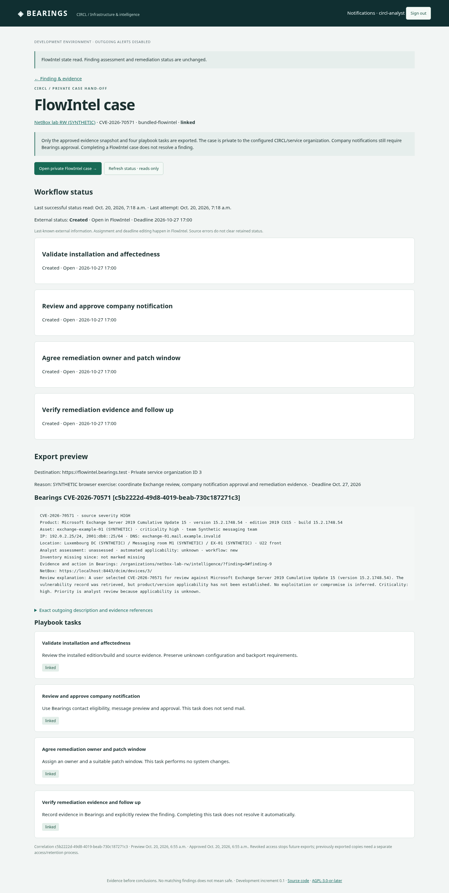
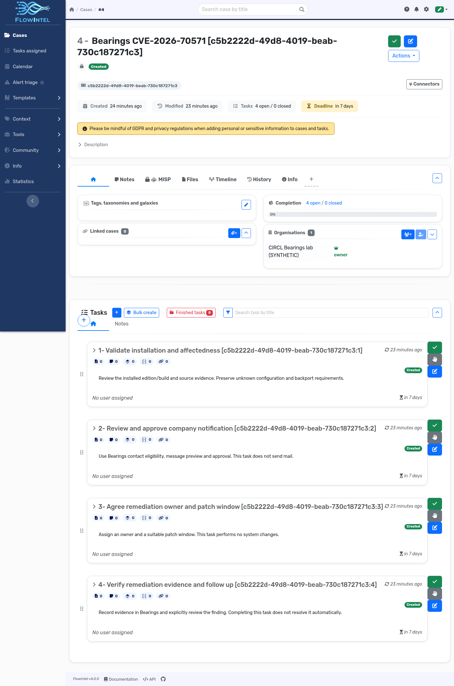

# FlowIntel: private case hand-off

Bearings can prepare and approve a private FlowIntel case for an existing vulnerability review, create four follow-up tasks and read back workflow status. This is an optional local pilot. It does not discover vulnerabilities, send notifications, patch machines or automatically resolve findings.

## Start the bundled lab

From your existing Bearings checkout:

```sh
git pull
python3 scripts/dev.py up --flowintel
```

The starter remembers the choice. Subsequent `python3 scripts/dev.py up` rebuilds and starts the selected configuration. NetBox and FlowIntel each have their own database, keys and runtime data. The first FlowIntel build fetches the exact upstream source revision and installs a separate hash-locked dependency set; Git, Docker with Compose 2.24+ and Python are required. The application runs natively on the Docker host architecture; only Linux amd64 has been exercised here.

The bundled FlowIntel is a **case-workflow build** of upstream commit `0fd54db3d3c7d17c4b26d8759cb6ac857d8d041f`, not its full official Docker distribution. The upstream web UI, case/task APIs and bundled static assets are included. PDF/LaTeX export, AI, the external MISP enrichment server and submodule catalog population are not part of this starter. The full official image could not be unpacked within the cloud's VFS storage budget; the smaller source build is the distributed and tested profile. Source/license notices remain included. No additional Python packages are installed into Bearings' own environment.

FlowIntel's browser gateway uses HTTPS on port **9443** by default (`FLOWINTEL_PORT` overrides it). It shares the existing lab's public CA trust, with a **separate server private key**. If you have not trusted the lab CA in your browser, export it with `python3 scripts/dev.py trust` and import the resulting public `.local/dev-stack/netbox-ca.crt` into your local browser/OS. Verify that it belongs to your lab. Do not bypass certificate verification. The internal application/database/Valkey ports are not published.

```sh
python3 scripts/dev.py credentials
```

This intentionally shows the generated initial local password. FlowIntel logins are `circl-analyst@example.com` and `platform-admin@example.com`. These are synthetic identities using the reserved example domain; SMTP, Matrix, webhooks and AI endpoints remain disabled. Existing passwords, users, role changes and connection policies are preserved. A separate non-admin editor API identity performs case writes; its key is never displayed. A separate read-only isolation probe is used by the lab smoke test and has no customer data.

The optional packaged FlowIntel profile currently requires bundled NetBox mode. An independently deployed FlowIntel instance can instead be configured by the operator; it is not bootstrapped or provisioned remotely.

## Use an existing Exchange example

If the case already exists, complete its NetBox context immediately:

```sh
python3 scripts/dev.py example-exchange --inventory-only
```

For a new Exchange example use `python3 scripts/dev.py example-exchange`; it also retrieves live Vulnerability-Lookup/MOSP evidence. Updating code does not clone screenshot databases. Missing example cases, disabled policies and source outages are not silently reset. See the [Exchange guide](exchange-example.md).

1. Sign in to Bearings as `circl-analyst`. Open the Exchange finding under **Asset → Vulnerability → Risk**.
2. Choose **Prepare private FlowIntel case**. Select the connection, optional deadline and a reason. The first pilot requires active installed software, an active review, shareable evidence and explicit CIRCL visibility. Company-only accounts cannot export cases to the CIRCL service.
3. Read the export preview, including the actual hostname, primary IP/DNS, room/rack, installed version/build, analyst applicability and source CVSS. The exact outgoing description and risk/evidence references can be expanded. The description preserves uncertainty and does not translate CVSS into MISP threat level or business risk.
4. **Approve private case & task export**. The starter worker processes the durable hand-off in bounded steps. Native/custom deployments must schedule `uv run python manage.py process_flowintel --all --due`. Repeated clicks do not create another case for the same finding/connection.
5. The private FlowIntel case receives four tasks: validate installation/affectedness; review company notification in Bearings; agree remediation ownership/window; verify evidence and follow up. Deadlines apply to the case and these tasks. Assign users and edit tasks in FlowIntel.
6. Follow **Open private FlowIntel case**, logging in there separately. FlowIntel's service organization is CIRCL-only; customer organizations are not added to these cases. A private case is created directly, avoiding the upstream template path's public default.
7. Use **Refresh status · reads only** in Bearings, or let the worker poll every ten minutes. Bearings displays last-known case status, completion, task status and deadlines with freshness/errors. It does not import arbitrary case notes or other users' tasks. Assignment names are not synchronized back in this increment.

Case completion is **external workflow completion**, not proof that the software is patched. Update the Bearings assessment explicitly with a reason/evidence. Company recipients still use Bearings' [notification preview, local approval and inbox](notifications.md).

## Synthetic browser example

These screenshots show the local synthetic Exchange workflow, not data automatically distributed by an update.





## Uncertain writes and outages

Each case/task POST has a committed local claim. A lost response or interrupted process enters an uncertain/in-progress state. **Reconcile uncertain attempt · reads only** searches bounded authorized case lists by the stable correlation ID, verifies private visibility, exact service organization and remote identity, and recovers matching task identities. A live write lease must finish/expire first. The worker also attempts read-only reconciliation after two minutes.

A missing case/task is not treated as proof that a POST failed. Uncertain POSTs are never blindly repeated. If no unique match is visible, the operator must investigate using the retained correlation and upstream records. Do not delete bindings to force a retry: that destroys the duplicate-prevention record. Case/task correlation titles are retained; changing them or adding another organization to the case can intentionally stop verification. There is no distributed exactly-once guarantee.

Before each write, Bearings rechecks creator access, current source sharing, connection policy and the approved evidence/asset/assessment snapshot. Changes stop further writes. Read failures retain last-known state. Revocation stops future exports and hides local hand-off details where access is no longer allowed; copies already exported require an explicit FlowIntel access/retention process.

## Disable, restart and verify

```sh
python3 scripts/dev.py up --no-flowintel
```

This stops the optional services and retains all volumes. Managed queued FlowIntel work is paused, while Bearings and NetBox continue. Re-enable with `up --flowintel`; source policies/passwords/case identities remain retained. Operator-disabled connections are not silently re-enabled.

```sh
python3 scripts/dev.py smoke
```

In the selected FlowIntel profile this runs the original NetBox import/write/recovery proof plus private cases for both synthetic RO/RW organizations, four tasks per case, unrelated-organization access denial, stable repeat identities and GET-only status feedback. It uses explicitly synthetic Log4j review fixtures, not live fetched vulnerability evidence. No real-company data, outgoing notifications, scans or remediation commands are executed.

## Startup fails with “Invalid cross-device link”

A failure in `flowintel-init` while renaming `logs`, `history` or `uploads` is an image-layer filesystem issue in the startup adapter. The corrected adapter preserves the image directory with a copy/remove fallback when a directory rename is unsupported. Existing runtime data and backup directories are not overwritten. Update and retry from your checkout:

```sh
git pull
python3 scripts/dev.py down
python3 scripts/dev.py up --flowintel --no-build
python3 scripts/dev.py credentials
```

This fix is in the bind-mounted `docker/flowintel/start.py`, so the already built images can be reused. `down` removes the old containers so their single-file bind mounts cannot retain an older file inode; it preserves all volumes. Keep the volumes; no database/password reset is needed. If initialization still fails, read `docker logs --tail 120 bearings-dev-flowintel-init-1` before making changes. Redact any credentials before sharing logs. A credentials error saying `web` is not running is a consequence of the failed startup.

## Operator-managed external connections

Platform superusers can configure **FlowIntel instances** in Django administration: approved credential-free HTTPS API/browser bases, an optional Bearings browser base, a `FLOWINTEL_*TOKEN` environment-variable name, the expected service organization ID, private-destination approval and enabled policy. Supply the key only through server-side secret configuration. Use the API user's own organization and an editor role with access to the intended private cases; do not default to an unrestricted admin key. Native/custom workers need the same key/trust configuration.

Once a preview exists, API base, credential reference and service organization identity cannot be repointed underneath it. Browser origins can be changed by the operator without sending credentials there. Only fixed case/task creation and read routes are supported. Generic GET crawling is prohibited because some upstream GET routes mutate state. Cases retain their own source-bound identities and are never synchronized into NetBox.
