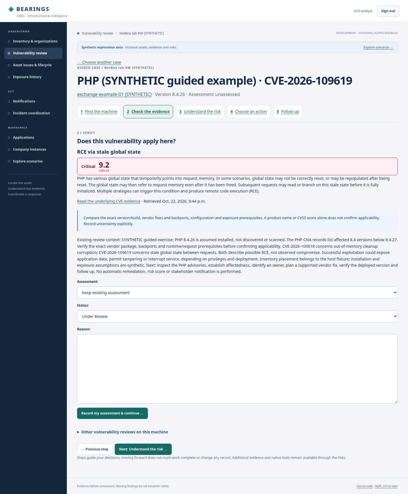

# Start with one case

Open **Start here** in the workspace navigation, or the prominent **Start here** action on the review overview. Choose an existing visible case by product, CVE or machine. Examples are selectable data, not fixed application workflows: PHP, Exchange and other installed software use the same guide. Empty workspaces explain the prerequisites: organization access, inventory import, installed product/version and recorded CVE evidence. Inventory import alone does not discover applicable vulnerabilities.

A guided case has five steps. Only the current question is expanded; the standard three-stage workspace bar is suppressed here to avoid two competing progress indicators:

1. **Find the machine** — confirm identity, IP/DNS, location, owner and inventory freshness. Missing source objects remain explicitly last-known information.
2. **Check the evidence** — inspect the actual CVE record, exact version/build, vendor fixes/backports and runtime/configuration prerequisites. Authorized reviewers can record applicability, workflow and a reason through the existing audited service, then return to the guide.
3. **Understand the risk** — inspect active pinned MOSP/MONARC scenarios and changed-evidence flags, or choose/justify a scenario with the named picker. Guided search, preview and confirmation return to the same case's action step. Technical severity does not establish business risk or compromise.
4. **Choose an action** — identify owner and eligible contacts, prepare a scoped notification or deliberately broaden to a CIRCL campaign. The page explains restricted evidence, missing contact readiness and the distinction between coordination and remediation.
5. **Follow up** — inspect analyst history, verify deployed remediation and review notification history separately. Closing a ticket, receiving an acknowledgment or moving to the next guide page does not establish that a vulnerability was fixed.

Step navigation performs no writes and does not mark steps complete. Existing permissions and visibility apply to the guide, selector, related CVEs on the same host and every linked destination. This is the first guided vulnerability-review slice, not a full organization-provisioning wizard or an automated remediation engine. Lifecycle/exposure guidance, consolidated campaign acknowledgment follow-up, service-specific remediation evidence and broader first-user acceptance remain follow-ups.

## PHP: two current CVEs on one synthetic installation

The example uses genuine published PHP CNA records retrieved through Vulnerability-Lookup for [CVE-2026-109618](https://vulnerability.circl.lu/api/vulnerability/CVE-2026-109618) and [CVE-2026-109619](https://vulnerability.circl.lu/api/vulnerability/CVE-2026-109619). The records retrieved on 2026-10-22 describe **RCE via OOM corruption** and **RCE via stale global state**, respectively; both report **CVSS 4.0 9.2**, with high attack complexity and additional attack requirements. The referenced PHP vendor advisories are [GHSA-w8hw-w9fx-j79w](https://github.com/php/php-src/security/advisories/GHSA-w8hw-w9fx-j79w) and [GHSA-6wmf-4rv5-p3rp](https://github.com/php/php-src/security/advisories/GHSA-6wmf-4rv5-p3rp).

The seed assumes **PHP 8.4.26** on an existing fictional host. This is not software discovery or proof of an exploitable deployment. At retrieval, both CNA records list 8.4 versions below **8.4.27** as affected; other affected branches and their boundaries remain in the actual source JSON. Verify the supported vendor/distribution fix, backports, prerequisites and deployed package before deciding. The seed validates the expected published PHP branch boundary and refuses changed/absent evidence rather than inventing a substitute. It never marks applicability confirmed or records observed exploitation.

For the bundled lab, after the normal tracked showcase has been installed:

```sh
git pull
python3 scripts/dev.py up
python3 scripts/dev.py manage seed_php_example --bundled
```

Open **Start here**, search **PHP**, and choose either CVE. Both reviews belong to the same synthetic installation; **Other vulnerability reviews on this machine** switches between them. The `--bundled` flag selects an existing guarded RW NetBox device for real location/source navigation but makes **no NetBox write**. Only the fictional PHP installation and local reviews are added. The command preserves existing versions, assessments, source restrictions, contacts and policies; no risk mapping, incident, scan or notification is generated. It requires DEBUG, an existing active platform admin and the active tracked showcase. New local records have creation provenance and participate in [synthetic cleanup](../operations/synthetic-data.md); a removed dataset is not restored. Without `--bundled`, an existing tracked development-only host is selected.

## Follow source references in the canvas

Known NetBox site, location, rack, primary IP/DNS and VRF links in asset fact panels open the exact object in the correct authorized instance's canvas. A case-originating link retains a validated return to that case; ordinary asset links return to the asset. Only stored positive source IDs and approved browser origins are used; request-supplied URLs and arbitrary native paths cannot select a destination. Restricted/foreign assets, disabled connections, unknown references and invalid case/asset combinations are rejected. Native NetBox still independently authorizes the user. Without approved framing, the existing separate-tab fallback remains. Missing upstream identities are labelled or lead to the local asset context instead of fabricated objects. UUID-level object canvas references are currently covered for these inventory facts; arbitrary text, all native products and every remote deep link are not universally mapped.

UI canvas URLs are added only to rendered facts. Stored notification, RT and federation evidence facts remain unchanged, preserving previously reviewed content fingerprints.

The current bundled SSO accounts have scoped native read rights for devices, VMs, IP addresses and prefixes. They do **not** automatically gain rack/site/location permissions from these new links. The CIRCL rack check correctly returned a native permission denial; an operator must deliberately configure any additional scoped native view permissions. The canvas explains this boundary and retains the return to the case. A live native device link and the return path were verified successfully without changing those permissions.


