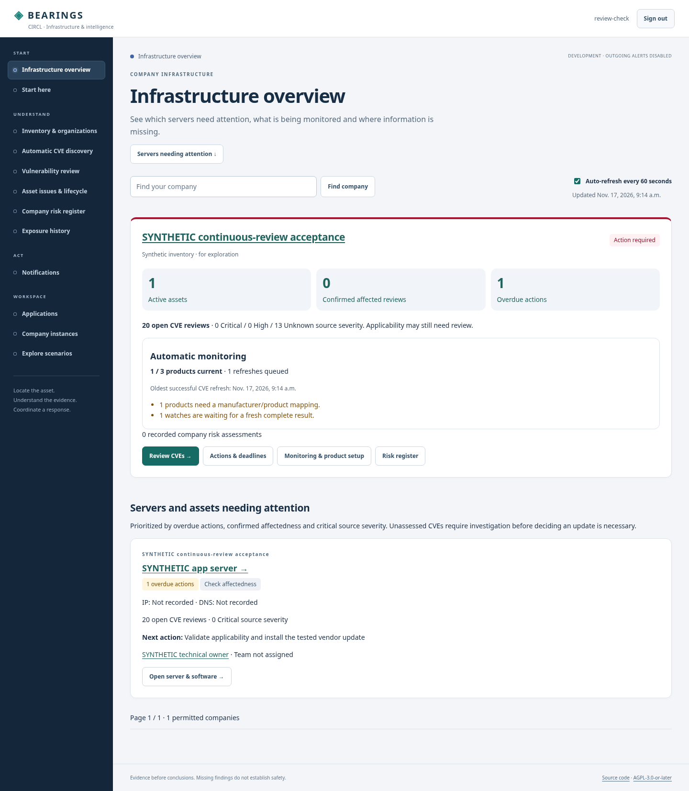
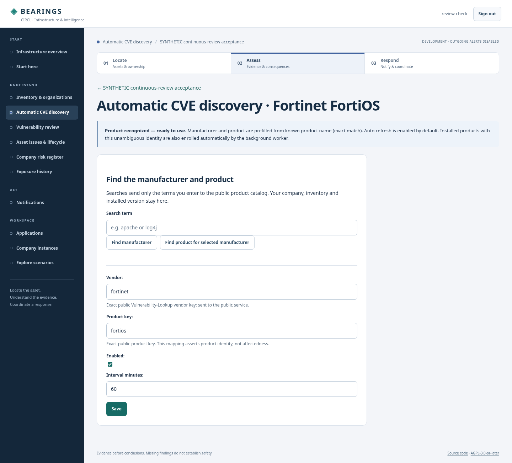

# Infrastructure overview and automatic product setup

After signing in, Bearings opens **Infrastructure overview** (`/`). Company users see their permitted companies; CIRCL analysts see companies allowed by current operator visibility or ordinary memberships. The brand link and the first navigation item return here. **Vulnerability review** remains available at `/reviews/` with its existing evidence, severity filters and assessment workflow.

## Read the company state

Each company card separates active inventory, confirmed affected reviews, overdue actions and monitoring coverage:

- **Action required:** a recorded confirmed-affected review, an overdue active issue action or an expired risk acceptance needs attention.
- **Review required:** open CVE/lifecycle issues exist, but confirmed affectedness or overdue action is not established.
- **Coverage incomplete:** no active inventory, stale/missing source data, missing software/versions, unknown product mappings, explicitly paused/stale product watches, retained missing assets or unavailable response contacts prevent a complete view.
- **No open items recorded:** no currently visible actionable items or recorded coverage gaps were found. This is not proof of safety, complete inventory, successful patching or absence of unknown vulnerabilities.

Coverage gaps remain visible even when the main state is Action/Review required. CVE source severity and unknown source severity are shown separately from analyst affectedness and company business risk. Synthetic inventory is labeled. Watch freshness means a complete supported read within the configured interval; it does not establish version applicability. The oldest successful refresh date covers reporting watches only; watches that have never succeeded are listed as gaps.

Use **Servers needing attention** to reach the prioritized asset list: overdue actions first, followed by confirmed affectedness, high-priority lifecycle/exposure issues and critical source reviews. Server names, recorded IP/DNS, contact/team and existing next actions link to the actual asset/software details. A product/CVE match creates investigation work; it does not automatically prove that a particular update is needed. Exact fixed-version/build/backport recommendations remain outside this bounded increment.

**Auto-refresh every 60 seconds** starts checked. It reloads the current view only while the tab is visible and no text/select field is being edited. Uncheck it to stop page refresh for that page. This page refresh reads local state; background source refresh is a separate worker operation. Company search, selection and pagination remain in the current URL. Overview reads never enroll products or contact upstream services. Company counters are aggregated across the visible page; only the twelve displayed priority assets receive up to four problem/scenario previews each. Inventory sources and related evidence load in batches. Counts and links still use current permissions on every request; no shared response cache delays policy changes.

## Known products: monitoring without typing catalog keys

New installed software is considered for automatic monitoring immediately. Bundled initialization and `sync_vulnerabilities` also enroll existing installed products that have no watch. The watch starts **enabled**, queued for its first complete read, with a default 60-minute source interval (minimum 15). Existing custom mappings, pinned source identities and explicitly paused watches are preserved.

Local suggestions come from:

1. Concrete unescaped CPE 2.3 vendor/product identity (`a`, `o` or `h`, with concrete vendor/product values).
2. Supported exact package identities: Log4j Maven `log4j-core` and `log4j-api`, including their versioned PURLs.
3. An exact known-name alias: Apache Log4j/Log4j → `apache/log4j`; Microsoft Exchange Server/Microsoft Exchange → `microsoft/exchange_server`; Fortinet FortiOS/FortiOS → `fortinet/fortios`. Name comparison ignores case and repeated whitespace, not arbitrary suffixes or similar words.

These aliases were checked against the public catalog. They establish a mapping candidate, not confirmed affectedness. Demo identifiers such as `demo:product:0` are not normalized identifiers, but an exact recognized product name can supply the mapping. Conflicting concrete identifier/name candidates remain a visible setup gap and require choosing the right identity. Unknown products are never silently guessed.

Opening **Configure automatic CVE discovery** shows known candidates already filled in and Enabled checked for new watches. A form GET makes no upstream call or saved change. Automatically enrolled watches show their saved mapping. Updates to the exact version/build queue another evaluation; no endpoint scanner is installed and software is not inferred from a server name.

## Unknown products: select from the public catalog

1. Open **Installed software → Configure automatic CVE discovery**, or **Automatic CVE discovery → Configure product watch**.
2. Enter the public manufacturer name in **Search term**, then choose **Find manufacturer**. Select the correct result.
3. Enter a product term and choose **Find product for selected manufacturer**. Select the exact product identity.
4. Check the selected keys and interval, leave Enabled checked and **Save**. Background refresh starts from the queued watch.

Search does not submit the watch form or change its fields before a result is selected. Existing interval/other entries remain intact while browsing. Manufacturer selection explicitly clears an older product key; product selection fills both keys. Failed searches and late responses do not replace entered data. Without JavaScript, the key fields and Save remain available for manual configuration.

The picker sends only the search terms you enter and the selected public manufacturer to the approved source. Company/asset names, installed versions, IPs, contacts and risk assessments are not transmitted. Each search retrieves one bounded page of up to 20 catalog entries, with at most 100 accessible pages; refine broad searches. Source links are not followed. Existing saved sources remain pinned. A source outage or incompatible response shows a failure and preserves the form; it never fabricates a mapping.

## Start/update

On the feature branch until it is merged:

```sh
git pull
python3 scripts/dev.py up
```

The starter applies migrations as usual, locally enrolls recognized existing software and starts the worker. No new schema migration is required by this follow-up. Native setups must schedule `sync_vulnerabilities --due` in addition to their existing inventory and notification jobs; it also enrolls recognized existing software. Initialization creates local watches only; subsequent source operations are bounded GETs. No production message, scan, public deployment or external inventory write is enabled.

## Browser examples

Screenshots use a fictional company, real public CVE/catalog reads and synthetic action/contact context. They are separate from the bundled dataset.






## Open the actual problems and suggested risk scenario

Every server card now includes linked problem titles, their dates and individual next actions. Identical action text remains attached to distinct named problems. Overdue badges filter **action deadlines** exactly; expiry/EOL dates remain separate. CVE/confirmed/critical counters open the scoped vulnerability queue; lifecycle counters open the scoped issue list. All-problem links use an exact asset ID, not a potentially ambiguous server-name search. Asset/attention filters survive subsequent filtering and pagination.

Each issue also receives an automatic conditional risk-scenario draft derived from current source weakness/text or issue type. Follow its link to review compatible cached MONARC scenarios, preview a selected template and confirm a prefilled justification with pinned evidence. This prepares business consequences and treatment context without guessing likelihood/impact or accepting company risk. [Workflow and boundaries](automatic-scenarios.md).


## Check loading time in the running application

After `git pull`, run `python3 scripts/dev.py up --no-build` to restart the web and worker processes with the bind-mounted Python code. This now applies in bundled and external modes, with or without SSO. Dependency/image changes still require a build. A matching Git commit alone does not establish which Python code an already running process has imported.

For an authenticated overview request, the HTTP response includes `Server-Timing: overview;dur=123.4`. The duration is milliseconds spent building the overview, including scoped database reads, access audits and template rendering. It excludes earlier middleware/authentication, TLS/network transfer and browser rendering; it does not disclose query contents or company data. In browser developer tools, open **Network**, reload, select the document request for `/` (or `/?organization=…`) and inspect **Response Headers** and **Timing**. Compare `overview;dur` with waiting/TTFB and the total page-load duration. A missing header after updating is a reason to check the actual web process/port/container rather than assuming the source checkout is already serving traffic.

The regression tests enforce bounded queries rather than a hardware-dependent time limit. Local browser benchmark results are documented in [validation](../validation.md); they do not establish another machine's latency.

For a slow SSO environment, use `python3 scripts/dev.py web-timing` to collect direct HTTP/proxied HTTPS and real SSO measurements without developer tools. See [SSO diagnostics](../operations/sso.md#diagnose-slow-page-navigation-with-an-existing-sso-session). The additional `session` and `django` Server-Timing values separate session validation from page processing; they overlap the overview duration and must not be added.


PostgreSQL overview queries now run with JIT compilation disabled only within their request transaction. Complex authorization joins can otherwise spend seconds compiling a query plan even for a small inventory. The previous setting is restored afterward, including when the caller already has a transaction; query failures roll back the local setting. Other pages and background jobs retain their existing database behavior. SQLite is unaffected. No shared data/authorization cache is introduced.

The timing response and `web-timing` output now also include `scope` (company selection and audits), `companies` (company counters), `priority` (asset ranking/problems/scenario previews), `render` (HTML rendering), `database` (total database execute time) and `dbmax` (slowest single execute). `database` overlaps the page stages, and `dbmax` is part of `database`; do not add overlapping values. The timers retain no SQL text, parameters or results. They help distinguish query execution/compilation from Python/rendering work if a particular environment remains slow.


Priority previews rank issue/finding identifiers before fetching full records for the displayed previews. Hydration reuses the current scoped querysets. Cards already containing four issue previews skip the legacy-CVE lookup; a public CVE whose common issue is restricted can still use its permitted CVE deep link. Legacy exclusion and exposure visibility use correlated existence checks against indexed relationships instead of adding full related rows to the ranking query. Counters still cover the full authorized asset set. The diagnostic additionally separates `ranking`, `issuepreviews` and `legacypreviews` inside `priority`; those subranges overlap `priority` and database time.


Company counters and priority previews share lazy, user-scoped evidence querysets within a single request. They are recreated on every page load; no response or authorization decision is cached between requests. Inventory counters aggregate the asset/installation hierarchy once, keeping distinct asset/product counts and source/product ownership checks. Unrelated contact/review/issue/risk aggregates remain separate. Risk revisions use a correlated current-visibility check; watch counters and scenario previews load only the fields they consume. Complete scenario evidence/fingerprints remain the same.


### IP addresses on server attention cards

The overview shows NetBox primary addresses and explicit interface-assigned IP
records from the same source and organization. An absent primary IP no longer
hides other assigned addresses or produces a contradictory “not recorded” claim.
Primary records are marked and deduplicated by their source identity. Retained
assignments missing from the latest import are labelled last-known; inactive
record states remain visible. Hostnames alone do not establish DNS records.

Each card previews at most 16 assigned addresses plus any separate primary fields
and links to the complete paginated network section. Counts/previews are fetched
in one batched query for the displayed hosts, not one query per host. Existing IP
records, assessments and NetBox data are unchanged. Update source and restart
`bearings-web`; no migration, client update or inventory import is needed when
the assignments are already present.


### Understanding why a CVE review appears

The section is labelled **Servers with open actions or reviews**. A server card
states why it is listed: overdue actions, an analyst’s affected assessment, an open
high-priority operational issue, or outstanding CVE review/reconciliation. Counts
represent CVE–installation records; they are not a count of unique vulnerabilities.

Each CVE preview shows a concrete reason, product and recorded version, analyst
assessment, saved automatic result and evaluation time, matching basis, advisory
host and source severity. Missing versions and unresolved checks are explicit.
A saved not-affected result with an open review calls for reconciliation; a human
affected assessment conflicting with that result is shown as a conflict. These
labels do not assert current feed/input freshness or a proven attack path.

The linked-issue preview is ordered by overdue status, recorded analyst affectedness,
high-priority operational issues, potential automated matches and source severity,
with action dates/stable identities breaking ties. Saved not-affected checks rank
below unresolved reviews. Older CVE-only records fill remaining slots, ordered by
assessment, automated result, severity and stable identity. At most four records
are previewed; the full scoped lists remain linked. Source severity is a source
fact, separate from whether this installation is affected.

**Next step** supplies an action even when none was entered. For CVEs it opens
the original assessment; an explicitly recorded action retains its issue link.
Risk scenarios are optional collapsed drafts, identified as hypotheses. Opening
the overview never closes a review or changes an assessment; saved workflow and
visibility policies determine when a record drops out.

Update the reviewed checkout and restart `bearings-web`. No migration, client
update/rebuild, static collection or worker restart is required.


Package matching now distinguishes a concrete affected/fixed package version from
a vendor presence-only rule. Original CVE evidence shows compared versions and
vendor notes; a source package embedding another library can legitimately have
a different package name/version. Old proofs are withheld while automatic
reevaluation is pending. See the [package/CVE audit](../audits/2026-11-21-package-cve-correctness.md).

### Distribution package verdicts in Vulnerability review

`/reviews/` starts with **Affected versions & manual reviews**. A matching
vendor version condition includes the installed version, affected/fixed bound
and native comparison. The tabs separately expose **Vendor clarification
needed**, **Awaiting current evaluation**, **Fixed / not affected / assessed**
and **All retained open reviews**. Severity counts apply to the selected tab
and search, before pagination. Counts are CVE–installation review records.

An updated package with a proven vendor fix leaves the default queue after
automatic reevaluation. Its review history and analyst assessment remain.
An explicit analyst affected assessment remains actionable until reconciled.
An explicit analyst not-affected decision is in the assessed category, with
any conflicting automatic affected-version result shown. Missing/stale
proof appears as awaiting evaluation; an empty action tab alone does not prove
that all software has been checked. A vendor can report an unfixed CVE against
the newest available distribution package.

CVSS and distributor priority appear separately. For example, CVSS 4.0 8.9 is
**High**, even when Ubuntu independently prioritizes the CVE **Medium**. Vendor
priority remains the sorting/filter scale; it is not a relabeling of CVSS.

For a current affected package with an explicit vendor fix, the review shows
the installed and vendor fixed versions and any declared Ubuntu ESM Apps
channel. This does not prove the update is available in the host's configured
repositories. `apt-cache policy <package>` checks the local candidate without
installing anything; an installed version equal to the candidate can still be
below the vendor's ESM fix. Check Ubuntu Pro/ESM configuration with the system
administrator. Updating a separately installed library does not necessarily
patch a copy bundled in another package. A later client inventory report and
vendor evaluation refresh the automatic result without closing human history.

### Company and national navigation contexts

The top switch also changes both desktop and mobile navigation. Company mode
shows local inventory/software, Linux clients, actions, monitoring, risk and
company administration. Its inventory/review links go directly to the selected
organization; shared views use their supported organization filter. Account-level
personal MISP tools remain personal tools, not an impersonated company identity.

National mode shows cross-company research/evidence, data-review follow-ups,
coordination and permitted platform administration. Linux rollout and local
company settings are reached by switching to a company first. Global collection
pages without an organization scope remain the wide view. Explicitly scoped
company links restore that context even if another tab last visited National.
The remembered company is reauthorized on each request; navigation preferences
do not add memberships, change roles, grant sharing or replace endpoint policy.


Company administrators can open **Linux clients → Application version profiles**
to define application release-file, JSON, regex or Git-tag detection. The method
controls the displayed fields. Validate/preview and download configuration for
local deployment, or select **Export PR proposal** for a ZIP with the recipe,
example configuration and software description/explanation. This neither deploys
profiles nor sends anything to GitHub. See [application profiles](../integrations/linux-application-probes.md).
