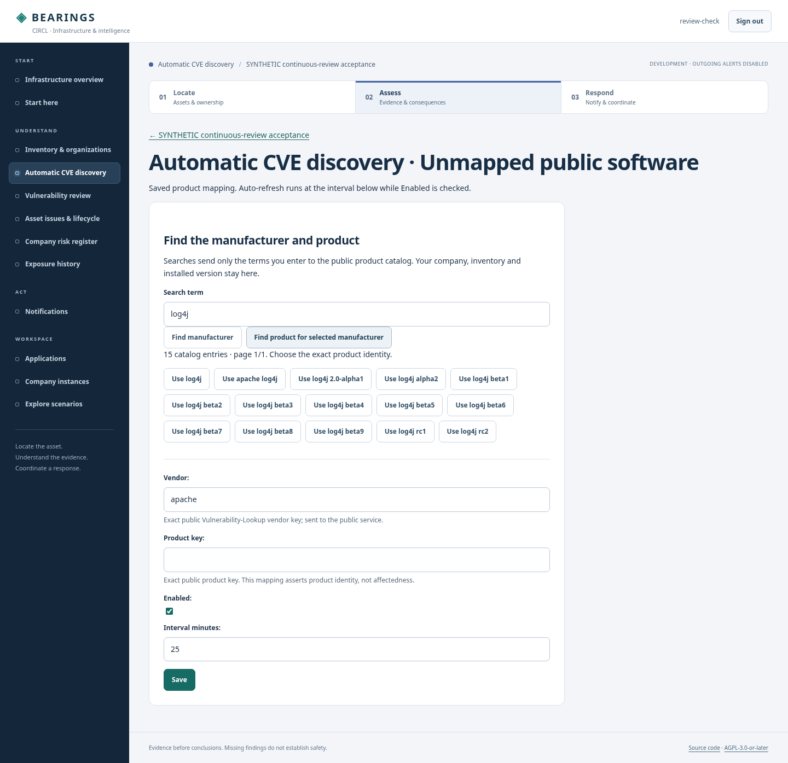

# Infrastructure overview and automatic product setup

After signing in, Bearings opens **Infrastructure overview** (`/infrastructure/`). Company users see their permitted companies; CIRCL analysts see companies allowed by current operator visibility or ordinary memberships. The brand link and the first navigation item return here. **Vulnerability review** remains available at `/reviews/` with its existing evidence, severity filters and assessment workflow.

## Read the company state

Each company card separates active inventory, confirmed affected reviews, overdue actions and monitoring coverage:

- **Action required:** a recorded confirmed-affected review, an overdue active issue action or an expired risk acceptance needs attention.
- **Review required:** open CVE/lifecycle issues exist, but confirmed affectedness or overdue action is not established.
- **Coverage incomplete:** no active inventory, stale/missing source data, missing software/versions, unknown product mappings, explicitly paused/stale product watches, retained missing assets or unavailable response contacts prevent a complete view.
- **No open items recorded:** no currently visible actionable items or recorded coverage gaps were found. This is not proof of safety, complete inventory, successful patching or absence of unknown vulnerabilities.

Coverage gaps remain visible even when the main state is Action/Review required. CVE source severity and unknown source severity are shown separately from analyst affectedness and company business risk. Synthetic inventory is labeled. Watch freshness means a complete supported read within the configured interval; it does not establish version applicability. The oldest successful refresh date covers reporting watches only; watches that have never succeeded are listed as gaps.

Use **Servers needing attention** to reach the prioritized asset list: overdue actions first, followed by confirmed affectedness, high-priority lifecycle/exposure issues and critical source reviews. Server names, recorded IP/DNS, contact/team and existing next actions link to the actual asset/software details. A product/CVE match creates investigation work; it does not automatically prove that a particular update is needed. Exact fixed-version/build/backport recommendations remain outside this bounded increment.

**Auto-refresh every 60 seconds** starts checked. It reloads the current view only while the tab is visible and no text/select field is being edited. Uncheck it to stop page refresh for that page. This page refresh reads local state; background source refresh is a separate worker operation. Company search, selection and pagination remain in the current URL. Overview reads never enroll products or contact upstream services. Company counters are aggregated across the visible page; only the twelve displayed priority assets receive up to four problem/scenario previews each. Inventory sources and related evidence load in batches. Counts and links still use current permissions on every request; no shared response cache delays policy changes.

## Known products: monitoring without typing catalog keys

New installed software is considered for automatic monitoring immediately. Bundled initialization and `sync_vulnerabilities` also enroll existing installed products that have no watch. The watch starts **enabled**, queued for its first complete read, with a default 60-minute source interval (minimum 15). Existing custom mappings, pinned source identities and explicitly paused watches are preserved.

Local suggestions come from:

1. Concrete unescaped CPE 2.3 vendor/product identity (`a`, `o` or `h`, with concrete vendor/product values).
2. Supported exact package identities: Log4j Maven `log4j-core` and `log4j-api`, including their versioned PURLs.
3. An exact known-name alias: Apache Log4j/Log4j → `apache/log4j`; Microsoft Exchange Server/Microsoft Exchange → `microsoft/exchange_server`; Fortinet FortiOS/FortiOS → `fortinet/fortios`. Name comparison ignores case and repeated whitespace, not arbitrary suffixes or similar words.

These aliases were checked against the public catalog. They establish a mapping candidate, not confirmed affectedness. Demo identifiers such as `demo:product:0` are not normalized identifiers, but an exact recognized product name can supply the mapping. Conflicting concrete identifier/name candidates remain a visible setup gap and require choosing the right identity. Unknown products are never silently guessed.

Opening **Configure automatic CVE discovery** shows known candidates already filled in and Enabled checked for new watches. A form GET makes no upstream call or saved change. Automatically enrolled watches show their saved mapping. Updates to the exact version/build queue another evaluation; no endpoint scanner is installed and software is not inferred from a server name.

## Unknown products: select from the public catalog

1. Open **Installed software → Configure automatic CVE discovery**, or **Automatic CVE discovery → Configure product watch**.
2. Enter the public manufacturer name in **Search term**, then choose **Find manufacturer**. Select the correct result.
3. Enter a product term and choose **Find product for selected manufacturer**. Select the exact product identity.
4. Check the selected keys and interval, leave Enabled checked and **Save**. Background refresh starts from the queued watch.

Search does not submit the watch form or change its fields before a result is selected. Existing interval/other entries remain intact while browsing. Manufacturer selection explicitly clears an older product key; product selection fills both keys. Failed searches and late responses do not replace entered data. Without JavaScript, the key fields and Save remain available for manual configuration.

The picker sends only the search terms you enter and the selected public manufacturer to the approved source. Company/asset names, installed versions, IPs, contacts and risk assessments are not transmitted. Each search retrieves one bounded page of up to 20 catalog entries, with at most 100 accessible pages; refine broad searches. Source links are not followed. Existing saved sources remain pinned. A source outage or incompatible response shows a failure and preserves the form; it never fabricates a mapping.

## Start/update

On the feature branch until it is merged:

```sh
git pull
python3 scripts/dev.py up
```

The starter applies migrations as usual, locally enrolls recognized existing software and starts the worker. No new schema migration is required by this follow-up. Native setups must schedule `sync_vulnerabilities --due` in addition to their existing inventory and notification jobs; it also enrolls recognized existing software. Initialization creates local watches only; subsequent source operations are bounded GETs. No production message, scan, public deployment or external inventory write is enabled.

## Browser examples

Screenshots use a fictional company, real public CVE/catalog reads and synthetic action/contact context. They are separate from the bundled dataset.




## Open the actual problems and suggested risk scenario

Every server card now includes linked problem titles, their dates and individual next actions. Identical action text remains attached to distinct named problems. Overdue badges filter **action deadlines** exactly; expiry/EOL dates remain separate. CVE/confirmed/critical counters open the scoped vulnerability queue; lifecycle counters open the scoped issue list. All-problem links use an exact asset ID, not a potentially ambiguous server-name search. Asset/attention filters survive subsequent filtering and pagination.

Each issue also receives an automatic conditional risk-scenario draft derived from current source weakness/text or issue type. Follow its link to review compatible cached MONARC scenarios, preview a selected template and confirm a prefilled justification with pinned evidence. This prepares business consequences and treatment context without guessing likelihood/impact or accepting company risk. [Workflow and boundaries](automatic-scenarios.md).


## Check loading time in the running application

After `git pull`, run `python3 scripts/dev.py up --no-build` to restart the web and worker processes with the bind-mounted Python code. This now applies in bundled and external modes, with or without SSO. Dependency/image changes still require a build. A matching Git commit alone does not establish which Python code an already running process has imported.

For an authenticated overview request, the HTTP response includes `Server-Timing: overview;dur=123.4`. The duration is milliseconds spent building the overview, including scoped database reads, access audits and template rendering. It excludes earlier middleware/authentication, TLS/network transfer and browser rendering; it does not disclose query contents or company data. In browser developer tools, open **Network**, reload, select the document request for `/` (or `/?organization=…`) and inspect **Response Headers** and **Timing**. Compare `overview;dur` with waiting/TTFB and the total page-load duration. A missing header after updating is a reason to check the actual web process/port/container rather than assuming the source checkout is already serving traffic.

The regression tests enforce bounded queries rather than a hardware-dependent time limit. Local browser benchmark results are documented in [validation](../validation.md); they do not establish another machine's latency.

For a slow SSO environment, use `python3 scripts/dev.py web-timing` to collect direct HTTP/proxied HTTPS and real SSO measurements without developer tools. See [SSO diagnostics](../operations/sso.md#diagnose-slow-page-navigation-with-an-existing-sso-session). The additional `session` and `django` Server-Timing values separate session validation from page processing; they overlap the overview duration and must not be added.


PostgreSQL overview queries now run with JIT compilation disabled only within their request transaction. Complex authorization joins can otherwise spend seconds compiling a query plan even for a small inventory. The previous setting is restored afterward, including when the caller already has a transaction; query failures roll back the local setting. Other pages and background jobs retain their existing database behavior. SQLite is unaffected. No shared data/authorization cache is introduced.

The timing response and `web-timing` output now also include `scope` (company selection and audits), `companies` (company counters), `priority` (asset ranking/problems/scenario previews), `render` (HTML rendering), `database` (total database execute time) and `dbmax` (slowest single execute). `database` overlaps the page stages, and `dbmax` is part of `database`; do not add overlapping values. The timers retain no SQL text, parameters or results. They help distinguish query execution/compilation from Python/rendering work if a particular environment remains slow.


Priority previews rank issue/finding identifiers before fetching full records for the displayed previews. Hydration reuses the current scoped querysets. Cards already containing four issue previews skip the legacy-CVE lookup; a public CVE whose common issue is restricted can still use its permitted CVE deep link. Legacy exclusion and exposure visibility use correlated existence checks against indexed relationships instead of adding full related rows to the ranking query. Counters still cover the full authorized asset set. The diagnostic additionally separates `ranking`, `issuepreviews` and `legacypreviews` inside `priority`; those subranges overlap `priority` and database time.


Company counters and priority previews share lazy, user-scoped evidence querysets within a single request. They are recreated on every page load; no response or authorization decision is cached between requests. Inventory counters aggregate the asset/installation hierarchy once, keeping distinct asset/product counts and source/product ownership checks. Unrelated contact/review/issue/risk aggregates remain separate. Risk revisions use a correlated current-visibility check; watch counters and scenario previews load only the fields they consume. Complete scenario evidence/fingerprints remain the same.


### IP addresses on server attention cards

The overview shows NetBox primary addresses and explicit interface-assigned IP
records from the same source and organization. An absent primary IP no longer
hides other assigned addresses or produces a contradictory “not recorded” claim.
Primary records are marked and deduplicated by their source identity. Retained
assignments missing from the latest import are labelled last-known; inactive
record states remain visible. Hostnames alone do not establish DNS records.

Each card previews at most 16 assigned addresses plus any separate primary fields
and links to the complete paginated network section. Counts/previews are fetched
in one batched query for the displayed hosts, not one query per host. Existing IP
records, assessments and NetBox data are unchanged. Update source and restart
`bearings-web`; no migration, client update or inventory import is needed when
the assignments are already present.


### Understanding why a CVE review appears

The section is labelled **Servers with open actions or reviews**. A server card
states why it is listed: overdue actions, an analyst’s affected assessment, an open
high-priority operational issue, or outstanding CVE review/reconciliation. Counts
represent CVE–installation records; they are not a count of unique vulnerabilities.

Each CVE preview shows a concrete reason, product and recorded version, analyst
assessment, saved automatic result and evaluation time, matching basis, advisory
host and source severity. Missing versions and unresolved checks are explicit.
A saved not-affected result with an open review calls for reconciliation; a human
affected assessment conflicting with that result is shown as a conflict. These
labels do not assert current feed/input freshness or a proven attack path.

The linked-issue preview is ordered by overdue status, recorded analyst affectedness,
high-priority operational issues, potential automated matches and source severity,
with action dates/stable identities breaking ties. Saved not-affected checks rank
below unresolved reviews. Older CVE-only records fill remaining slots, ordered by
assessment, automated result, severity and stable identity. At most four records
are previewed; the full scoped lists remain linked. Source severity is a source
fact, separate from whether this installation is affected.

**Next step** supplies an action even when none was entered. For CVEs it opens
the original assessment; an explicitly recorded action retains its issue link.
Risk scenarios are optional collapsed drafts, identified as hypotheses. Opening
the overview never closes a review or changes an assessment; saved workflow and
visibility policies determine when a record drops out.

Update the reviewed checkout and restart `bearings-web`. No migration, client
update/rebuild, static collection or worker restart is required.


Package matching now distinguishes a concrete affected/fixed package version from
a vendor presence-only rule. Original CVE evidence shows compared versions and
vendor notes; a source package embedding another library can legitimately have
a different package name/version. Old proofs are withheld while automatic
reevaluation is pending. See the [package/CVE audit](../audits/2026-11-21-package-cve-correctness.md).

### Distribution package verdicts in Vulnerability review

`/reviews/` starts with **Affected versions & manual reviews**. A matching
vendor version condition includes the installed version, affected/fixed bound
and native comparison. The tabs separately expose **Vendor clarification
needed**, **Awaiting current evaluation**, **Fixed / not affected / assessed**
and **All retained open reviews**. Severity counts apply to the selected tab
and search, before pagination. Each case groups the visible open records for one
normalized CVE on one inventory server. Other identifiers are grouped only
within the same source record on that server. The case takes the first
applicable category in this order: actionable, vendor clarification, awaiting
evaluation, and fixed or not affected. The source severity of the selected
record controls the case's severity filter.

When a case spans multiple installations, its compact card lists up to six
distinct software names and gives the number of additional names. **View
software & evidence** opens the complete paginated records with the software
version, edition and build where known, the source, package result, and saved
assessment. Searching for one software name finds the server case with all its
visible software. Different review categories and saved assessments are flagged
on the card.

The organization's **Asset → Vulnerability → Risk** list uses the same
CVE-and-host grouping within its current filters, including retained decisions.
All reviews use the same compact card. A single record links directly to its
review details. A grouped case links to paginated evidence.
Existing direct finding links open the individual assessment and risk mapping.
The assessment and workflow controls sit side by side where space allows.
The reason field starts at three lines and can be expanded.
The review-decision timeline still counts recorded transitions.

An updated package with a proven vendor fix leaves the default queue after
automatic reevaluation. Its review history and analyst assessment remain.
An explicit analyst affected assessment remains actionable until reconciled.
An explicit analyst not-affected decision is in the assessed category, with
any conflicting automatic affected-version result shown. Missing/stale
proof appears as awaiting evaluation; an empty action tab alone does not prove
that all software has been checked. A vendor can report an unfixed CVE against
the newest available distribution package.

CVSS and distributor priority appear separately. For example, CVSS 4.0 8.9 is
**High**, even when Ubuntu independently prioritizes the CVE **Medium**. Vendor
priority remains the sorting/filter scale; it is not a relabeling of CVSS.

For a current affected package with an explicit vendor fix, the review shows
the installed and vendor fixed versions and any declared Ubuntu ESM Apps
channel. This does not prove the update is available in the host's configured
repositories. `apt-cache policy <package>` checks the local candidate without
installing anything; an installed version equal to the candidate can still be
below the vendor's ESM fix. Check Ubuntu Pro/ESM configuration with the system
administrator. Updating a separately installed library does not necessarily
patch a copy bundled in another package. A later client inventory report and
vendor evaluation refresh the automatic result without closing human history.

### Company and national navigation contexts

The top switch also changes both desktop and mobile navigation. Company mode
shows local inventory/software, Linux clients, actions, monitoring, risk and
company administration. Its inventory/review links go directly to the selected
organization; shared views use their supported organization filter. Account-level
personal MISP tools remain personal tools, not an impersonated company identity.

National mode shows cross-company research/evidence, data-review follow-ups,
coordination and permitted platform administration. Linux rollout and local
company settings are reached by switching to a company first. Global collection
pages without an organization scope remain the wide view. Explicitly scoped
company links restore that context even if another tab last visited National.
The remembered company is reauthorized on each request; navigation preferences
do not add memberships, change roles, grant sharing or replace endpoint policy.


Company administrators can open **Linux clients → Application version profiles**
to define application release-file, JSON, regex or Git-tag detection. The method
controls the displayed fields. Validate/preview and download configuration for
local deployment, or select **Export PR proposal** for a ZIP with the recipe,
example configuration and software description/explanation. This neither deploys
profiles nor sends anything to GitHub. See [application profiles](../integrations/linux-application-probes.md).


## Compact company inventory

The organization workspace's **01 / Inventory & software** section lists one row
per top-level asset, retaining explicit NetBox address grouping. Pages contain
50 assets and a server-name search. Each row shows the reported OS/release, up to
three additional software entries (manifest applications first), and links to the
full asset/software/NetBox details. At most two assigned addresses are displayed
alongside a link to all addresses. Missing and stale facts remain labelled.
Company metadata and inventory synchronization diagnostics are collapsed by
default, with source-error/disabled/stale warnings retained on the summary; setup
and review controls remain available through their scoped links.

The compact preview excludes entries identified as Debian/RPM packages by their
package URL or agent manager. It does not assert which packages belong to a
vendor's default installation: custom `.deb`/RPM applications are also retained
in the full inventory, and can be highlighted through application profiles or
explicit application records. Package storage, exact versions and automated CVE
matching are unchanged. OS identity comes from a same-organization/source agent
or an explicitly recorded OS; a package name does not infer the host's release.
Unknown OS remains unknown. A retained stale observation is not presented as a
fresh report. All software counts/links include the packages omitted from preview.

On the full asset software page, **Edition** means an optional product variant,
for example Community or Enterprise. It appears beside the version only when
recorded, with Build below when present. Empty editions have no dedicated column
or repeated "Not recorded" placeholder. The creation form explains the field;
version, variant and build remain separate stored values.

Deploy by collecting static assets and restarting `bearings-web`; the stylesheet
URL is versioned for the new layout. No migration, client update or worker restart
is required for this display change.

## Concrete next steps on company cards

Company cards now lead with **Next steps**, rather than monitoring totals and a
large menu. Up to five recommendations are visible; additional steps are disclosed
separately. Each gives a reason, a role to involve and a direct scoped link. Roles
are suggestions, not newly assigned users/tasks. Recorded overdue actions, expired
risk acceptances and saved affected cases rank first, followed by broken checks,
reporting/contact/inventory gaps and unassessed review triage.

At most three problematic package-reporting client examples are loaded per company
in one bounded query. Their hostname, last receipt, last applied observation and
last evaluation attempt identify where to investigate. Counts may overlap: one
client can have both a reporting gap and an evaluation error. Device/source/asset
ownership must agree; unrelated or reassigned-source examples are excluded.

- Expired credentials request re-enrollment, not a service restart.
- Old observations with recent server receipts request inspection of processing
  and host/report timestamps. Without recent receipts, inspect client service and
  outbound HTTPS. Neither case asserts that the whole server is down.
- Evaluation failures show a recognized safe exception class only when recorded;
  otherwise the cause is explicitly unclassified and the platform operator must
  inspect diagnostics. Arbitrary saved error text is not copied into the card.
- Pending/stale vendor feeds, unsupported releases, incomplete source metadata and
  unresolved vendor conditions have distinct guidance. Repeating an unsupported
  rule alone does not establish coverage. Queued checks do not prove completion.
- Missing response contacts direct company administrators to contact reachability,
  notification opt-in and current role review. DPO-only records do not satisfy
  response-contact coverage. Source problems distinguish missing configuration,
  disabled/unbound NetBox, missing import and overdue owner review.

Current-version proof and retained reviews remain separate. **Active reviews
assessed as affected** is a count of saved analyst decisions in the active queue;
zero is not an automated clean result. **Overdue recorded actions** counts only
recorded due dates, not these recommendations. Source severity and active review
counts are not counts of confirmed vulnerable installations. Fixes may already
be installed; inspect version evidence and reconcile retained workflow accordingly.
The active queue excludes resolved, false-positive, accepted-risk and analyst-
not-affected records; accepting risk is not patching.

**Monitoring details** retains package identities, client/check totals, watch
freshness, coverage reasons, risk counts and advanced setup links. Configuration
links are shown only to company administrators/platform superusers. Ordinary read
routes still apply their existing authorization; no recommendation triggers a
write, retry, scan or notification. Company responses explicitly prohibit caching.

After updating the reviewed checkout, run
`./deploy/ubuntu24/manage.py collectstatic --noinput </dev/null` and
`systemctl restart bearings-web`, then reload the browser. No migration,
national/ordinary-worker restart or Linux client update is needed for this change.


Package-evaluation failures now distinguish local match/proof/definition limits
and evaluation/publication timeouts with a concrete next action. A
`ConnectorError` from an older attempt alone does not prove a network outage.
The next worker attempt records a safe classified cause; failed attempts retain
prior evidence and cannot establish current affectedness. A stopped reporting
service is a separate issue from a server-side package-evaluation failure.
For this evaluator/diagnostic fix restart both **bearings-web** and
**bearings-worker**; see [evaluator operations](../integrations/distro-cves.md).


## Coverage information versus repair tasks

A completed `partial` package evaluation is no longer automatically a
“Resolve incomplete package coverage” task. **Coverage limitations · information**
shows recorded relevant-definition and unresolved-association counts separately
from definitions that cannot be indexed anywhere in the vendor feed. That last
count is feed-wide: it cannot identify affected installed software on this host.
Neither partial coverage nor an unresolved association establishes a missing
package update or a confirmed vulnerable installation.

Identical recorded limits for the same feed are grouped with bounded client
examples and each example's evaluation timestamp; counts describe each client,
not a sum across the grouped hosts. These notes do not increase the Next steps
count or assign a repair role. Missing source-package facts remain a concrete
Next step with the number of affected Debian package observations and guidance to
check collection/obtain a new report, updating the client only if needed. Such
clients rank ahead of informational partial results in the existing three-client
example budget. Errors, expired credentials and stale reporting retain their
existing actionable recommendations.

Each client check explains its recorded limits and can show up to five package
examples with reported version, known condition and a read-authorized link to
that package on the same host. Conditions include unsupported package-signature
identity, RPM module labels, inventory object sets, version/architecture variables,
missing host architecture or missing vendor version boundaries where these were
actually recorded. Fixed labels are used instead of echoing arbitrary vendor
text or CVE IDs. When no specific explanation exists, the absence is explicit;
no remedy is invented. The examples are bounded, not a complete scan ledger.

Examples require fresh scoped bindings, current input hashes/evaluator/feed
receipts and no queued or pending report. Changed inputs/generations, disabled
matching and foreign installation bindings suppress examples. A feed-only gap
performs no extra package scan and cannot fabricate an installed-package example.
These are display reads only, without retries, source downloads or changed
applicability/workflow. Existing coverage counters remain conservative.

Deploy the reviewed checkout and run `systemctl restart bearings-web`. This
presentation change needs no migration, collectstatic, worker restart, client
update or artifact publication. Existing summary/receipt data is reused.

### Why a coverage limit remains after a successful check

Open the affected client's **Automatic distribution CVE checks**. Package/version
examples now distinguish missing source metadata, queued/stale official Ubuntu
status, outstanding Ubuntu triage, conflicting release status and unsupported
conditions. A missing source name/version calls for checking client collection;
a vendor triage state calls for following the vendor evidence. Neither is a
confirmed missing update. Fresh Ubuntu status is matched to the exact source
package and release before native version comparison.

Running-kernel results have their own scope and complete definition counts.
**Running-kernel evidence** lists every current positive technical match with its
version comparison and source. A shared container kernel requires assessment on
the hosting system; its guest package feed cannot clear it. Unknown scope or an
unsupported kernel build remains explicitly unresolved. Kernel review actions
are recommendations, separate from saved package review/analyst workflow.


### Large current package queues

Company counters, server ranking and issue previews now reuse request-local
aggregate bins. Native package currentness is classified once for review totals;
issue counts and the four preview identities per asset share a window query.
Only the final twelve assets load preview facts. Counts remain complete even
when only four previews are shown, and cleared reviews or explicit human tasks
retain their existing meaning. Each new request rechecks visibility and input
freshness. There is no shared response/authorization cache.

In an isolated PostgreSQL fixture with 10,000 package-CVE rows and linked issues,
the complete superuser overview fell from **8.17 s to 2.21 s** (database execution
7.81 s to 1.94 s; 34 to 31 executes). This is a synthetic local comparison,
not a measurement of the production URL or client-side page load. Request-local
PostgreSQL join-planning limits are restored after the view, as is JIT policy.

Asset provenance now names the last complete source import for that asset and
the latest applied Linux-client observation separately. An export-confirmed new
host can have software observations before its first successful complete NetBox
import; a prior source-wide import does not prove this new host was included.

For this update, deploy the reviewed commit and restart `bearings-web` and
`bearings-worker`. No schema migration, collectstatic or client update is needed.
A successful complete import clears the source's retained import error; RHEL 10
continues to display missing automatic coverage until CSAF/VEX support exists.


### Stored queue facts for large retained proofs

Large immutable evidence documents previously made repeated JSON field extraction
expensive even after aggregate reuse. Migration **0072** adds `queue_proof`, a
stored database-generated selection of the existing snapshot's currentness,
verdict and Ubuntu evidence keys. Queue counts and preview selection read these
compact facts; the full snapshot remains the authoritative retained evidence.
The projection preserves JSON types/nulls and is recalculated by the database on
snapshot inserts/updates, including bulk/raw updates. It is not a periodically
refreshed cache. Current component/source/platform/version/sequence, vendor-rule,
Ubuntu status, expiry and visibility checks still apply on every request.

A 10,000-row PostgreSQL fixture with roughly 29 KB of additional synthetic
retained context per proof takes **9.68 s before / 0.99 s after** this change.
The prior smaller-proof fixture did not cover that cost. These timings are local
synthetic measurements, not an assurance of a sub-second production request.

For this revision, **run migrations before restarting the web and worker**:

```sh
./deploy/ubuntu24/manage.py migrate --noinput </dev/null
systemctl restart bearings-web bearings-worker
```

The additive stored-column migration computes existing rows once and can briefly
lock the match table. It leaves full snapshots, immutable history and human
assessments intact. No static collection or client upgrade is required. A dry-run
source import deliberately rolls back success/error changes; request a real
**Refresh inventory** to retain a successful complete import and clear its old
error. Queue optimization and NetBox source import are independent operations.

## Machine indicators and attention view

Company overview cards now emphasize machine-based match and evaluation-coverage proportions, partial evaluations and missing coverage. Technical installation/review counters remain collapsed. The links open exactly the corresponding permitted machine cohorts. A separate company software-case route supports ordinary members under current evidence policy, without granting access to national pages.

**What needs attention?** defaults to one card per active machine with a compact reason, highest current source-priority match where established, and up to three product teasers. Overdue recorded work is ordered first, followed by version evidence/saved affected assessments, operational issues, missing current evaluation and application applicability. Only explicitly recorded lifecycle/exposure issues or vulnerability issues with a deadline/next action count as operational work; passive vendor clarification alone does not manufacture a repair task. An unsupported/unreported machine remains a coverage follow-up, not an automatically vulnerable machine. Click the machine for detail. The **Grouped actions** toggle preserves the former view, organization filter and pagination. Neither view creates or assigns tasks.

## Compact review workflow

The company card now shows three primary next steps and folds detailed reasons, network/evidence previews and monitoring limitations. Filter chips and case return paths preserve your selected work. See [usability improvements](usability-improvements.md) for the implemented behavior and validation limits.

### Organization host inventory while assessment loads

The organization page renders an inventory preview of up to 25 active hosts
before the separate CVE assessment request completes. Inventory links stay
available after a timeout, redirect, or other failed response. Retry CVE
assessment to recover the evaluated priorities and counts, or follow **Open
full inventory** for the full retained inventory. A preview reflects the
authorized inventory and carries no package or assessment totals.
