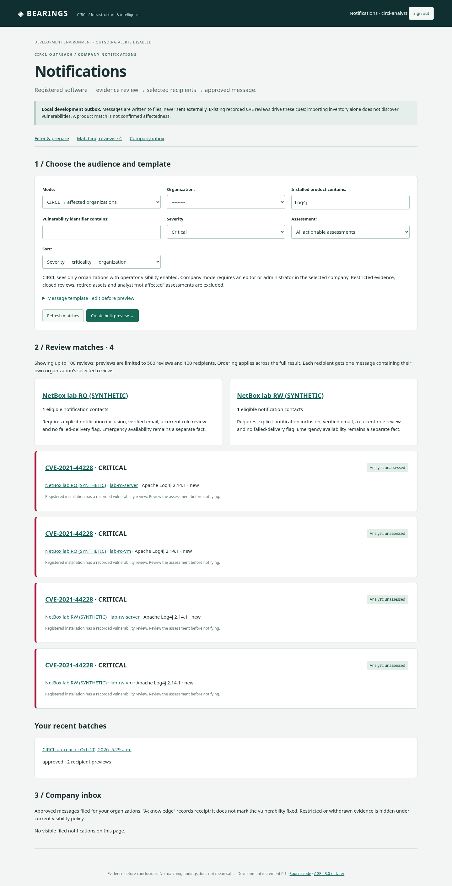
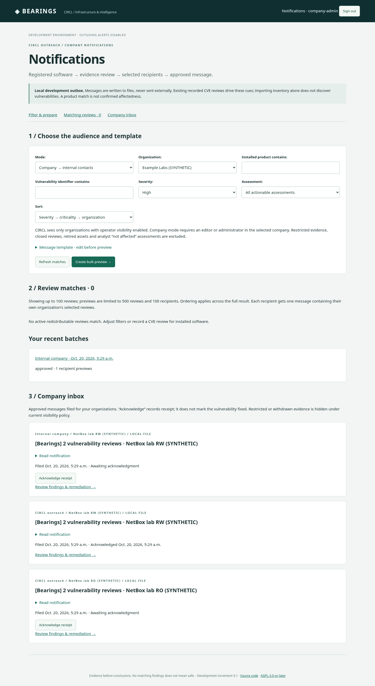

# Reviewed notifications: CIRCL and company workflow

This increment implements filtered bulk previews, a constrained message template engine, explicit approval, a **default local file outbox**, an explicitly configured SMTP option, a company inbox and acknowledgment. The development stack never sends SMTP outreach. Open **Notifications** under **Act** in the workspace navigation, or choose **Respond** in the workflow bar. Choose the audience first, then filter evidence and create a bulk preview. Optional draft subscriptions are under **Automatically prepare future drafts**.

## Run the synthetic exercise

```sh
git pull
python3 scripts/dev.py up
python3 scripts/dev.py manage sync_netbox --all
python3 scripts/dev.py manage seed_notification_example --bundled
```

Startup fills empty facts on the four original bundled devices/VMs: documentation IPv4/IPv6, `.example.invalid` DNS and Debian platform; physical servers additionally have synthetic room/rack/U10/serial/asset tag. Existing primary IPs, platform, placement and operator edits are retained. Both tenants have populated inventory; Bearings still uses a genuinely read-only token for the RO tenant. No API write capabilities are raised. Importing these facts uses the regular GET-only inventory importer.

The explicit notification exercise adds **synthetic minimal Log4j CVE-2021-44228 records (Critical)** for registered lab installations and separate synthetic notification contacts. Its source is `fixture://notification-example/SYNTHETIC`; it is not a live Vulnerability-Lookup response. Contacts explicitly simulate email reachability and a current role review; no real verification or emergency availability is asserted. Repeating the command preserves existing contact inclusion, evidence redistribution policy and analyst decisions. No notification is created until you request a preview. The command refuses external inventory when `--bundled` is supplied.

For the existing live-evidence Exchange exercise, keep its separately documented [setup](exchange-example.md). Its CVE-2026-70571 has **High** severity, so use the High filter and product Exchange. The bundled notification exercise provides an eligible synthetic contact for that same RW organization. The Exchange placement command remains `python3 scripts/dev.py example-exchange --inventory-only` for an already confirmed case.

Native fallback: `DJANGO_DEBUG=1 uv run python manage.py seed_notification_example` prepares only the separate Example Labs development workspace; it does not provision NetBox.

## Screenshot data missing after an update

Screenshots show a separately populated test database. `git pull` updates source files; it does not copy that database, create optional scenarios or approve messages. Docker runs the packaged application image, so run `python3 scripts/dev.py up` after pulling; restarting an old image alone does not install new application code.

The commands above rebuild/start the bundled application, immediately import current NetBox facts and explicitly add the notification exercise. Without the explicit import, an existing projection can retain old fields until the next scheduled refresh (15 minutes by default). Check the organization's inventory import health if the command reports a failed source; failures retain last-known data.

To see the four seeded Log4j reviews, sign in as `circl-analyst`, choose CIRCL audience, all organizations, **Critical** severity and product **Log4j**, then refresh matches. As `company-admin`, choose Company audience and **NetBox lab RW** or **NetBox lab RO**; the default separate Example Labs workspace is not one of these bundled organizations. High severity does not include Critical. Existing restrictions, closed findings and membership/visibility decisions remain respected; the seed does not reset them.

The company inbox screenshot also includes messages that were manually previewed, approved and partly acknowledged. Seeding creates no messages. Follow the approval steps below to populate your inbox; an empty inbox immediately after seeding is expected.

The Exchange screenshot is a separate opt-in scenario. For an already confirmed bundled Exchange case, run `python3 scripts/dev.py example-exchange --inventory-only` to populate IP/DNS/placement and import it. If the case does not exist yet, run `python3 scripts/dev.py example-exchange` instead; that command retrieves live CVE/MOSP evidence and reports any public-service connectivity failure. Neither command targets external NetBox instances.

Native `uv run ... runserver` uses its own database and development inventory adapter. Starting or seeding Docker does not populate that native instance. Use the matching native instructions above, or access the bundled application you started; do not run both against the same local port.

## CIRCL → organizations

1. Sign in as `circl-analyst`, open **Notifications** and choose **Start a campaign across all constituents**. Select CIRCL mode and **All matching constituents**, or **Selected constituents** to select several companies. The single-organization field applies only to **One organization**. Filter once by product, CVE, severity, assessment or lifecycle/exposure issue.
2. **Refresh matches**. The complete audience table counts all matching organizations and eligible contacts, even beyond the first 100 displayed reviews. Inspect asset/evidence links. Technical severity and unassessed applicability do not establish business risk or affectedness.
3. Resolve missing-contact blockers, or explicitly choose **Prepare ready constituents and document blocked constituents**. The latter excludes only constituents without eligible contacts, retains their names/counts/reasons in the reviewed campaign report, and requires at least one ready recipient. There are no silent exclusions.
4. Edit the templates once and choose **Preview campaign for all ready recipients**. One campaign groups messages by organization. Each contact receives only its organization's matching evidence, with a private recipient address; no cross-company To/CC list. Expand message bodies to inspect them. The audience report is pinned at preview time, not a live contact-status monitor. Historical reports are hidden if constituent visibility or the pinned evidence's redistribution permission is revoked.
5. **Approve entire campaign** approves all pending, not previously attempted messages in one action. Alternatively uncheck recipients and use **Approve checked messages**. Approval revalidates every selected message atomically; one stale recipient/evidence/policy blocks the approval before any attempt is claimed.
6. The worker dispatches approved messages in the background. **Refresh campaign status** shows `queued`, local `filed`, SMTP relay `accepted`, duplicate, excluded or uncertain outcomes. An HTTP approval is not delivery confirmation. Each company's inbox contains only its permitted messages.

No separate campaign per company is needed. SMTP attempts are bounded and processed individually; “bulk” means one reviewed action across constituents, not a shared email or a promise of simultaneous network delivery.

### Three-constituent synthetic exercise

With the default tracked showcase active:

```sh
python3 scripts/dev.py manage seed_circl_campaign_example
```

Open CIRCL campaigns, select **All matching constituents**, product **SYNTHETIC CIRCL Campaign Example**, source severity **High**, and refresh. Three fictional organizations have synthetic reviews; two receive new simulated eligible `.invalid` contacts, while the third illustrates the missing-contact workflow. Existing contact/policy changes are preserved, so readiness may differ on reruns. Choose the explicit blocked-constituent exclusion policy to prepare the ready companies together. This command makes no network calls or deliveries, requires DEBUG and an existing platform admin, tracks newly created records for [synthetic cleanup](../operations/synthetic-data.md), and never restores a removed dataset. Approving messages creates attempt receipts, which deliberately require separate retention review before synthetic cleanup.

CIRCL outreach requires explicit organization operator visibility, even for a platform-created CIRCL campaign. Evidence marked non-shareable is excluded from recipients, counts, previews, historical inbox messages and approval; permission to investigate restricted evidence does not grant redistribution permission. The batch preview belongs to its creator; the ten most recent currently visible batches are linked from Notifications. A reader cannot create internal campaigns or approve another user's batch.

## Company → internal contacts

1. Sign in as `company-admin`, choose Company audience and the company workspace. Select the same product/CVE/severity filters.
2. Review the findings, create a preview, select the internal contacts and approve to the local outbox. Only that company's installations and contacts can enter the message.
3. Open **Company inbox**, read the message and **Acknowledge receipt**. Editors/admins can acknowledge; readers can read permitted messages. The first actor/time is preserved on repeat requests. Acknowledgment does not change the finding's assessment or mark remediation complete. Follow the scoped review link to assess and remediate separately.

Eligibility requires a contact's explicit **notification inclusion**, verified email reachability, a substantive role review with a future next-review date, and no failed-delivery flag. Configure/review contacts in the organization workspace. Emergency availability is independent. By default a matching organization without eligible contacts blocks the complete preview. CIRCL may explicitly document these blocked constituents and preview the ready audience together; company-mode previews still require ready contacts. Organizations are never silently dropped. Saved filter subscriptions prepare changed drafts; service/team-specific routing and timed escalation remain future work; inclusion currently covers the organization's selected reviews.

## Template engine and state

Supported variables, each in double braces: `organization`, `contact_name`, `contact_role`, `language`, `finding_count`, `findings`, `audience`, `action`, `item_count`, `items`. Example: `{{ finding_count }} reviews for {{ organization }}`. `findings` includes CVE, source severity, installed edition/version/build, asset, IP/DNS, room/rack/U, team, assessment, workflow, explanation and scoped evidence/NetBox links. Bearings links are relative application paths until an operator-controlled public origin is added. Language is metadata, not automatic translation.

Only flat text variables are allowed: no template tags, filesystem loaders, includes, filters, attribute traversal, model objects or request context. Messages are plain text; web previews escape content. Subject header injection and overlong rendered subjects are rejected.

Explicit CIRCL campaigns default to 10,000 reviews and 2,000 recipients; company and legacy previews retain limits of 500 reviews and 100 contacts. Operators can configure `BEARINGS_CIRCL_CAMPAIGN_MAX_REVIEWS` (1–50,000) and `BEARINGS_CIRCL_CAMPAIGN_MAX_RECIPIENTS` (1–10,000). Exceeding a limit rejects the whole preview; it never silently truncates recipients or evidence. The match view displays the first 100 reviews; audience readiness covers the complete scoped result. A changed source payload, rendered asset/software/assessment or recipient invalidates approval. Closed reviews, retired assets and explicit “not affected” assessments are excluded. Missing/stale inventory is last-known information, not proof of present exposure. Contact readiness and current policy are checked again immediately before transport I/O.

Each selected message claims a unique receipt before transport I/O. Unchanged fingerprints are suppressed across batches for the same audience/contact/content. Approved background messages start as `queued`; a worker commits `filing` before I/O. A crash between claim and confirmation leaves `filing`; a caught file/policy failure becomes `uncertain`. Neither is automatically retried, because a partial file may exist. An operator must investigate the retained receipt/file and audit trail. This is duplicate-attempt prevention, not a distributed exactly-once delivery guarantee. Changed legitimate content can generate a new message; grouping additional reviews can also change its fingerprint. Drafts and excluded recipients remain retained. Production retention/erasure governance is not implemented.

Files use Django's explicit file backend and configured `EMAIL_FILE_PATH` (`.local/mail`), including in Docker's retained local-data volume. Changing `EMAIL_BACKEND` cannot enable SMTP for this workflow; use the separate reviewed transport configuration below. Automatic retries, confirmed end-user delivery, bounce handling, reminders and timed escalation are not implemented.

## Next phase

The current cue is derived from **already recorded CVE reviews on registered installations**, such as the Exchange live lookup or explicit fixture. Inventory import alone does not discover CVEs or generate applicability. Continuous Vulnerability-Lookup ingestion, canonical product/version correlation, event-driven discovery and canonical product matching remain separate work. Saved subscriptions already prepare drafts for recorded review changes. A product-only match must create a potential/unknown review with evidence, never automatically assert affectedness. Production transport additionally needs reviewed operational authorization, verified destinations, monitored retry/bounce/escalation policy and an approved public application origin. Issues #5/#6/#10/#11 retain these parts.

### Discovery/event flow still planned

1. A scheduled Vulnerability-Lookup importer records a new/changed CVE revision. Match canonical product identifiers (vendor/product, CPE or package identity) against registered installations, then evaluate only supported structured version rules. Unknown builds, backports or configuration requirements retain potential/unknown applicability.
2. Create/update a deduplicated finding with source revision, match reason and uncertainty. CIRCL sees a new actionable cue such as “High · Exchange · 2 permitted organizations · 3 installations · notification review required.” The organization's own review queue receives the same scoped finding. Operator-only evidence stays out of redistribution.
3. Apply saved audience subscriptions (organization, product, severity and assessment), then offer the bulk template preview. Confirmed affectedness may select a different message from a potential-match investigation request. The existing approval/outbox/inbox/acknowledgment flow handles the reviewed result.
4. Track which finding revision/recipient/audience was handled so unchanged refreshes do not raise repeated alerts. Meaningful evidence changes can reopen review. Outages retain last-known evidence and expose freshness instead of silently clearing findings. Production delivery, bounce recovery and timed escalation require their own transport/recovery increment.

These are acceptance goals for #5/#6/#10/#11, not currently running background discovery or automatic mail delivery.

## Screenshots

Only synthetic data is shown.





## Lifecycle/exposure outreach and draft subscriptions

Select **Asset issues** as the review domain to filter lifecycle/exposure issues by kind, company and product. These messages use organizational priority and recorded deadlines; CVSS/applicability filters belong to vulnerability reviews. Only active assets, active reviews and explicitly redistributable, non-operator-only evidence are eligible. `items` / `item_count` support both domains. Scope or Plum claim/source revocation suppresses derived data and invalidates approval. Dates, owner, possible consequences, next action and asset location are included; changing them requires a new preview.

Name a subscription and choose **Subscribe · prepare changed drafts only**. It saves filters/templates and prepares a draft when matching evidence, recipients, timing or transport changes. Unchanged content reuses the draft; an older unapproved draft is superseded. An active creator with current scope and eligible contacts remains required. No matching reviews, invalid policy or unavailable recipients produce no automatic message. Each prepared draft still needs creator review/approval. Use `prepare_notifications --due`; the bundled worker includes it. Polling covers already recorded evidence, not automatic CVE discovery. Subscriptions can be paused in Notifications.

## Explicit SMTP configuration

SMTP is an opt-in deployment feature, tested with mocked transport; no operational messages were sent. Keep `BEARINGS_NOTIFICATION_TRANSPORT=file` for development. For an approved non-development deployment set `DJANGO_DEBUG=0`, `BEARINGS_NOTIFICATION_TRANSPORT=smtp`, `SMTP_HOST`, `SMTP_PORT`, optional private `SMTP_USER`/`SMTP_PASSWORD`, and an actual operator-controlled `DJANGO_DEFAULT_FROM_EMAIL`. Select exactly one verified TLS mode: `SMTP_STARTTLS=1, SMTP_TLS=0` (usually port 587), or `SMTP_STARTTLS=0, SMTP_TLS=1` (usually 465). Unencrypted SMTP, a development stack, missing host and a placeholder sender are refused. Runtime credentials stay outside Git.

Previews pin transport, relay/TLS/user/sender configuration and rendered content; changing configuration requires a fresh preview. SMTP fingerprints differ from local-file fingerprints, so testing a message locally does not suppress the separately approved SMTP attempt. Password rotation does not expose/persist the password. A 10-second SMTP timeout applies. An `accepted` result means **the relay accepted the message**, not that the stakeholder received it. Partial/uncertain outcomes retain their receipts and are not automatically retried. Inbox acknowledgment is separate from SMTP acceptance and remediation. Configure monitored relay/bounce handling, retention and escalation procedures before operational deployment; these are not supplied by the bounded transport adapter.


## Background dispatch operations

The bundled worker runs `process_notifications --limit 5` each loop, alongside draft preparation and existing connector work. Independently operated deployments must schedule `uv run python manage.py process_notifications --limit 25` repeatedly (allowed 1–100 per invocation). This command dispatches only already-approved queued messages; it never approves subscription drafts or retries `filing`/`uncertain` attempts. PostgreSQL workers use row locks with `skip_locked`; SQLite supports a single local worker. Five SMTP attempts can each take up to the configured 10-second timeout; monitor queue age and worker health for operational volume. A stopped worker leaves messages queued. Policy, consent, active creator, content and transport are checked again immediately before each attempt. One blocked dispatch is recorded as uncertain while other eligible queued messages can proceed.
