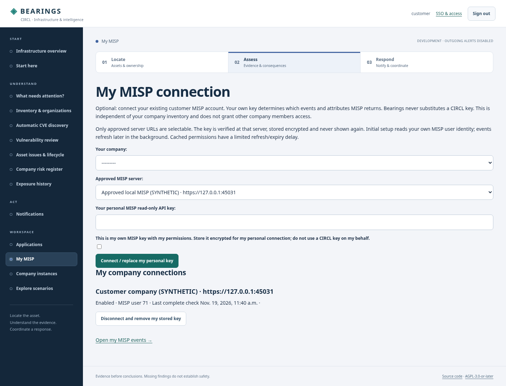
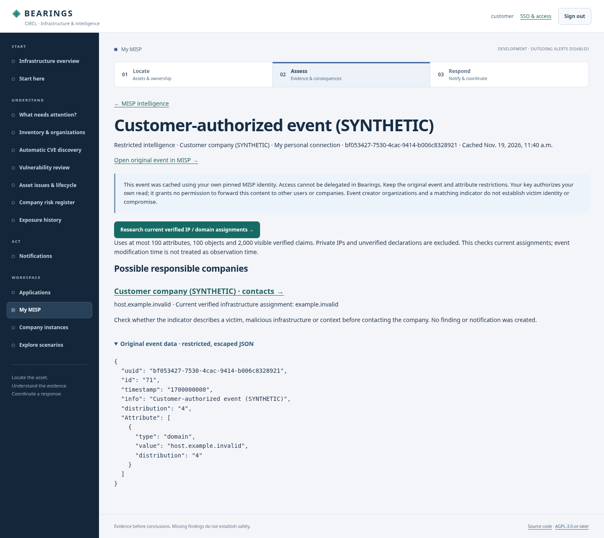

# My personal MISP connection

If you already have a customer account in MISP, you can optionally connect it to Bearings. Use your own read-only API key. A CIRCL analyst's universal key cannot represent your permissions. You do not need a MISP account to use the rest of Bearings.

1. Open **My MISP → My personal MISP connection** (also linked from company configuration).
2. Check your company and the displayed approved MISP server URL. If no server is available, the platform administrator must approve one first.
3. Enter your personal API key and confirm that it belongs to you. Bearings checks your native MISP identity and stores the key encrypted; it will not display it again.
4. Return to **My MISP** after the first complete background refresh. Only events/attributes returned under your key appear. The same-company administrator, colleagues and CIRCL cannot open your personal cache through their Bearings privileges.

From an event, **Research current verified IP / domain assignments** searches only the company selected for this connection. It does not send inventory to MISP, confirm an incident or notify anyone. With several company memberships, each connection/cache retains its own company context. MISP company UUIDs are correlation references, not permission grants.

Use **Connect / replace my personal key** to rotate a key for the same MISP user. To switch native accounts, disconnect first, then connect the new key. Old cached data is retained but unavailable and is not reassigned to the new identity. Disconnect removes the active stored key and hides events; revoke the native key in MISP separately if needed.

Permission changes in MISP become effective in the cache on refresh/expiry: by default five-minute refresh and ten-minute maximum age. Failed/stale caches are unavailable, and an empty list does not prove that no threats exist. There is never a fallback to a CIRCL key. The read pilot is bounded to 500 events/20 MB; larger datasets need a separate operating/scalability plan. Upstream permission/version acceptance still needs the actual service and customer account.
