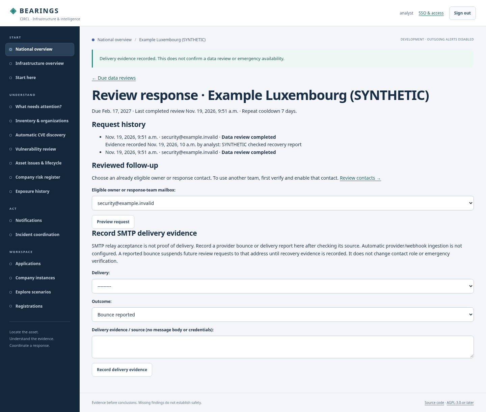

# Follow up unanswered company data reviews

**National overview → Data reviews awaiting response** lists due reviews for the platform administrator and CIRCL for currently shared companies. It shows the current cycle and latest queued/sent/error state, including when no request has been queued. This is a follow-through surface for the existing periodic confirmation workflow, not an incident-alert escalation engine.

Open the company to inspect recent requests and their separate delivery/response states:

- **Queued:** the existing durable worker has not accepted a send yet.
- **Written to local mail files:** the default local sink accepted the message; no external delivery is claimed.
- **Accepted by SMTP relay:** the configured relay accepted a message. Delivery and owner response remain unknown.
- **Send failed / retry scheduled or exhausted:** attempts are retained; there are at most three existing automatic retries.
- **Bounce / delivery reported:** an authorized operator recorded checked provider evidence. This is distinct from relay acceptance, contact role review and emergency availability.
- **Data review completed:** an authenticated administrator confirmed the actual data snapshot for this due cycle after the request. Opening mail/link scanning alone cannot establish this.

Older messages with no known transport remain explicitly legacy/unknown. No SMTP mode or successful historical delivery is backfilled. New confirmations record the reviewed due cycle; older confirmations are not retrospectively attributed to a recipient/message.

## A reviewed repeat or alternate team

Select an eligible mailbox, preview the generic data-review request and explicitly approve it. The message contains a portal link, not inventory, vulnerability or MISP data. A signed 15-minute preview binds actor, policy revision, due date and recipient; confirmation rechecks current sharing, schedule and recipient eligibility. A completed review, revoked contact/sharing permission or changed schedule blocks a stale request. The existing durable delivery worker rechecks policy again before sending.

Choose only the mailbox-confirmed registered owner or opted-in reachable response contacts. Add/verify another team through the contact editor first; do not type an arbitrary recipient here. DPO-only contacts are excluded automatically. A request already created for that mailbox in the configured reminder cooldown blocks another manual repeat; automatic/manual requests use the same cycle/day/mailbox deduplication key. This does not automatically escalate unanswered messages or change mandatory reminder commitments.

## Delivery evidence and bounced addresses

An authorized operator can record a checked provider bounce or delivery report for a tracked **SMTP-accepted** message, with a short source justification. Local-file or unsent messages cannot be reported as successful external delivery. Feedback, actor/time and changes are audited. The latest recorded feedback per company/mailbox controls bounce suppression; later checked recovery evidence can release it. Existing pending sends re-evaluate recipient eligibility too.

No general inbound mailbox, provider webhook, automatic DSN parser or trusted SMTP bounce source is enabled in this increment. Operational delivery/bounce integration needs the actual provider contract and acceptance. Manual evidence is labeled as reported, not independently verified by Bearings. Recording it does not mark a contact role/phone as verified or create an owner data confirmation. An authenticated owner still uses the existing data-review page.

