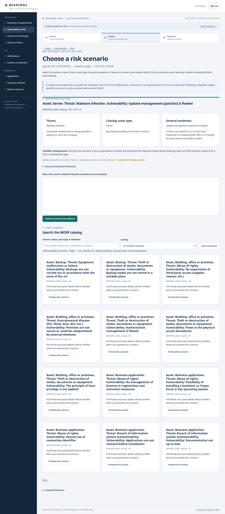

# Choose a MOSP / MONARC risk scenario

Open an asset's vulnerability review and choose **Link a MONARC scenario**. The integrated picker replaces manual UUID entry: **Search → Preview → Explain relevance → Confirm**. The existing catalog browser also opens this preview when you select a scenario. Existing links remain unchanged.

Search by scenario description, threat, catalog asset type or general weakness; optionally filter by enabled catalog. Twelve results appear per page. Search runs against the local cache and sends no asset names, CVEs, search text or justification to MOSP. Results are catalog matches, not recommendations or confirmed risk assessments. Empty results offer broader-search guidance; a platform operator can populate the cache with `sync_mosp --all`. Disabled catalogs and missing scenarios cannot be selected.

Choose **Preview this scenario** to see its name, threat, catalog asset type, general weakness, source/language/licensing and captured revision time. If complete details have not been cached, this explicit preview verifies the public scenario identifiers with MOSP; opening/searching the list does not fetch each result. An outage preserves the cache and offers a retry without creating a mapping. No placeholder scenario or business-impact claim is invented. Interpret possible consequences for the actual organization, deployment and asset; catalog asset types may differ from inventory asset types.

Describe relevance, assumptions, possible impact and uncertainty, then choose **Confirm scenario & pin evidence**. The server verifies the source and requires the same immutable catalog revision as the preview. If MOSP returns changed content, no mapping is created: the new preview appears with the justification retained and requires another explicit confirmation. Source/UUID/reviewed revision are handled internally; an expandable technical reference retains provenance and the public source link.

The resulting mapping pins catalog and vulnerability evidence, actor and justification. It does not confirm CVE applicability, compromise, business-risk score or remediation, and it sends no stakeholder notification. Existing organization permissions and evidence visibility still apply. Lifecycle/exposure issues retain their existing named-scenario selector; this integrated picker covers the CVE review workflow. Automatic relevance ranking, impact scoring and shared mapping rules remain future work.

