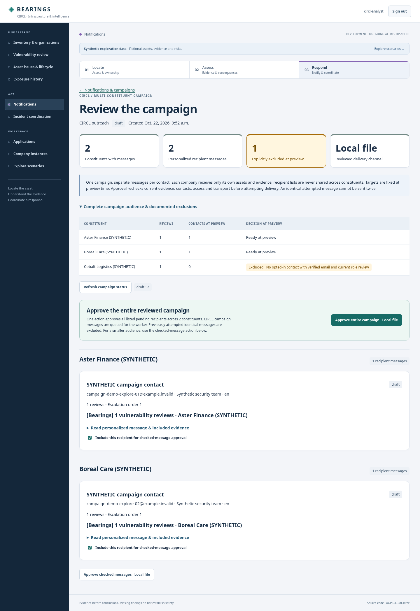

# Initial implementation validation

Date: 2026-10-16. All application data used here is synthetic. No production notifications, active scans, NetBox writes or public deployment occurred.

| Check | Actual outcome |
| --- | --- |
| `uv sync --frozen` | Passed, repeated without dependency/lockfile changes |
| Django migrations | Applied on SQLite and PostgreSQL 17; repeat application was a no-op |
| Django tests | **44 executed, 44 passed on SQLite; 44 executed, 44 passed on PostgreSQL**; no skips or expected failures |
| System check and migration drift | Passed; no pending model changes |
| Ruff lint and format | Passed |
| Static collection | Passed, 128 files collected |
| Real host HTTP workflow | Login, organization/CIRCL dashboards, inventory/software APIs, live CVE lookup and authorized evidence read passed with temporary synthetic accounts; accounts deleted afterward |
| Live Vulnerability-Lookup | Retrieved CVE-2021-44228 (PUBLISHED), persisted its real source record and finding; repeated retrieval reused the finding; applicability remained unknown |
| Docker | Built non-root development image with frozen dependencies and verified TLS using temporary cloud CA mount; repeat helper build passed. Container + PostgreSQL real HTTP login, organization page and software inventory API passed |
| Compose | Configuration syntax validated; image/runtime/database separately exercised. Full Compose lifecycle was not used in this session |
| PostgreSQL recovery | Custom-format dump restored into an isolated database; organization, operator policy, source/asset, installation and finding relationships verified, then isolated restore database removed |
| GitHub access | Native Git read and API metadata succeeded. `git push --dry-run origin HEAD:refs/heads/main` passed, confirming the push path without publishing a branch |
| Repository visibility and license | Owner confirmed public open-source publication and selected AGPL-3.0-or-later; no visibility change is needed |
| GitHub Actions | [Run 38872455361](https://github.com/rommelfs/bearings/actions/runs/38872455361) passed: 44 tests on SQLite and 44 on PostgreSQL, plus lint, formatting, migration drift, checks and static collection |

Tests cover cross-organization reads/writes and foreign-key injection; per-organization membership roles; operator default-deny/revocation and audit; policy ownership; restricted raw and derived finding visibility/counts; CSRF and HTML escaping; IPv4/IPv6/ranges/domains and DNS boundaries; historical/shared/private claims; separate contact review concepts, hashed/expiring/one-use tokens, update invalidation and reminder deduplication; pending/failed/confirmed inventory writes, backoff and recovery; partial NetBox responses and wrong tenant identities; product selection isolation; unknown versions; finding deduplication, analyst override/history; proxy destination restrictions; repeatable synthetic seeding; and the inventory-to-both-views slice.

Toolchain: host Python 3.12.14, Django 5.2.18, uv 0.12.23; image Python 3.12.15. Dependencies and hashes are in `uv.lock`. Cloud-specific DNS/proxy and Docker build namespace issues were diagnosed and corrected without disabling verification. Source fixtures validate contracts, not live compatibility.

Connections: Vulnerability-Lookup real public read tested; central NetBox adapter fixture-tested but no live instance/key supplied; development inventory adapter explicitly synthetic; MISP official OpenAPI researched but adapter pending; Plum Island official InfoIP semantics researched but adapter pending. Generalized applicability, continuous import, production scheduling/delivery/security controls and complete connector policy remain backlog work.

The environment install/start configuration was saved as a draft, including cloud proxy-DNS settings and required GitHub/Vulnerability-Lookup domains. Draft persistence is not publication or proof of fresh-task restoration. Public source publication and AGPL-3.0-or-later are owner-approved. A verified security reporting channel remains outstanding.

The implementation and AGPL-3.0-or-later license are published on public `main`. Four milestones and 15 issues were created; issue #1 is completed. Repeating backlog publication created zero duplicate issues. Source/license links are present in the application. Repository description editing remains unavailable through the integration (HTTP 403); an owner can set the description in GitHub settings. No deployment or operational-data publication occurred.

## Multi-instance NetBox increment

The instance/capability migrations applied successfully to existing SQLite and PostgreSQL databases; drift checks pass. The expanded suite executed **64 tests on SQLite and 64 on PostgreSQL, all passed**, including 20 new multi-instance query/capability tests. Ruff lint/format checks and Django checks pass. The actual CLI runs against the current unconfigured environment and reports zero live sources; this is not a live connection validation.

Contract fixtures cover two distinct instance keys and URLs, identical external IDs across instances, complete offset pagination, malicious/changed continuation scope, missing/duplicate/wrong-tenant pages, failure isolation across multiple bindings, independent read health with retained data, read-only portal/service denial, blocked queued writes after downgrade, cached capability revocation, instance-specific write defaults/authentication, dedicated whole-instance access, missing/invalid credential references, operator-only configuration/audit and legacy fail-closed upgrade behavior. No NetBox instance was contacted and no automatic projection import is claimed.

## Bundled NetBox development environment

The local lab uses official NetBox `v4.7.3-5.1.1`, PostgreSQL 17, Valkey 9.1 and a verified HTTPS gateway. Fresh initialization, repeated provisioning, retained credentials/data, read-only and read-write tenant queries, upstream read-only POST denial, both application logins, real device/VM writes through the durable worker, and recovery after a lost acknowledgement were exercised against the real bundled API. The expanded suite passed all 75 tests on SQLite and all 75 on PostgreSQL. Ruff lint/format, migration drift and whitespace checks passed. The final live smoke/query checks passed again after the retained-data app restart; HTTPS-only cookies and the disabled outbound SMTP destination were confirmed in actual NetBox settings. General inventory import remains unimplemented; only explicitly identified synthetic starter assets are projected locally.

External mode was exercised against a separately running copy of the pinned reference NetBox, with a supplied CA, private token and read-only tenant scope. It started only Bearings and its database/worker, remained usable while the reference was unavailable, then queried devices, virtual machines, IP addresses and prefixes successfully after connectivity was restored. Switching back retained the bundled data. This validates the external wiring, not compatibility with every independently deployed NetBox release. AMD64 was run; ARM64 image manifests were checked but ARM64 execution was not tested.

A final full restart in this cloud hit the shared host's inode limit: Docker uses the `vfs` storage driver and copies the large NetBox image per container. Unused build cache and unstarted lab containers were removed without deleting volumes. Final local checks used the retained running NetBox and sequential app startup, omitting the separate NetBox background worker/provision container. The committed integration workflow exercises the complete default stack, smoke checks, shutdown, retained-volume restart and queries on a standard GitHub Docker runner. This environment is for development; no production notifications, scans, external-server provisioning or operational data publication occurred.

The smoke target guard additionally checks the current database endpoint, token reference, authentication, capability, tenant and organization before any HTTP access; a regression test verifies refusal after an operator changes the stored endpoint. The guarded real smoke workflow passed again.

Public CI confirmed the complete default stack on the guarded implementation: [Development stack run 38883987302](https://github.com/rommelfs/bearings/actions/runs/38883987302) passed fresh startup, the real HTTPS/query/login/write/recovery smoke, shutdown without data deletion, retained-volume restart and queries. [Checks run 38883987223](https://github.com/rommelfs/bearings/actions/runs/38883987223) passed 75 tests on each database plus lint, formatting, system checks, migration drift and static collection. Issue #17 is complete; general import and broader deployed-version validation remain separate backlog work.

## Docker prerequisite diagnostics

Following a macOS report with no `docker` executable on PATH, the helper now fails before changing local lab state, identifies missing Docker/Compose or an unreachable engine, and preserves offline external configuration. Regression checks cover missing CLI without state creation, missing Compose, engine errors and engine timeout. The expanded SQLite suite passed all 77 tests; Ruff passed. macOS Desktop installation remains a user-side prerequisite and was not performed in the Linux cloud.

## General NetBox import and reconciliation

The bounded four-type importer now projects devices, VMs, IP addresses and prefixes for central and external sources, using GETs only. It validates the complete traversal before committing, preserves local assessments/software/findings, tracks separate import health/freshness, queues member-requested refreshes and runs periodically in the development worker. Missing identities remain retained with reasoned review/reappearance handling; no importer deletion is implemented.

Local validation: **95 tests passed on PostgreSQL**, including two real concurrent-transaction tests that observe the second transaction waiting on the source lock. SQLite executed the same 95-test suite with **93 passed and the two PostgreSQL-only lock tests explicitly skipped**. Migrations applied to existing SQLite and PostgreSQL databases; system checks, Ruff lint/format, frozen dependency sync and migration drift passed. No test-created database sessions remain after the concurrency checks.

The rebuilt complete local stack passed the extended live smoke against official NetBox v4.7.3 / netbox-docker 5.1.1: one synthetic device created directly in NetBox without a seed identity was imported, renamed upstream and refreshed while local criticality/team survived, then deleted only as that invocation's owned upstream probe. Bearings retained its missing projection. The real read-only import, four scoped query types, HTTPS/admin and portal logins, upstream/portal read-only denial, portal device/VM worker writes and lost-ack recovery passed too. Source data and credentials were retained across the image/migration upgrade. These tests used only the synthetic bundled lab, not operational inventory or production delivery.

Contract coverage adds repeated/multi-instance identity, complete pagination, last-endpoint failure rollback, malformed/wrong-tenant data, lost-ack adoption and conflicting marker rollback, foreign-marker isolation, pause/manual queue/interval/failure throttling, continued processing after another source fails, membership/CSRF restrictions, escaped allowlisted metadata, bounded UI/API pages and preservation of import health during stale operator form saves. Strong upstream snapshot consistency, interfaces/service topology/OS inference, broader NetBox versions and monitored production scheduling are not claimed.

A separate real HTTP workflow verified company-admin login, the read-only workspace's CSRF-protected Refresh inventory request, consumption by the running periodic worker, and the fresh paginated inventory API containing all four kinds and constructed source links. Repeating the real `sync_netbox --all` command imported two sources without new identities or deletion; the smoke probe remained a retained missing record.

The first import revision passed complete public CI: [Checks 38901475599](https://github.com/rommelfs/bearings/actions/runs/38901475599) and [Development stack 38901475661](https://github.com/rommelfs/bearings/actions/runs/38901475661), including fresh full-stack startup, extended real import/write smoke and retained-volume restart. A final browser-link correction adds an optional operator-owned HTTPS browser base distinct from the API destination, with a localhost/gateway-port default for the bundled lab. Credentials still target only the API base; the regression test also rejects credential-bearing browser URLs. The expanded suite passed 96 tests on PostgreSQL; SQLite passed 94 with the two PostgreSQL-only concurrency tests explicitly skipped.

The separate browser-address revision also passed the rebuilt complete local stack and extended real smoke. A host request to the constructed localhost HTTPS device URL verified the generated CA and returned the expected unauthenticated login redirect (302).

Final browser-address implementation 2f798f1 passed [Checks 38902455756](https://github.com/rommelfs/bearings/actions/runs/38902455756) (96/96 PostgreSQL; 94 passed + two explicit PostgreSQL-only skips on SQLite) and [Development stack 38902455791](https://github.com/rommelfs/bearings/actions/runs/38902455791) (fresh full startup, extended import/write/browser-link smoke, stop retaining data, restart and queries). Issues #3 and #14 are completed.

## MOSP / Vulnerability-Lookup / NetBox visibility

The suite now executes **114 tests on PostgreSQL, all passed**; SQLite passes **112 with two explicit PostgreSQL concurrency skips**. Eighteen new contract/authorization/evidence tests cover MOSP string-valued paging metadata, approved schemas/publisher/language/CC0 rights, incomplete pages and retained catalog state, source immutability, versioned CVE and complete scenario evidence, definition-only re-resolution, justified idempotent links and withdrawal, authorization before HTTP, visibility revocation for raw/derived endpoints, CSRF, foreign IDs, escaped content and joined API/catalog paging. CVE refresh preserves existing operator redistribution restrictions. Frozen dependency sync, system checks, migration drift, Ruff lint/format, static collection and whitespace checks pass.

The public MOSP service returned a complete 1,938-template MONARC CC0 catalog both natively and inside the rebuilt Docker lab using approved proxy DNS and verified public/local CA chains. The schema adapter verified all root identities and references; no remote schema URLs were followed. Some requests returned transient HTTP 503; failed attempts retained last-success data and mappings. Public API availability is independent of startup and deterministic fixture tests. Referenced definition-only changes are detected on bundle re-resolution; periodic catalog refresh currently traverses risk roots only.

The rebuilt complete bundled stack started with retained data/credentials and applied the new migrations. Its real smoke passed: general NetBox creation/import/update, local assessment preservation, retained missing projection, read-only import, four scoped query types, HTTPS and both logins, upstream/portal read-only denial, worker device/VM writes and lost-ack recovery. All data in this exercise is synthetic. No external NetBox provisioning, scans, production delivery or operational inventory publication occurred.

A complete live chain passed on the retained synthetic read-only NetBox workspace: an actual confirmed device with the explicitly recorded Log4j 2.14.1 installation → CVE-2021-44228 retrieved from Vulnerability-Lookup → verified MOSP risk UUID `7f9fc1a8-4f02-11e9-b3ea-0800277f0571` (Server / Malware infection / Update management is flawed). The saved justification explicitly describes a lab hypothesis and does not assert an organizational weakness or affectedness. Authenticated real HTTP reads verified the joined HTML view, paginated chain API and pinned CVE plus four-object catalog evidence. A transient MOSP 503 interrupted the first mapping attempt; retry succeeded without losing the complete catalog. The public-runtime validation temporarily supplied the approved proxy and public CA to that process only; it did not embed proxy settings in the image or configure ordinary Docker runtime egress automatically.

Updated cloud startup instructions were saved as an environment configuration draft. They preserve the existing install script, repository membership, network policy and runtime bindings. The draft requires review/save and publication in environment settings to activate; saved instructions do not prove fresh-task restoration.

The final app image retained the live scenario link after restart; a real authenticated HTTP read verified both snapshot timestamps, the original author, public source identity and unchanged review flags. Public implementation `ceabb90` passed [Checks 38910631336](https://github.com/rommelfs/bearings/actions/runs/38910631336) on SQLite/PostgreSQL and [Development stack 38910631286](https://github.com/rommelfs/bearings/actions/runs/38910631286): fresh complete startup, real NetBox smoke, shutdown without deleting data, retained-volume restart and scoped queries. Public issue #18 is complete; #5 remains open for aliases, broader source schemas, service version and freshness work.

## Exchange exercise and analyst review queue (2026-10-19)

Verified public CVE-2026-70571 in Vulnerability-Lookup and the CVE Program: published Microsoft Exchange RCE, source CVSS 3.1 8.1/High, including CU15 affected builds below 15.02.1748.055. The opt-in exercise assumes CU15 build 15.2.1748.54, explicitly records a manual affected assessment/history, retains automated unknown applicability and links a public CC0 MOSP scenario without asserting exploitation or scored business risk.

The expanded suite passes **124 tests on PostgreSQL**; SQLite passes **122 with the two PostgreSQL-only concurrency skips**. Ten new tests cover bounded/invalid source severity, synthetic identity/build/manual assessment, preservation of remediation/workflow/withdrawals/operator restrictions, development/external guards before HTTP, changed upstream edition/range, analyst visibility and scoped deep links, closed/accepted queue behavior, HTML escaping, pagination and explicit criticality ordering. Lint, format, system checks and migration drift pass; no new migration or dependency is needed.

The fresh cloud checkout had owner-only permissions on public bind-mounted NetBox Python config. Granting read/traverse permissions only to those public source paths restored non-root NetBox startup; private configuration and secret volumes were not broadened. The complete lab started with verified TLS and unchanged capability boundaries. The actual Exchange example was entered in synthetic writable tenant/workspace `netbox-lab-rw`, with a confirmed real NetBox device identity, live Vulnerability-Lookup CVE and a verified live four-object CC0 MOSP bundle. A real `circl-analyst` HTTP login verified the start-page RCE/8.1/build/affected cue, exact-finding detail view, joined API and pinned evidence. The example has one manual assessment history entry and one risk link; business risk remains unassessed. The complete existing real NetBox smoke passed after the upgrade, including read-only denial, general import/reconciliation and worker write/lost-ack recovery.

Public runtime validation securely forwarded the existing approved proxy and public CA to that process only, retained verified local/public TLS and kept internal NetBox DNS direct. This does not configure persistent Docker public egress automatically. An additional full MOSP catalog refresh failed while the pinned Exchange scenario evidence remained readable; source catalog health remains distinct from successful individual scenario resolution. No fabricated source data was substituted.

Updated cloud install/start instructions were saved as a draft, preserving other configuration. They include the narrow public-config permission correction and the opt-in Exchange workflow; activation still requires environment-settings review/save/publication.

A subsequent approved-proxy catalog refresh completed all 1,938 public CC0 templates and cleared catalog health; the intermediate failed traversal did not replace the pinned case evidence. Repeating the real bundled Exchange command reused the same confirmed NetBox identity and finding, left exactly one manual history entry and one scenario link, and passed the same real analyst HTTP/UI/API/evidence checks again. Static collection and whitespace validation pass. Public [Checks 39315216988](https://github.com/rommelfs/bearings/actions/runs/39315216988) passed SQLite/PostgreSQL for implementation `15ac294`.

Implementation `15ac294` also passed the complete public [Development stack run 39315217194](https://github.com/rommelfs/bearings/actions/runs/39315217194): fresh startup, real NetBox smoke, shutdown without deleting data, retained-volume restart and queries. Issue #19 completes this bounded example/in-app-cue increment; #11 retains broader triage/assignment/freshness work, #6 retains generalized applicability and #10 retains notification/escalation delivery. No production transport, scans, real-company inventory publication or automatic CVE discovery was enabled.

## Asset context and source-severity triage (2026-10-19)

The expanded suite passes **136 PostgreSQL tests**; SQLite passes **134 with two PostgreSQL-only concurrency skips**. Twelve new tests cover source-local primary IP/DNS/VRF joins, placement/reference projection, malformed input rollback and retained snapshots, safe generated URLs, whole-queue severity ordering/counters/search/filtering before pagination, current visibility on context/finding counts and deep links, scoped CSRF-protected local edits, frozen severity-cache backfill/policy preservation, escaped source labels, assessment return navigation and external/invalid-identity helper refusal. Migration 0009 applies to existing data without changing CVE snapshots or analyst assessments; frozen dependencies, lint/format, checks and migration drift pass.

The guarded fixture placed the already confirmed synthetic Exchange device in real bundled NetBox, then the GET-only importer populated DNS `exchange-01.mail.example.invalid`, IPv4 `192.0.2.25/24`, IPv6 `2001:db8::25/64`, synthetic Luxembourg DC / Messaging room M1 / rack EX-01 / U22 / front and platform. No service-token permissions were expanded. A real Chromium analyst login verified all machine facts in the overview, followed the scoped asset link and exact-finding evidence link, searched/filtered the case by IP, and read the same context in the asset/evidence views. Computed High/Unknown styles differ in background, ink and border; desktop and 390px-mobile screenshots were inspected. Mobile had no horizontal overflow and no browser JavaScript errors were observed. Further visual review tightened header spacing and made CVSS version and affected assessment explicit.

Source-severity ordering is technical, not a business-risk score. Inventory names are not inferred DNS names. Source URLs are constructed, not taken from responses; IP/DNS links open NetBox records, never the host itself. Missing source facts remain explicit. All data in this exercise is synthetic; no DNS probes, scans, external provisioning or outgoing alerts occurred. See [asset triage](user-guide/asset-triage.md) and [ADR 0006](decisions/0006-asset-context-and-source-severity.md).

The real smoke initially exposed a stale assertion for the previous dashboard title. Revision `fd92380` updates the authenticated-home assertion to the new dashboard and also exercises the new scoped asset page; it retains all existing import/write/recovery assertions. The rebuilt complete local smoke then passed. A repeat of the guarded placement/import produced zero new or updated projections, preserving the example identity and relationships. The final browser pass verified visible CVSS version, all severity contrast ratios (6.76:1–9.00:1), current links and zero horizontal overflow at 390px. Desktop/mobile screenshots of synthetic data are included in the triage guide. [Checks 39323407391](https://github.com/rommelfs/bearings/actions/runs/39323407391) passed SQLite/PostgreSQL for `fd92380`. The superseded initial integration run was cancelled when its obsolete-title assertion was identified.

The final behavioral revision `fd92380` passed [Development stack 39323407347](https://github.com/rommelfs/bearings/actions/runs/39323407347): fresh complete startup, authenticated dashboard/asset detail, full scoped import/write/recovery smoke, stop retaining volumes, restart and queries. Together with [Checks 39323407391](https://github.com/rommelfs/bearings/actions/runs/39323407391), this completes public issue #20. The final screenshots contain only the explicitly synthetic lab and demonstrate the published interface.

## Notification previews, company inbox and populated NetBox fixtures (2026-10-20)

The final suite executed **158 tests on PostgreSQL, all passed**. SQLite executed the same suite: **155 passed and three PostgreSQL-only concurrency tests skipped**. Twenty-two new notification tests cover company/CIRCL scope, redistribution restrictions including hidden pagination counts, individual consent/reachability/role-review expiry, grouped separate organization messages, strict text templates/header injection/HTML escaping, immutable preview revalidation, source/inventory/assessment/contact edits, access revocation before approval and immediately before I/O, selection/creator ownership, per-content duplicate attempts, uncertain local file failure, retained first acknowledgment, source severity ordering, whole-result limits, explicit fixture preservation and competing PostgreSQL receipt claims. Existing tests and frozen dependencies remain intact. Ruff lint/format, Django checks/migration drift, migrations 0010/0011 and static collection passed.

The actual pinned bundled NetBox provisioner populated both original RO/RW tenants with primary documentation IPv4/IPv6, `.example.invalid` DNS, platform and physical room/rack/U10/serial/asset-tag facts. The regular GET-only importer projected these facts; the updated real smoke explicitly asserts them for all four starters. The complete real smoke passed all existing general import/reconciliation, read-only API/portal denial, authenticated source-linked asset page, worker writes and lost-ack recovery assertions. Existing placement, primary IPs, policies, credentials and service-token write capabilities were preserved. The explicit notification seed was repeated without contact-policy resets or automatic message creation.

A real Chromium login as CIRCL selected Critical + Log4j, saw four reviews in two organizations, rendered two separate per-contact previews, verified actual IP/DNS/rack context and organization isolation, and approved two messages to the local file sink. A company-admin login saw both messages, acknowledged one, then prepared and approved one separate internal message. Actual database state confirmed three local filed messages, three receipts and one acknowledgment. No SMTP transport was used. A subsequent rebuilt startup retained all messages/acknowledgment, and a browser pass verified the new scoped home “Review & notify contacts” action, batch history, absent approval controls after completion and zero horizontal overflow at 390px. No browser JavaScript errors occurred in the complete first workflow. Screenshots contain only the synthetic lab.

The implemented cue uses previously recorded CVE reviews attached to registered installations. It does not automatically discover CVEs from inventory, infer confirmed affectedness from product names, calculate business risk, send production mail or implement timed escalation. The Log4j notification records and contact verification are explicitly synthetic fixtures; the separate Exchange exercise retains its live-source evidence. [Issue #21](https://github.com/rommelfs/bearings/issues/21) bounds this increment; #5/#6/#10/#11 retain ingestion/correlation/subscriptions, production transport and broader operations. No reusable environment setup changes were required.

Public [Checks 39375496679](https://github.com/rommelfs/bearings/actions/runs/39375496679) passed SQLite/PostgreSQL for implementation `c4435b6`, including all 158 tests (three expected PostgreSQL-specific skips on SQLite), formatting, migration drift and static collection.

## Exchange setup entry-point clarification (2026-10-20)

A user reproduced missing Exchange IP/DNS/location/rack fields after running the lower-level `manage seed_exchange_example --bundled` command from the setup guide. That command creates the case/evidence but does not execute the host's guarded NetBox placement helper. The guide now uses `scripts/dev.py example-exchange` for full setup and explicitly documents `example-exchange --inventory-only` for existing cases. The low-level seed prints this completion instruction before MOSP retrieval, so a catalog failure does not conceal the missing step. No provisioning permissions or assessment policies changed.

All 25 focused Exchange/starter tests passed on SQLite; Ruff lint/format and Django checks passed. The actual `python3 scripts/dev.py example-exchange --inventory-only` command completed against the existing bundled NetBox, validated the expected DNS/IP/Luxembourg DC/rack EX-01/U22 placement and immediately imported both sources. Existing enriched projections were unchanged, confirming repeatability; this was the cloud lab, not a remote repair of the user's database.

## Optional FlowIntel private case pilot (2026-10-20)

The final suite executed **186 PostgreSQL tests, all passed**; SQLite executed the same suite with **182 passes and four PostgreSQL-specific concurrency skips**. The 28 additional tests cover the optional starter/source-cache behavior, CIRCL/company/foreign/restricted export boundaries, cross-organization invalid relationships, exact local preview, creator/CSRF approval, current policy/asset/evidence revalidation before writes, immutable instance identity, private case/task payloads, repeat prevention, lost case/task acknowledgments, active write leases, remote ID collisions, bounded route/key contracts, UUID/private/service-organization verification, retained status/outage/HTML escaping, malformed status values, disabled-profile queuing and two concurrent PostgreSQL workers claiming one POST. Migration 0012/0013, frozen dependencies, Django checks/migration drift, Ruff lint/format, static collection and whitespace validation passed.

The optional profile runs a compact native-architecture build of public FlowIntel upstream `0fd54db3d3c7d17c4b26d8759cb6ac857d8d041f`, with a separate hash-locked dependency set, PostgreSQL/Valkey, runtime-data/secrets volumes, non-admin editor bridge and separate verified HTTPS gateway. Fresh initialization follows the pinned upstream create-schema/stamp path; retained databases use Alembic upgrade. The initial full official 4.0.0 image pull could not be unpacked within the cloud VFS storage budget; that distribution was not validated or shipped here. The smaller source build was built and exercised successfully. It excludes PDF/LaTeX/AI/external enrichment services and submodule catalog population. Only Linux amd64 has been executed; native architecture support on other hosts is not claimed as tested.

The real bundled smoke passed the existing NetBox primary-IP/DNS/rack projection, general create/update/missing import, read-only API/portal denial, authenticated pages, worker writes and lost-ack recovery. It additionally created private FlowIntel cases for both original synthetic NetBox RO/RW organizations, with four tasks each, then verified exact service-organization/remote UUID identity, unrelated FlowIntel organization access denial, stable repeated hand-off and GET-only workflow feedback. The final smoke deliberately cleared only its own synthetic local case acknowledgment and recovered the same real case/task identities through actual bounded read APIs; a wrapped API assertion allowed **GET only**, and no replacement case/task was posted. Findings remained unchanged. Fixture review records are explicitly `fixture://flowintel-smoke/SYNTHETIC`, not live retrieved CVE evidence.

An actual `up --no-flowintel --no-build` removed the optional services and left Bearings/NetBox healthy and GET-queryable; the managed connection was unavailable without resetting operator policy. Re-enabling with `up --flowintel --no-build` retained **four cases and 16 tasks with identical local/remote IDs/UUIDs**, as well as the existing databases, generated credentials and local notification history. The full smoke passed again after rebuilding the final application. CI now exercises both optional-profile settings and retained-volume restart, repeating the FlowIntel proof after restart.

A real Chromium session as CIRCL used the Exchange fixture's hostname, `192.0.2.25/24`, DNS and rack EX-01 in the exact preview, approved the private hand-off, followed its verified case link, authenticated separately to FlowIntel and read the four tasks/deadline/private CIRCL organization. A retained-volume repeat reused the same case. Bearings had no horizontal overflow at 390px; no JavaScript errors were observed. Native Chromium in this cloud did not trust the lab CA through its temporary NSS store, so FlowIntel browser requests were intercepted and fulfilled through **CA/hostname-verified httpx TLS**, with equivalent navigation for redirects; TLS verification was never disabled. This proves the browser workflow through that transport, not native browser trust-store configuration. Contributor browsers still need the documented public lab CA trust step. Upstream login validation rejected `.invalid` interactive email identities; the shipped interactive demo logins use reserved `example.com`, with SMTP empty/disabled. API-only service identities remain separate. Screenshots in the [guide](user-guide/flowintel.md) contain synthetic data only.

FlowIntel completion remains external workflow information; it never changes Bearings affectedness, remediation, NetBox or company notification approval. Assignment editing occurs in FlowIntel; assignment names are not synchronized. MISP alert ingestion/severity normalization, production transport, additional deployed-version compatibility, remote retention/revocation and production hardening remain separate work. No scans, real-company data exports, patches or operational messages were executed. Cloud install/start instructions were updated as a **saved draft**, preserving existing settings and adding the tested optional source build/start path; environment-settings review/save and publication are still required to activate that draft for future tasks.

Public implementation `0180fc0` passed [Checks 39385820815](https://github.com/rommelfs/bearings/actions/runs/39385820815) and the complete [Development stack 39385820816](https://github.com/rommelfs/bearings/actions/runs/39385820816), including fresh builds with/without FlowIntel, original smoke, retained-volume restart/queries and repeated FlowIntel case/task recovery proof after restart. An additional verified-TLS local read check confirmed **24 unrelated-organization denials** across unfinished/finished task lists and individual task details for the four synthetic cases. Issue #22 completes the bounded pilot; the documented production/external-version/alert-ingestion work remains separate.

## FlowIntel image-directory EXDEV startup correction (2026-10-20)

A contributor's Docker startup failed before application initialization: `Path.rename` raised EXDEV (`Invalid cross-device link`) when moving the image-layer `logs` directory to `logs.image-original`. The adapter now uses `shutil.move`, which falls back to preserving a directory tree by copy/removal when rename is unsupported. Existing backup collisions, unexpected files and links to a different destination stop explicitly instead of overwriting retained data. The original image directory stays in its backup; the runtime symlink points to the existing data volume.

All **189 PostgreSQL tests passed**; SQLite **185 passed with four PostgreSQL-specific skips**. Three regression tests force EXDEV and verify nested contents/symlinks, preserved runtime contents after repeat calls, existing-backup refusal and unexpected-link preservation. Ruff lint/format, Django checks/migration drift and whitespace validation passed. No dependencies or database migrations changed.

The real bundled lab was stopped without deleting volumes and started using existing images with the updated bind-mounted adapter, creating fresh container filesystems. Both FlowIntel initializer and web service succeeded; a second startup succeeded. All three image backups and persistent runtime links were checked inside the actual FlowIntel container. The full original NetBox smoke plus private FlowIntel cases/tasks, outsider denial and lost-ack read-only reconciliation passed with retained case identities. The cloud uses VFS; the contributor's failing image-layer rename is reproduced by explicit fault injection in regression tests, not claimed as a direct test of their Docker host. Recovery uses `git pull`, `dev.py down` and `dev.py up --flowintel --no-build`: recreating containers also refreshes single-file bind mounts after Git replaces the adapter file. Existing images, volumes, passwords and policies are retained; no cloud configuration change is required.

## Accepted roadmap and Plum Island source review (2026-10-20)

Recorded the accepted lifecycle/RT/notifications/federation roadmap and additional existing-data/scan-coordination Plum Island phases. Public upstream source `06972ba8d462a537aaeb6b58815d1c6165d084df` was inspected for InfoIP permissions/window selection, authenticated UI search/export owner checks, target bulk-import scheduling and scan-profile completion semantics. CIRCL's stated Luxembourg mandate and large existing corpus inform the plan; the operator's internal endpoint was not contacted, configured or published. No scan, customer-data import or operational notification was performed. These are planning/source-review artifacts, not new implemented application capabilities.

Validated canonical JSON, 27 unique issue titles and local links across the five changed/new roadmap/integration/index documents. The provided backlog publisher created five missing issues without duplicating existing items; #8 is updated for historical ingestion and #23–#27 track the additional scoped increments. No runtime dependencies, schema, installation/start instructions or application behavior changed, so application/integration suites were not rerun for this documentation change.

## Asset issues, RT, historical Plum, outreach and federation pilots (2026-10-20)

Implemented migrations 0014–0021 add common asset issues/evidence/history, installation software/firmware type, original-CVE backfill, RT connections/ticket mappings, Plum snapshots/exposure reviews, lifecycle delivery links, transport-pinned notification batches, draft subscriptions and bounded company snapshot federation. Existing Finding IDs/assessments, inventory authority, FlowIntel mappings and original evidence remain authoritative. No runtime dependencies changed.

The suite executes **237 tests**: **all pass on PostgreSQL**; SQLite **232 pass and five PostgreSQL-specific concurrency checks skip**. Added coverage exercises lifecycle/entitlement facts and dates, immutable evidence/risk pins and withdrawal, company/CIRCL/reader/source isolation including counts/evidence, original CVE workflow authority, request/CSRF/escaping, RT REST2 routes/keys/queue verification, single committed POST under concurrent PostgreSQL workers, uncertain-create read-only reconciliation, policy/content revalidation, Plum protocol/hostname/time/404/empty/closure distinctions, historical ownership revocation, deduplication/atomic exports, local and mocked TLS SMTP approval, transport-separated fingerprints, subscription draft deduplication, guarded seed preservation, and federation grants/TLS/client binding/expiry/sharing/complete snapshots/retained failures. Final focused notification and federation checks also pass after fingerprint and malformed-ID hardening. SMTP tests mock the transport; no real relay is contacted. Django checks/migration drift, Ruff lint/format, static collection and whitespace validation pass.

The actual rebuilt bundled lab applied the migrations and passed the full pre-existing NetBox/FlowIntel smoke: verified TLS/primary-IP/DNS/room/rack projection, all four inventory types, upstream RO denial, regular import/update/missing retention, worker writes, lost-ack recovery, private FlowIntel cases/four tasks, outsider denial and GET-only reconciliation/status. Optional lifecycle seeding added four explicitly invented contract/lifecycle issues and two synthetic historical Plum windows on the existing Exchange documentation IP. Repeated seeds preserve review decisions and create no messages/cases/scans. Cloud VFS disk pressure was addressed by stopping retained-volume containers and pruning unused image/build cache, without deleting volumes or source data.

A real Chromium CIRCL session viewed the scoped support queue and exact Exchange IP/DNS/rack, edited ownership/workflow with a reason, pinned a live public MOSP scenario, compared synthetic Plum windows (new 3389/tcp and missing 53/udp), created an exposure review, previewed/approved a lifecycle message to the local file sink and created a draft-only subscription. The issue queue, detail, exposure, notifications and company-instance views had no horizontal overflow at 390px and no JavaScript errors. Screenshots in the [issue guide](user-guide/asset-issues.md) contain synthetic data only. A second real company-admin browser session created the review specifically for newly observed 3389/tcp, followed the lifecycle inbox link and acknowledged the locally filed message. Unit/request tests additionally cover foreign-company and reader denial.

RT contract research used Best Practical RT 5.0.10 source commit `51f63bbd924b9277ec6d2db49a6d89e8f25da141`: REST2 token header, ticket creation/read/search, nullable search totals, owner expansion and merged-ticket identity. **No live RT/RTIR queue, scrip, custom-field or deployed-version acceptance was performed.** A configured queue can send mail through its own scrips; the adapter requires explicit operator attestation and reviewed hand-off.

Plum public source `06972ba8d462a537aaeb6b58815d1c6165d084df` defines the reviewed historical formats. A read-only attempt to obtain the operator-provided `/v1/swagger` timed out from this environment, yielding no deployed API/auth contract. No private endpoint, real national/customer corpus, Agent credentials, target registration or scan submission was used/published. Historical imports are bounded complete partitions; automatic source export jobs/checkpoints and corpus-scale refresh remain open. Missing observations never establish closure or malware.

Federation is validated by source/client contract tests, **not a live two-instance deployment**. It exports bounded complete snapshots, not deltas; reports cannot overwrite local inventory or enter outreach. Source grant revocation stops future reads but cannot erase prior exported copies. Partitioned/delta federation, retention/revocation governance and operational service acceptance remain open. Draft subscriptions cover recorded reviews; automatic CVE discovery, bounce/reminder/escalation management, full risk assessments, SSO and controlled scan coordination are separate increments. No operational email, real-company export or production deployment was performed.

The final withdrawal check distinguishes operator investigation from redistribution: withdrawing a Plum company read grant keeps authorized CIRCL investigation available but suppresses company-bound exports, bulk match counts, historical delivery access and prepared notification/RT approval. A regression verifies both transports remain uncalled and no receipt is claimed. PostgreSQL and SQLite full suites were rerun after this correction with the counts above.

## Explicit historical exposure seed feedback (2026-10-21)

The optional lifecycle seed now distinguishes skipped exposure data from retained/visible snapshots and prints the mapped asset/IP plus exact historical windows. Missing imported documentation IPs produce a completion instruction. Existing grants and historical scope revocations remain unchanged. The 17-test issue suite passes, including new cases for an empty inventory projection, creation of both synthetic windows, repeat ingestion and retained-but-hidden history after scope withdrawal. The full PostgreSQL suite at this working point also passed; the SSO increment under development is recorded separately when completed. No live Plum data or scans were used.

## Optional OIDC SSO for Bearings and NetBox (2026-10-21)

Implemented an opt-in pre-approved OIDC backend and optional Keycloak **26.8.1** lab. Bearings uses frozen `social-auth-app-django 5.9.0` / `social-auth-core 4.9.1`; the pinned bundled NetBox image was exercised with its installed **6.1.0 / 5.2.0** packages and Python **3.14**. The shared backend supports both tested contracts. No project model migration is added; normal `migrate` also applies the installed social_django identity/session-association tables. Existing accounts, passwords, memberships, operator visibility, inventory source identities, API keys, findings, local outboxes and FlowIntel case/task identities remain intact.

The final suite executes **254 tests, all pass on PostgreSQL**. SQLite executes the same suite with **249 passes and five PostgreSQL-specific concurrency skips**. Fourteen OIDC tests exercise actual signed RSA JWT validation with mocked HTTP transport: authorization code/PKCE, issuer/audience/authorized party/required expiry/iat/nonce/signature, state/replay and UserInfo subject checks, unknown identities with matching email, ignored privilege claims, local authorization preservation, account/binding revocation and old-session generations, local fallback, sanitized failures, fixed HTTPS endpoints/no redirects/bounded responses, POST/CSRF initiation, callback-log redaction and strict CA-chain compatibility. Two starter tests cover optional composition, external-mode refusal, distinct client credentials, repeat setup and refusal to repoint retained issuer/ports. Existing tests plus the exposure-feedback regression remain covered. Frozen dependencies, Ruff lint/format, Django checks/migration drift, static collection and whitespace checks pass.

The actual bundled **Bearings + NetBox + FlowIntel + Keycloak** stack starts successfully. The new standard-library `scripts/dev.py sso-smoke` performs normal CA/hostname-verified HTTPS requests and real confidential-client/code exchanges: one company password submission to Keycloak, Bearings login, NetBox's POST/CSRF SSO initiation, password-free IdP reuse, access to its own NetBox device, denial of the foreign tenant's device, and refusal of the valid but unapproved `unassigned-demo` identity. It uses no API key and creates no account/role during login. Distinct client secrets and locally approved issuer+subject bindings provide the separation; IdP email/group/admin claims do not confer application permissions.

A real Chromium run also completed the two-app workflow with exactly one password submission, verified company-only NetBox inventory, no JavaScript errors and no horizontal login overflow at 390px. As with the previous browser validation, HTTPS was fulfilled through a CA/hostname-verifying HTTPX transport with preserved browser cookies and equivalent redirect navigation, because this cloud Chromium does not trust the temporary private CA through its native store. No TLS verification was disabled. This proves browser behavior through that verified transport, not native browser trust-store installation. The screenshot in the [SSO guide](operations/sso.md) contains no operational data or credentials.

The legacy generated public lab CA certificate lacked keyUsage, rejected by Python 3.14's strict verification on NetBox's OIDC backchannel. The initializer now adds the necessary public certificate extension while retaining the existing CA private/public key and a backup of the old public certificate; it refuses to silently change an unknown custom CA identity. A real OpenSSL strict-chain test verifies a leaf issued before the upgrade, unchanged private-key bytes and repeat idempotence. Real NetBox OIDC/TLS and the full pre-existing NetBox/FlowIntel smoke pass with the updated trust. Public CA export/trust guidance is documented; private keys are never exported.

The live profile was removed using `up --no-sso --no-build`: Keycloak stopped, the local sign-in page no longer offered SSO, and the complete original NetBox/FlowIntel smoke passed using local authentication. Re-enabling with retained volumes restored the same realm/subjects and the real SSO smoke passed again. A synthetic CIRCL binding deliberately revoked before this toggle remained disabled after bootstrap; it was then explicitly relinked by the existing local platform administrator. Neither binding store contains provider tokens. The full original smoke passed after re-enable, including source-scoped RO/RW behavior, location projection, atomic imports, worker writes, private FlowIntel cases/tasks and read-only lost-ack recovery.

CI includes a third isolated bundled SSO profile, real one-password SSO/scope/denial proof and repetition after retained-volume restart. Production IdP/MFA/local-fallback policy, external NetBox version acceptance, FlowIntel/RT sign-in, global/backchannel logout and automatic account lifecycle remain separate work. The local Keycloak uses its own retained H2 development volume and is not a production IdP deployment. No production account, external IdP, operational notification or scan was changed.

## FlowIntel SSO and RT deployment bundle (2026-10-21)

The frozen application suite now executes **263 tests, all pass on PostgreSQL**; SQLite executes **258 passes and five PostgreSQL concurrency skips**. Nine new host-side tests cover the FlowIntel code/PKCE transaction, real RSA JWT verification with invalid issuer/audience/azp/signature/nonce/time/required claims/UserInfo subject, bounded verified HTTP/redirect refusal, privilege-claim independence, retained callback/secret policy, and RT generator private files, repeat setup, injection rejection and executable case-sensitive Perl mappings. A generator CLI check runs through `dev.py` without Docker, produces its own private client secret and proves repeat execution preserves it. Four additional tests run inside the pinned FlowIntel runtime against an isolated SQLite database and cache: POST/CSRF, no account/role/password changes, unknown identity denial, binding revocation/re-enable generations, expiry/deleted account and profile-off session invalidation. Ruff format/lint, Django checks, migration drift and whitespace checks pass. No portal migration is added; FlowIntel's separate binding table is created explicitly without changing upstream migration history.

Real retained Keycloak 26.8.1, official NetBox and pinned FlowIntel prove Bearings-to-NetBox sign-in with one company password prompt and tenant-isolated read-only access; the same provider session signs the CIRCL account into Bearings and FlowIntel without another prompt. The company IdP account is denied FlowIntel, and an unassigned valid IdP identity is denied Bearings. The adapter persists no provider token, maps only issuer+subject, and leaves local organization/role/password/API keys untouched. The combined starter added a separate FlowIntel client to the pre-existing realm through an isolated one-off service, without resetting users/passwords/client policies. Explicit CIRCL binding revocation followed by another `up` remained revoked and rejected the already signed-in browser; explicit re-enable rotated its generation. `up --no-sso` retained local login and passed the original complete NetBox/FlowIntel smoke; re-enable with retained volumes passed shared login again. The original real integration smoke also passes with SSO enabled: all four asset types, exact IP/DNS/rack context, scoped import/write/recovery and private FlowIntel cases/tasks/outsider denial/read-only reconciliation. No production notification, scan or remediation was executed. The CI matrix now includes FlowIntel and SSO together, before and after retained restart.

The generated RT include passed an actual **Apache 2.4.69 / mod_auth_openidc 2.4.17** configuration check. A separate temporary loopback Apache TLS service, real Keycloak authorization-code flow and CGI harness using the generated `WebCanonicalizeInfo` overlay proved the existing CIRCL IdP session reaches the exact mapped RT-compatible identity without another password prompt; an unmapped company identity and forged identity headers were denied. The Perl mapping separately rejects subject case changes. This validates the actual OIDC module and execution-boundary handoff, **not a complete RT/RTIR deployment**: RT queue ACLs, its API/session behavior, existing overlays and mail scrips were not exercised against a running customer RT instance. The generated REST2 exemption and Authorization propagation follow RT 5.x's separate REST2 middleware; target installation acceptance remains required. Generated credentials and all test-session/provider data remain outside Git and public artifacts.

Production/external deployment compatibility, enforced participant MFA/password policy, shared logout/backchannel account revocation and broader account lifecycle synchronization remain open. Native upstream FlowIntel Keycloak mode remains off; the pinned bundled adapter is the tested route. See [SSO operation](operations/sso.md) and [RT deployment](operations/rt-sso.md).

## Optional real RT 5 reference and shared SSO (2026-10-21)

The frozen application suite executes **270 tests, all pass on PostgreSQL**; SQLite executes **265 passes and five PostgreSQL-specific skips**. Six RT-lab regressions cover optional/retained starter selection, external-mode refusal, private endpoint/client retention and repoint refusal, the actual Perl credential reader's terminal newline handling, scoped default Bearings connections and preservation of disabled/queue-confirmation policies. A native RT response regression accepts typed `EffectiveId` ticket references and rejects merged/foreign effective identities while ignoring response URLs. Existing executable Perl overlay tests now resolve exact active local account names to verified numeric IDs, reject disabled accounts and preserve case-sensitive subject binding. Frozen sync, Ruff lint/format, Django system checks, no migration drift and whitespace checks pass. No portal schema migration is needed.

Both the initial and Debian-tag-pinned image builds succeeded. The running reference is **RT 5.0.7+dfsg-4+deb13u3** with Debian security patches, PostgreSQL 17, Apache 2.4.69, mod_fcgid and mod_auth_openidc 2.4.17. Real RT database initialization uses a private generated root-password file; users, queues and separate bridge tokens are provisioned only in this isolated lab. RT/DB stay on an internal Docker network without an Internet route. The existing edge gateway terminates browser HTTPS and verifies HTTPS to the RT backend. The public lab CA is reused; no TLS check is disabled. Native RT checks assert own-queue access, foreign-queue denial, no global human SuperUser grant, documented local-only `mbox` mail and no default Internet route.

The complete real NetBox/FlowIntel smoke continues to pass with RT enabled. Real RT API tests additionally create company/CIRCL tickets with different scoped tokens, verify queue/subject/effective identity, preserve the original Bearings issue state, expose separate status/owner/due feedback, deny foreign-ticket reads and unauthenticated access, and prove repeated previews retain their mapping. A simulated lost acknowledgment clears only the synthetic local acknowledgment and recovers the exact remote ID through real GET/search calls without another POST. Repeated startup/ingestion does not duplicate the retained tickets. The real API exposed the typed EffectiveId representation absent from the earlier scalar contract fixture; both representations are now supported without accepting merges or foreign reference types.

The guarded browser-flow smoke performs actual Keycloak code exchanges over verified TLS: company/CIRCL RT accounts use their existing provider sessions without another password prompt, read their own probe tickets and cannot read the other queue. A valid unassigned IdP account is denied. The local recovery root password login reaches RT administration, while that cookie cannot bypass the separate SSO entrance. An additional live proof disabled the synthetic CIRCL RT account and denied its already signed-in session; only that synthetic account was explicitly restored after the test. The exact-subject overlay checks current active local accounts and returns their verified numeric ID, avoiding RT's numeric username ambiguity. The generator updates only its known unmodified legacy overlay; conflicting operator mappings still fail closed rather than being reset.

A live retained-volume proof revoked a synthetic company queue ModifyTicket right, restarted with **SSO and FlowIntel off**, and confirmed that bootstrap did not restore that right and ticket count stayed unchanged. The original right was explicitly restored after inspection. The full NetBox/RT API/native smoke passed in local-password mode, and a separate standard-library TLS browser proof authenticated both local RT humans and verified permitted/foreign tickets. Re-enabling the full **Bearings + NetBox + FlowIntel + RT + Keycloak** profile retained its realm, accounts, secrets, ACLs and tickets and passed both the complete integration smoke and shared sign-in again. The lab is left with all these optional services healthy. CI now covers RT with shared SSO/all optional services and RT with local authentication, including retained restarts. Its hosted run is reported separately from these local results.

No operational mail, scans or remediation were executed. RTIR is not installed or certified by this reference; incident-type/custom-field semantics and customer-specific RT/RTIR versions, overlays, queue/mail policies and operational recovery still need acceptance. Production MFA/fallback policy, shared/global/backchannel logout and cross-application account lifecycle synchronization remain separate work. See [RT lab](operations/rt-lab.md), [external RT SSO](operations/rt-sso.md) and [RT connector](integrations/rt-rtir.md).

## Native RTIR coordination and retained deployment (2026-10-21)

Implemented optional RTIR **5.0.10** on the existing Debian **RT 5.0.7+dfsg-4+deb13u3** reference. The pinned upstream extension is installed in the image and activated/initialized only for the RTIR profile or an already installed retained database. Verified both a clean, isolated first installation and adding RTIR to the retained RT reference without replacing its existing accounts, queues, keys, tickets or SSO client.

- **280 tests pass on PostgreSQL**; SQLite passes 275 with five PostgreSQL-specific skips. Frozen dependency sync, Ruff lint/format, Django checks, migration drift and whitespace checks pass.
- New authorization/state tests cover one Incident with multiple company/asset Investigations, independent approval, immutable source/parent identity, company denial, aggregate hiding and queued-write blocking after company visibility withdrawal, failed native lifecycle preflight before any POST, last-known feedback retention and GET-only uncertain creation recovery.
- The live bundled example retains **one native Incident and three Investigations for three real bundled NetBox assets across two synthetic companies**. The native `incidents`/`investigations` lifecycles, exact queues/effective identities and parent IDs are verified. REST2 represents `MemberOf` as typed `_hyperlinks` with `ref=parent`; the implementation checks those IDs and never follows their URLs.
- Real company and ordinary CIRCL RT API tokens cannot read the separate RTIR tickets. Native permission checks deny company SeeQueue/ShowTicket/CreateTicket/ReplyToTicket on all four RTIR queues and verify CIRCL access. RT remains on an internal network without an Internet route; mail stays in local mbox files.
- Actual RTIR `open` → `resolved` was refreshed into Bearings while the linked asset issue's assessment/active state remained unchanged. The synthetic Investigation was explicitly restored to its original open status after the proof. No remediation or operational message was generated.
- Real verified-TLS OIDC browser flows passed for Bearings, NetBox, FlowIntel and RT/RTIR: CIRCL reads the native Incident/Investigations through the existing provider session; the company is denied in both RTIR and the Bearings aggregate. Ordinary private RT queues, foreign-ticket denial, unassigned identities and emergency recovery continue to work.
- After temporarily revoking a synthetic CIRCL RTIR native queue grant, retained initialization did not regrant it; the RTIR service key and all local/remote parent/child identities stayed unchanged. The original synthetic grant was explicitly restored. A further full retained `up` succeeded, followed by the complete NetBox/FlowIntel/RT/RTIR smoke and SSO checks.
- CI includes an additional full-stack RTIR profile and retained restart coverage. GitHub Actions results are separate from these local proofs.

Remaining boundaries: customer queue/ACL/scrip/custom-field acceptance, RTIR version upgrades or adoption of arbitrary pre-existing queues, import of externally created graph relationships/types, company-facing RTIR partitioning and production notification/retention acceptance. One Investigation binding per connection/asset issue is currently retained; distinct investigative questions require distinct issue records. RTIR workflow completion remains independent of Bearings applicability/remediation. See [RTIR lab and workflow](operations/rtir-lab.md).

## Extensive synthetic exploration and safe removal (2026-10-21)

The bundled lab now automatically creates the provenance-tracked `explore-v1` showcase: **10 fictional companies, 300 assets, 900 software/firmware installations, 300 vulnerability reviews, 600 lifecycle issues, 60 exposure reviews, 180 weekly observations, pinned synthetic risk mappings, 8 offline RTIR preview tickets, 4 FlowIntel previews/16 tasks and 20 rendered outreach previews**. The actual running lab reports **6,374 tracked objects** with its existing company account. No new accounts/passwords, remote cases, inventory writes, scans or messages are created by this seed. The additional assets/evidence are offline fixtures in Bearings, distinct from the separate live bundled integration examples.

- **293 PostgreSQL tests pass**; SQLite passes 287 with six PostgreSQL-specific skips. Frozen sync, migrations/checks, Ruff formatting/lint and whitespace validation pass.
- Tests exercise complete default-size creation and deletion in an isolated database, unchanged existing users/passwords/real assets, a durable removal tombstone and explicit restoration, stale-preview rejection, private-company visibility, non-DEBUG removal, real dependency/M2M grant protection, promoted connector/real recipient/address blockers, remote identity retention and platform-only web removal.
- A real PostgreSQL concurrency test holds the complete reviewed deletion graph while another connection tries to insert an unowned contact. The FK writer remains blocked and is rejected after the synthetic organization is removed; no real reference can slip into the purge. Thread connections close before test database teardown.
- The authenticated running application served `/explore/` with **300 visible assets / 960 visible issues** to its platform administrator and the unblocked **6,374-object** removal preview. The main lab dataset was retained; complete removal was tested against isolated test data.
- Repeating `seed_showcase` retained all 6,374 existing records and decisions. Startup uses the same retained-state logic; a removed dataset is not recreated without explicit `--restore`.
- The complete live NetBox/FlowIntel/RT/RTIR smoke passed with the large dataset present, followed by the existing real verified-TLS SSO/browser flow suite. Scope isolation, native case/ticket identity, GET-only lost-ack recovery, local mail and private queues remain intact.

Cleanup targets explicit recorded ownership rather than names, includes synthetic review histories, preserves audit events and users, and refuses unowned references or operational conversions. Older unregistered examples and fixtures in separate bundled backends are reported/reviewed separately; they are never remotely erased or silently adopted. The data readiness check is not production deployment certification. See [synthetic-data operations](operations/synthetic-data.md).

## FlowIntel SSO login visibility and update reload (2026-10-21)

The retained full lab had an enabled FlowIntel binding and working OIDC route, but its injected light-outline SSO button sat outside the upstream dark login card on a light background. SSO now appears first in its own dark card; the separate CSRF-protected local form remains under expandable administrator recovery. `dev.py up` restarts FlowIntel and waits for health so bind-mounted adapter updates reach retained Gunicorn processes. Startup reports shared versus local login mode. No bindings, passwords, roles or client policies are reset.

Validation: frozen dependency sync, Ruff lint/format, Django checks and migration drift passed. The actual pinned FlowIntel login template renders in the standalone runtime suite: **5 tests passed**, including independent, non-nested CSRF forms and primary SSO placement. **46 relevant Django tests passed on PostgreSQL and 46 on SQLite**. A real retained full-stack `up --no-build` restarted FlowIntel successfully. The verified-TLS browser smoke checks the updated primary login entry and confirms the shared Keycloak session signs CIRCL into FlowIntel without another password prompt, denies company access there, and continues to sign into Bearings, NetBox and RT/RTIR. The bundled integration smoke passed with real scoped NetBox import/write/reconciliation, FlowIntel private cases/tasks and RT queue isolation. All services remained healthy. Only synthetic lab data was used; no external notifications or operational scans occurred.

## Workspace navigation and visual review (2026-10-22)

Reviewed the running synthetic lab and delivered grouped active desktop navigation, an expandable mobile menu, a direct searchable `/inventory/` entry, organization breadcrumbs, Locate/Assess/Respond orientation, compact machine-first finding cards, inventory-first company pages, semantic severity/priority/deadline colors and audience/evidence notification fieldsets. Optional subscription and creation controls expand on demand. Native backend interfaces and access/approval/SSO semantics are retained. See [findings and screenshots](reviews/workspace-ux.md).

Frozen dependency sync, Ruff lint/format (**122 Python files**), Django system check, migration drift and whitespace checks passed. **298 Django tests passed on PostgreSQL; SQLite ran 298 with six PostgreSQL-specific skips and no failures**. Five new tests exercise scoped inventory search/counts, restricted evidence omission, distinct counts across memberships, operator audit/policy revocation, menu and endpoint role separation, anonymous access and missing-source/empty inventory rendering.

A read-only Chromium exercise covered nine main routes plus asset, intelligence and issue details; it followed real asset-to-evidence links, checked inventory-first ordering, organization search, notification filter submissions, expandable facts/subscriptions, active navigation and company/CIRCL/admin menus. Desktop **1440 px** and responsive **1280/1024/768/390/320 px** checks found no document-level horizontal overflow or JavaScript errors. The mobile menu navigated successfully. Computed visible-text contrast samples on review/inventory/issues/exposure/notifications initially identified weak workflow text; corrected samples meet 4.5:1 normal / 3:1 large text. This does not claim a complete WCAG audit or screen-reader certification.

Real verified-TLS SSO smoke passed again across Bearings, NetBox, FlowIntel and RT/RTIR, including company scope, unassigned/foreign denial and retained local RT recovery. Browser screenshots contain synthetic data only. This review created no operational notifications, cases, scans or remediation changes.

## Connected native application canvas (2026-10-22)

Implemented an authenticated, scoped browser application directory and explicit sandboxed frames inside Bearings. The optional SSO profile adds a loopback HTTPS Bearings gateway on port 9441; native NetBox, FlowIntel and RT/RTIR pages accept only their own origin and this configured Bearings ancestor. Authentication and local RT recovery retain framing denial. The native FlowIntel policy preserves non-framing directives and fails closed on unexpected framing directives. Same-origin child apps and unapproved/caller-supplied destinations are rejected; unknown external destinations remain separate-tab hand-offs. Browser URLs never fall back to internal API endpoints. See [boundaries and screenshots](user-guide/applications.md).

Validation: frozen dependency sync, Ruff lint/format (**125 Python files**), Django checks, migration drift, Compose configuration and whitespace checks passed. **306 Django tests passed on PostgreSQL; SQLite ran 306 with six PostgreSQL-specific skips and no failures**. Eight new tests cover scoped connection metadata, disabled/current sharing policy, foreign/unassigned access, canonical origin redirects, explicit activation, exact CSP, sandbox/referrer policy, same-origin/unapproved fallback, missing browser URLs, malformed/canonicalized origins (including default-port, IPv6 and noncanonical-IP isolation) and the loopback-only retained callback behavior. The actual pinned FlowIntel standalone suite ran **seven tests successfully**, including native directive preservation and fail-closed policy changes.

A real retained `up --no-build` brought up the HTTPS gateway and refreshed all native SSO processes while retaining realm/client/account/database policy. The dev profile now mounts Bearings config read-only alongside its existing portal mount. Real full-stack smoke passed scoped NetBox query/import/native placement, portal RO denial, device/VM write and lost-ack recovery, FlowIntel private cases/tasks/foreign-org denial, RT company/CIRCL queue/key isolation and native RTIR Incident/Investigation/lifecycle/link/reconciliation checks. Its homepage assertion was updated to the review page's current title. No production messages or scans were performed.

The extended `sso-smoke` passed existing identity/tenant/RTIR denial, separate RT recovery and the new HTTPS directory/frame/native CSP tests. The retained OIDC client needed no callback-policy reset: HTTPS Bearings uses the existing loopback callback only in the DEBUG lab; HTTP localhost/127.0.0.1 and external client behavior are covered.

Chromium at **1600×1100** and **390×844** rendered authenticated NetBox, FlowIntel and RTIR inside Bearings with **one total IdP password prompt**, an intact Bearings location/navigation and no outer document horizontal overflow. Negative browser checks confirmed that an HTTP Bearings parent cannot frame NetBox and that NetBox login is denied even within the approved canvas. Header reads over verified TLS confirmed exact native ancestry rules, DENY on NetBox login and retained DENY on local RT recovery. Browser test traffic used CA/hostname-verifying transport with redirects replayed through that transport; TLS checks were not disabled. The normal user browser must import the public lab CA. All screenshot data is synthetic. Native form/permission/version acceptance for independent deployments, unrelated-site cookie restrictions, cross-product logout, route/deep-link persistence and exhaustive native sandbox/assistive-technology testing remain separate work.

## CIRCL multi-constituent campaigns · 2026-10-22

CIRCL outreach now explicitly supports all matching constituents, a selected group or one organization in one reviewed campaign. Readiness aggregates the complete scoped match set beyond the first 100 displayed reviews. Default missing-contact blocking remains; the explicit exclusion option pins excluded constituents, reasons and review counts. Grouped private previews and one **Approve entire campaign** action replace organization-by-organization preparation. Company messages remain isolated; excluded evidence is also rechecked for current redistribution permission before historical reports or approval are exposed.

Explicit CIRCL campaigns default to bounded 10,000-review / 2,000-recipient previews; exceeding configured limits rolls back the entire preview. PostgreSQL row-locked background workers claim only approved queued deliveries, commit before I/O, and recheck current active creator, contact, scope, evidence and transport. Uncertain/interrupted attempts retain receipts without blind retry. The bundled worker processes five approved messages per loop; independent deployments must schedule `process_notifications`. This is one bulk approval, with separate per-recipient transport attempts, not simultaneous SMTP or confirmed recipient delivery.

Frozen dependency sync, Ruff lint and formatting (128 Python files), Django migration/system/drift and whitespace checks passed. **320 Django tests passed on PostgreSQL; SQLite ran 320 tests with six explicit PostgreSQL-only skips.** Suites cover multi-company selection, tenant-private bodies/inboxes, explicit exclusions, all-blocked rollback, readiness beyond 100 reviews, more than 100 recipients, bounded rejection, one-action HTTP queue approval, stale-recipient atomicity, policy revocation after queue, interrupted claims, excluded-count withdrawal, draft-only subscriptions, and creation-only synthetic provenance/idempotent opt-out preservation/removal. PostgreSQL additionally validates concurrent workers claiming each approved message only once.

The real retained bundled stack smoke passed NetBox placement/query/import/RO enforcement/writes/lost-ack reconciliation, FlowIntel private case/task isolation, RT scoped tickets and native RTIR incident/investigation/lifecycle access. Extended SSO smoke passed Keycloak, NetBox, FlowIntel, RT/RTIR and the application canvas with verified TLS. Chromium at 1440×1100 and 390×844 passed real CIRCL login, the three-constituent audience (two ready, one blocked), deliberate exclusion, grouped two-company preview, a visible whole-campaign approval action and no horizontal overflow. The unapproved browser proof draft was removed explicitly; tracked fictional example records remain available. Browser exercise did not approve/deliver messages. File dispatch and SMTP contract behavior were exercised in isolated tests; no production notification or scan was performed.

## Integrated named MONARC scenario picker · 2026-10-22

The CVE risk-link form now provides local scenario search, enabled-catalog filtering, twelve-card pagination and an inline selected scenario preview. Human-readable threat, catalog asset type and general weakness replace manual UUID entry; source identifiers and reviewed revision are hidden form data with a collapsible provenance reference. Explicit selection hydrates missing public catalog details, while ordinary searches remain local. Disabled/missing scenarios are rejected, outages retain existing evidence, and a changed upstream revision blocks mapping until the updated preview is explicitly confirmed with the analyst's justification retained. No recommendations, automatic impact scores or confirmed applicability are inferred.

Frozen dependency sync, migrations, Django checks/drift, Ruff lint/format (129 Python files), and whitespace checks passed. **328 tests passed on PostgreSQL; SQLite ran the same 328 with six PostgreSQL-only skips.** Eight new tests cover named search/preview, no mapping or network request during cached browsing, related threat search, empty results, justified confirmation, exact reviewed-revision matching, upstream-change re-confirmation, disabled/missing entries, foreign organization/reader denial, malformed parameters, escaping and missing-detail/outage handling. Existing programmatic mapping and evidence/history tests remain green.

Authenticated Chromium exercised the actual retained CIRCL UI against synthetic assets and 1,938 cached public catalog entries at **1440×1050** and **390×844**: empty search, selected human-readable preview, three context panels, hidden identifiers, explicit confirmation action and no outer horizontal overflow. The browser created no mapping and performed no notification delivery or scan. The screenshot includes the existing catalog refresh warning; a cached preview is last-known catalog information, and confirmation still requires successful source verification. Connector/deployment wiring was unchanged in this increment. See the [guide and screenshot](user-guide/risk-scenarios.md).

## Guided cases, interchangeable PHP example and inventory reference canvas · 2026-10-22

Implemented the first product-independent guided CVE workflow: global **Start here**, product/CVE/machine case search, five question-led steps, existing audited assessment service, named MOSP picker return context, same-host related CVEs, owner/contact readiness and explicit follow-up semantics. Moving through steps creates no completion assertion, risk mapping, incident or notification. Existing advanced workspaces remain available. Full organization provisioning, non-CVE guides, consolidated acknowledgment/remediation verification and first-user acceptance remain follow-ups.

The opt-in tracked `seed_php_example --bundled` added an assumed PHP 8.4.26 installation to an existing guarded NetBox lab device and two genuine public PHP CNA records: CVE-2026-109618 (OOM corruption) and CVE-2026-109619 (stale global state), both CVSS 4.0 9.2 at retrieval. The records list the 8.4 boundary below 8.4.27; runtime prerequisites, backports and actual deployment remain unconfirmed. Direct Docker public retrieval was unavailable in this cloud environment; the successful live command temporarily used the existing approved cloud proxy and CA in its process, with destination allowlisting and TLS verification retained. No runtime configuration, proxy credentials or CA private keys were committed or retained. Both live records were fetched through the normal connector; no fixture JSON was substituted for the live seed. New local records have creation-only provenance, existing state is preserved and removed datasets are not restored. No NetBox mutation, scan or notification was performed by this seed.

Known site/location/rack/primary IP/DNS/VRF references in fact panels and review cards now navigate to the exact stored identity in the authorized NetBox instance's canvas, with a validated return to the originating case or asset. Arbitrary destinations/paths, foreign assets, disabled instances and invalid case/asset combinations are rejected. UI-only reference URLs are excluded from stored notification/RT/federation facts, preserving content fingerprints. Source links do not grant native application permissions.

Frozen dependency sync, migrations/system/drift checks, Ruff lint/format (132 Python files) and whitespace checks passed. **334 Django tests passed on PostgreSQL; SQLite ran 334 with six PostgreSQL-only skips**, with targeted navigation/guide/picker/source-reference reruns after presentation refinements. New tests cover all five steps without writes, scoped selection, restricted evidence, assessment return/role denial, exact-origin object framing, ignored arbitrary URL injection, invalid/foreign case references, unchanged stored evidence facts, two-CVE seed provenance/idempotency/state preservation, atomic failure on incomplete live evidence and safe removal. Existing fingerprints, inbox privacy, connector and SSO tests remain green.

Real bundled stack smoke passed NetBox placement/query/import/RO enforcement and write/lost-ack checks, FlowIntel private cases/tasks, scoped RT/RTIR lifecycle and reconciliation, and native local-only mail. Extended SSO smoke passed existing IdP, native product isolation and canvas checks. Authenticated Chromium at **1440×1050** and **390×844** verified PHP search with both CVEs, all five steps, real source references and no horizontal overflow without recording an assessment or sending messages. A CA/hostname-verifying browser transport exercised the native HTTPS canvas with one IdP password prompt across NetBox/FlowIntel/RTIR, an exact native device page and return to the original PHP case. The exact rack target correctly returned native permission denial for the existing CIRCL SSO identity, whose retained grants do not include racks. No permissions were expanded to bypass that denial; it is explicitly documented and explained in the canvas. See [guided cases and screenshot](user-guide/guided-cases.md).

## HTTPS SSO callbacks and retained-client migration · 2026-10-23

Fixed the bundled Bearings SSO callback downgrade from the HTTPS workspace to HTTP localhost:8000. Port 8000 is plaintext HTTP; localhost HSTS/HTTPS upgrades can turn that callback into the unusable HTTPS-on-8000 URL reported in Safari. Lab callbacks now remain on the configured HTTPS workspace port (9441 by default), preserving the initiating localhost/127.0.0.1 cookie hostname. Independently operated clients and native NetBox callbacks are unchanged. Invalid/non-HTTPS/credential-bearing fixed callbacks are refused; production TLS, state/PKCE/nonce and exact redirect allowlisting remain intact.

A separate local provisioning dependency checks the Bearings client before app initialization. Only the exact generated legacy HTTP callback list is migrated, after client-policy, PKCE and secret validation. The Keycloak update contains **only `redirectUris`**; disabled state, credentials, bindings, grants and custom metadata are preserved. Differently configured clients fail closed. Private provisioning inputs live outside the realm-import directory. Explicit SSO `up` restarts web/worker even with retained images, so updated callback code is loaded.

Frozen sync, migrations/drift/system checks, Ruff lint/format (132 Python files) and whitespace checks passed. **335 tests passed on PostgreSQL; SQLite ran 335 with six PostgreSQL-only skips**, followed by 41 targeted SSO/startup tests after final migration/invalid-callback refinements. Tests cover HTTPS and HTTP loopback initiations, a wrong HTTPS-on-8000 origin, external-client preservation, credential-bearing callback rejection, fresh generator output, migration policy/secret guards and no unrelated client writes.

A real retained-volume `up --no-build` brought the complete existing SSO lab back up with the new provisioning dependency; existing realm/users/secrets/data remained. Re-running the provisioning service verified idempotency. An isolated temporary Keycloak acceptance realm additionally exercised the actual legacy-to-HTTPS partial client update and repeat verification: exactly one redirect-only write, unchanged secret, retained disabled state and custom attributes. The temporary realm was removed afterward; the retained lab realm was not modified by this acceptance exercise.

Real standard-library SSO smoke passed Bearings/NetBox, FlowIntel, RT/RTIR, unauthorized identity/tenant denial and canvas checks over verified TLS. Full native stack smoke passed inventory/import/RO enforcement/write/lost-ack, FlowIntel cases/tasks, RT/RTIR isolation/lifecycles and local-only mail. Fresh Chromium sessions starting at both HTTP localhost:8000 and HTTPS localhost:9441 completed real IdP sign-in and returned **only to HTTPS localhost:9441**; no callback request targeted either HTTP or HTTPS port 8000. Browser test transport verified the lab CA/hostname and retained browser cookies. Native Safari is not available in this cloud environment; the exact protocol/port regression is covered without disabling HSTS or TLS verification. No production messaging/scans or browser-security bypass was performed. See [Safari troubleshooting](operations/sso.md#safari-cannot-open-the-callback-on-https-port-8000).

## Continuous inventory discovery, accountable outreach and company-risk decisions (2026-11-17)

Implemented explicit organization-local public vendor/product watches with pinned operator-owned HTTPS sources, bounded complete live-envelope/legacy pagination, CVE JSON 5 identities, atomic source failure retention and conservative structured exact/release-SemVer evaluation. Existing manual finding IDs/rules, analyst workflows and source restrictions survive refresh. Discovery input/evidence revisions and changed-review cues remain separate, including for previously closed findings. Installation-version changes queue refresh and expose stale automated inputs. CPE/package identifiers are included in evaluation fingerprints.

Added structured Security/Technical/Management/DPO contact functions, scoped accountable asset contacts with readable selectors/current channels, optional/company-default DPO audiences with explicit blockers, opt-in initial management audiences and at most one timed reminder/management-escalation draft per original message. New policy/role fingerprints and approval/I/O rechecks preserve consent, visibility and acknowledgment behavior; follow-ups never automatically approve/send. Current-policy disablement and original acknowledgment suppress queued follow-up transport; inactive evidence or missing management roles leave visible blockers.

Company-local risk assessments now pin issue/CVE/MOSP scenario context, preserve immutable assessment revisions and reject concurrent/stale edits. They record business consequences/uncertainty, likelihood/impact, existing/planned controls, residual rationale, accountable contact, treatment/review deadline and administrator-only expiring acceptance. The documented local 5×5 matrix remains separate from CVSS and native MONARC scoring/synchronization. The scoped company/CIRCL register selects the latest assessment per currently visible issue and flags changed evidence, overdue review and expired acceptance. JSON history uses the same current raw/derived visibility rules.

Frozen dependency sync, SQLite/bundled PostgreSQL migrations, Django system/migration-drift checks, Ruff lint/format (**141 Python files**), local documentation references and whitespace checks passed. **364 Django tests passed on PostgreSQL with successful test-database teardown. SQLite ran the same 364 with nine explicit PostgreSQL-only skips.** The 29 new acceptance tests include public pagination/partial/malformed/repeated identities, conservative versions/CPE identity, idempotent discovery and retained missing/failure history, restricted-source counts, manual override preservation, configuration/version scoping, DPO readiness and policy changes before I/O, original acknowledgment/policy disablement, staged follow-up fairness, risk evidence/history/admin acceptance/stale submissions, cross-company/restricted aggregate views and contact routing. PostgreSQL races validate one committed discovery evaluation, one risk revision with a stale competing edit, and one follow-up draft per stage. Worker-thread connections are explicitly closed so test teardown succeeds.

A separate temporary synthetic company database completed the **real public apache/log4j search → 20 persisted CVE review items** path with TLS verification and the approved proxy-DNS mode. The inspected public search envelope contains `results`, combined `total_count`, `page_size` and `page`; the live service release is not asserted. No company inventory, version, address, contact or assessment was transmitted. A repeat refresh reused findings. MOSP scenarios and business assessments used in this new browser exercise are explicitly synthetic, separate from earlier live MOSP validation.

Chromium exercised actual login, product coverage, company DPO/follow-up policy, risk form submission (16/25 inherent, 6/25 residual), latest-risk register, accountable contact links and a private technical-owner/DPO notification preview. Management was excluded from that initial audience. At **1440 px and 390 px**, discovery/register/asset/assessment/campaign pages had no document horizontal overflow or JavaScript errors. Screenshots: [discovery](images/continuous-review-discovery.png), [risk assessment](images/continuous-review-risk.png), [DPO preview](images/continuous-review-dpo.png). The browser did not approve or dispatch any messages.

The real retained bundled stack was restarted with its pinned cached images and current mounted application code. Full smoke passed NetBox placement/query/import/read-only enforcement/write/lost-ack behavior, FlowIntel private case/task isolation, RT scoped ticket/status reconciliation and native RTIR incident/investigation lifecycles/rights; all mail stayed local. Real SSO smoke passed Keycloak/Bearings/NetBox/FlowIntel/RT/RTIR identity/tenant denial and the verified HTTPS application canvas. Restored non-secret source mount permissions required local repair for NetBox/FlowIntel/RT; the first optional RT image rebuild could not reach Debian package indexes, so the retained images supplied the unchanged dependencies. No source endpoint/role/password policy was weakened.

Documentation and canonical backlog were updated; the provided script published the missing [company-risk tracking issue #36](https://github.com/rommelfs/bearings/issues/36) through the available GitHub API. No production notification, scan, public deployment, private operational data publication or remote MONARC assessment write occurred. Broader version/backport/configuration ecosystems, aliases/incremental scaling, production bounce/automatic escalation delivery, native MONARC assessment synchronization and operational methodology/scheduler acceptance remain open.

## Automatic product identity setup and infrastructure landing overview (2026-11-17)

Known exact product names, concrete CPE 2.3 identities and supported Log4j package identifiers now supply explainable local mapping candidates. Recognized installed products enroll enabled/queued watches during software creation, bundled initialization and `sync_vulnerabilities`; no network request occurs during local enrollment. Conflicting identifier/name suggestions require selection, and existing source bindings/custom keys/explicit pauses remain intact. Known new products are prefilled without a form GET changing persistent state.

A new scoped CSRF-protected vendor/product picker retrieves one bounded public catalog page at a time through the existing approved TLS/no-redirect HTTP boundary. Only explicit search terms/public vendor keys leave the app. Live `GET /api/browse/vendors` and vendor product metadata were inspected; canonical `apache/log4j`, `microsoft/exchange_server` and `fortinet/fortios` appeared. Space-containing published keys are safely supported. Choosing a result fills fields without submitting; query failures and outdated responses retain current edits. Manual keys remain usable when the catalog is unavailable or JavaScript is disabled.

The post-login `/` route and brand link now open Infrastructure overview. Company cards and prioritized assets use current organization/evidence visibility for every count and derived status. Action/review/coverage states expose inventory freshness, unknown versions/software, unmapped/paused/stale watches, response-contact gaps, confirmed affectedness, source severity including Unknown, overdue actions and expired risk acceptance. Priority cards include recorded IP/DNS, owner and actual next actions. High-priority lifecycle/exposure issues can appear before their deadline; an empty queue never becomes a claim of safety. The former technical queue remains at `/reviews/`; its existing severity/location/authorization tests now address that named route. Page refresh starts enabled at 60 seconds and defers in hidden tabs or while editing inputs.

Frozen sync, system/migration drift, Ruff lint/format (**145 Python files**) and whitespace checks passed; no schema migration was needed. **384 tests passed on PostgreSQL; SQLite ran 384 with ten explicit PostgreSQL-only skips.** Twenty new acceptance tests cover known prefill without HTTP/mutation, CPE/package/name conflict behavior, preserved pauses, immediate and existing-product enrollment, entered-value retention, CSRF/method/role/tenant denial before source access, pinned sources, bounded/partial catalog metadata, source-key escaping and malformed inputs, dashboard isolation/revocation/count integrity, missing coverage, concrete overdue and high-priority lifecycle actions and empty/retired/closed/not-affected cases. A PostgreSQL race validates exactly one automatic watch when two workers enroll the same product. Existing queue checks retain their original assertions at the new explicit review route.

Chromium verified actual login to the new landing page, recognized FortiOS fields/Enabled default, a live public manufacturer → product selection (`apache/log4j`), saving a queued enabled watch, retained interval/key edits on catalog failure and ignored delayed results after newer edits. The overview's actual 60-second interval was accelerated only in the browser test to exercise reload and typing protection. **1440 px and 390 px** views of the overview/configuration pages had no document horizontal overflow or JavaScript errors. Screenshots show a fictional company and synthetic action/contact data with real public CVE/catalog reads: [overview](images/infrastructure-overview.png), [prefill](images/product-prefill.png), [catalog picker](images/product-catalog-search.png). The separate synthetic inventory received 20 live Log4j reviews and a repeat refresh changed zero records. No notification was approved or sent by this browser exercise.

The updated real bundled smoke verifies the overview as the login landing page and separately checks the retained review queue, followed by existing NetBox placement/general import/RO/write/lost-ack, FlowIntel isolation, RT scoped tickets and native RTIR lifecycle tests. Real SSO smoke also passed across Bearings/NetBox/FlowIntel/RT/RTIR and the verified-TLS canvas. Default synthetic mail remains local; there was no production notification, active scan or external inventory write. Canonical backlog publication added [#38](https://github.com/rommelfs/bearings/issues/38). Broader product aliases/version-specific patch advice and production operational acceptance remain separate work.

## Exact problem links and automatic contextual risk scenarios (2026-11-17)

Infrastructure cards now link named individual issues, dates and next actions, with direct scenario entry for each problem. Identical action text no longer hides which problem it belongs to. Asset UUID/attention filters preserve exact company/asset scope and pagination; overdue links match action deadlines, while expiry/EOL dates remain separate. CVE/confirmed/critical counters open the exact asset-scoped review queue, including legacy findings without a common issue. Displayed badges are recomputed across the full scoped candidate asset set before the bounded card list is rendered.

Added the local deterministic `asset-evidence-scenario/v1` draft: conditional consequences, source/rule basis and suggested treatment from bounded CVE CWE/English evidence or lifecycle/exposure/entitlement kind. Actual registered version/build/product context and analyst status remain explicit. Drafts do not mutate issues or imply affectedness, compromise or poor company processes. At most three compatible enabled public MONARC/EN/CC0 cached scenarios are recommended from at most 200 root matches by asset type and topic; fixture/unlicensed/missing/disabled candidates and previously withdrawn mappings for unchanged evidence are excluded. Already linked current revisions are labeled.

An explicit preview may hydrate missing public details; confirmation re-verifies the catalog and checks reviewed revision plus current issue/CVE/install/product fingerprints before pinning ordinary protected RiskLink/IssueRiskLink evidence with actor and an editable prefilled justification. A final source-record lock/hash check rejects evidence refreshed immediately before pinning. Repeats are idempotent and existing manual assessments/history are preserved. Business consequences/treatment/known deadline are prefilled while recorded consequences take precedence; likelihood/impact/residual choices now start explicitly unselected. No business risk or acceptance is automatically submitted.

Frozen dependencies, Django system/drift checks, Ruff lint/format (**148 Python files**) and whitespace checks passed; no new schema migration is needed. **402 tests passed on PostgreSQL; SQLite ran 402 with ten explicit PostgreSQL-only skips.** Eighteen new cases cover exact badge/problem sets, same-name asset isolation, malformed/foreign IDs, restricted derived links/drafts, legacy CVE deep links, retained filters, conditional CWE/lifecycle/contract drafts, public catalog identity/license/fixture boundaries, read-only generation, prefilled/idempotent adoption, stale source/catalog revisions and editable text, role/current-policy checks before source I/O, source outage retention, non-CVE pinned issue evidence, withdrawn decisions, escaped catalog text and mid-request/last-moment evidence changes. Targeted PostgreSQL scenario checks also passed after adding explicit product-context fingerprints.

Chromium followed the actual **3 overdue actions → exactly three named problems on one asset → CVE-2021-44228 → automatic scenario → real public MONARC Server/Malware infection/patch-management template preview → local pinned mapping → prepared company assessment** path. The live template UUID was `7f9fc1a8-4f02-11e9-b3ea-0800277f0571`; its organizational weakness remained an explicitly unverified hypothesis. The temporary synthetic-company database retrieved real public CVE/MOSP evidence through the approved TLS/proxy-DNS boundary. No company data or justification was sent upstream; no company-risk assessment, notification, scan or ticket was submitted by this browser exercise. At **1440 px and 390 px**, overview, exact issue list, problem, scenario and assessment views had no document horizontal overflow or JavaScript errors. [Problem card](images/linked-problem-card.png) · [Automatic scenario](images/automatic-risk-scenario.png).

The real retained bundled smoke passed NetBox placement/query/general import/RO enforcement/writes/lost-ack, FlowIntel private case/task isolation, RT scoped ticket/status reconciliation and native RTIR lifecycles/company denial with local-only mail. Verified-TLS SSO/canvas smoke passed for Bearings/NetBox/FlowIntel/RT/RTIR. Canonical backlog publication added [#39](https://github.com/rommelfs/bearings/issues/39). Drafts remain assistance rather than automatic confirmed business risk, native MONARC scoring/synchronization or a claim of complete semantic risk coverage.

## Severity-first company, asset and intelligence lists (2026-11-17)

Replaced implicit company finding order and evaluation-time-first detail order with a shared database ordering: Critical → High → Medium → Low → None → Unknown, then newest evaluation and stable identity. Authorization/source filtering remains intact; sorting occurs before pagination in asset and joined intelligence views. The main review queue already sorted source severity first and retains its separate asset-criticality tie-breaker.

Thirty-five asset/intelligence/workspace tests passed on SQLite, including two new integrated regressions for mixed-severity ordering across all three views and a more-than-one-page dataset with newer Unknown entries and a restricted Critical record. Both new regressions passed on PostgreSQL. Frozen dependency sync, Django system/migration-drift, Ruff and whitespace checks passed; no migration, upstream request, notification or deployment change is introduced.

## Infrastructure overview query performance (2026-11-17)

Replaced per-company count queries with separate page-wide grouped aggregates for inventory, installations/products, currently visible reviews/issues, latest visible business-risk revisions and eligible contacts. Inventory sources/instances are eagerly loaded. Priority counts retain their full scoped candidate sets; only the final twelve cards load details. Window queries retrieve at most four active visible issues and four eligible legacy findings per displayed asset, maintaining overdue/deadline/identity ordering and exact problem links. Operator membership checks are batched while sensitive-read audit events remain per company. Current permissions, coverage freshness and scenario evidence are evaluated on every request; no cross-user response or authorization cache is introduced. There is no upstream I/O or schema change.

Measured the fully rendered authenticated `/` Django Client request in the retained local PostgreSQL lab, with the same synthetic inventory and users before/after: **13 organizations, 418 assets, 910 installations, 985 issues**. Initial company-admin response: **3.478 s / 485 SQL queries**; after: **0.456, 0.322, 0.316 s / 36 queries**. CIRCL analyst: **3.319 s / 468 queries → 0.339, 0.303, 0.319 s / 48 queries**, including individual access audits. Platform administrator: **2.142 s / 342 queries → 0.288, 0.206, 0.188 s / 32 queries**. Timings cover local application/middleware/template/database processing, not browser/TLS/SSO/network latency, and are not a production capacity benchmark.

Three new regressions verify that twelve companies and additional priority assets stay within a bounded query budget, that shared product installations are counted without multiplication and only the latest authorized risk revision contributes to expiry, and that four correctly ordered problem previews are selected separately for each asset while full badges remain accurate.

**407 tests passed on PostgreSQL; SQLite ran 407 with ten explicit PostgreSQL-only skips.** Frozen dependency sync, Django system/migration-drift checks, Ruff lint/format (148 files) and whitespace checks passed. Backlog synchronization found no missing issues. Existing policy/revocation, legacy-link and contextual-scenario tests also pass. No production notification, scan, external inventory write or deployment was performed for this performance change.

## Verify overview speed in the retained server and browser (2026-11-17)

The earlier query reduction was measured with Django Client in a fresh interpreter, not against the retained HTTP process. This follow-up reproduced the distinction: authenticated requests to the already running local web server still took **3.786 / 3.564 / 3.402 s** at `/` and **1.583 / 1.640 / 1.644 s** for `/?organization=demo-explore-01`, despite current files in the checkout. Restarting that actual web container gave **0.406 / 0.341 / 0.332 s** and **0.295 / 0.300 / 0.356 s** respectively. The company inventory detail route was already fast, around 0.12–0.21 s. A current commit and a fresh-process benchmark do not prove the retained server imported the current code.

Found a concrete starter gap: `up --no-build` explicitly restarted web/worker only in SSO mode, although all modes run Python without autoreload. Explicit `up` now restarts both services and waits for health in bundled/external and SSO/non-SSO modes. A command-order regression covers all three supported combinations without touching an external server. SSO already had this restart behavior; the gap does not establish the cause of the user's reported latency, and that machine has not been measured here.

Authenticated overview responses now include standard `Server-Timing: overview;dur=…` milliseconds, measured through database aggregation/auditing/template rendering without recording queries or exposing company values. It excludes preceding authentication middleware and browser/network/TLS overhead. The real bundled smoke requires this response marker to detect a stale web process. The guide explains how to compare it with the document request's TTFB and total load.

After running the updated `python3 scripts/dev.py up --no-build` against the retained bundled stack, actual headless Chromium at **1440 px and 390 px** loaded the authenticated HTTPS overview in **480–701 ms** total, **402–538 ms** TTFB, **384–517 ms** reported overview processing. The selected company loaded in **322–394 ms** total, **286–362 ms** TTFB, **267–343 ms** overview processing. There was no document overflow, failed request or JavaScript error. Certificate validation used the lab CA to verify the localhost leaf certificate before passing that exact public-key pin to Chromium; it did not disable certificate checking for arbitrary destinations. The temporary local browser session was removed. These are local synthetic-lab results, not measurements from the user's machine.

**35 focused tests passed on SQLite and PostgreSQL**, covering starter behavior, overview query budget, counts/current policy and timing response. Frozen sync, Django system/migration-drift, Ruff lint/format (148 files) and whitespace checks passed; no schema change. The updated real bundled smoke passed the retained NetBox import/RO/write/lost-ack paths, FlowIntel private case/task isolation, RT company ticket/status behavior and native RTIR lifecycle/rights checks with local-only mail. No production inventory, scan, notification or external-mode provisioning was used.

Verified-TLS SSO smoke also passed Keycloak/Bearings/NetBox/FlowIntel/RT/RTIR session/tenant boundaries and the HTTPS application canvas after the starter change.

## Isolate persistent navigation latency with real SSO sessions (2026-11-17)

The user reports uniformly slow page navigation with a still-valid SSO session; this remains unresolved on that machine. No further speculative cache, IdP relaxation or DNS configuration change was made. Existing `Server-Timing` covered only the overview view, leaving earlier SSO authentication unmeasured. `SessionGuard` now preserves that metric and adds `session` (session loading, lazy authentication and current binding checks) plus `django` (the same middleware through response construction) for SSO sessions. Timings overlap rather than add. Existing identity revocation, enabled/generation checks and absolute expiry remain enforced on every request.

Added `python3 scripts/dev.py web-timing [--username circl-analyst]`: a standard-library diagnostic restricted to the explicitly enabled bundled synthetic SSO lab. It validates local ports/issuer/origins, verifies the lab CA, measures direct HTTP/proxied HTTPS login pages, performs a real Keycloak authorization-code login with a retained existing lab identity and measures `/` plus `/applications/`. Two samples per authenticated route are separated by six seconds to include expiry of the proxy's five-second DNS cache. It prints only status, phase and numeric TTFB/body/server milliseconds; no credentials, codes, cookies, page contents or inventory. Unexpected redirects, oversized responses and external/non-SSO environments are refused, and its own application session is signed out afterward. The command does not reset passwords, create users or change access.

Actual Chromium over verified/pinned local HTTPS performed fresh real Keycloak logins for **company-admin and circl-analyst** (confirmed the SSO-specific Sign out here marker), followed by four overview requests per account six seconds apart: **399–558 ms** total load, **355–444 ms** TTFB, **337–417 ms** overview processing, no authentication redirects/JS errors. This differs from the earlier browser benchmark that inserted a local-password session into the SSO-enabled deployment. The new real-SSO CLI also measured both accounts: session processing **12.5–30.2 ms**, full overview HTTP response **380–483 ms**, Applications response **30–75 ms** before the added idle spacing. These are local synthetic-lab results; they neither reproduce nor resolve the reported user-machine delay.

**30 focused tests passed on SQLite and PostgreSQL.** New regressions verify that ordinary SSO navigation calls no IdP HTTP endpoint and preserves/combines timing headers, that the diagnostic refuses external/foreign origins and invalid ports, and that only known numeric metrics are output with bounded response handling. Existing identity/signature/nonce/state/revocation/expiry and overview authorization/query-budget checks pass. Frozen sync, Django system/migration-drift, Ruff lint/format (150 files), whitespace and backlog publication checks passed; no schema change. The real full SSO smoke passed Keycloak/Bearings/NetBox/FlowIntel/RT/RTIR and HTTPS canvas boundaries. No production scan, notification, external inventory write or external SSO configuration was changed.

The final diagnostic including six-second idle spacing also passed for both real SSO identities: overview HTTP responses **357–434 ms**, Applications **33–50 ms**, session checks **13–29 ms**. The five-second proxy DNS cache expiry did not reproduce the delay in this lab.

## Avoid PostgreSQL compilation stalls in the infrastructure overview (2026-11-17)

The supplied environment measurements locate **9.46–9.68 seconds inside the overview view**, with roughly **9 ms SSO session validation**, **14–17 ms login HTTP/HTTPS responses**, and **26–48 ms Applications responses**. They establish overview processing as the slow path, rather than a generally slow SSO/proxy path; they do not identify a particular SQL statement by themselves.

Profiled the existing retained-lab overview SQL with execution timing and EXPLAIN ANALYZE. Its authorization-heavy ORM queries join many inventory/finding/exposure/source tables. Under normal local estimates PostgreSQL did not JIT-compile them, and the view remained fast. A session-local stress test explicitly set `jit_above_cost`, `jit_inline_above_cost` and `jit_optimize_above_cost` to zero in an outer transaction, leaving global settings/data/policy unchanged. The existing overview then took **11.746 s** end-to-end (**11.575 s** overview, **11.539 s** SQL); the slowest query took **2.058 s**. This reproduces a compilation stall under aggressive optimizer thresholds, not proof that the user's actual plans selected JIT.

The overview now disables PostgreSQL JIT only within its request transaction and explicitly restores the caller's previous value. Nested transactions are preserved; a failed query rolls back the savepoint and its local setting. Other pages/background jobs and global PostgreSQL configuration remain unchanged; SQLite does not issue PostgreSQL settings. Source/organization/evidence policy and per-company sensitive-read audits are preserved without adding a shared authorization/data cache. Under the same session-local stress settings, the updated overview took **0.678 s** end-to-end (**0.501 s** view, **0.446 s** SQL including nested transaction/settings bookkeeping); the slowest overview execute took **64.7 ms**. Two small settings statements plus restoration replace seconds of compilation; the query-budget regression remains bounded as companies/assets increase.

Added numeric response/CLI timings for `scope`, `companies`, `priority`, `render`, total execute time `database`, and slowest execute `dbmax`. The timer retains no SQL, parameters or results. Overlapping timing ranges must not be added. These metrics provide the next distinction between query execution/compilation, aggregate collection, previews and rendering if the user's deployment remains slow after updating.

Actual retained-server verified-TLS Keycloak CLI checks for company-admin and circl-analyst, including six-second idle spacing, returned overview HTML in **348–510 ms**, with **224–349 ms** database execute time and **33–60 ms** maximum single execute; Applications remained **44–61 ms**. Local results verify the change and diagnostic output, not the user's post-update response time.

**416 tests passed on PostgreSQL; SQLite ran 416 with thirteen explicit PostgreSQL-only skips.** Three new PostgreSQL regressions verify prior on/off setting restoration inside an existing transaction, restoration/connection usability after a failing SQL statement, and absence of a JIT plan under aggressive optimizer thresholds. Existing overview policy/revocation/count/ranking/scenario/query-budget tests and all SSO security tests pass; timing-output coverage includes the new stages while excluding unknown metrics and query strings. Frozen sync, Django system/migration-drift, Ruff lint/format (152 files), whitespace and backlog checks passed; no schema migration, source request, scan, notification or operational external write was introduced.

## Narrow priority ranking and correlated visibility lookups (2026-11-17)

The user's follow-up measurements still show **9.3–10.0 s** overview processing after the JIT change, with **8.4–9.1 s** in priorities and a single SQL execute taking **6.7–7.3 s**. Session checks remain around **9–10 ms** and Applications around **28–30 ms**. The JIT stress reproduction therefore did not establish or resolve that deployment's cause. The next change addresses the priority query structure directly.

Issue and legacy ranking windows now select only identifiers/asset identifiers. Full preview rows are fetched afterward through the same current scoped querysets and kept in ranked order. This removes eager detail joins and source payload projection from ranking. Cards with four visible issue previews skip legacy lookup entirely. Legacy CVEs use a correlated `NOT EXISTS` probe against the existing unique finding/issue relationship rather than a broad exclusion set. Exposure policy similarly probes the unique issue/exposure-review relationship and still applies the complete current `visible_snapshots` policy; absent exposure reviews do not hide ordinary issues. No authorization/data cache, source request, inferred affectedness or change to full counter semantics is introduced.

Created and removed a separate PostgreSQL benchmark database with **3 synthetic companies, 90 assets, 270 installations, 27,000 findings and 27,000 common issues**. Payloads include synthetic 8 KiB descriptions. With full preview cards, the original priority phase took **407–469 ms**, versus **185–196 ms** after the rewrite; the ranking window no longer hydrates full preview relations. A second shape retained three common issues per asset and many legacy findings; ranges overlapped and did not show a stable gain (**199–205 ms before, 252–263 ms after** in that sample). Adding **3,780 synthetic exposure snapshots and 90 exposure reviews** also produced overlapping priority ranges (**213–288 ms before, 186–294 ms after**). Those mixed-case results do not establish a speedup for the user's dataset. Existing source code at the prior commit was loaded only in the isolated benchmark process for the before comparison. No retained lab/user inventory was replaced; the temporary benchmark database was dropped afterward.

The HTTP/CLI timings now separate `ranking`, `issuepreviews`, and `legacypreviews` within `priority`, without retaining SQL text, parameters or data. This identifies the relevant query family if a deployment remains slow. The real retained HTTPS/Keycloak diagnostic returned overview HTML in **348–520 ms** for company/CIRCL accounts, with priority **204–294 ms**, across samples separated by six seconds. These local results do not confirm the user's post-update latency.

**418 tests passed on PostgreSQL; SQLite ran 418 with thirteen explicit PostgreSQL-only skips.** New acceptance regressions cover a visible legacy CVE whose common issue is operator-only, a subsequent shareability change with correct slot refill, and exposure grant/claim revocation hiding exposure counts/links while preserving unrelated issues. Existing query-budget, per-asset four-preview/deadline ordering, policy/revocation, full counts and scenario tests remain intact. The first full run caught a missing explanation in the new synthetic finding fixture; the fixture was corrected before both final full suites passed. Frozen sync, Django checks/migration-drift, Ruff lint/format (152 files), whitespace and canonical backlog publication checks passed; no schema change.

The real bundled smoke passed NetBox importer/placement/RO/write/lost-ack, FlowIntel private case/task boundaries, RT scoped tickets/status and native RTIR lifecycle/queue rights. Verified-TLS SSO smoke passed Keycloak/Bearings/NetBox/FlowIntel/RT/RTIR and the HTTPS canvas. Mail remained local; no production notification, scan or operational external write was performed.

## Reduce remaining company-counter and preview work (2026-11-17)

After the user confirmed roughly two-second browser loading (1.35–1.48 s HTTP response, including 0.73–0.80 s company counters), profiled the remaining work and refined the same live overview path:

- Build lazy, user-scoped review/issue querysets once per request and reuse them for company counters and priorities. They are filtered to the current page and retain their SQL visibility conditions; they are not evaluated/cached for reuse across requests. This removes repeated role lookups and redundant organization subqueries.
- Aggregate the related asset/installation inventory hierarchy in one query. Keep distinct asset/product counts and existing source/product ownership checks; aggregate unrelated review/issue/risk/contact dimensions separately to avoid multiplication. Define the installation-count alias after relation-based expressions so it does not shadow their ORM relation path.
- Check latest risk-revision visibility with a correlated issue probe, while retaining the latest-revision and acceptance-expiry semantics. Watch counts load only their used status/freshness/organization fields, without unused summaries and product metadata.
- Hydrate bounded problem previews with only issue facts, asset kind/criticality and the CVE/install/product fields consumed by scenario generation. Full scenario output, reasons and fingerprints remain identical; the actual asset/context query retains its source/owner/location data.

Ran five alternating before/after Django Client pairs per identity against the same retained synthetic PostgreSQL database, loading the prior committed overview functions only in the benchmark process. Median **company-admin**: **40 → 33 executes**, total **276.8 → 267.8 ms**, database **193.3 → 184.2 ms**, company counters **76.4 → 72.4 ms**, issue previews **56.1 → 42.1 ms**. Median **circl-analyst**: **52 → 45 executes**, total **357.7 → 289.3 ms**, database **265.1 → 215.0 ms**, company counters **83.8 → 75.0 ms**, issue previews **55.3 → 44.6 ms**. Medians for separate stages do not add. The company-admin total gain is modest in this run; a prior intermediate run varied, so these results are not a promise of a particular user-machine speedup.

Restarted the retained web process and exercised real verified-TLS Keycloak login and both overview/Applications routes for both identities using `web-timing`, with six-second idle spacing. Updated company-admin overview HTTP samples were **296–354 ms**; CIRCL **359–439 ms**. Before/after HTTP ranges overlap for the company-admin account; paired query/field reductions are the clearer result. All responses succeeded with expected timing fields. These remain local synthetic-lab measurements.

**420 tests passed on PostgreSQL; SQLite ran 420 with thirteen explicit PostgreSQL-only skips.** New regressions exercise twelve CVE previews with a bounded query budget and compare the complete scenario with ordinary full-row generation; a dense inventory case verifies no multiplication across multiple versions, correct missing/no-software counts and exclusion of retired/foreign-source assets. Existing latest-private-risk/expiry, visibility/revocation, legacy slots, pagination/scope, source/grant policy and scenario tests pass. Frozen sync, Django system/migration-drift, Ruff lint/format (152 files), whitespace and canonical backlog publication checks passed; no schema/dependency/connector/deployment configuration change. No production scan, notification or external inventory write occurred.

## CIRCL national overview and confidential no-CVE research (2026-11-17)

Added operator-only `/circl/`, `/circl/findings/` and `/circl/research/`, with a first navigation entry and role-aware brand link. Company accounts remain on their existing infrastructure entry and cannot open CIRCL endpoints. National indicators aggregate currently permitted reporting companies, active valid-source inventory and current raw-evidence visibility. They separate unresolved confirmed affectedness, company/asset reach, critical source severity and accepted-risk review state; accepted risk is still outstanding. Every record/indicator links to a scoped paginated review list and exact original evidence/installation. Missing recorded remediation is not labeled proof of an uninstalled patch.

Version prevalence groups exact normalized inventory names/identifiers and recorded versions, with distinct company/asset and installation counts, unknown versions, bounded top lists and POST drilldowns. Coverage exposes reporting denominator, synthetic/development sources, inventory freshness/errors/missing bindings, unknown versions and current response-contact gaps. It does not claim a country-wide census or verified absence of risk.

The local research form accepts product text/exact identity, all/exact custom versions or inclusive-minimum/exclusive-maximum plain release SemVer intervals. Numeric boundaries, unknown versions and non-comparable vendor/prerelease versions remain distinct; more than 500 version strings in a range query is refused without partial results. Results paginate 25 installations with company/asset/evidence and assigned contact/team links. No CVE or source lookup is required. Criteria are POST-only, not stored in advisories/audits/sessions or sent upstream, and do not create findings, assessments or outreach. Operator reads are audited without criteria. CIRCL responses are private/no-store; query strings are redacted by the Django log filter, and same-origin referrer policy permits CSRF-protected forms while suppressing external referrers. This supports authorized TLP:RED-context investigation, not an advisory/recipient distribution lifecycle or new permission to share a report.

The activity chart uses first immutable automated DiscoveryRevision dates with matching watch/product/evidence lineage, plus genuine transitions to Resolved in FindingHistory, scoped through current finding visibility. Refreshes and repeated Resolved-to-Resolved entries are not new events. Thirty-day daily values and recent/preceding seven-day discovery counts are explicit; manual records without first automated history are not invented discoveries. Historical inventory adoption and true historical national backlog/patch/exploitation trends are outside these event metrics.

**429 tests passed on PostgreSQL; SQLite ran 429 with thirteen explicit PostgreSQL-only skips.** Nine new cases cover company/anonymous denial and navigation/audit/cache policy, accepted/resolved/not-affected/revoked/private-source review behavior, foreign-source/retired inventory and distinct prevalence counts, transient custom-version searches with unknowns/POST pagination/no HTTP or data mutation, numeric/exclusive interval boundaries and broad-query refusal, CSRF/GET/log privacy, escaped inputs and current revocation, immutable first-evidence/closure trend semantics, and constant queries when scaling from one to thirteen reporting companies. The strengthened nine-case suite also passed on both databases after explicitly testing private evidence under membership-only analyst access. Frozen sync, system/migration drift, Ruff lint/format (156 files), whitespace and canonical backlog publication checks passed; no migration or new dependency. Publication added [#40](https://github.com/rommelfs/bearings/issues/40).

Actual Chromium used a real verified-CA/pinned-leaf Keycloak CIRCL session to exercise National overview → local Apache Log4j/2.14.1 research → 25-row POST result page → next POST page with unchanged URL → confirmed affected review list. At **1440 px and 390 px**, all three pages had no document horizontal overflow or JavaScript errors. Local national overview processing was approximately **0.43–0.51 s**, including approximately **0.39–0.47 s** database execute time in the retained synthetic lab, not a user-machine capacity guarantee. The first browser run caught `Referrer-Policy: no-referrer` producing `Origin: null` and a real CSRF rejection; switching to same-origin fixed the form without weakening CSRF, and a positive same-origin CSRF regression plus browser resubmission verified it. No confidential advisory was used: screenshots show fictional inventory with public CVE/product context. [Desktop overview](images/circl-overview-1440.png) · [Mobile overview](images/circl-overview-390.png) · [Research](images/circl-research-1440.png).

The full real verified-TLS SSO smoke passed Keycloak/Bearings/NetBox/FlowIntel/RT/RTIR, tenant/unapproved-identity boundaries, native application sessions and HTTPS canvas behavior after the navigation/log changes. No production notification, scan, external inventory write or public deployment was performed.

## National query scaling and email-confirmed reporting workspaces (2026-11-17)

National activity now starts from DiscoveryMatch and uses the indexed first immutable revision timestamp, retaining current scoped finding access and product/evidence lineage. Refresh revisions do not create events. Migration 0028 adds `(match, created_at, id)` and `(status, created_at)` indexes. Numeric `nationalcounts`, `nationalversions`, `nationalvulns` and `nationaltrend` response timings and `web-timing --national` identify remaining database costs without SQL/criteria logging. Explicit retained `up --no-build` now migrates before restarting web/worker; the starter-order regression covers all existing modes.

An isolated synthetic PostgreSQL database held three companies, 90 assets, 270 installations, **27,000 findings / issues, 270,000 discovery revisions and 27,000 closure events**, with 8 KiB synthetic evidence payloads and first-evidence dates both inside and outside the 30-day window. Before: **2.221 / 2.034 s**, discovery-history query **1.788 / 1.705 s**. Indexed match-first result: **0.732 / 0.512 s**. After the final manual-source review schema/freshness integration, a repeat measured **0.686 / 0.583 s**, slowest discovery query **253 / 225 ms**. Benchmark timing was Django Client execution on this host, not the user's SSO environment or a proof for all national inventory sizes. The isolated benchmark database was removed afterward. Real retained verified-TLS CIRCL SSO diagnostic returned **507 / 464 ms** HTTP national responses and **55 / 48 ms** Applications responses; no user-machine speed claim.

New public registration requires a responsible mailbox, company name, username and at least one normalized range/IP/domain declaration. No password is chosen or usable before mailbox confirmation. Deliberate CSRF-protected verification sets the owner's password and atomically opens a new private company-admin workspace immediately; subsequent CIRCL approval enables operator visibility. Rejection preserves private access. Existing company names never grant membership in an existing company, and no SSO/staff/group privilege is provisioned. Pending-email applications cannot be approved/rejected as a CIRCL sharing decision. Application snapshots are auditable; live pending inventory is hidden from analysts. Scope authority, contact roles, emergency reachability and patch verification remain separate.

Migration 0029 adds registration/rate-control, owner-review policies/confirmations and durable reminder delivery records; manual reported sources record assets locally without connector write jobs. Owners can correct/withdraw declarations while retaining old history. Review intervals (1–365 days), overdue repeat intervals (1–90 days) and email opt-out are configurable. Confirmation records signed current-data digest/counts and an immutable actor/time entry; stale or other-actor forms fail. Manual-source freshness uses owner review rather than NetBox import. Worker service emails recheck current policy/recipients, deduplicate, retry bounded failures and suppress pending delivery after confirmation/opt-out. Codes/passwords/provider errors are not persisted in logs; URLs use an operator-pinned origin. SMTP is separate from vulnerability campaigns, TLS-configured and mocked in validation; no operational email was sent. Ambiguous SMTP outcomes are not exactly-once delivery and bounce processing remains open.

**447 tests passed on PostgreSQL; SQLite ran 447 with fourteen PostgreSQL-only skips.** After the final pending-email sharing guard, navigation wording and additional manual-source freshness regression, **43 focused registration/starter tests passed on PostgreSQL and SQLite (one concurrency skip on SQLite)**. Coverage includes private-before-approved access, no existing-company adoption, unverified claims, code expiry/replacement/replay, password prehijack prevention, rejection preserving access, CSRF/rate controls, manual inventory/software without upstream writes, configurable periods without postponing unreviewed data, changed-data/actor tokens, dedup/repeats/current recipient removal, mail errors/backoff/opt-out, preserved corrected claims and manual-source freshness. Real concurrent PostgreSQL schedulers create exactly one delivery. Frozen sync, Django checks/migration drift, Ruff lint/format (164 files) and whitespace checks pass.

Actual Chromium exercised anonymous signup → email-fragment prefill/URL clearing → deliberate password confirmation → local company login → 14-day review / 2-day repeat settings → confirmation. At 1440 and 390 px there was no horizontal overflow or JavaScript error. A separate analyst browser session received 404 for the private workspace, approved sharing in Registrations, then opened it with claims still declared. All data was synthetic and mail remained local. [Desktop review](images/reporting-review-1440.png) · [Mobile review](images/reporting-review-390.png).

Real bundled smoke passed NetBox scope/import/read-only/write/lost-ack, FlowIntel private case/task, RT scoped ticket and native RTIR lifecycle/queue checks. Verified-TLS SSO smoke passed Keycloak/Bearings/NetBox/FlowIntel/RT/RTIR and HTTPS canvas boundaries. No production mail, scan, public deployment or external operational inventory write occurred. Backlog publication created [#41](https://github.com/rommelfs/bearings/issues/41).

## Accountable organization registration and administrator-only periods (2026-11-18)

Replaced the public “reporting workspace” wording with **Register your organization** and a private organization area after mailbox proof. New signup requires an international emergency telephone (format normalization/validation, no implied availability), explicit authorization to share, acceptance of periodic data reviews/email reactivity checks, and a commitment to keep data current/report changes immediately. Each new statement is recorded with its own submission timestamp and text version 2026-11-18. CIRCL's submitted-application view shows them; migration 0030 adds nullable/blank legacy-compatible fields only, with no fabricated phone, agreement, authority or existing-policy changes. Emergency telephone is included in the confirmed data digest, so a changed number invalidates open owner confirmation.

Removed public interval and optional-mail fields; extra forged POST fields cannot select a period or disable mail. Platform superusers and active CIRCL analysts with **current** organization sharing may configure periods. Company admins remain able to review/correct/confirm data but cannot change the schedule. Current sharing is checked again under the organization lock; a stale object or ordinary membership cannot bypass revocation. For registrations accepting the new periodic-check terms, admin forms expose no mail opt-out and the service forces enabled mail even when a forged false value is supplied. Legacy optional settings remain explicit historical state. Email requests call for an active portal response; no email-open tracker, automatic escalation, phone proof or infrastructure-control challenge is added. DNS TXT/HTTPS, RDAP/provider and reverse-DNS methods are documented recommendations only.

**452 tests passed on PostgreSQL; SQLite ran 452 with fourteen explicit PostgreSQL-only skips.** Four new registration cases exercise each missing phone/required statement, invalid/international-normalized numbers and persisted timestamps/version; absence of signup controls plus forged period/mail values and unverified emergency availability; company-admin denial, pending CIRCL denial, membership-only denial, approved CIRCL changes, revoked visibility with a stale object and superuser access; and explicit legacy records without retrospective commitments. Existing tests were updated for server-controlled defaults and administrator-only configuration; changed emergency-number snapshot and direct-service mandatory-mail checks pass. Existing concurrent PostgreSQL reminder deduplication remains passing. Frozen dependency sync, migration drift/system checks, Ruff and whitespace checks pass.

Actual Chromium exercised the new four required statements and telephone, mailbox fragment verification, immediate private login, absent company schedule controls, CIRCL 404 before sharing, approval, a 14-day review / 2-day overdue-repeat schedule without a mail opt-out, and owner confirmation after the change. Signup at 1440 and 390 px had no horizontal overflow or page JavaScript errors. An initial browser attempt reached the temporary server before startup and was rerun after it was ready; the complete flow then passed. All inventory/contact data was synthetic; mail remained local. [Desktop registration](images/organization-registration-1440.png) · [Mobile registration](images/organization-registration-390.png). Backlog publication created [#42](https://github.com/rommelfs/bearings/issues/42). No connector/deployment routing change, scan, DNS/RDAP/HTTP authority lookup, real phone check or operational mail occurred.

## Optional company address for later geographic views (2026-11-18)

Added one optional 1000-character company-address textarea (street/postal code/city/country), persisted on the registration and copied to the private organization only after mailbox proof. A scoped company-admin/superuser editor permits add/correct/clear while preserving the original application and current sharing policy. CIRCL sees the original submitted address in application review and the current organization address under existing visibility; analyst-only access does not grant editing. Address display is escaped and no geocoding, coordinates, map, external address query or technical infrastructure challenge is added. A future geographic view must distinguish company location from physical asset locations. The address joins the signed owner-review digest; changes invalidate an open confirmation without exposing raw address content in audit details. Migration 0031 adds only optional blank-compatible fields.

**63 focused tests passed on PostgreSQL; SQLite ran 63 with five explicit PostgreSQL-only skips**, covering registration/reviews, CIRCL policy, product/overview workflows and database query budgets. New cases cover optional address persistence/copy and private/current-sharing reads; administrator-only correction without changing name/sharing or original submission, metadata audit, stale review invalidation, limits and clearing; escaped malicious input. Existing signup without an address remains successful. Frozen sync, Django system/migration-drift, Ruff and whitespace checks pass. The first selected-test command referenced a nonexistent overview module; it was corrected to the actual two overview modules and both final suites passed.

Actual Chromium registered a fictional organization with an optional address, confirmed mailbox/set password, signed into the immediate private organization, displayed the supplied address and corrected it through the company editor. At 1440/390 px there was no document overflow or page JavaScript error. Mail stayed local. No new connector/deployment routing or operational inventory/notification action was performed.

## CIRCL offline company map and weighted heat overlay (2026-11-18)

Added an independently fetched private `/circl/map/data/` panel to National overview: highest current vulnerability source severity / non-CVE issue priority, accepted-risk inclusion, exact company-scoped problem links, co-located markers, severity/name filtering, an accessible paginated table and a weighted heat overlay. Canonical findings include legacy reviews without duplicate common-issue counts. Current organization/raw-source/exposure/claim policy and active valid-source/product lineage are preserved; no-open-recorded is neutral, not safe. The normal national response performs no additional map queries. Map responses clear stale client markers on refresh failure, remain no-store/private, are independently authorized/audited and use transaction-local JIT handling plus numeric database timings.

Bundled Leaflet/heat and public Natural Earth outlines/GeoNames Luxembourg centroids have retained licenses, source descriptions and checksums in portal/data/README.md. Gazetteer lookup is indexed, local and approximate, refusing missing/ambiguous/foreign locations rather than inventing points; no runtime address/tiles/CDN request leaves the application. Explicit manual positioning is a signed, address-bound CSRF POST for platform superusers or CIRCL with current organization sharing. Coordinate ranges are constrained in migration 0032. Address changes invalidate old manual points; local lookup of the new address or explicit unlocated status follows. No authority/address/server-location verification is inferred. Company-user and membership-only analyst positioning remain denied.

Grouped organization queries and streaming bounded selection avoid per-company query/network work. Up to 2,000 located companies are returned, highest severity/count first; omitted/unlocated/missing-address/stale-manual counts are visible. The first 50 unlocated companies prioritize severity and show open-problem counts. A standalone synthetic PostgreSQL database with **30 companies, 10,000 assets and 30,000 non-CVE issues** produced map JSON in **198 / 192 ms**, then **288 / 129 ms** in a final-code repeat; the latter responses were 13,524 bytes, database executes 189 / 104 ms and slowest executes 116 / 73 ms. This is a local Django Client measurement, not user-environment or unrestricted-company-count capacity proof. The benchmark database was removed afterward.

**462 tests passed on PostgreSQL; SQLite ran 462 with fourteen explicit PostgreSQL-only skips.** Seven new map cases cover conservative local centroids, operator/company/anonymous access, private no-store JSON without HTTP lookup, canonical source severity and non-CVE priority/accepted-risk/exact filtered drilldowns, source revocation under membership-only analyst access, signed/manual positioning/coordinate validation/address changes/clear, foreign-source/retired inventory exclusion, prioritized point limits, and bounded queries from one to thirteen companies. Sixteen focused CIRCL/map tests passed on both databases after the unlocated-priority refinements; seven map cases passed again on PostgreSQL after adding untrusted-name JSON assertions. Existing overview/query budgets, registration and full relational/privacy tests pass. Frozen sync, Django check/migration drift, Ruff (168 files), JavaScript syntax and whitespace checks pass.

Actual Chromium exercised the marker view, heat canvas, marker popup while heat was enabled, exact canonical review drilldown, a click-selected/saved manual point and responsive views at 1440/390 px. There were **zero external browser requests and zero page JavaScript errors**. A malicious company name rendered as literal text in both accessible table and popup, with no image/dialog execution. Synthetic screenshots: [markers](images/circl-map-1440.png), [heat](images/circl-map-heat-1440.png), [mobile](images/circl-map-390.png). All company data was fictional and mail remained local.

The retained bundled `up --no-build` applied the new migration/restarted services successfully. A real verified-CA/SPKI-pinned Keycloak browser session returned CIRCL map HTTP 200 (database 89 ms; inner Django 157 ms), no mobile overflow or JavaScript errors; a real company-admin SSO session returned map HTTP 403. All eleven currently permitted retained-lab companies were explicitly unlocated because no suitable address/manual point was available; no lab company was assigned invented coordinates to populate a screenshot. No public deployment, production notification, scan, external geocoding or operational inventory mutation was performed.

## Remove blocking aggregates from National Overview (2026-11-18)

The user reported an almost minute-long blank document; the old real-SSO diagnostic returned only “failed during national”, while login responses were 12–16 ms. This does not identify a specific user-machine SQL statement or distinguish a timeout from an HTTP error. Local previous national responses were 329–346 ms, so those local numbers were not treated as reproduction of the user's minute.

National Overview now returns an authenticated, audited lightweight document without any aggregate queries. Summary/coverage, problem ranking, versions and activity load in separate private/no-store role-scoped fragments; the map stays independent. Every fragment enforces current organization/raw-evidence policy. Missing or failed sections show an unavailable state with Retry, never false-zero findings. PostgreSQL query timeout is transaction-local at 3 s with an 8 s section budget checked between executes; an in-flight query can extend the latter by up to 3 s. Cancellation rolls back/restores settings and leaves the connection usable. There is no global response/authorization cache. Sanitized diagnostics now sample each endpoint, print numeric HTTP errors/server timings separately from network/timeouts and keep response bodies/SQL/credentials private.

Forty focused PostgreSQL CIRCL/query-timeout/registration tests passed; eighteen CIRCL/query-timeout/diagnostic tests passed on SQLite with four PostgreSQL-only skips. New cases assert no aggregate invocation/Finding query in the document, section failure isolation and company denial; actual `pg_sleep` cancellation at 25 ms verifies timeout restoration and usable connection. Existing count/prevalence/trend/current-policy tests exercise the corresponding fragments. Actual Chromium delayed activity for three seconds, observed the document in 0.489 s and usable summary/versions during the delay, then isolated a simulated 503 and recovered through Retry without mobile overflow or page errors.

After retained up/restart, real verified-TLS Keycloak diagnostic samples were **30 / 39 ms for the document**, 84 ms summary, 222 ms problem ranking, 41 ms versions, 246 ms history and 123 ms map. These remain local synthetic-lab timings, not proof that the underlying affected-environment query is optimized; the new per-section diagnostics are needed there. Frozen dependency/checks, Ruff, JavaScript syntax and whitespace validation pass. No source connector, notification transport or inventory write was changed by this performance correction.

## Luxembourg showcase addresses, team mailbox and periodic-reaction acceptance (2026-11-18)

Added one-time provenance-only address completion to fresh/retained `explore-v1` companies, with fictional street labels and ten real Luxembourg postcode/locality pairs. Only owned development sources/fixture assets with blank addresses and no unowned assets/manual points qualify. Existing/edited/cleared addresses, converted sources, review decisions and removal tombstones are preserved; processed-company metadata prevents future refill of a user-cleared field. The helper does not wait for busy source rows while holding organization locks. Dataset metadata records the exact synthetic address hashes; cleanup blocks nonblank address edits not matching that provenance. Bundled init and explicit up complete addresses idempotently; the container-aware automatic flag respects `BEARINGS_SHOWCASE=0` even through Compose .env settings. Manual completion requires an active platform superuser and DEBUG. No data is adopted by name, remotely provisioned or mailed.

Registration now offers a distinct optional team notification mailbox (security/abuse/NOC or another valid address) without creating a team User/login. Migration 0033 adds an optional address and nullable contact reference; old registrations remain unchanged. Personal mailbox proof still opens private access immediately. A separate unverified security contact receives a 24-hour one-use hashed confirmation through the configured service transport, with a 15-minute resend cooldown and current company-admin check. Equal personal/team emails deduplicate. Link fragments prefill/clear without a GET mutation; explicit POST verifies only the mailbox. Failure of the team send leaves the owner's active organization intact. Role review, availability, infrastructure authority and outreach approval remain separate. Existing contact editing invalidates old mailbox proof, and the verified team becomes eligible for generic data-review reminders alongside the owner. Contact query redaction and sensitive POST handling protect tokens. A separate company-point rendering pane keeps marker outlines visible above the heat canvas; the final real-SSO screenshot and mobile checks passed.

The end-to-end review test exposed that `remind_inventory` took its delivery cutoff before creating new queue rows, so those rows waited until the next worker iteration. Refreshing the cutoff after queueing now sends newly due messages in the same pass. The browser verified signup → primary mailbox/password → separate team token GET-without-consumption/POST → two due review emails → link/login → explicit data confirmation → future next-due date → no repeat mail. This was file-backed synthetic mail, not operational delivery. Desktop/mobile had no overflow/page JavaScript error.

**469 full tests passed on PostgreSQL; SQLite ran 469 with fifteen explicit PostgreSQL-only skips.** After the same-pass cutoff/extra source guard, **45 registration/demo cases passed on both databases (two SQLite skips)**, including the new single-pass delivery regression. A final **25 PostgreSQL starter/automatic-address tests passed** after adding the container-aware disable flag. Eighty-one earlier focused registration/demo/contact/starter cases also passed. New cases cover independent team reachability without roles/users, primary-access retention on mail failure, invalid/same-email handling/cooldown, local known-ownership address placement, preservation of edited/cleared addresses and unrelated companies, legacy extension/idempotency, cleanup protection and removal tombstones. Frozen dependencies, Django checks/migration drift, Ruff (170 files), JavaScript syntax and whitespace checks pass.

Retained bundled up completed the addresses/migration/restarts. Real verified-TLS Keycloak CIRCL map showed **8 located companies out of 11 currently permitted**; the two private showcase companies retained their policy, and company-admin map access still returned 403. [Actual Luxembourg showcase map](images/circl-luxembourg-showcase.png) contains only fictional companies. Full real NetBox importer/RO/write/lost-ack, FlowIntel private cases/tasks, RT scoped tickets and native RTIR lifecycle/queue smoke passed; full Keycloak/Bearings/NetBox/FlowIntel/RT/RTIR/HTTPS canvas SSO smoke passed. No production mail, scan or external operational write occurred.

Reviewed the existing federation code and documented [the proposed company synchronization model](decisions/0008-company-synchronization-proposal.md): current manual bounded issue/asset snapshots are separate from future contacts/software/profile resources, stable identity, cursors/outbox, outbound agent and national projection integration. No new synchronization behavior, export permission, contact sharing or federated national count was introduced by that design document.

## National planning and one-company demonstration account (2026-11-18)

The user's phase timings show a fast document but 1.5–1.8-second summary/problems/map database calls and an activity query cancelled at the existing three-second timeout. Local paired EXPLAIN ANALYZE of those scoped queries identifies costly join-order planning: with collapse limits 8, planning took approximately 31–159 ms while execution took 1–9 ms; a paired run at 4 reduced planning to approximately 1–3 ms. National panels/map now apply that limit only within their transactions. Existing authorization/evidence filters, JIT handling and query/section budgets remain unchanged. A regression verifies nested planning-limit restoration, actual cancellation and a usable connection afterward.

A temporary isolated synthetic PostgreSQL database contained 10,090 assets, 57,000 issues, 27,000 findings and 270,000 discovery revisions. Alternating original/new limits produced identical summary, problem, version, activity and map outputs. Warm summary changed from 84 to 73 ms and problems from 131 to 91 ms; versions/map were similar. Large history was 383–386 ms before and 396–407 ms after, so this is not a uniform history-execution speedup. The temporary database was removed after comparison. This does not establish user-machine acceptance.

After retained bundled restart, actual verified-TLS Keycloak diagnostics returned document samples at 60/64 ms and all section/map responses HTTP 200: summary 100 ms, problems 49 ms, versions 43 ms, activity 67 ms and map 78 ms. Measurements overlapped local validation load and are synthetic-lab results. The statement timeout was not increased.

The bundled company-admin profile now keeps only its existing read/write lab company. Tests cover safe retained multi-company narrowing/idempotency, unchanged CIRCL access/passwords/privileges, standalone single-company seeding, revoked-access retention and atomic refusal of unrelated/operator/external profiles. Fixture registry membership rows are removed alongside their grants. Actual bundled smoke verified company login, foreign-company HTTP 404, operator read-only write denial, real NetBox GET-only imports, worker device/VM writes and lost-ack recovery, FlowIntel private cases/tasks and RT/RTIR scoped workflows. Full real Keycloak/Bearings/NetBox/FlowIntel/RT/RTIR/HTTPS SSO smoke passed with existing identities and native foreign-tenant denial. These are bundled synthetic services, not external operational targets.

AIL integration, optional company monitoring keywords and a separate Honeytoken indicator are recorded in the public agenda as planned work only, without actual indicator values or connector/form implementation.

Final validation: **475 full tests passed on PostgreSQL; SQLite ran 475 with sixteen explicit PostgreSQL-only skips.** Frozen dependency sync, Django system/migration-drift checks, Ruff and whitespace validation passed. No schema migration was needed for this follow-up.

## Resumable company configuration and manual AIL export (2026-11-18)

Migration 0034 adds optional public PGP/S/MIME registration material, an organization configuration and revisioned per-section drafts/review state. Registration no longer requires scope; already stored legacy declarations remain. Personal mailbox proof copies optional public material to the private company. Current CIRCL approval/sharing gates the guided wizard, while private independent section editors remain available. Owner-admin and organization checks apply on every read/save/download; public communication material alone is separately exposed on the ordinary currently permitted company page, without AIL values.

Automatic saves validate and update current local data, retain bounded invalid non-key drafts, reject private/oversized key material without persisting it, and detect stale section revisions/current-data digests. Scope withdrawal retains history and preserves verified/multi-context declarations; local manual inventory updates the same asset/software records across retries, with a new-entry action for the next asset. Nonmanual sources do not receive autosaved inventory writes. A real PostgreSQL source-lock contention regression verifies NOWAIT failure, retained draft and no inserted asset, avoiding an organization/source FK lock cycle. Current public-key/configuration edits invalidate signed owner-review snapshots. No key identity, infrastructure authority, encrypted-mail capability, recipient verification or complete inventory is inferred from setup progress.

AIL has no direct connector: owner-selected keyword/Honeytoken preferences and optional different-team routing produce an explicit local POST custom-YARA download. Escaped UTF-8 literals, ASCII-insensitive keywords and case-sensitive Honeytokens compiled/matched with yara-python in a temporary test environment; nonmatching material did not match. No extra YARA runtime dependency, API call, mail subscription, webhook, automatic finding import or alert was added. A real import into the operator's deployed AIL version remains an acceptance step. Canonical backlog/guide records the owner's decision to defer direct integration because of false positives.

**489 full tests passed on PostgreSQL; SQLite ran 489 with seventeen PostgreSQL-only skips.** After the final current-public-material display/privacy regression, **59 focused configuration/registration/access tests passed on PostgreSQL and SQLite (two SQLite skips)**. Frozen sync, Django system/migration-drift checks, Ruff, JavaScript syntax and whitespace checks pass. PGP validation tests use synthetic public RSA packet material; S/MIME uses a synthetic X.509 certificate. Tests assert private key/oversized-draft refusal, registration copy, current approval/revocation/CSRF/foreign-role protection, invalid-draft recovery, scope normalization/history, current-data and revision conflicts, no upstream writes, manual inventory identity, optional AIL nonparticipation, export privacy and current-policy public material.

Actual Chromium completed registration → mailbox/password → private pending state → CIRCL approval → guided scope autosave/reload → local asset/software autosave/reload → AIL YARA download → preserved second-tab conflict → contacts/address → 100% setup → resume last saved section. A rejected private-key marker never entered stored drafts/configuration. The browser exercise also caught and corrected a form `action` property shadowing the fetch target and an early Saved status while a newer edit was pending. Desktop 1440px/mobile 390px showed no overflow or JavaScript errors; the final completion and wizard screenshots contain only synthetic data: [desktop wizard](images/configuration-wizard-1440.png), [mobile wizard](images/configuration-wizard-390.png), [completed setup](images/configuration-complete-1440.png).

Retained bundled up applied the migration and restarted services; final web/worker restart loaded current code. Full real bundled NetBox imports/RO/foreign-company checks, worker device/VM writes/lost-ack, FlowIntel cases/tasks and RT/RTIR scoped/native queue smoke passed. Full verified-TLS Keycloak/Bearings/NetBox/FlowIntel/RT/RTIR/HTTPS canvas SSO smoke passed. All new registration mail was file-backed in an isolated synthetic test installation; no production delivery, scan, external operational inventory write or live AIL operation occurred.

## Registration delivery visibility and platform activation override (2026-11-18)

Sanitized inspection of the retained bundled service found file-based service delivery, no configured SMTP host and four existing local message files. This explains absent external delivery; it was not evidence that email generation failed. Registration receipts/application views now distinguish local mode from SMTP relay acceptance and display send-attempt/failure metadata. A platform-only private/no-store local outbox lists up to 200 newest message files, bounded recipient/subject previews and escaped bounded message text. SMTP mode disables file previews; unknown identifiers, symlinks, non-log files and non-platform users are excluded. No credentials/provider error bodies are exposed.

Migration 0035 records administrative activation actor/time/reason independently of email verification. A platform superuser may explicitly activate a pending private manual-inventory company and return a 24-hour one-use owner password setup link. The account initially has an unusable password; only explicit owner completion sets it. Email verification/contact reachability remain unset, no SMTP is sent by the override, and CIRCL sharing uses its separate review. Existing passwords, unexpected memberships/groups/staff/superuser/active-account state refuse activation; link reissue is possible only before a usable password exists, invalidates the old token and cannot reset a configured password. GET/link scanning does not consume it. Activation responses are no-store/no-referrer; audits contain metadata, never raw codes. The Django admin lists read-only registration records with controlled review/activation/retry links. A platform resend explicitly rotates the token and can bypass public cooldown; public resends retain their 15-minute throttle.

**497 full tests passed on PostgreSQL; SQLite ran 497 with seventeen PostgreSQL-only skips.** After final delivery-header/unique-form-ID refinements, **37 focused registration/override tests passed on both databases (one SQLite skip)**. They cover privilege/CSRF/checkbox/reason checks, no fake mailbox proof or mail on override, one-use/expiry/reissue/password protection, retained grants, separate CIRCL approval, backend registration visibility, local mail scope/escaping/file bounds/SMTP isolation, explicit retry failure/recovery and normal registration. A PostgreSQL test worker now closes its thread connection explicitly, avoiding a transient database-in-use teardown after lock-contention validation. Frozen sync, Django system/migration-drift checks, Ruff and whitespace checks pass.

Actual Chromium exercised pending signup → explicit local-mode receipt → Django registration admin → reasoned override → owner password setup → login → separate CIRCL approval, with email_verified_at and contact reachability still unset. It also completed a second registration through the actual local-outbox verification message and ordinary mailbox-confirmation path. Company access to the outbox returned HTTP 403; owner desktop/mobile had no overflow or JavaScript errors. The [administrative activation screen](images/registration-admin-override-1440.png) shows only synthetic data and contains no activation token. All test messages were local files; no operational SMTP relay, real recipient, production notification or operational inventory was changed. Retained bundled migrations/restart succeeded.

Final real bundled NetBox/FlowIntel/RT/RTIR smoke and verified-TLS Keycloak/Bearings/NetBox/FlowIntel/RT/RTIR/HTTPS canvas SSO smoke both passed after the retained web/worker restart. Existing single-company access, foreign-company denial, upstream read-only enforcement and lost-ack recovery remain intact.

## Explicit local platform-admin sign-in (2026-11-18)

The bundled platform-admin is a separately managed local Bearings account, without a generated Keycloak identity. A read-only check of the retained lab confirmed that the account exists, is active/staff/superuser and still matches the generated local password; no password, hash, secret, membership or binding was printed or changed. This does not establish the retained password on another installation.

The SSO-enabled login template labels the local administrator Username/Password form and explains the lab account. Starter credentials output now begins with an explicit platform-admin/local-login entry, preserves generated-initial versus retained-password semantics, and flushes its labels before streaming the password so redirected/captured output retains the intended order. Default local accounts and IdP provisioning remain unchanged.

**39 existing SSO/starter tests passed on PostgreSQL and SQLite.** Frozen sync, Django checks, Ruff and whitespace validation pass. After restarting the retained web to load the template, actual Chromium used verified CA/SPKI-pinned HTTPS to sign in locally as platform-admin with the retained generated credential. Django registration admin and pending-registration pages both returned HTTP 200; logout, 1440px/390px overflow and JavaScript checks passed. The real credentials command was captured only in test memory and checked without printing its password. No account/password/group/SSO changes or external notification occurred.

## Complete credentials account and published-URL directory (2026-11-18)

The starter's credentials command now lists managed human accounts/service login routes across the selected Bearings, NetBox, Keycloak, FlowIntel and RT/RTIR profiles, including local/SSO/recovery and unassigned-test distinctions. A read-only container query also lists current Bearings usernames/active flags, including additional registrations, with escaped terminal output. Passwords are explicitly generated initial values per service, including Keycloak's distinct bootstrap administrator; self-chosen/changed passwords are not claimed recoverable. No role, password, identity binding or account state is modified.

Actual Docker port publication determines concrete localhost URLs, including custom mappings. Missing/unexpected mappings are marked, not guessed; disabled profiles are omitted. External mode only reads the operator-owned safe HTTPS endpoint and local Bearings account information, without contacting external NetBox or accessing its credentials. Each selected service's retained generated password is read independently; inaccessible services/password files report unavailability. API/client/database secrets are excluded. Complete console output still contains initial login passwords and is confidential.

**27 credentials/starter tests passed on PostgreSQL and SQLite; three directory tests passed again on PostgreSQL after the final secret-read error handling refinement.** Coverage includes nondefault published ports, all selected profile routes/account names, separate password-file sources, external-mode isolation, credential-bearing URL refusal, unavailable bindings/accounts and terminal control-character escaping. Frozen dependencies, Ruff and whitespace checks pass. The actual full-profile credentials command returned exit 0; nine managed login names, eight representative published URLs and current Bearings enumeration were verified from captured output. Generated passwords were kept in test memory and never printed into validation logs. No external login, deployment, notification or operational write was performed.

## Bearings administration branding and theme (2026-11-19)

Admin site/browser titles now identify Bearings administration. A supported `admin/base_site.html` override and a dedicated stylesheet apply the workspace font, teal/navy palette, surfaces, form styling and dark sidebar, plus workspace/registration/outbox navigation. Platform-only links remain conditional. Explicit `portal/templates` search precedence lets the override win ahead of Django's installed admin templates while retaining existing mounted lab paths. No native form templates, app registration order, roles, authentication, model permissions or CSRF behavior are replaced; there is no new package, migration or Docker volume.

**21 existing access/registration-override tests passed on PostgreSQL and SQLite.** Actual Chromium on an isolated synthetic database verified branded admin login/index/user-edit views, changed/saved/reloaded a synthetic user's first name, retained permission filter widgets/CSRF and popup mode, and checked both light/dark at 1440px and 390px without overflow or JavaScript errors. Visual inspection corrected current-app sidebar and chosen-selector heading contrast. Screenshots contain synthetic users only: [light](images/bearings-admin-light-1440.png), [dark](images/bearings-admin-dark-1440.png). Stock theme controls and focus states remain available.

After a retained web restart, actual verified-CA/SPKI-pinned HTTPS local platform-admin login reached the live branded user-change form, registration backend and pending-registration page with HTTP 200; mobile/logout/JavaScript checks passed. The retained user was only read; no live password/role/account was changed. Frozen dependency sync, Django system/migration-drift checks, Ruff and whitespace checks pass. No external service, mail or inventory change occurred.

## Registration personal names and company title (2026-11-19)

Required first/last names and free-text role/job title replace the single full-name form input. Names persist on the local account and submitted registration; the derived full name/title are copied to the initial company contact in both ordinary mail-proof and platform override paths. Titles do not grant staff/superuser/analyst roles or a verified contact review. Migration 0036 adds blank-compatible fields, with no inferred legacy name split, fabricated job title or changes to existing users/contacts.

**55 focused registration/override/configuration tests passed on PostgreSQL and SQLite (two PostgreSQL-only SQLite skips).** New regressions cover required fields/no old-full-name bypass, combined-name bounds, Unicode/multiword normalization, account/contact propagation, arbitrary declared operator-like titles without privileges and legacy pending activation fallback. Actual isolated Chromium covered the new form/autocomplete fields, administrative activation/owner login/contact names/title, separate CIRCL approval and a second ordinary local-mail-confirmed registration; company outbox denial/mobile/JavaScript checks passed. [Synthetic registration form](images/registration-names-title-1440.png). No real mail or operational data was used.

## Approved company SSO, scoped native NetBox and MISP reference (2026-11-19)

Migration 0037 adds an optional unique MISP organization UUID and operator attestation actor/time. Platform admin changes are audited; organization forms cannot assign it. It is correlation metadata, not membership/ownership proof, a merger rule or a live MISP connector. Registered-owner identity linking is a separate explicit local-password and signed-OIDC operation, with a five-minute intent, ten attempts/account/ten-minute window, current approval/membership revalidation and no token persistence or email-based adoption. Revoked bindings are never self-restored.

The bundled-only operator CLI plans without mutation and applies provider/native/application stages with private creation receipts and a rechecked company/source fingerprint. Empty manual inventory conversion is source-locked; nonempty manual sources refuse native conversion and can use SSO-only mode. Existing passwords, roles, source identities, disabled accounts/bindings and changed native permission profiles are preserved or refused, not reset. A new native tenant gets own-inventory human view/add/change, a separate scoped API identity and constrained company/site/catalog/reference relationships. Generic self-service linking supports the configured issuer; external IdP/native provisioning, populated inventory migration and coordinated lifecycle revocation remain unimplemented.

**511 full tests passed on PostgreSQL; SQLite ran 511 with seventeen PostgreSQL-only skips.** Frozen dependency sync, Django system/migration-drift checks, Ruff and whitespace validation passed. Focused linking/operator tests cover wrong passwords, current approval/membership, expired intents, subject collision, revoked bindings, bounded attempts, password/role preservation, signed subsequent SSO login, empty-source finalization, source/membership change refusal and platform-only MISP attestation/uniqueness. JWKS caches are explicitly invalidated between independently signed OIDC test fixtures.

Actual verified-TLS Chromium exercised both routes against the retained synthetic Keycloak 26.8.1/NetBox v4.7.3 lab: operator provisioning → first-login password change at IdP → Bearings → NetBox with no second password prompt; and local owner reauthentication → signed existing-provider identity linking → logout → normal SSO login. The latter passed 1440px/390px overflow and JavaScript checks; [linked account screenshot](images/constituent-sso-linked-1440.png) contains synthetic data only. Local recovery passwords remained unchanged. Repeated owned CLI provisioning succeeded without resetting the changed provider password. Credentials output was captured privately and checked for the additional enrolled owner/native human and correct URLs; no password or token was copied into validation output.

A fresh native profile was exercised with real authenticated NetBox writes: own device create/edit, VM, interface create/edit, inventory item, IP create/assignment and prefix creation succeeded. Foreign device reads, foreign tenant device create/move, foreign site assignment, foreign interface creation/bridge, IP reassignment to a foreign interface/tenant, foreign prefix creation and global tenant creation were refused. The company API importer remains separate from the human session. An explicit fresh GET-only company refresh completed without error and projected four native assets (device, VM, IP and prefix). These are synthetic lab checks, not acceptance of independently deployed NetBox versions or arbitrary native topology workflows.

One smoke attempt overlapped an operator-triggered web restart and was terminated; a subsequent complete run passed. The final bundled smoke covers the fixed seed and general real-API import/update/missing-object preservation, company/RO isolation, worker device/VM writes, lost-ack recovery, FlowIntel private cases/tasks, RT scoped tickets and native RTIR queue access. Shared SSO smoke covers Keycloak, Bearings, NetBox, FlowIntel, RT/RTIR and the HTTPS canvas with retained permissions. No production notification, external operational inventory write, scan or live MISP operation occurred. Extra approved registration/provider/native test identities are explicitly synthetic; unknown partially created test identities were not adopted by name.

The follow-on [Vulnerability-Lookup/MISP ecosystem proposal](integrations/ecosystem-accounts.md) was researched against pinned public upstream source (Vulnerability-Lookup 21adb22c, MISP 7dce1ef5) using read-only repository retrieval. It records actual upstream OIDC support, Vulnerability-Lookup's email-based matching and public community reads/permission-checked writes, MISP lifecycle caveats, and staged restricted correlation. No deployed capability, real API-key validity or enabled public-service SSO is inferred from source availability. No keys were received or used; the proposal adds documentation/backlog only.

## Restricted MISP cache pilot and whole-product priorities (2026-11-19)

Migration 0038 adds configurable disabled-by-default MISP sources and source-bound cached events, UUID/timestamp/content identity, explicit exact-revision recipient metadata and health/lease state. The read adapter was checked against pinned public MISP 2.5 OpenAPI 7dce1ef5: `POST /events/restSearch` is a read-only paginated search, with full JSON metadata, attachments disabled and local tags retained. No private endpoint or real API key was accessed. Cache publication is atomic only after a complete bounded local response set; MISP's live pages are not asserted to be a strong upstream snapshot. Native MISP replication and large-corpus deltas/checkpoints remain unimplemented.

**534 full tests passed on PostgreSQL; SQLite ran 534 with eighteen PostgreSQL-only skips.** After final source-generation/retry/lock-order hardening and a credential-rotation regression, **24 focused MISP tests passed on PostgreSQL and SQLite (one PostgreSQL-only SQLite skip)**. These cover page/identity/schema/size/time refusal, deduplication and atomic rollback, retained but hidden missing/failed/stale/in-flight data, current CIRCL roles and named recipients, policy-only digest changes, stale review forms, private/unverified/suffix lookalikes, current organization visibility, HTML escaping, CSRF, immutable source identity, credential stdin/output isolation, external-mode refusal, due-source fairness, expired lease recovery and old-worker rejection after credential change/re-enable. A real PostgreSQL concurrent-worker test disables a source while its fetch is blocked, confirms the second worker performs no fetch, and prevents the first from publishing. Source and event locks use the same ordering for reader attestations and merges.

The actual HTTP adapter also ran against a temporary local TLS server with a generated trusted test certificate. Two authenticated read-search pages returned ten synthetic events; a redirect was refused without contacting its target. Request payloads/authentication stayed in test memory. This validates transport/client behavior, not a native MISP installation's API version or permission semantics. TLS verification, bounded responses and socket timeouts remain enabled; the additional optional streaming deadline leaves other connector call contracts unchanged.

Actual isolated Chromium exercised platform inspection → explicit named analyst/handling approval → analyst local domain research → company contact link, followed by company-role denial. Desktop 1440px/mobile 390px had no overflow or JavaScript errors. The [research screenshot](images/misp-research-1440.png) contains synthetic/offline data only. The final UI uses one authorized event query including its payload, so deferred JSON loading cannot mix an approved revision with a later unapproved one. Stale review forms are rejected before reader grants.

Retained bundled startup applied migration 0038. The real `configure-misp` command was exercised with a **synthetic key and example.invalid endpoint**, then repeated after final hardening. It stored a mode-0600 private secret, loaded the credential reference after web/worker restart and left the source disabled, with no upstream attempt or cached event. No real private-service key was requested or printed. After the final restart, complete bundled NetBox fixed/general import, company isolation, RO/write/lost-ack, FlowIntel, RT/RTIR and shared Keycloak/HTTPS-canvas SSO checks all passed. Frozen sync, Django checks/migration drift, Ruff and whitespace checks pass.

The [whole-product review](product/next-priorities.md) documents implemented capabilities separately from proposed minimal onboarding/bulk import, a short action list and reachability/nonresponse follow-through. It records operational retention/revocation/recovery as release gates. These recommendations do not implement a CSV importer, duplicate task system, production mail or automated upstream feedback. Production MISP version/key/recipient-policy/scale/retention acceptance remains open; there was no production notification, scan, upstream event write, inventory export or public deployment.

## Minimal company workflows and personal MISP permissions (2026-11-19)

Migrations 0039–0041 add pinned personal MISP ownership, manual CSV preview/bindings and separate review delivery/cycle-response evidence. Shared-key MISP connections are quarantined without transferring cache ownership or deleting payloads. New enabled sources bind one active Bearings analyst/platform user, one native MISP user ID and an isolated private key reference. `GET /users/view/me` must match before event search; the potentially credential-bearing response is never persisted/logged. Owner-only raw/title/count/research reads have no platform-user bypass and ignore old Bearings reader grants. Native permission changes have explicit bounded cache lag (five-minute refresh/ten-minute maximum age by default, max sixty), not instantaneous upstream revocation.

**543 full tests passed on PostgreSQL; SQLite ran 543 with twenty PostgreSQL-only skips.** Final **32 focused company-work/MISP tests passed on PostgreSQL and SQLite (two PostgreSQL-only SQLite skips)** after final operator-read auditing and guard refinements. CSV coverage includes explicit preview/commit, all-row validation/late rollback, unknown versions, stable repeated asset/install keys, local-edit and stale/source/role conflicts, no adoption by name/deletion of missing rows, private actor/CSRF checks and a real complete 500-row batch. PostgreSQL simultaneously committed one preview from two connections, returning one inventory projection. Source locking remains compatible with the existing organization/source order and nowait contention handling. Actions preserve original CVE applicability/history, reject stale forms and restricted/reader edits, and never resolve a finding from a remediation note. Follow-up tests cover cooldown/replay, current eligibility/sharing/schedule, independent transport/outcome/response states, SMTP-only reported feedback, bounce suppression/recovery, cycle acknowledgment and DPO exclusion.

Real local trusted-HTTPS tests verify personal-key identity checks and paginated read-only searches, mismatched ID rejection before event requests, bounded errors and redirect refusal. Same-UUID caches stay separate for two owners; another analyst, a company member and a platform account cannot read the wrong personal cache, including with legacy reader metadata. A retained **previous-version SQLite browser fixture** was actually migrated: its shared source became disabled/unowned, its cached event became unavailable while the payload remained, and the former authorized analyst lost access. The repeated bundled personal-key installer used only an example.invalid destination and synthetic token, retained disabled status and made no upstream request. No real MISP key or private-service compatibility was tested.

Actual isolated Chromium completed minimal scope → CSV preview/explicit import → exact action-group drilldown → acknowledgment/assignment → reviewed follow-up → local file-mail generation → owner snapshot confirmation. A separate analyst was denied the first analyst’s personal MISP event. A synthetic SMTP-accepted fixture exercised operator-reported bounce (recipient suppressed) and reported recovery (eligibility restored), with owner response remaining separate; no actual SMTP was sent. Desktop/mobile (1440/390) and JavaScript checks passed. Screenshots contain only synthetic data: [CSV preview](images/csv-preview-1440.png), [company actions](images/company-actions-1440.png), [response follow-through](images/review-followup-1440.png).

Retained bundled startup applied all three migrations and the personal-key installer reloaded web/worker. Full real bundled NetBox fixed/general imports, RO/company isolation, worker writes/lost-ack, FlowIntel, RT/RTIR and shared verified-TLS Keycloak/HTTPS canvas SSO smoke passed. Frozen dependency sync, Django checks/migration drift, Ruff and whitespace checks pass. CSV writes remain manual-source local only; product enrollment reuses conservative public mappings and preserves paused watches. Source-specific import formats/migration, production-scale CSV/jobs, five-minute usability, real MISP permission/version acceptance and actual SMTP/bounce-provider integration remain separate. Default mail stays local; no production notification, scan, upstream inventory/MISP write or public deployment occurred.

## Customer-native MISP permissions (2026-11-19)

A universally privileged CIRCL analyst key does not represent customer permissions. Migrations 0042–0043 add optional company-context personal connections and a disabled approved-server catalog entry for misppriv.circl.lu. Customers provide their own key through a CSRF-protected write-only form; setup verifies its native user ID and stores purpose/owner/company/connection-bound encrypted credentials. Customer sources cannot use staff environment credentials, and no missing/invalid key falls back to CIRCL. Keys require a private application secret, with explicit fallback-secret rotation/recovery semantics. Endpoint approval, current membership, native identity pinning and owner-only cache reads remain independent checks. A former member can remove their own retained key without reading company data.

**556 full tests passed on PostgreSQL; SQLite ran 556 with twenty PostgreSQL-only skips.** After final disconnect, endpoint and identity-input refinements, **28 focused MISP/customer tests passed on PostgreSQL and SQLite (one PostgreSQL-only SQLite skip)**. These verify narrower customer attributes versus universal staff responses for the same event UUID, no cross-owner/platform/company-peer cache inheritance, company-bound research even with multiple memberships, current membership/server approval, encrypted credential tampering/context isolation, no environment fallback, native identity switching without cache transfer, disconnect/key removal, secret rotation, unsafe development-secret refusal, rate limiting and write-only forms. Frozen dependency sync, Django system/migration-drift checks, Ruff and whitespace checks pass.

Actual Chromium and the real HTTP connector ran against a temporary trusted local TLS test server returning deliberately different native users/events/attributes for synthetic customer and universal CIRCL keys. Customer setup, background refresh, company-scoped research, peer/CIRCL cache denial, disconnect and desktop/mobile 1440/390 layouts passed with no JavaScript errors or horizontal overflow. Screenshots contain synthetic data only: [connection](images/customer-misp-connection-1440.png), [events](images/customer-misp-events-1440.png). This validates client behavior and isolation, not the private MISP deployment's API/permission configuration.

Retained bundled startup applied both migrations without enabling a destination or contacting MISP. Full real NetBox import/company/RO/write/lost-ack, FlowIntel, RT/RTIR and shared Keycloak/HTTPS-canvas SSO smoke passed. Native MISP cache permission changes retain the documented bounded lag (five-minute refresh/ten-minute expiry by default); instantaneous upstream revocation, production retention/recovery and large-corpus replication are not implemented. No real MISP key, private endpoint authentication, production mail, upstream event write or public deployment occurred.

## Company-admin invitations and reviewed company consolidation (2026-11-19)

Migration 0044 adds digest-only 72-hour invitations and an explicit archived-source merge reference. Actual current company administrators can invite admin/editor/reader members, revoke invitation proofs, update company roles and remove memberships while retaining an active administrator. Existing accounts must authenticate with the invited mailbox and retain their password/current membership role; new account acceptance creates only the invited membership, without another company, staff/CIRCL roles or native account provisioning. Code acceptance is deliberate POST/CSRF, with fragment cleanup, current inviter authorization, expiry/replay/revocation and public-attempt limits. Mail preparation failures remain distinct from membership or delivery. Default service mail stays local.

**571 full tests passed on PostgreSQL; SQLite ran 571 with twenty PostgreSQL-only skips.** After final merge/identity/query refinements, **33 focused membership/merge/workspace/CIRCL tests passed on PostgreSQL and SQLite (one PostgreSQL-only SQLite skip), including all eighteen new membership/merge tests**. Coverage includes company/role isolation, existing-account password preservation, ambiguous/wrong mailbox denial, expired/current-inviter/reissued proofs, mail errors/cooldowns, last-active-admin protection, GET non-mutation/CSRF, signed/tampered/stale merge previews, target-role precedence, native source and product identity blockers, preservation of asset/installation IDs, a duplicate into an existing native target without rebinding it, refusal to adopt manual assets into native inventory and full rollback after a late failure. A real PostgreSQL two-connection race redeems one invitation twice and creates one membership; both thread connections are explicitly closed at completion. An initial focused run passed assertions but left persistent thread connections during database teardown; the test cleanup was corrected and the complete focused runs then passed with clean teardown.

Merge previews are platform-only, actor-bound and expire after fifteen minutes. Source-only members retain their role; target roles win on overlap, and the actual resulting membership must retain an active administrator. Supported local manual assets/software/evidence/issues/contacts/claims transfer atomically. Source records/settings/registrations/audits are retained under the archived company; pending source invitations are revoked. A metadata-only audit manifest records transferred object IDs, original membership roles and previous CIRCL visibility. Target settings are preserved, CIRCL sharing requires both former companies' consent, and the resulting data review becomes due. Conflicting identities, source-side native/MISP/federation/delivery/CSV/case bindings and unresolved configuration require separate reconciliation. No arbitrary fuzzy merge, upstream tenant/key reassignment, native account migration or automatic undo is claimed. Product/evidence conflict checks use SQL existence queries and member transfer uses a bounded bulk insert rather than one query per record.

Actual isolated Chromium performed company-admin invite → local file-mail code → new-user acceptance → exact company/role access → reviewed platform merge, including the real JavaScript fragment fill/removal and CSRF submissions. Desktop/mobile 1440/390 layouts had no horizontal overflow or JavaScript errors. The browser found a too-strict no-referrer header suppressing the POST origin; the join view now retains the existing same-origin private-response policy, and the whole browser flow passed. Screenshots contain synthetic users/data only: [members](images/company-members-1440.png), [merge](images/company-merge-1440.png). No real company or account was merged, invited, removed or changed.

Retained bundled startup applied 0044 and preserved existing passwords, data, sources and native grants. Full real NetBox fixed/general imports, company/read-only isolation, worker writes/lost-ack recovery, FlowIntel, RT/RTIR and shared verified-TLS Keycloak/HTTPS-canvas SSO smoke passed. Frozen dependency sync, Django system/migration-drift checks, Ruff and whitespace checks pass. Membership changes apply to Bearings; native application permissions/sessions need separate operator lifecycle management. Production SMTP delivery, cross-application corporate merger/source migration, large merge operations and operational retention/recovery remain open. No production mail, private MISP access, external operational inventory change or public deployment occurred. See [company members guide](user-guide/company-members.md).

## Readable backend membership list (2026-11-19)

Membership object labels now include username, company and human-readable role. A dedicated platform-only admin list shows user/company/role columns, supports username/email/personal-name/company search and role filtering, and fetches user/company in the list query to avoid a per-row relationship lookup. Existing membership forms/permissions/audits remain inherited. No schema migration is required.

All eighteen existing membership/merge tests passed on PostgreSQL and SQLite (one PostgreSQL-only SQLite skip). An actual admin changelist rendered against isolated synthetic data confirmed the separate columns, readable object labels and an email search returning the matching membership. Frozen sync, Django checks/migration drift, Ruff and whitespace pass. No new tests or connector changes were needed for this presentation change.

## Four-language project website, FAQ and documentation reconciliation (2026-11-19)

Added a dependency-free static project introduction in English, German, French and Luxembourgish, with eight home/FAQ pages, twenty complete translated answers, company-first benefit copy and free-registration calls to action. Four optimized WebP product images reuse explicitly synthetic documented fixtures; the local Luxembourg map retains Natural Earth/GeoNames attribution. Screenshot enlargement and searchable FAQ are progressive enhancements; native answers/links work without JavaScript. No analytics, cookies, forms, private connectors or new application behavior were introduced.

At the owner's later direction, the website remains **local-only**, with registration buttons targeting the existing `https://localhost:9441/register/`. No Site version/content was uploaded or deployed, and no GitHub Pages or hosting automation was enabled. A private unpublished Site identity had been reserved before the local-only direction and received no website content. Canonical source/build instructions remain in `website/`; later public builds require an explicit non-loopback registration URL, HTTPS origin and separate publication. Local output is noindex/disallow and does not retain a stale public sitemap after rebuilding.

The website's five real vulnerability examples lead with November 2026 NGINX2Root and Java/Java4Shell. Primary NGINX/Oracle advisories and official vendor/CISA/CERT-FR context were researched through public read-only retrieval. Historical Cisco Secure FMC, React Server Components and FortiCloud SSO examples remain dated. Per-card fictional vulnerability quotes are clearly labeled in all languages and separated from factual summaries, source links and original descriptions of the company benefit. There are no fake customers, endorsements, prevented-incident claims or blanket affectedness/patch assertions. The Fortinet advisory itself returned 403; the accessible official CERT-FR/Fortinet update provided the corroboration. [Source review](product/website-examples.md) records the exact boundaries.

Actual Chromium exercised **all eight pages at 1440, 390 and 360 pixels** with no horizontal overflow or JavaScript errors. It verified twenty-question search/reset/empty state, French/Luxembourgish language switching on the FAQ route, image-dialog open/Escape/focus return, local registration hrefs, five labeled example cards and no-JavaScript FAQ operation. All source images were decoded for desktop inspection; a Luxembourgish long-label mobile grid overflow was found and corrected. The isolated website made **zero third-party requests** and set **zero cookies**. These checks do not characterize a future host's logs/cookies or the authenticated application. Visual evidence: [desktop](images/public-website-desktop.png), [mobile](images/public-website-mobile.png), [real examples and fictional quotes](images/public-website-examples.png).

Static validation checked nine HTML files (including 404), local links/fragments/assets, one h1 per page, source-image alt text and JavaScript syntax. The complete generated local site is approximately 490 KB including all languages and images. A temporary build checked the public/localhost refusal, four-language canonical metadata with explicit public origins and subsequent local noindex/sitemap cleanup, without any publication or network request. Frozen dependency sync, Ruff, Django system/migration-drift and whitespace checks pass. No schema migration, application data change, new connector or broad backend regression run was needed for this documentation/static-site change.

Added `docs/README.md` and generated `docs/faq.md` from the same FAQ source. Corrected outdated high-level assertions about exports/search/caches, self-service company membership, MISP ownership, SMTP options and write adapters; linked current first-use/service/operations/scale acceptance priorities from the historical roadmap. This is a reconciliation of the entry points and new workflows, not a claim that every historical guide or external deployment was independently revalidated. Human editorial review of translations, operator legal/support details and real public registration/hosting remain launch tasks. No private MISP key, live company record, production mail, scan or public website deployment occurred.

Operator clarification in the same website task: at the owner’s request, all four languages now visibly identify CIRCL as this installation’s operator, its private-sector/municipal constituency in Luxembourg and the Ministry of the Economy mandate. The brand caption, entry mission strip, footer and twentieth FAQ cover this; the official CIRCL RFC 2350 and current Ministry LHC/CIRCL page were consulted. No generic Bearings copyright/ownership or service-level guarantee was inferred. The two newest examples also link official CIRCL TR-104/TR-105. The full eight-page browser/link checks were repeated after the operator/navigation additions.

## Local website 404 recovery (2026-11-19)

Added `python3 website/serve.py`: it builds before starting, resolves output relative to the script rather than the shell's directory and binds loopback only. An occupied port exits with a stop/retry or alternate-port instruction instead of leaving an old wrong-directory server silently in use. English remains canonical at `/`, with generated `/en/` and `/en/faq/` aliases for static hosts. No application routes or public deployment changed.

A real fresh temporary source copy without `dist/` was started from an unrelated working directory. HTTP checks confirmed `/`, `/de`, `/de/`, `/en`, `/en/`, `/en/faq/`, French/Luxembourgish and assets return 200 (including normal slash redirects), unknown paths retain 404, and a second server on the same port fails with the expected diagnostic. The owned test process was stopped. Eleven generated HTML pages pass link/fragment/asset checks. Frozen sync, Ruff, Django system/migration-drift and whitespace checks pass; no migration or new implementation-mirroring unit test was needed. The user's original server directory/build state was not observable; this removes both common startup causes without asserting which one occurred remotely.

## SaaS-first landing copy and discoverable fictional testimonials (2026-11-19)

All four landing pages now lead with the CIRCL-operated service and free company signup. The workflow CTA opens the configured registration target; self-hosting/federation promotion, local-start labels and the technical local-preview/mail message were removed from the public-facing content. Developer preview/build instructions remain in `website/README.md`, and the site still has no public deployment. The shared public FAQ now has nineteen entries after removing the own-installation/federation promotion; SSO and periodic mail answers describe the company service and retain independent rights/delivery evidence boundaries. Source/license notices remain.

The five fictional vulnerability testimonial cards were present in the prior generated build but far down the page. Added a visible hero link in all languages and a stable `#testimonials` target, without hiding evidence or changing the fixture/factual labels. Chromium checked navigation from each localized hero to all five cards and the signup target; the existing eight-page desktop/mobile/FAQ/no-JS/dialog checks were rerun with nineteen answers. Eleven HTML pages pass local link/asset/fragment checks; JavaScript syntax, Ruff and whitespace checks pass. No backend behavior, real delivery, application data or hosting was changed. The user's remote build/cache state is not observable, so no claim is made that an absent remote build was reproduced.

## Fast registration entry and targeted HTTPS/SSO timing (2026-11-19)

Observed in the retained lab before changing code: anonymous HTTP/HTTPS registration already returned in roughly 15–20 ms, whereas an authenticated `/register/` returned 302 to `/`, adding the overview's aggregate request (about 281 ms for the sampled single-company account here). This does not reproduce the remote user's long delay or establish its exact browser/server cause. It identifies an unnecessary navigation dependency in the signup entry.

Registration now returns a small private/no-store account-entry page for an existing session, with at most six actual-membership company links and an explicit workspace/account-switch choice. It does not automatically call overview aggregates or accept another signup from the signed-in identity. Account switching uses CSRF-protected POST logout and retains independent IdP-session semantics. Closed registration remains closed. Fresh anonymous form rendering no longer queries the showcase table; a full fresh anonymous test request performs zero SQL. Existing session authentication/SSO revocation checks remain current and uncached.

Numeric `registration`, `database` and `dbmax` Server-Timing fields record the entry itself without storing SQL, parameters or bodies. Existing SSO `session`/`django` fields remain separate. `python3 scripts/dev.py web-timing --registration` compares public HTTP/HTTPS and authenticated HTTPS; login returns directly to registration instead of passing through aggregates. Its output contains the final path and allowlisted numeric durations, no password/cookie/query-string/form data. National/registration modes are mutually exclusive and existing external/non-SSO-lab refusal remains.

**65 registration/override/SSO/diagnostic tests passed on PostgreSQL and SQLite (one PostgreSQL-only SQLite skip).** Final **six entry regressions passed again on both** after the account-page copy refinement. Coverage verifies zero-query anonymous display, no redirect/asset/finding aggregate queries for an existing identity, actual membership rather than operator-wide company enumeration, no duplicate account/company creation on authenticated POST, explicit CSRF-protected logout, closed-registration policy and sanitized numeric timing output. Existing signup, email/override and SSO isolation tests remain passing. Frozen sync, Django system/migration drift, Ruff and whitespace pass; no schema change.

After actual web reload, the final **verified-CA HTTPS + real Keycloak login** diagnostic measured anonymous registration at **10.1–10.9 ms TTFB** and signed-in company registration at **26.0–30.0 ms**. A separate real CIRCL SSO run measured **23.6–28.4 ms** signed in, with `/register/` returning 200 throughout. SQL time for public display was 0.0 ms; company/CIRCL reads stayed small and source-free. These are local reference observations, not a promised remote latency. The first probe immediately after an owned web restart encountered the startup window; repeating once the service was ready passed. Full bundled shared-Keycloak/NetBox/FlowIntel/RT/RTIR/HTTPS-canvas SSO smoke passed. Static CSS/template inspection found no external font/import request in the registration page; no third-party client-side dependency was added. No real account/password/role or inventory was changed, no registration/mail was submitted to the running service, and no public deployment occurred.

## Continued free use and unified website startup (2026-11-19)

The CIRCL service's four localized closing headlines now explicitly promise free continued use, following the owner's clarification. English reads “Your first step is free. So is every step after.” The developer guide distinguishes this service offer from third-party hosting/support.

`python3 scripts/dev.py website --language de` builds the static output and opens the chosen language in the local browser. It bypasses Docker checks, uses the numeric HTTP loopback address to avoid localhost HSTS upgrades, and supports `--no-open` for headless use. Standalone `website/serve.py` remains available. The app's separate HTTPS registration target is retained; no public hosting or stack/deployment configuration changed.

A real subprocess launched from an unrelated temporary directory with Docker absent from PATH successfully built/served eight localized home/FAQ routes, verified all four headlines and HTTPS signup links, and invoked a controlled browser executable with the exact local German URL. A conflicting server correctly failed with the occupied-port diagnostic. A separate `--no-open` run passed Chromium overflow checks for all four longer headlines at 1440/390/360px. All eleven generated HTML pages passed local link/asset/fragment checks. Owned test servers were terminated. Frozen dependency sync, Ruff checks/format and whitespace checks pass. No Django/schema/connector change; no backend suite or full stack deployment smoke was necessary for this standalone preview change.

## Luxembourg benefit added to the use-case headline (2026-11-19)

Kept the existing company and CIRCL benefit lines and added “Gut für den Standort Luxemburg.” as a third German line, with corresponding EN/FR/LB translations. This is a copy-only addition; no product behavior or hosting changed. Rebuilt all static pages; eleven generated HTML pages pass internal link/asset/fragment checks. Actual Chromium confirms the three-part heading in all four languages without horizontal overflow at 1440/390/360px, including the exact German wording. The owned preview server was stopped; whitespace checks pass. No backend tests were needed for the text change.

## CIRCL-derived Bearings identity and original project logos (2026-11-19)

Added the owner-supplied original full CIRCL SVG to the operator footer, preserving its geometry/colors and linking it to CIRCL. A generated transparent Bearings design uses the supplied CIRCL aperture symbol as its recognizable core, with a teal bearing/compass ring and six symbolic ecosystem nodes. Header/footer and favicon use optimized local assets (approximately 15 KB WebP / 6 KB PNG); the high-resolution design source remains outside the generated asset directory. The generated symbol is a design proposal and an interpretation of the original, not an exact replacement for CIRCL's official identity. Brand source/ownership boundaries are documented in website/branding/README.md.

Nine original project logos were obtained from the projects' official repositories/websites: NetBox, Vulnerability-Lookup, MOSP, MONARC, MISP, AIL, FlowIntel, RT and RTIR. Each has a local asset and ordinary project link in its corresponding existing integration section; source URLs, retrieval dates and content SHA-256 hashes are recorded. Original logos retain their aspect ratios/colors. SVGs were checked for scripts, event handlers, foreign objects, raster/external image dependencies and non-local href references. No additional operational integration or partnership is implied; AIL/manual export, personal MISP pilot and independent native permissions retain their existing descriptions.

Built eleven HTML pages and passed local links/assets/fragments, single-H1 and image-alt-attribute checks (brand symbols beside existing accessible text intentionally use empty alt). Actual Chromium exercised all eight localized home/FAQ pages at 1440/390/360px: 24 page/layout combinations, nine loadable project images per home, CIRCL operator logo and Bearings header mark, no horizontal overflow, no JavaScript errors, no third-party network requests and no cookies. Desktop/mobile ecosystem, footer and header screenshots were visually inspected. Narrow screens now show ecosystem sections in one column after the initial two-column layout proved cramped. The complete 24-layout check was repeated after that adjustment. Owned preview servers were stopped. Frozen dependency tooling, Ruff checks/format and whitespace checks pass. No schema, backend or deployment change; no backend suite or stack smoke was needed. The website remains local-only.

## Actual 40,000-company / 1.2-million-asset PostgreSQL baseline (2026-11-19)

Implemented the guarded `scripts/scale_test.py` runner and synthetic `benchmark_scale` seed/measure command in a separately owned PostgreSQL 17.11 container/internal network, capped at two CPUs/3 GiB. No existing lab data, users, passwords, native sources or deployment services were changed. Actual seed: 40,000 companies/owners (plus one analyst), 1,200,000 assets and installations, 120,000 products, 240,000 findings/discovery matches, 360,000 asset issues, 480,000 discovery revisions, contacts/claims/review policies and source evidence. Seed took 520 seconds; database size 1.43 GiB. Ten percent of companies remain private to CIRCL. No upstream connector, scan, real email or operational data was used.

The complete 21-route serial matrix used real middleware/authentication/templates with DEBUG=False, three samples for successful routes and one sample for failed routes. Company overview median 275 ms, company inventory 22 ms, asset 29 ms; company issues 3.66 s and reviews 0.83 s. Company actions returned 503. National shell 9 ms, but summary/versions/activity returned 503, map returned 500 after its six-second query budget, national findings 4.66 s and exact product/version research 14.29 s. The global issue queue hit the 1,000-query guard; the global review page prefetched about 1.08 million visible assets, reached 3,344.8 MiB process peak RSS and hit the next-query wall guard after 38.94 s. Those guard durations are failed requests, not successful load times. Estimated query plans capture broad scans/nested loops and strongly underestimated same-company join cardinalities; actual executor row counts/planning-time attribution were not measured by EXPLAIN ANALYZE.

Actual loopback HTTP with four concurrent clients made twelve authenticated company overview/national shell/problem-panel requests. Three national problem-panel calls returned 503; p50 617 ms, p95 3,137 ms. Serially failed panels were explicitly excluded from the burst, not treated as passing. Eleven of twelve function/scope checks passed; summary availability failed. Passing checks include exact company/asset counts, one company per owner, login requirement, foreign company/asset refusal, operator-private company refusal, company denial to national/map pages, exact scoped inventory contents and a real owner asset write rolled back after approximately 18 ms.

The initial template-test setup replaced the email backend with Django's in-memory local test outbox; the harness now explicitly restores the configured file sink. A separate actual file-backend reminder run on the same large database confirmed eight new locally stored messages, zero errors, 179 ms/159 statements. Multiple messages can share a Django sink file, so the final check counts Message-ID headers and durable sent states, not files. An earlier verification incorrectly expected one file per message and was corrected. The empty inventory-write queue poll is measured separately and does not establish importer/write throughput.

Five PostgreSQL safety/fixture regressions passed: refusal of ordinary settings/databases, query/deadline guard behavior, consistent two-company fixture ownership and refusal to reseed. Frozen sync, Django system/migration-drift, Ruff and whitespace checks pass. The result and limits are in docs/performance/scale-test.md and its sanitized machine-readable baseline. Full estimated plans/private ownership state remain ignored locally. The owned scale container was stopped, retaining its dataset volume for repeatable comparison; ordinary development services remain running. No production query change is included: global pagination/prefetch/audit loops, scoped query plans, current-policy national read models and recoverable timeout behavior are explicitly tracked as unresolved production gates.

## 40,000-company remediation and repeated scale acceptance — 2026-11-19

The failed baseline is preserved in [scale-test.md](performance/scale-test.md). Implemented bounded global pages/audit/selectors, narrow-key pagination, planner-friendly same-company checks, exact version research projections, transactional national invalidation/read models, a dedicated refresh service and private recoverable overload responses. Every measurement uses the retained 40,000-company / 1,200,000-asset fixture; ordinary lab data and credentials remain separate.

The original full PostgreSQL suite exposed merge/cleanup assumptions about new cache references; these were fixed without treating unknown business relations as disposable. Further concurrency tests reproduced and fixed writer/refresh key-lock deadlocks, and verify both locking orders, raw SQL invalidation/rollback, cache resets, organization deletion/truncation, evidence audience changes, exact aliases/unknown versions and consistent cached/live research while another transaction commits. The complete PostgreSQL suite passed **604 tests**; the subsequent national join simplification passed all **34 targeted national/map/snapshot tests**. CI Ruff formatting also corrected existing formatting-only differences; no dependency changes.

The final full HTTP run completed **1,050 calls, zero failures**, p50 **547.6 ms**, p95 **4,054.4 ms**, in **305.23 seconds**, while **784 committed software updates and 431 refreshes** ran without errors. All **19/19** correctness/workflow checks passed. Forty concurrent CSRF/view/service/DB write probes passed (p95 75 ms, rolled back); a separate actual committed owner create/read/delete passed and the exact inventory count was preserved. Stable national traffic with 16 clients completed 300 calls without errors (p95 2,598.2 ms). This passing full workload used four DB CPU cores / 3 GiB, not the baseline's two cores; the two-core ongoing-write run's seven failures remain published as a capacity limit.

`python3 scripts/dev.py up --no-build` applied migrations and started/reloaded the independent national worker; its heartbeat health passed. Real retained-volume `smoke` passed against bundled NetBox, FlowIntel, RT and RTIR: read-only/scoped import, owner writes, preserved assessments, lost acknowledgements/reconciliation, native permissions and local mail. Real `sso-smoke` passed shared company/CIRCL sessions, native NetBox/FlowIntel/RT/RTIR access/denials and the HTTPS application canvas. Initial smoke attempts overlapped the helper's intentional service restarts and were discarded; complete repeats after startup passed. No external instance or real SMTP was used. Backlog publication via the supplied idempotent script created zero duplicate issues.

Full samples, resource differences, statement bounds, preparation/freshness procedure and remaining deployment-specific workload/provider/recovery gates are in [scale-improvements.md](performance/scale-improvements.md). Warm PostgreSQL loopback diagnostics and a five-minute mixed workload do not establish a sustained production SLA, production ingress/SSO capacity or arbitrary history/large-tenant limits.

The final review additionally bounded the issue ordering scan by an explicitly selected company; three direct CIRCL company drilldowns on the same large fixture passed (70–270 ms). Initial final-suite repeats found three obsolete startup test expectations for the old two-process restart list. The tests now assert migration-before-restart and readiness for web, ordinary worker **and national worker** in bundled, SSO and external modes. This was corrected in test expectations; the actual bundled startup had already passed. Full suites were repeated after the correction rather than ignoring those errors.

Final corrected suites: **604/604 passed on PostgreSQL 17 (181.582 s)**; SQLite **604 executed, 567 passed and 37 PostgreSQL-specific skips (90.091 s)**, with no failures/errors. Frozen dependencies, full-repository Ruff lint/format, Django system/migration-drift checks, whitespace and static collection passed. The scale container is stopped with its owned volume/reports retained; the ordinary national worker remains healthy.

## Complete EN/DE/FR/LB website text review — 2026-11-19

Reviewed all four landing pages, 76 FAQ question/answer translations and twenty fictional vulnerability quote/fact/benefit sets. Removed builder-added outer quotation marks: Java's initial quoted phrase now has exactly its intended single pair. Standardized German formal address, corrected awkward French/Luxembourgish wording and French nonbreaking punctuation, localized screenshot-window/four-step/CVE-count labels, clarified permanent free use and the actual platform/CIRCL review-schedule roles, and reconciled production FAQ with measured scale evidence and remaining gates. CVE identities, source links, fiction labels and synthetic image provenance remain. Rebuilt the shared English documentation FAQ.

Actual loopback Chromium checks passed all eight home/FAQ pages in four languages at 1440, 768, 390 and 360px (32 layouts), exact rendered contents of twenty quotations and 76 FAQ pairs, localized labels, free-registration targets, FAQ search and empty state, and all four FAQ pages without JavaScript. No horizontal overflow, JavaScript errors, external requests or cookies. Desktop testimonial screenshots and Luxembourgish mobile card were visually inspected. Static checks passed all 292 local links/assets/fragments across eleven generated HTML documents (including English aliases and 404). Website build, JavaScript syntax and Ruff checks passed. No database, application workflow, external service or public hosting change; backend/connector capacity tests were not repeated for this editorial change.

## Authenticated Linux inventory reference — 2026-11-19

Implemented a native standard-library Go client and separate signed machine ingress/administration/worker. Public-key-bound one-use enrollment, verified HTTPS, RFC 9421 Ed25519 coverage, exact body/digest/evidence, locked sequence/idempotence, quotas, bounded private local outbox, expiry/revocation and explicit same-asset version ownership are covered. Host creation is an explicit approved enrollment variant: hostname/IP declarations remain unverified, while writable NetBox device/VM creation reuses the existing tenant-checked source queue. No interface/IPAM writes or verified authority claims are inferred. Exact enrollment proof excludes the bearer secret. Revoking the client does not undo previously approved hardware writes.

Independent Python-library signature vectors interoperate with the Go emitter. Actual Go tests with the race detector and `go vet` pass, including certificate/redirect refusal, exact-ack retry, local permissions/locks, native version/RPM parallel-slot handling and a real running child whose executable inode is replaced on disk. Official Go 1.27.4 was checksum-verified; static Linux amd64/arm64 builds pass without module downloads. ARM64 was cross-built, not executed on ARM hardware. Artifacts/checksums are not CIRCL-signed release packages.

Actual native collection on Debian read 1,437 dpkg package records. An official Rocky Linux 9 minimal container, run read-only without capabilities as an unprivileged UID and with no network for collection, read 120 RPM records. These are compatibility observations for those images; they do not establish every distribution/runtime privilege combination. No collected operational package report is committed.

The actual Go/PostgreSQL loopback-HTTPS acceptance exercises browser CSRF grant issuance, key-bound enrollment, package delivery/receipt, explicit canonical version binding, revocation, lost acknowledgment with exact retry, concurrent duplicate admission and first-host registration. The batched 500-owned-version-change regression passes under a 30-SQL bound while preserving other-company data. Other tests preserve original analyst findings, enforce foreign/editor/CIRCL-only denials and detect partial/stale observations, clock/sequence rollback, source changes, revoked queued inputs, invalid/oversize JSON and cancellation. The new enrollment asset selector is bounded/searchable and keeps an explicitly selected scoped asset.

Actual bundled `smoke` and `sso-smoke` passed for retained NetBox, FlowIntel, RT/RTIR and shared Keycloak/verified HTTPS canvas. A separate reproducible `scripts/linux_client_lab_smoke.py` ran the native Rocky client through the real verified HTTPS ingress, registered a clearly synthetic VM, confirmed its correct NetBox tenant and reconciled UUID, applied its package report, then revoked its credential and removed temporary key/grant files. Only the explicitly named synthetic asset/evidence remains. The helper also cancels its grant on failure/lost acknowledgment. Migrations 0054–0056 are applied in the retained lab and ordinary web/worker readiness is healthy.

Initial implementation failures identified optional JSON/model validation, missing Origin in the test CSRF request and a JSON nesting bound dependent on Python's recursion limit; these were corrected and affected suites repeated. A full native-image build failed in an unrelated RT dependency download/proxy resolution; the existing cloud-aware verified-CA Bearings image build succeeded and retained native images were reused through normal `up --no-build`. The global review pagination test intermittently returned 503 in broad suites, including two 635/636-test repeats without a simultaneous build. An instrumented complete repeat passed 637 tests; its query-error recorder observed only the intentional timeout test, so the earlier overview timeout was not isolated to an exact statement. Existing query deadlines remain unchanged; this intermittent broad-suite behavior remains a monitoring concern, not a claimed performance fix.

This establishes the tested bounded reference, not sustained fleet ingest, an independent security audit, hardware attestation, verified network ownership or production acceptance. A compromised host can sign false facts. Full snapshots have explicit report/backlog/day limits; retention/backup encryption, global admission/egress/ingress, target privileges, proxy trust, key replacement and sustained write/refresh workloads require operator acceptance. There is no remote command channel, self-updater, automatic patching, automatic vulnerability closure, Windows collector, TPM/mTLS, automatic renewal or signed binary release. No external operational service, production SMTP, scan or public deployment was used.

Final PostgreSQL run: **637/637 tests passed (170.831 s)**, with a temporary external query-error diagnostic and the unchanged interactive query budgets. The final tests include the bounded/searchable host selector, strict identifier type validation and manual-form versus new-agent-binding race protection. Frozen dependency sync, system/migration-drift checks, Ruff lint/format, static collection and whitespace pass. Native Go race/vet checks pass. Backlog publication through the supplied script created zero duplicate issues.

Final SQLite repeat: **637 executed, 596 passed and 41 expected PostgreSQL-specific skips (87.680 s)**, no failures/errors. The final bundled native-client acceptance was repeated after migrations/reload and verified the archived enrollment proof, correct NetBox VM identity/tenant, applied report and revoked credential. Temporary secrets were removed; the two native acceptance runs retain their explicitly synthetic VM fixtures.

## Locally configured native binary versions — 2026-11-20

Added an opt-in local configuration/collection scope for native ELF software installed outside dpkg/RPM. Stable local IDs, reviewed absolute paths/fixed arguments and one-capture RE2 patterns produce separately signed version/path/SHA-256 observations. Server validation retains exact package compatibility, distinct bounded binary scope, canonical path/digest evidence, generic product identity, original per-component/full-package freshness and explicit version ownership. A bound name/path cannot silently become a different program. No raw command output/arguments/regex are sent or remotely configured. Migration 0057 stores component evidence; historical signed reports remain unchanged.

Go race/vet checks pass, including actual executable probes for stdout/stderr, minimal environment and inherited no-new-privileges, exact SHA-256, timeout/nonzero/ambiguous/excessive-output refusal, local configuration duplicates/unknowns/unsafe paths/permissions/symlinks/scripts and mixed-scope refusal. The first tests correctly refused their temporary executable path: this managed rootless environment maps the system root filesystem owner to UID 65534. The trust check now recognizes the actual non-shared-writable root filesystem owner as well as root/collector; tests use private controlled native-file copies. This does not admit arbitrary other-owned or writable files. A native Java 21 invocation over its canonical path returned **21.0.12.1** through stderr; its exact executable SHA-256 independently matched Python's digest. No inventory/key/grant was sent during that local collection.

All **38 targeted PostgreSQL agent/client tests passed**, including actual built Go collection -> verified loopback HTTPS -> PostgreSQL -> explicit software binding. The custom-binary integration uses native printf with fixed synthetic version output. New server tests reject scope impersonation, metadata/identity changes and malformed evidence while preserving package/finding state; raw report history retains the earlier fingerprint. Root collection is explicitly refused; configuration programs remain trusted local code with the collector account's file access, not sandboxed/attested software.

Final repetition: **38/38 targeted PostgreSQL tests passed (8.408 s)** with the rebuilt client, and the final Go race/vet run passed, including atomic executable replacement refusal. The complete PostgreSQL suite executed **642 tests (166.802 s): 641 passed; one existing global review pagination test returned 503**, the intermittent query-budget behavior documented before this extension. No overview query/deadline change is claimed here. Migration drift, system checks, frozen sync, lint/format and whitespace checks pass. The native Java invocation was tested as a regular non-root CLI; JVM startup under the optional hardened systemd unit was not validated and may require an explicitly reviewed JIT-memory-policy override.

The final targeted SQLite repeat passed **33 tests with five expected PostgreSQL-only HTTPS/concurrency skips (38 executed, 1.712 s)**. Migration 0057 was applied to the retained bundled lab; web/ordinary worker reload and readiness both passed. Backlog synchronization created zero duplicate issues. No external writes, operational notifications or public deployment were performed.

## Central Linux installer and roll-out preparation — 2026-11-20

Added an explicit local Python 3.9+/systemd installer, public operator-built artifact downloads, one-use clipboard transport and bounded stdin enrollment, machine-readable public identity and operator-side `issue_agent_enrollment` issuance. The native signed protocol, key-bound grant/current membership/source checks and existing JSON handoff remain compatible. Customer-scoped delegated issuance HTTP API is proposed, not implemented; no universal bootstrap credential is introduced. Installer root actions create the dedicated account/protected state and publish reviewed executable/unit files. Candidate initialization/enrollment runs as that non-root account; updates retain keys/counters/outbox/configuration/drop-ins and a deliberate service stop. Unsafe state/accounts/destinations/architectures/edited units are refused. Input reads use the invoking sudo user's privileges. Certificate publication accepts only validated PEM certificates, avoiding a private-key-as-CA disclosure.

**69 targeted PostgreSQL tests passed (12.676 s)**, covering existing signed Go-client interoperability and new private code UI, operator issuer policy/foreign-company/CIRCL denial, anonymous allowlisted artifacts, checksum/writable/symlink refusal and existing startup/credentials behavior. **Seven unprivileged installer boundary tests pass**, including size/nofollow/private-state/wrong-architecture/root prerequisite, registration transport and private-key-as-CA refusal. Frozen sync, system/migration-drift and Ruff lint/format/whitespace checks pass; no migration/dependency change. The standalone installer test is added to CI.

A disposable root container, network-isolated except loopback and without host account/service/socket mounts, performed real account creation, ownership/modes, native initialization/repeated upgrade, central HTTPS artifact fetch/hash checks, failed TLS then successful registration, verified RFC 9421 public-key proof and headless stdin handoff. It verified stable keys/config/queued input/operator drop-ins, preserved active and deliberately stopped service states, explicit resume, edited-unit refusal, original downloaded-file retention, ephemeral grant cleanup and invoking-user file-read restrictions. **Systemd was a controlled test double**, not a real PID1 lifecycle assertion. The container is removed after acceptance; no host system account/unit was installed or production enrollment issued. The ordinary native Go/HTTPS/PostgreSQL integration remains separately covered.

Initial container tests found and corrected a shallow standalone-path lookup and a private-umask-created CA directory unreadable by the service account. Extended central-fetch tests found a misplaced CA-option restriction; the final full container repeat passes. The first actual lab download correctly returned unavailable because local build outputs were absent from the app's named volume. Development now creates and mounts the dedicated public artifact directory read-only, publishes public build-file modes explicitly and keeps it separate from private app state. Bundled `up --no-build` recreated/reloaded healthy services. Actual CA-verified anonymous HTTPS downloads then matched the reviewed installer byte-for-byte and displayed the file-free registration instructions. No TLS bypass, production public artifact source, external deployment or code-signing claim was introduced.

Build output includes the installer/unit/license/manifest/source note and corresponding client source archive; checksums establish consistency from the trusted origin, not independent operator release signatures. Production must configure an approved read-only absolute artifact directory. Real distro/systemd lifecycle, caller-managed CA bootstrap, sustained fleet download/ingest budgets and actual SaaS customer/Ansible deployment acceptance remain explicit gates. Existing broad-suite global-review intermittent 503 remains documented; this increment does not change that query/deadline or claim another full-suite result.

Final targeted SQLite: **69 executed, 64 passed and five expected PostgreSQL-only HTTPS skips (6.392 s)**. The bundled native NetBox/FlowIntel/RT/RTIR smoke passed again after the final read-only artifact mount/recreation, including scoped read/write, general import, lost-ack reconciliation and local-only mail. Static systemd unit verification passed with the executable location adjusted only for the local parser check; it does not replace real PID1 lifecycle acceptance. Backlog publication created one scoped-rollout-API follow-up, with no duplicate existing issues.

## Native Ubuntu 24.04/systemd first-deployment profile — 2026-11-20

Added a separate fail-closed production settings module, frozen optional Gunicorn 25.3.0/packaging 26.3 dependencies, Ubuntu 24.04/systemd first-install helper, protected environment and state/static paths, local PostgreSQL peer authentication, Nginx HTTP-01/TLS templates and independent web/ordinary/national services. No developer bootstrap or seed/provisioning command is invoked. Public registration starts disabled and cannot be enabled without explicit service SMTP. Trusted-edge IP replacement is limited to the private Unix-socket topology; arbitrary forwarding chains are rejected. Login/admin/accounts, registration and agent ingress have distinct edge budgets. HSTS starts at one hour without nested-host/preload enrollment; W005/W021 are explicitly acknowledged and other deployment warnings remain fatal.

The helper refuses unsupported OS/PID1, existing environment/account/database/proxy state, unsafe checkout location and a container unable to run the required systemd sandbox. It generates a new private key only for first installation; updates/recovery retain the environment/database and use reviewed revisions. Privileged management uses systemd's own EnvironmentFile parser and application identity with PTY/pipe forwarding, avoiding a second secret/configuration parser. The installer/real Ubuntu package and PID1 lifecycle were **not executed on the target server** by this task. Target apt/systemd/namespaces, DNS, actual ACME/organization certificate policy, SMTP/IdP/native providers, backups/restore and monitored workload acceptance remain operator steps. No public server access/deployment, real certificate issuance or production mail was performed.

Local isolated acceptance ran **actual PostgreSQL 16** with Unix peer authentication and a non-superuser application role, applied all migrations, collected static files, passed deployment checks, ran bounded work/national refresh and verified zero organization/demo seeds. Actual Gunicorn 25.3.0 plus the Nginx template served login 200, disabled registration 403, static 200 and download-page 200 through CA-verified TLS with a synthetic certificate and loopback-only hostname resolution for bearings.circl.lu. The real domain was not contacted. Nginx workers used a distinct UID and shared socket group. Owned containers/volumes/processes and fixture files were removed. This is component/configuration acceptance, not an LXC PID1 or production capacity test.

Intermediate checks corrected explicit public permissions for collectstatic under a private administrative umask; the first fixture also requested a nonexistent CSS name and briefly observed PostgreSQL's temporary init server before final readiness. Static storage permissions, the actual stylesheet path and final server readiness were corrected before the passing repeat. Production policy/edge/worker checks and existing agent/company regressions initially passed **62 tests on PostgreSQL (17.754 s)**; final repetitions and syntax checks follow below. Worker failures preserve later work and sanitize error output; production write polling is explicitly bounded without changing the old default.

Final targeted PostgreSQL repeat: **63/63 passed (17.236 s)**, including invalid write-batch refusal before database access. All three systemd service templates passed static unit verification with only local executable/environment/dependency paths substituted; no service was started on the host. The native production-profile smoke is added as a separate CI job; the default job also checks the frozen Gunicorn extra. Local frozen production dependency sync, Ruff lint/format, shell syntax and whitespace checks pass. The retained bundled NetBox/FlowIntel/RT/RTIR smoke passed again, including scoped permissions/import, approved writes, lost-ack reconciliation and local-only mail.

The final component repeat also created an explicitly synthetic post-bootstrap company/asset/grant and verified **signed enrollment 200 through the real Nginx/Gunicorn edge**, retaining the signed authority's port. No automatic fixture seeding occurred; this manual test data lived only in the owned disposable database. The final target suite passed on SQLite too: **63 executed, 57 passed and six expected PostgreSQL-specific skips (8.172 s)**. The target installer does not change the LXC/Incus host policy: sandbox preflight must succeed, otherwise it stops without weakening systemd protection.

## LXC mount-namespace deployment recovery — 2026-11-20

Operator-provided target evidence exposed a gap in the original root-only preflight: services failed with `226/NAMESPACE` at `/tmp`. An unprivileged probe with empty capabilities and `NoNewPrivileges` also failed with `PrivateTmp=yes`. Removing that flag from a probe let the other protections pass, but removing it from the actual services exposed another denied mount at `/var/lib/bearings`. The earlier probe had omitted writable-path/state exceptions and therefore did not establish service compatibility. Both intermediate diagnoses were corrected; no data, keys or database were reset.

The operator applied explicit per-service drop-ins removing the systemd mount sandbox and clearing `ReadWritePaths`, while retaining non-login identity, no-new-privileges, empty capabilities, SUID restrictions and outer container confinement. This reduces inner filesystem isolation, including protection of application-owned static files. Gunicorn then listened on its private Unix socket. An immediate request during worker boot still returned 502; a subsequent operator check returned **HTTPS login HTTP 200** and **all three services active**. This establishes startup/login reachability in that container, not sustained health, functional external integrations or production capacity.

The first-install preflight now runs as existing Ubuntu `www-data` with no-new-privileges, empty capabilities and a writable-path exception; failure aborts before package installation. It does not silently select the reduced protection profile. Local regression executes the actual shell helper with a controlled systemd runner, verifies the security properties and exact propagation of success/226; all five production policy tests pass. This controlled test does not emulate LXC/AppArmor. Shell syntax, Ruff and whitespace checks pass. The real retained bundled NetBox/FlowIntel/RT/RTIR smoke passes again; the isolated native component smoke also passes again: PostgreSQL 16 peer authentication/non-superuser, Gunicorn/Nginx verified loopback TLS login/static/download, registration closed, worker/deploy checks and signed enrollment through the edge (200). No host service or public connection was used by that smoke.

## Native NetBox/FlowIntel/Keycloak extension — 2026-11-20

Prepared a separate staged native extension for the operator's existing Ubuntu 24.04 Bearings installation. It creates independent non-login identities/databases, root-owned pinned source and hash-locked Python runtimes, private Redis Unix sockets, protected receipts/initial credentials and independent web/worker/IdP services. The explicit constrained-LXC profile omits inner mount protection while preserving user/capability controls; no container-host policy is modified. Bootstrap serves ACME challenges only; activation checks Nginx and the exact CA-verified HTTPS issuer before appending a retained OIDC configuration to Bearings. Existing different issuer/client configuration is refused; environment backups and configuration-check rollback retain the old private key/data. This is not a distributed deployment transaction or automatic upgrade facility.

Nine standalone boundary tests pass: safe plan, no fixture users/password grants/wildcard redirects, mandatory PKCE, preserved environment and rejected identity repoint, rejected environment/symlink injection, explicit mount compatibility, forwarding/logging/ACME boundaries and actual-response readiness. The full source passes Ruff and formatting checks; frozen dependency sync and Django checks/migration drift pass. The targeted production/SSO/application suite passes **28/28 on SQLite (3.546 s)** and **28/28 on PostgreSQL (4.203 s)**. The pinned FlowIntel suite passes **8/8** including native HTTPS endpoint validation. Real retained NetBox/FlowIntel/RT/RTIR integration and full shared Keycloak/NetBox/FlowIntel/RT/RTIR SSO/canvas smoke pass again, preserving existing policies and local-only mail.

The generated TLS vhosts pass actual Nginx 1.28 syntax checks with a disposable synthetic certificate. Both mount-sandbox and explicit compatibility unit profiles pass static systemd verification with only local executable/environment paths substituted; no host service was started. The production realm is exercised on actual Keycloak 26.8.1 with a disposable non-superuser PostgreSQL 16 database: exact public issuer, three independent clients/callbacks/PKCE, password/service-account grants disabled for those clients, and no demo/users in the Bearings realm. Its test uses loopback-published HTTP fixture ports with forwarded HTTPS headers; it does not claim a real certificate/SSO deployment on the operator's server. Keycloak's pinned runtime uses Java 21, matching the native package requirement.

Fresh actual NetBox 4.7.3/FlowIntel Python runtimes against disposable PostgreSQL 16 and private Redis sockets pass login 200, native FlowIntel SSO UI without lab account text, foreign-tenant inventory exclusion and repeated FlowIntel initialization preserving password hashes/roles/orgs. The first attempt found that upstream FlowIntel overwrites the database URI inside `Config.init_app`; the native profile now replaces that factory so the peer/socket DSN is retained. NetBox dependencies use psycopg binary/pool (avoiding an implicit native pg_config build) and the tested Gunicorn 25.3.0. Intermediate fixture failures involved PostgreSQL's temporary initialization server, unavailable host-published ports on an internal Docker network and cleanup of PostgreSQL-owned socket files; readiness, the owned test network and bounded fixture cleanup were corrected. Functional checks passed before cleanup; final complete repeat is recorded below.

Native company/tenant/API provisioning is not claimed: the operator must configure verified per-company NetBox grants/source bindings and a dedicated non-admin CIRCL FlowIntel bridge rather than reusing recovery administrator tokens. Operational source permissions, TLS/renewal, actual Ubuntu apt/systemd/LXC startup, MFA/SMTP, coordinated deprovisioning, private NetBox media delivery, backups/restore and production capacity still need acceptance. No production domain was contacted, host account/service installed, operational data exported or notification sent by these local tests. See docs/operations/native-ecosystem.md.

Final complete native NetBox/FlowIntel repeat **exited 0**: both login pages returned 200, tenant isolation and repeat-initialization identity retention passed, private Redis sockets worked, and all owned containers/processes/socket files were removed. The bounded PostgreSQL-owned socket cleanup also passed an independent ownership/sticky-directory test. The Keycloak realm smoke exited 0, and existing bundled integration/shared-SSO smoke remained passing. CI now runs the boundary tests and isolated native application/realm fixtures. Target apt/PID1/LXC/certificates remain operator acceptance, not locally simulated success.

## Native NetBox static destination correction — 2026-11-20

The operator's actual Ubuntu/LXC run completed NetBox migrations but failed during collectstatic with permission denied under `/opt/bearings-services/netbox/netbox/static`. This exposed a false assumption in the original profile/test: NetBox 4.7.3 deliberately ignores configuration.STATIC_ROOT, and the earlier fixture's writable source allowed collection to the unintended destination. Its login/API/identity checks remain evidence for those behaviors; it did not establish the intended static destination or source-write boundary.

The profile now uses NetBox's supported `STORAGES` configuration with an explicit staticfiles storage location under `/var/www/bearings-netbox/static`, base URL and 0644/0755 modes. No source-tree write permission is granted. Removed the deprecated explicit LOGIN_REQUIRED parameter while retaining NetBox's default required login. A new actual-upstream, unprivileged fixture extracts pinned NetBox source, makes it read-only, reproduces the exact failure with the old ignored setting, then verifies the effective backend location, collects real CSS assets outside source and checks permissions. Both the initial positive test and the complete negative/positive repeat exit 0. The general native smoke now asserts the actual destination instead of configuring the ignored name, and CI runs the read-only-source fixture.

All nine standalone deployment boundary tests, Django system checks, Ruff/format and whitespace checks pass. The retained real NetBox/FlowIntel/RT/RTIR stack smoke passes again. No new dependency/migration, operational server change, credential rotation or source-identity repoint was performed by these local tests. The resumable installer retains completed target migrations and the protected receipt; actual target continuation remains operator acceptance.

## Native IPv6 vhost and issuer diagnostics correction — 2026-11-20

The operator successfully completed native installation and certificate issuance, but activation stopped at its public HTTPS issuer probe. Operator checks established: loopback with normal certificate verification returned the correct issuer, public IPv4 returned 200, and public IPv6 failed hostname verification while Nginx listened on both families. The generated new vhosts had only IPv4 listeners, leaving IPv6 requests on an existing default vhost/certificate. No `/etc/hosts` workaround, DNS removal or disabled TLS verification was applied.

All three generated HTTP/ACME and HTTPS vhosts now explicitly listen on IPv6 as well as IPv4. Activation continues to require the actual public, CA-verified issuer and refuses redirects. Sanitized diagnostics distinguish TLS/certificate, DNS, connection timeout/refusal and HTTP failures without emitting underlying exception details or secret-bearing proxy configuration. Eleven standalone boundary tests cover both families in generated configuration, transport-error redaction, exact issuer, size limits and redirect policy. Real dual-stack Nginx regression results follow below; target activation remains operator acceptance.

The final real Nginx 1.28 regression **exits 0** in an owned network-none container with IPv6 loopback enabled only inside that network namespace. A synthetic CA signs both a deliberately wrong IPv6 fallback certificate and the three correct SANs: the old IPv4-only templates reproduce curl certificate mismatch, then regenerated dual-stack vhosts pass all twelve IPv4/IPv6 HTTP ACME and verified HTTPS checks. No host ports or public domains are contacted. Intermediate fixture 403s were caused by inherited private file/directory modes on synthetic ACME files; explicit public fixture modes corrected those before the passing run. All owned containers were removed. The retained real NetBox/FlowIntel/RT/RTIR integration smoke and all eleven boundary tests pass again; Ruff/format/whitespace checks pass. No existing production certificate, identity or key was replaced.

## Native activation after Nginx worker transition — 2026-11-20

After applying the IPv6 fix, the operator's immediate activation probe still reported a certificate failure. Subsequent explicit public IPv4 and IPv6 probes both returned 200, and repeating activation unchanged passed the public issuer and Django deployment checks and enabled Bearings SSO. This is consistent with the asynchronous Nginx reload/worker transition; it does not establish a measured transition duration. The operator then successfully created the local NetBox recovery administrator. These target results establish issuer reachability/activation and local account creation, not completed human SSO linkage or company/API permissions.

Activation now performs a finite post-reload issuer readiness check (up to eight attempts, two-second request timeouts, 250 ms pauses), retrying transient certificate/connection/5xx errors only. Each attempt retains HTTPS CA/hostname validation, bounded metadata, no redirects and exact issuer matching. Persistent failures still abort before changing the private environment; identity/metadata and non-transient errors do not retry. Twelve standalone tests pass including transient-to-ready, persistent failure exhaustion, and immediate rejection of a wrong issuer. The actual Nginx dual-stack/SNI/ACME regression passes again. No production service was changed by these local checks; the already activated server need not rerun installation.

The retained actual NetBox/FlowIntel/RT/RTIR integration smoke also exits 0 after the readiness change. Frozen-source lint, formatting and whitespace checks pass; the server’s already successful activation requires no repeat installation.

## Native NetBox SSO link without Django admin — 2026-11-20

The operator linked the Bearings identity successfully, then the NetBox link helper failed importing `django.contrib.admin.models.LogEntry`: NetBox intentionally excludes that application. The import failed before input/identity mutation. The previous native runtime checks covered login/tenant scoping but did not execute the link command; that coverage gap is corrected.

Removed the unsupported admin import. Actor/event metadata is now saved atomically in the binding's existing JSON field, and a structured event is emitted after commit to the local system logger. No new app, dependency or database migration is needed; existing passwords, roles, tenant grants and revoked bindings are preserved. System-log retention is an operator responsibility and binding deletion removes its embedded metadata.

Four actual NetBox 4.7.3/PostgreSQL command checks pass twice in the guarded retained lab: the exact reviewed script executes without Django admin, stores actor/time/event/issuer/hash and preserves the password and precise tenant grant; non-superuser actors/inactive targets are refused; revoked/existing bindings are not restored/retargeted; an existing identity cannot be attached to another user. All synthetic users, grants, tenants and bindings are enclosed in rollback transactions, and system-log emission is captured rather than delivered by tests. The same checks are wired into the disposable native runtime smoke and the real-stack CI workflow. The guarded driver uses the same shared OIDC implementation under its bundled module name; the production script imports its native `oidc` module.

All twelve standalone deployment boundary tests and the full retained NetBox/FlowIntel/RT/RTIR integration smoke pass again. Lint/format/whitespace checks pass. No operational server data or identity was modified by these local tests. The operator retries only the failed NetBox step before proceeding to FlowIntel.

## FlowIntel browser form-action / SSO redirect — 2026-11-20

The operator confirmed Bearings/NetBox SSO worked but Safari's FlowIntel button left the login page unchanged and no callback denial appeared in the service journal. An actual Chromium check against the guarded synthetic FlowIntel/Keycloak lab reproduced the problem: the SSO POST was sent, then the browser blocked its cross-origin redirect under `form-action 'self'`. The prior standard-library HTTP smoke followed the protocol correctly but did not enforce browser CSP, so it did not establish browser form navigation acceptance.

The adapter now adds exactly the configured HTTPS authorization origin to the known upstream `form-action 'self'` rule on the login and SSO begin pages only. It retains other page policies, all other directives, blocked authentication framing, CSRF POST validation, verified token transport and explicit user/role bindings; unexpected upstream form restrictions remain unchanged. Nine pinned FlowIntel tests pass, including narrow origin allowance and fail-closed policy checks.

Actual Chromium and Playwright WebKit 26.5 each reproduce the old block by replacing only the fixture document's form-action directive, then complete the corrected real FlowIntel → Keycloak → FlowIntel login with the approved synthetic analyst. Requests are restricted to the two loopback lab origins; no codes/cookies/passwords/console bodies are printed. Fresh loopback-only browser contexts accept the lab's self-signed browser certificate; server-side OIDC still verifies the lab CA normally. No production TLS bypass is introduced. This tests WebKit's engine, not the operator's exact Safari build.

WebKit's optional test binary and missing runtime libraries were downloaded/extracted only under `/tmp`; no host package installation occurred. Its local launcher was adjusted only to find those extracted libraries, and the host dependency preflight was skipped after actual linkage worked. The browser engine/CSP enforcement stayed enabled. Both browser regressions exit 0; CI installs the optional pinned Playwright/browser dependencies conventionally. The native server needs only the reviewed adapter copy plus a FlowIntel restart and fresh document load; no binding, credential, role or database reset.

The final retained full NetBox/FlowIntel/RT/RTIR integration smoke and shared HTTPS/OIDC/canvas HTTP smoke both pass after restarting only the lab FlowIntel service with the reviewed adapter. All nine pinned FlowIntel tests, twelve standalone native boundary tests, lint/format and whitespace checks pass. No operational server, provider key, membership or customer inventory was modified by these local checks.

## Native CIRCL pilot and service-mail readiness — 2026-11-20

Validated 66 PostgreSQL tests covering registration/review mail, reviewed outreach, production settings and the new native binding/readiness commands; the final native-binding subset passed again after the explicit Bearer-policy check. Fifteen standalone deployment tests cover secret-preserving environment merges, bracket/subject quoting, real settings names, staged delivery and private captured process pipes alongside the existing deployment boundaries. Ruff, formatting, Django system checks and migration drift passed; no migration or dependency update is needed.

Actual NetBox 4.7.3 checks use rollback fixtures to verify the generated service identity, own-tenant VM visibility, denial of foreign VMs/add/change, read-only token, safe repeat and retention of token revocation. The complete disposable native PostgreSQL 16/Redis/runtime smoke passed with fresh migrations, generated native permission checks, FlowIntel non-admin bridge/repeat checks and rejection after privilege-policy changes, both login endpoints and HTTP tenant isolation. The retained bundled ecosystem smoke also passed real inventory import and write-denial/recovery, company isolation, FlowIntel cases and RT/RTIR checks. Tests use synthetic isolated services only; they do not contact the operational SMTP relay or mutate the production server. Actual target CIRCL import, controlled case and verified SMTP/inbox delivery remain operator acceptance steps.

## Scoped encryption-only SMTP — 2026-11-20

The CIRCL operator explicitly accepts self-signed relay certificates for transport encryption. Verified 69 PostgreSQL tests across service mail, registration/review, native setup, production and outreach, plus 17 issue/outreach tests including changed-verification-policy approval rejection. Three SMTP tests perform actual TLS handshakes against an ephemeral self-signed local certificate (default rejection versus explicit relay-bound acceptance), enforce hostname/config scope, retain global verified SSL contexts and reject missing STARTTLS before authentication/delivery. Sixteen standalone native boundary tests include the explicit flag's environment output. The retained real bundled ecosystem smoke passed again. Ruff, formatting, Django checks and migration drift passed. No production relay, operational email or global SSL trust was changed by local validation; the target probe/test message remains an operator step.

## Dual company/platform navigation and reviewed duplicate merge — 2026-11-20

Validated 113 PostgreSQL tests for company membership/merge, workspace authorization, native CIRCL setup, registration/review, MISP/customer confidentiality, existing navigation and national access. Coverage includes the actual HTTP preview/confirmation path, no credential contents in HTML, explicit MISP retirement without source/key/cache reassignment, active-refresh and non-personal refusal, transaction rollback, mandatory review schedule/consent and verified-owner recipients after archival, native target preservation, and retry after an archived CIRCL name. A separate-connection PostgreSQL lock test proves a busy source refuses the merge without partial transfer. Search/selector limits, CSRF, foreign-company/platform denial, reauthorization of remembered selections and unchanged account roles are tested. The final native setup subset also passed independently.

Actual Chromium exercised local administrator login, workspace selection, company overview navigation and the merge UI. Workspace layouts at 1440/1024/768/390 px had no horizontal overflow; the mobile merge page was visually inspected. The retained bundled integration smoke passed real NetBox inventory/permission/recovery, FlowIntel and RT/RTIR workflows. Lint, formatting, Django checks and migration drift passed. No schema/dependency update, production company merge, key transfer or operational email was performed by local validation. Navigation preserves the account's current permissions; it is not least-privilege impersonation or an external application role switch.

## Merge confirmation 500 recovery — 2026-11-20

Reproduced the actual error-handler failure locally before the fix: a stale confirmation correctly raised ValidationError and rolled back, then `MergeForm.add_error` on the separate unbound preview form raised AttributeError for missing cleaned_data. Action-level errors now render separately. Regression coverage includes stale/invalid confirmation, sanitized integrity-conflict response, busy-source HTTP confirmation, failed last-admin membership changes and atomic state retention. Only append-only audits and explicit background health/scheduling metadata are excluded from preview hashes; actual contacts/data, memberships, source configuration and personal credentials still invalidate them, and active leases/row locks still block.

Final relevant PostgreSQL suite passed 111 tests, including source-lock concurrency and successful DB teardown after explicitly closing the short-lived lock-holder connection. Production profile tests verify the journal handler, and formatter tests preserve exception classes/code locations while suppressing message/args, POST/path/kwargs, source text and local values. The target journal supplied by the operator showed startup messages only, so the original target exception/commit status is not independently confirmed. Native production now logs sanitized django.request failures even with DEBUG=False. Actual local Chromium verifies the invalid-confirmation response is HTTP 200 with a visible retry error at desktop/mobile sizes. Retained real bundled ecosystem smoke, lint/format, system checks and migration drift pass. No production data mutation or merge replay is performed by this fix.

## Organization archive status in administration — 2026-11-20

Validated 72 PostgreSQL membership/merge, company SSO/attestation, registration override and workspace/navigation tests. The existing reviewed-merge regression now opens the real administration changelist after the merge, verifies retained archive/target linkage, and exercises active/archive filters while preserving membership/history assertions. Django checks, migration drift, Ruff and formatting pass. Organization labels identify archives without an extra database query; the admin joins the retained destination once per list query. No new schema, merge replay, historical deletion, permissions change or connector operation is involved.

## Personal MISP account mismatch guidance — 2026-11-20

Validated 72 PostgreSQL personal/operator MISP, membership/merge and workspace tests. New scenarios distinguish a platform account from another account's existing membership, prove GET does not grant membership or probe MISP, verify the own-account admin link and restored company selector after explicit membership, and prove a submitted alternate owner cannot reassign the authenticated account's key. The setup page shows only the current account identity and authorized connection data; no credentials are rendered. Existing roles, SSO bindings and key ownership remain unchanged.

## Native Linux publication and LXC installer acceptance — 2026-11-20

Nineteen native boundary tests pass, including dirty-source refusal, compiler-checksum rejection before extraction/publication and preservation of the active release/environment after build failure. A temporary local fixture executes the actual publisher twice using the previously downloaded official checksum-verified Go archive and real amd64/arm64 compilation; checks all manifest hashes, compiler reuse, preserved previous release/private environment backup and only the requested web restart (system calls/paths are redirected inside the fixture; no host services changed). Source archives now include only tracked files, refuse untracked compiled Go input, and an ignored synthetic .env fixture was verified absent from the published source archive.

Seven installer boundary tests and disposable privileged installer acceptance pass. The container verifies real account/file permissions, HTTPS/signature enrollment and retained keys/config/queues/drop-ins/stopped state, plus explicit LXC override creation, unchanged hardened base unit/key, persistence when the flag is omitted on later updates, and refusal to overwrite an operator-edited override. systemd itself is a controlled fixture double; actual inner-LXC service execution remains target acceptance. Forty-two PostgreSQL client/agent/download tests pass, Go race tests pass, and the real bundled signed-client/HTTPS/NetBox tenant/revocation smoke passed. System checks, migration drift and Ruff checks pass. Native CIRCL's read-only source is preserved: the first reporting host must already exist in its imported inventory. No production device, tenant write grant or enrollment was created by these local checks.

## Automatic Linux fleet registration — 2026-11-20

Implemented company-admin fleet UI/API and installer hidden prompt/stdin bootstrap, migration 0058, indexed reservation identity and self-reported observed hosts compatible with an unchanged read-only native NetBox source. Each device retains a unique local Ed25519 key; the shared short-lived rollout secret is hashed on the server and never persisted on targets. Current creator/source/company checks, bounded quota, expiry and revocation apply. No production enrollment or source permission change was performed locally.

Validation uses synthetic isolated data:

- 82 relevant PostgreSQL tests passed for agents, actual Go/verified TLS interoperability, company merges/memberships and workspace behavior, followed by the fleet/download boundary subset after the additional validation test. Exact signed bootstrap/enrollment lost-response retries retain one reservation/device; cancellation, rollout revocation/expiry, source change, wrong signature/bearer/transport and CSRF fail closed. Twelve actual native clients enroll concurrently through real HTTPS against a three-device policy: exactly three successes, three quota reservations and three devices, with no native write jobs.
- Disposable privileged installer acceptance passes for both the existing one-use-code path and automatic company bootstrap, using actual non-root execution, local accounts/files, verified TLS and independently verified RFC 9421 signatures. Central downloads, failed-TLS key preservation, private stdin handoff, completed-registration retry, LXC drop-in and preserved deliberate stops/outbox/operator overrides pass. systemd is a controlled test double; actual target inner-systemd remains an operator rollout check.
- The actual bundled stack smoke passed (NetBox, FlowIntel, Keycloak and RT/RTIR). Extended native-client acceptance creates a separately keyed observed host through the read-only NetBox company source, applies a real RPM package report, repeats enrollment without a duplicate and runs an actual GET-only NetBox import without marking/removing that observation. Read-only capability and absence of InventoryWrite are checked. Synthetic credentials/policies are revoked afterward; temporary target keys and one-use grants are removed. The preexisting explicit writable-host path still creates/reconciles a scoped synthetic NetBox VM and revokes the device.
- Go race tests/vet, nineteen native deployment boundary tests, seven installer boundary tests, frozen dependencies, Ruff, Django checks and migration drift pass. Both architectures build; ARM64 execution is not claimed.

This is bounded onboarding/retry/concurrency acceptance, not sustained ingestion acceptance for tens of thousands of package inventories. Native ingress rate limits remain, and the example Ansible process limits concurrency and retries with jitter. Automatic 90-day device credential renewal, ingestion/backpressure/retention sizing, independent release signatures and reviewed authoritative identity reconciliation remain tracked separately.

## Automatic standard Debian/RPM software inventory — 2026-11-20

Migration 0059 enables separate automatic package installations for enrolled devices and queues fresh already-applied observations for backfill. Partial indexes cover unbound components, pending devices and non-distro upstream watch candidates. Historical explicit releases are recovered from company-scoped audit events in bounded migration batches. The existing client protocol is unchanged; no reenrollment or binary rebuild is required. Manual/CSV records, explicit bindings, native source permissions and findings remain separate.

Normalization follows the public Package URL deb/rpm type definitions retrieved on 20 November 2026. Stable versionless product identity uses reported distribution namespace, package name and native architecture. Exact versioned evidence preserves report-time host release, Debian epoch/revision and RPM epoch/version/release. This does not attest official repository/vendor or invent binary-to-source mapping. Distributions' version semantics are not replaced with SemVer. Standard package PURLs are excluded from generic upstream-name watch enrollment; explicit existing watches remain unchanged. Distro-aware advisory/source-package ingestion remains tracked separately.

Validation: 114 PostgreSQL agent/fleet/real-client/inventory/asset/product-watch tests passed; the final package-specific subset covers automatic default creation/update, duplicate-free reprocessing, retained manual and foreign-company data, already-applied report backfill using original OS context, partial/missing/released slots, RHEL epoch/parallel kernels, unsupported identities, bounded continuation, legacy release migration and scoped policy/CSRF. A 1,000-package initial report creates its separate entries in fewer than 60 SQL statements. The asset UI pages 100 rows with search and a bounded query count; company previews retain at most ten entries per asset. The package subset also passes on the SQLite development fallback.

Actual Go client/verified HTTPS interoperability passes, including lost bootstrap/redemption responses and automatic inventory on a real package report. Extended bundled RPM acceptance verifies an actual Rocky package version/PURL and installed-software linkage under the unchanged read-only NetBox source, retained GET-only import and device revocation. Full retained NetBox/FlowIntel/Keycloak/RT/RTIR smoke passes. Frozen dependency checks, Ruff, Django checks and migration drift pass. No operational client report, production data mutation, external mail or advisory fetch was performed by this validation. This is not a sustained fleet-ingestion or complete distro CVE-feed claim.

## Automatic distro CVEs and public service entry point — 2026-11-20

Implemented migration 0060, shared versioned vendor OVAL caches, native Debian/RPM comparisons, optional dpkg source-package metadata, scoped automatic findings and immutable match evidence. The default worker schedules cache/evaluation work; manual assessments/workflow remain unchanged. The existing application now serves the public EN/DE/FR/LB marketing pages at `/`, with same-origin Login/Registration and private overview at `/infrastructure/`. Statutory CIRCL copy links the official RFC2350 and Luxembourg law of 5 May 2026 (Article 9 CVD role); copy describes scanning/voluntary information sharing without triggering either operation.

Validation on retained local services and isolated synthetic test databases:

- Broad PostgreSQL regression: **160 tests passed** covering agents, actual Go/TLS interoperability, automatic inventory, product/overview, SSO, native production settings, timing, memberships and asset reviews. After parser hardening, **18 PostgreSQL tests passed**, including three opt-in actual vendor XML cases and the concurrent feed-lease check. Final public-origin/HEAD, distro and native client subset: **23 PostgreSQL tests passed**. Public landing rendering also has a zero-database-query regression. SQLite fallback subset: 15 tests passed with the separate-connection lease test appropriately skipped. Native ecosystem boundary suite: 19 tests passed. Go race tests pass, including legacy/new dpkg source metadata compatibility. Ruff, formatting, Django checks and migration drift pass.
- Actual public vendor XML was downloaded and fully compiled locally: Ubuntu noble ~284 MB expanded (18,217 indexed definitions, 216,850 package links), Debian bookworm ~137 MB (63,317 definitions/package links), RHEL 9 ~37 MB (2,413 definitions, 30,547 links). Full compilation took approximately 12/9/3 seconds respectively on this environment. These timings measure parsing, not full database publication or fleet throughput. Unsupported/unindexed rules remain explicit coverage gaps. Opt-in actual Canonical binary, Debian source-to-libssl3 and Red Hat rule fixtures evaluate synthetic inventories against a reviewed subset in an isolated PostgreSQL database; no operational inventory is used or disclosed. The production download helper also retrieved the actual RHEL feed over verified HTTPS with fixed destination/size bounds; only the exact public vendor hostname was added to this test's restrictive proxy allowlist.
- The real bundled stack smoke passes NetBox identity/import, tenant isolation, read-only enforcement and retained-write recovery, FlowIntel, RT/RTIR and scoped native human access. Separate real Keycloak browser smoke passes Bearings/NetBox/FlowIntel/RT SSO and foreign-tenant/unapproved-identity denial. The actual native Linux client smoke passes verified TLS, exact RPM observation processing, GET-only reconciliation, device revocation and read-only fleet enrollment without NetBox write jobs. All mutations are designated local synthetic fixtures, not production systems.
- Chromium checks ten integrated public home/FAQ routes, all languages, visible Login/Registration clicks, official law links and desktop/mobile layouts (1440/390 px); no horizontal overflow or JavaScript errors. Visual review caught and corrected low-contrast hero Login styling. Public indexing/canonical metadata uses only the operator-configured public HTTPS origin; loopback preview remains noindex. Curated assets, private route protection and no tenant data in public pages have regression coverage.

Ordinary Docker rebuilding was blocked by this cloud environment's BuildKit DNS/proxy access (including the unrelated RT APT layer). Functional acceptance used a temporary offline dependency build of the same application Dockerfile, using the exact official wheels and SHA256 hashes from frozen uv.lock; no TLS or destination checks were weakened. Dependencies/source were updated and migration 0060 applied in the retained local lab before smokes. This is not a claim that the ordinary networked image build succeeded. Native target upgrades use frozen uv sync before management commands. Production deployment, first full target feed publication, target Linux binary rollout and sustained national-fleet CVE processing remain operator acceptance/follow-up work. No production email, scan, patch, role/key/source mutation or public deployment was performed.

## Native batch-command terminal hang — 2026-11-20

Target evidence identifies an inactive/dead migration transient service with `Result=success`, `ExecMainCode=1` (normal process exit) and `ExecMainStatus=0`, while its `systemd-run --pty` forwarder remains in `ep_poll`. This confirms successful migration 0060 and a retained terminal-forwarding wait; it does not justify re-running an unknown/active migration. Native Bearings/NetBox batch management now uses `--pipe` even from SSH. Interactive Django password/account/shell commands retain PTYs, except explicit no-input/command modes; captured input/output always retains pipes. FlowIntel non-interactive management defaults to pipes. Root-only protected environment validation, systemd parsing, service identity, wait/collect and exit propagation remain intact.

Six production helper/profile/worker tests and twenty native ecosystem boundary tests pass. Regression exercises terminal-origin batch commands, non-interactive shell/createsuperuser and preserved interactive password prompts. Ruff/format and diff checks pass. The complete retained local NetBox/FlowIntel/RT/RTIR smoke passes, including import/source isolation and native write/ack recovery. These checks do not execute the native wrapper on a real systemd host in this cloud environment (PID1 is not systemd); corrected native target completion remains operator acceptance. Recovery documentation requires checking the original unit result before interrupting the completed command's forwarder and gives `</dev/null` as an old-helper batch workaround. No database/schema/credential/role changes are introduced.

## CIRCL corporate identity across public and private pages — 2026-11-20

Inspected the current CIRCL HTML/CSS and rendered reference over verified HTTPS: Raleway regular, blue #315e73, red #de2d38, white navigation, neutral #f7f9fa surfaces and the #173f52–#477a8f introductory gradient. Applied that visual language to all four marketing translations, login/workspace, map typeface and supported Django administration. Original Bearings/CIRCL marks and project identities remain unmodified. Font copies retain SIL OFL1.1 and source/SHA256 manifests; font/mark delivery is local. Semantic risk/status colours remain distinct, and new stylesheet/preview URLs avoid stale theme caches. The marketing overview illustration is refreshed from the local synthetic NetBox lab, without operational company data.

Seventy-four PostgreSQL public/overview/membership/SSO regression tests pass; three public-asset tests pass again after adding curated WOFF/license delivery. Chromium checks 32 public layouts (four languages × home/FAQ × four widths), 24 company/CIRCL/admin layouts, six anonymous login/register/join layouts, expanded mobile navigation and the supported admin dark theme. Fonts are confirmed loaded locally; no external requests, JavaScript errors or horizontal overflow. Visual inspection caught and corrected long package-identifier overflow and mobile-menu contrast. Standalone static acceptance independently checks all 76 FAQ translations, twenty exact fictional quotes, no-JavaScript FAQ access and zero external requests/cookies. Current previews are in docs/images/corporate-*. No roles, memberships, credentials, operational notifications, scans or production deployment were changed by these checks. No new migration/dependency is required by the theme; native deployments must collectstatic and restart web.

## Exact-domain membership codes, SMTP notices and visible view switching — 2026-11-20

Migration 0061 adds bounded reusable domain-code policy and optional personal-invitation provenance. Company admins choose an exact normalized domain, reader/editor role, expiry and acceptance quota. The raw code is shown once; only SHA-256 is stored. A domain request sends a separate one-use mailbox challenge, and the existing personal consent/account path is still required. Public responses remain generic; existing public/company/recipient mail limits, CSRF/no-store, creator/current-domain/role/expiry/revocation checks and org-lock serialization apply. Domain requests cannot revoke personal admin invitations. Source merges revoke source codes and retain history; native accounts/roles, SSO identity links and existing company roles are not silently changed. Invitation notices now distinguish actual configured SMTP submission, local outbox and failure; relay acceptance is not delivery proof.

The header's company/national segmented navigation names the remembered company or an existing canonical CIRCL membership, requires explicit authorized company selection otherwise, and marks the actual matching destination with aria-current. It is navigation rather than impersonation/global filtering; destination checks remain authoritative. Company-only users do not receive national access. Current remembered-company visibility is rechecked, and neither membership roles nor native grants change.

Validation: **116 PostgreSQL tests pass**, including exact/subdomain/lookalike domains, no access from the shared code alone, personal email proof, creator removal, quota/expiry/revocation/role tampering, preserved personal invitations, merge revocation without transfer, one-time secret display, generic responses, CSRF, SMTP/local notices and current company/national selection. Two simultaneous real PostgreSQL confirmations compete for one remaining slot: exactly one succeeds. SQLite fallback passes forty membership/domain tests with three PostgreSQL-only concurrency cases skipped. System checks, migration drift, Ruff/format and diff checks pass.

Actual local HTTPS browser acceptance creates a designated synthetic domain code, confirms its one-time display and fragment removal, writes the personal challenge only into the verified local file mail sink, verifies no account exists before proof, and joins with reader-only access and no staff/superuser/group grants. The synthetic test code is revoked and account deactivated afterward; earlier failed password-validation attempts' pending test codes are also revoked. No operational mail was sent. Actual selector clicks preserve a specifically selected synthetic company while moving to/from the national overview; desktop/tablet/mobile controls remain visible without horizontal overflow. Corporate regression rechecks 32 public, 24 workspace/admin and six anonymous form layouts, expanded mobile navigation, locally loaded fonts and admin dark mode. The retained real NetBox/FlowIntel/RT/RTIR stack smoke and Keycloak/NetBox/FlowIntel/RT native SSO browser smoke pass, preserving foreign-scope denial and native permissions. Production migration 0061/application restart remain operator acceptance.

## Concrete distro mappings and actionable registration-review blockers — 2026-11-20

Automatic discovery now shows the installation's reported binary/source/version/architecture, exact distribution lookup, indexed vendor-definition count and scoped CVE review links. Software recognition, automatic matching readiness and current CVE reviews are independent visible statuses; no indexed advisory is shown as monitoring, rather than confirmed coverage or safety. Server-wide partial coverage is explained separately. Default manual product-watch prompts are removed for distro packages while explicit additional watches remain manageable. Request-local batch selection limits previews to five installations per displayed product and groups current feed-generation counts, currently visible findings, edit roles and audits; rendering performs no network/rule evaluation. A twelve-additional-package regression proves query count stays bounded instead of growing per card. Source/device/asset/product ownership and raw finding visibility are checked; installation/product links reject foreign objects.

Corrected the Canonical singleton Unix-family/codename checks which actually use `check="at least one"`. Known Ubuntu/Debian OS expressions are recognized explicitly; arbitrary patterns, operations, references and unsupported runtime predicates remain unknown. Compiler version 2 is recorded in each complete feed and the worker recompiles even unchanged vendor bytes after a compiler upgrade, then queues device reevaluation. Old-generation health is pending until complete successful publication; failure retention, leases, native version comparisons and manual decisions remain intact. Actual reviewed Canonical BIND data contains forty indexed definitions for each of the three relevant binary package names; offline native comparison exercises fixed and outstanding-rule cases. These are vendor predicates/review candidates, not proof of vulnerable runtime or available patches. No operational inventory or account details are included in public fixtures/screenshots.

Registration review now identifies the registered company by label/slug/ID, current applicant role/account state, and other memberships visible under the reviewer's current policy. Platform-only membership/account links provide an explicit correction path; roles/sharing are never restored automatically. Missing applicant-admin membership, inactive account, archived company or already-shared state render an in-form error rather than a generic permission page. Actual permission/CSRF denials remain. Blocked reviewed decisions are audited without recording submitted notes/secrets. Company-visibility decision labels, explicit verification-mail words in administration and the reviewed-outreach transport banner distinguish company review, user access and registration SMTP.

Validation: **116 PostgreSQL tests pass**, including actual Canonical/Debian/Red Hat XML fixtures, strict OS guards, unchanged-feed automatic recompilation, scoped package links, bounded query count, retained evidence/manual assessment and registration/activation boundaries. The final visible-membership privacy check and seventeen package/readiness tests pass separately. **51 SQLite tests pass** with two PostgreSQL-only concurrency checks skipped. An actual local HTTPS browser reproduces the missing-membership review state: preflight blocker and exact company/action links are visible, POST returns HTTP 200 with the explanatory error, and membership/sharing/status remain unchanged; mobile layout fits. The explicitly synthetic fixture is disabled/removed from the review queue afterward; no operational mail was sent. Complete retained NetBox/FlowIntel/RT/RTIR and native Keycloak/NetBox/FlowIntel/RT SSO smoke checks pass. System checks, Ruff/format, migration drift and diff checks pass. This change requires source/static update and web/worker restart, with no new schema, dependency, role write or Linux-client rollout. Target records are diagnosed read-only; production role/duplicate-company correction remains an explicit operator decision.

## Inventory and CVE action clarity — 2026-11-20

Company inventory previews and machine software tables now distinguish recorded installations from CVE reviews. They reuse the cached distribution recognition/matching statuses for only their bounded displayed installations, and link to an authorized exact-product discovery view. Scoped review counts include retained reviews but exclude inaccessible source records; zero does not imply completed coverage or safety. The legacy per-package configuration prompt is removed for distro packages. Manual known-CVE retrieval is collapsed in machine details, explicitly optional, uses an empty labeled field and explains unknown applicability. It retains editor/CSRF boundaries and existing lookup semantics; no automatic policy, schema or client changes are made.

Validation: **55 PostgreSQL tests pass** across distro matching, asset review and product setup. The final focused test also passes after adding restricted-record count assertions and oversized/foreign product-filter rejection. Current status remains visible to readers while manual POST is denied. Actual local HTTPS Chromium acceptance checks company/machine pages, the collapsed manual action and empty field, exact-product link navigation and 1440/390px fit against retained synthetic lab inventory. No manual lookup is submitted and no operational mail is sent. Ruff/format, Django checks, migration drift and diff checks pass. Native update needs source refresh and web restart only; no migration or Linux-client rollout is required.

## Package-check receipts, fixed-version evidence and map restoration — 2026-11-20

Migration 0062 adds server-owned per-component latest-check receipts and queues existing enabled devices. Successful evaluations publish counts, bounded recent CVE examples, report/identity/feed-generation binding, timestamps and rule/fixed-version provenance atomically with existing finding updates. Proven native fixed-version negatives are distinct from arbitrary false rules; unresolved predicates stay explicit, missing rules are not manufacturer non-applicability claims. No initially fixed finding is invented, no human workflow closes, and old receipts are not shown as current after changed/pending reports, errors, revocation, disabled matching, expired inputs/cache or generation changes. The UI separates compact inventory status from expandable technical outcomes and scoped retained human reviews.

**73 PostgreSQL tests pass**, including four actual vendor XML tests. Actual Canonical NGINX definitions yield four potential candidates for a synthetic older-version fixture and four fixed-version receipts after the synthetic package update; existing four review records remain. **26 final PostgreSQL package/receipt tests pass** after adding pending-report handling, including query-budget, ownership and raw-visibility regressions. Eight SQLite receipt/proof tests pass, including source-version labeling and rejection of unknown guard contexts as fixed proof. Budget/publication failures preserve prior receipts atomically; complete counts and ten-example limits are tested. These checks do not establish sustained fleet throughput or full OVAL/runtime coverage.

Actual local HTTPS Chromium acceptance uses a designated synthetic package/definition/report fixture: fixed-version proof and timestamps are visible, fixed details start collapsed, partial coverage is explicit, a changed version suppresses a current-success headline, and discovery/machine views fit 1440/390px. The synthetic device is disabled and its temporary feed/definition removed afterward. No manual lookup, operational inventory publication or mail is performed.

The real local Leaflet canvas/heatmap is exercised with synthetic same-origin company JSON, including responsive width and direct height changes, hidden-container restoration, visibility/pageshow events and retained user pan/zoom. Renderer bounds match container dimensions, center/zoom remain unchanged, singular status text is correct and no JavaScript errors occur. Fonts/outline remain local; Safari's intermittent idle behavior requires target acceptance, rather than claiming a reproduced Safari root cause. Updated script URLs cover overview and point editor. The complete retained real NetBox/FlowIntel/RT/RTIR stack smoke also passes after the local schema update. Ruff/format, Django/migration drift and diff checks pass. Native deployment requires migrate/collectstatic/restart; no client rollout or role changes are required.

## Company inventory rendering and scoped count-query optimization — 2026-11-20

Reproduced the single-asset slowdown in an isolated PostgreSQL database: 1,000 synthetic installations/reviews yielded 2,031 queries, roughly 2MB HTML and 7.2104s median request/render time. Removing complete CVE/human-history/forms/payload rendering in favor of scoped workflow aggregates reduced the request to 29 queries, roughly 19KB and 0.2997s. A signed-agent case with 1,000 projected packages measured 0.2109s. No network/TLS/browser time is included.

The 101-asset / 100,900-installation / 10,000-review case identified an independent nested-loop problem in the per-installation count: EXPLAIN ANALYZE showed roughly 3s execution and 100,900 traversed installation rows. Concrete scoped ID predicates preserve raw-source/company constraints and avoid the whole-inventory count join. The final large-case median is 0.3863s, 26 queries and 349,771 bytes; first-page asset/software output is bounded. Raw synthetic measurements and limits are in docs/performance/company-inventory.md and the adjacent JSON.

Seventy-five relevant PostgreSQL inventory/asset/package/receipt regressions pass after the final count-shape optimization; an additional corrupt-installation scope check verifies the concrete-ID counting precondition. Contact/scope pagination preserves other section state, and local-only agent records are identified without enabling writes. No schema, endpoint credentials, sharing policy, native account or upstream inventory mutation is part of this performance fix.

## Managed native NetBox and public Linux-client explanation — 2026-11-20

Migration 0063 preserves existing observed-only codes and adds explicit managed admission, guarded jobs and declared VM technology. Native provisioning validates its retained private receipt, preserves tenant/source/API identity/token/expiry and human roles, and grants only scoped Device/VM view/add/change plus exact reference reads. No delete or IP/prefix write capability is granted. Existing observed host promotion uses the same UUID, VM+lxc; lost acknowledgements reconcile by UUID. Known external identities with missing/changed markers cannot create replacements. Complete scoped GET-only import preserves enrolled keys, software and human findings.

The 93-test PostgreSQL release subset passes across managed fleets/agents/native setup/inventory/public/company/package behavior, and 22 native ecosystem boundary tests pass. An additional regression verifies missing/changed known UUID bindings perform GET only. Real pinned NetBox over verified HTTPS validates retained promotion, repeated apply/verify, actual signed Incus VM and physical-host registration/report processing, retained software and lost enrollment response recovery. Foreign-tenant creation is denied (400/403) and deletion denied (403). Independent NetBox ORM checks confirm exactly one object per UUID, expected tenant and lxc/incus tags. The complete retained NetBox/FlowIntel/RT/RTIR stack smoke passes. These are designated local synthetic fixtures, not operational CIRCL inventory.

Chromium independently signs into Bearings and NetBox, verifies the direct authoritative VM link, hostname and lxc tag, and checks the compact company CVE summary. Eight public layouts (EN/DE/FR/LB × desktop/mobile), expanded client FAQ and registration CTA pass without overflow or JavaScript errors. The website explains optional dpkg/RPM inventory, configured binaries, bounded rollout, signed HTTPS reports, server-side checks and conditional managed registration without promising patching or host attestation. Documentation covers upgrade, plan/apply/verify, permissions, partial failures and unchanged observed codes. Migration/collectstatic/restart and explicit managed activation are required on production; target-side results remain operator acceptance. No production credentials, roles, notifications, scans or public deployment were changed by local validation.

## Per-customer RW NetBox inventory export — 2026-11-20

Migration 0064 adds opt-in per-source inventory-export policy, an indexed bounded worker queue and last-success/error receipts, independently of host-registration state. Native Interface/VMInterface and tenant/VRF-scoped IPAddress creation uses deterministic UUID ownership, verified parent/assignment and a selected tenant-owned VRF with enforced uniqueness. No implicit child adoption, deletion, prefix allocation, primary-IP selection or global-space guessing. The full bounded current observed software set, OS/kernel, runtime observations, timestamps, report references and source/device/asset UUIDs export to the host's native JSON custom field; completeness and observation age remain explicit. Reports optionally carry fresh signed host declarations; old reports remain valid and cannot refresh enrollment-time network age. Network enumeration failure omits only that optional declaration, preserving valid software reporting.

Operator configuration supports existing separate customer NetBox instances, server-side credential references, RW/disabled/read-only checks, inventory-only mode, revocation and explicit first marking of an already-confirmed external host with an active bound client. No endpoint/tenant/token is replaced. Native CIRCL provisioning explicitly extends its retained permission receipt, custom fields and unique VRF without changing human accounts, token values or expiry. Pending exports recheck current policy/device/source/tenant/UUID and keep old receipts on failure. Report/export lock order is preserved; configuration queues work after releasing its source transaction. A 60-second request budget plus in-flight transport bound limits one export.

Validation: **101 PostgreSQL regressions pass**, including ten export/binding cases and signed network refresh/legacy retention; the final focused suite passes eleven cases including after-commit queueing, plus **seven actual Go-client/verified-HTTPS/PostgreSQL tests**. Go race tests pass; **23 native deployment boundary tests** pass, including export verification without grants/restarts or token output. Real pinned NetBox over verified HTTPS accepts signed VM and physical-host reports, native interface/IP creation and exact NGINX software snapshots. Repeated export creates no duplicates; independent NetBox ORM confirms each UUID, tenant, interface, VRF assignment and exact version. Foreign-parent writes and interface deletion both return 403. Retained native extension repeats without replacing its identity or VRF. Actual Chromium navigation verifies the software JSON field, the exact host interface, its assigned IP and the correct VRF with no JavaScript errors. The complete real NetBox/FlowIntel/RT/RTIR smoke passes. Local checks use designated synthetic tenants and produce no production mail, scans, patching or deployment.

The later CIRCL-to-customer NetBox move has a documented tenant-only export/manifest, destination-reference mapping, UUID/old-new-ID receipts, final-delta verification and audited source-cutover design. The migration executor/preview UI and automatic reconciliation of pre-existing unmarked child interfaces/IPs are **not implemented** here. Production activation, source-specific customer preparation, client artifact rollout for recurring network reports and sustained fleet export throughput remain operator acceptance/follow-up work.

## First UI/security audit and runtime dependency corrections — 2026-11-21

[Audit report](audits/2026-11-21-ui-security.md) and adjacent structured evidence distinguish public production observation from local synthetic tests. Verified HTTPS responses render 24 public desktop/mobile layouts without JavaScript/resource/anchor/label errors; a real mobile overflow on Linux downloads is reproduced and corrected locally. Authenticated synthetic browser checks confirm independent client/host/export status, visible disabled exports, correct active client navigation, disclosure keyboard operation, no page overflow and preserved reader/editor boundaries. Screenshot data is synthetic only. Browser transport uses verified HTTPX/proxy response interception because Chromium lacks the environment interception CA; direct production TLS, authenticated production routes and active production attacks are not claimed.

The pre-change security baseline passes 121 PostgreSQL tests. The updated release subset passes **173 PostgreSQL tests**, including signed cross-browser nonce rejection followed by successful original-session completion, issuer/audience/expiry/state/PKCE/signature checks, explicit linking/tombstone/role retention, company/domain membership, signed agent admission/replay, foreign/read-only NetBox denial, framing policy, registration, scoped inventory and public entry points. The final UI/auth subset passes **56 tests**. Native helper boundaries pass **23 tests**. Production-profile smoke confirms restricted PostgreSQL, verified local TLS/Gunicorn, signed enrollment, closed registration, static files and worker scheduling without host installation or synthetic seeding.

Advisory scanning updates certifi/oauthlib/social-auth-core in Bearings, DRF/Pillow and shared SSO in native NetBox, and cryptography/dnspython/Werkzeug in FlowIntel. Compatible social-auth-app-django/MSAL updates are required by those changes. Frozen/hash-locked profiles now report no known advisories across **33/98/76 profile records** respectively; duplicates in baseline advisories are deduplicated in the evidence. The original PKCE setting mitigates the generic OIDC shared-nonce default flow; unused SAML/VK/LoginRadius/Vend backends and server-side device grants are not labelled exploitable Bearings paths. The adapter preserves approved issuer+subject digest UIDs in the historical empty identifier-key namespace and blocks raw-claim alias migration; upstream social-auth migrations are configured not to reinterpret existing OIDC rows. No memberships, passwords, permissions, tokens or tenant/source identities are reset. CI repeats the three lock audits on pushes/PRs.

Final isolated native runtime smoke passes with the complete updated NetBox and FlowIntel locks: both login pages return 200, tenant isolation and retained identities hold, and PostgreSQL/Redis remain disposable/private. The complete retained NetBox/FlowIntel/RT/RTIR stack smoke passes after its backend/worker startup; five additional real NetBox ORM link/namespace tests pass. Retained bundled images are compatibility regression fixtures, not proof that their old packaged dependency versions have been patched. Production requires frozen dependency synchronization before management commands, upstream social-auth migrations, static collection and application/worker restart; native services use their own reviewed hash-locked environments. Source publication does not patch running processes/images or enable the currently disabled production NetBox export. No operational email, account registration, active scan or production deployment is performed.

## Audit follow-up: installed images and browser boundaries — 2026-11-21

The actual bundled NetBox v4.7.3/docker 5.1.1 Python 3.14.4 environment is now
built from its digest-pinned upstream image with nine hash-locked security overrides.
All 135 installed Python distributions pass dependency consistency and advisory checks
(zero remaining advisory records; the baseline has 55 records across eight packages,
including duplicate/alias records). Rebuilt retained Bearings/FlowIntel environments
also have zero reported advisory records across their actual 32/76 installed packages.
This is not an OS/image scan or production-deployment claim. The separate native
locks remain separate. CI now checks the built bundled NetBox environment too.

**137 PostgreSQL tests pass**: 67 registration/public/guide/application/browser-policy
cases and 70 SSO/company-SSO/agent/fleet/status cases. Five real NetBox ORM identity
checks pass against the updated image. After applying the retained Bearings
social-auth upstream migrations with identifier-key preservation, the actual
Keycloak SSO smoke also passes across Bearings/NetBox/FlowIntel/RT/RTIR, including
shared sessions, company scope, foreign/unapproved denials and native frame policy. The complete retained NetBox/FlowIntel/RT/RTIR
stack smoke passes with the rebuilt runtime images and existing credentials/data.
The checks cover scoped RO/RW API access, general GET-only import, retained missing
objects/local assessments, private cases, durable/lost-ack writes and native RTIR links.
No operational messages, scanning, role grants or production changes occur.

During backend recreation, a stale static Docker upstream IP caused FlowIntel gateway
502s. Fixed NetBox/SSO/FlowIntel gateways re-resolve only their fixed Docker service
names; native Ubuntu socket proxy configuration is unchanged. Syntax/reload checks
pass and, after a further FlowIntel recreation without recreating its gateway, all
three verified-TLS login endpoints return 200. The unused FlowIntel Gunicorn control
socket is disabled instead of attempting to write to an unowned home directory.

Registration now separates required account/contact/commitments and optional
address/team/public encryption fields. Invalid optional fields and entered values
remain expanded. Local Chromium at 390/1440 pixels verifies labels, required consents,
keyboard disclosure and no horizontal overflow; a real inline-script probe is blocked
by CSP. An authenticated synthetic national map, asset and integrations page has no
CSP violations or JavaScript errors. The temporary synthetic account is disabled
afterward. Default policy permits inline styles for Leaflet/admin compatibility and
preserves the exact explicit application frame policy. This is partial accessibility
and CSP acceptance, not WCAG conformance or a complete penetration test.

Frozen sync, Django checks, no migration drift, full Ruff lint/format and whitespace
checks pass. Production acceptance, signing/renewal, operator egress/MFA, language
continuity and sustained national fleet workload acceptance remain open as listed
in the [audit](audits/2026-11-21-ui-security.md).

## One machine with its explicitly assigned IPv4/IPv6 records — 2026-11-21

Migration 0065 adds a nullable self-reference from imported IP records to their
NetBox device/VM. Only the nested interface parent type/ID in the same complete
source/organization snapshot establishes the relation. Unknown/unassigned/FHRP or
out-of-snapshot parents remain independent; foreign nested interface metadata is
not retained. There is no hostname, DNS or textual-IP reconciliation. Import remains
GET-only, locked per source, atomic on schema/scope errors and deletion-free.
The next complete import backfills existing records without changing their UUID,
local criticality/team, software or findings. The schema migration has no network I/O.

The company **01 / Inventory & software** paginates top-level assets, groups assigned
IP records inside the host card, and keeps a 16-address preview with a paginated
100-address host detail. Address links preserve access to independent notes/software
and reviews. Missing addresses/hosts show last-known labels. The raw API remains
an object inventory. Query-count regression with 100 assigned addresses verifies
bounded rendering without per-address fetches or full upstream blobs. Cross-org
corrupt links cannot group/hide records or expose a foreign host in the UI.

**121 PostgreSQL cases pass** across import/concurrency, bounded company inventory,
status, native export, signed agents, company invitations and exact-domain membership.
Tests cover dual stack, physical/VM type collisions, identical IDs on independent
instances, pre-existing local assessments/software/reviews, unsupported/missing/foreign
parents, unassignment and failed snapshots. The guarded complete real stack smoke
additionally creates invocation-owned physical/VM interfaces and dual-stack IPs in
actual NetBox, imports them, verifies both groupings, then cleans up only those remote
probes while retaining local missing records. Existing NetBox RO/RW, FlowIntel and
RT/RTIR checks pass as well.

Chromium at 390/1440 pixels shows exactly one machine card and two address links,
no horizontal page overflow/JavaScript errors, and working links to the retained IP
detail/parent. These use synthetic local fixtures, not production data. See the
[browser record](audits/2026-11-21-address-grouping-browser.json) and
[mobile grouped card](audits/2026-11-21-grouped-inventory-390.png).
The temporary reader is disabled afterward. Frozen sync, Django checks/migration
drift, Ruff and static collection are checked. Production activation still requires
the normal frozen upgrade, migration, service restart and a successful scoped import.

A direct organization-page **Company email domain codes** link and stable section
anchor expose the existing company-admin/platform-superuser action. No new rights
or secret redisplay is added; editors/readers cannot see the management link. Codes
remain one-time displayed and digest-stored. The members guide documents how to find
settings, revoke/replace a lost code and confirm an invited mailbox.

## Overview: package automation and pending workspace cleanup — 2026-11-21

The screenshot's manual manufacturer/product mapping request came from a legacy
product-watch-only overview. Distribution PURLs now have their own identity count,
enabled-client summary, queued/unavailable/error counts and recorded evaluation
attempt time. Those summaries are scoped by device/asset/source/product organization
and use one aggregate query with component/report EXISTS predicates; full component
bodies, receipts and vendor feeds are not loaded into the overview. They do not claim
current package/feed generation or successful CVE coverage. Detailed receipt coverage
remains in the existing automatic-discovery view. Explicit supplemental product
watches remain independent and do not double-count configured package products.

Top-level asset counts reuse the explicit assigned-address grouping predicate; IP
and prefix objects do not cause machine-without-software warnings. Underlying IP
software/findings remain in their scoped totals. Empty organizations have **No active
inventory** status, and truly empty workspaces move to a compact setup disclosure.
Inventory-bearing organizations sort first before pagination; exact searches and
direct selections keep empty workspaces directly accessible. No source/account/
organization/membership is changed or merged by GET. A platform consolidation link
uses the existing explicit merge workflow.

**78 PostgreSQL cases pass**, including six new overview regressions and the existing
product setup, bounded priority queries, company inventory, registration review and
query-setting restoration/cancellation suites. They cover distribution identity
without a product watch, supplemental watch overlap, disabled matching, pending
reports, expiry, mismatched sources, grouped IP counts and empty workspace scope.
The existing priority-queue query budget remains within 40 queries.

Chromium at 390/1440 pixels verifies one main organization/machine, two compact
pending workspaces, correct package route, keyboard disclosure, direct empty-workspace
selection and no page overflow/JavaScript errors. Fixtures are local/synthetic and
the reader/device are disabled again afterward. No production scan, mail, merge or
permission change is performed. See the
[browser record](audits/2026-11-21-overview-cleanup-browser.json) and
[desktop overview](audits/2026-11-21-overview-cleanup-1440.png).
Frozen sync, Django checks/no schema drift, static collection, Ruff and whitespace
checks pass. Production acceptance still requires deploying/restarting the updated
Bearings services; the screenshot may show an older running revision.

## Inventory directory and repeat consolidation into one canonical target — 2026-11-21

The separate `/inventory/` directory still counted raw IP objects and displayed
asset-less registrations as full cards after the overview cleanup. It now shares
the explicit top-level host/IP grouping for counts, orders inventory-bearing
organizations first, compacts asset-less workspaces while retaining contact-due
counts/links, and leaves exact search/direct company access available. Platform-only
**Review consolidation** links preselect a source; the destination is explicitly
chosen. Source labels use meaningful inventory modes instead of generated instance
names. No GET archives, merges, grants roles or changes source identities.

A prior merge on the retained target incorrectly blocked another reviewed duplicate
registration. The target may now keep its previous archives while receiving another
source. Source-side archive chains and all existing native/conflict/credential/
identity guards remain blocked. Earlier archives participate in the existing signed
preview fingerprint; changed archive data invalidates approval. Merge policy version
2 invalidates old-policy tickets, so an operator must prepare a fresh preview.
The preview shows every source user's ID/username, original role, existing target
role and resulting role, plus the actual resulting CIRCL analyst visibility. The
displayed membership outcomes are pinned in the fingerprint; existing target roles
retain precedence. No global/SSO or
native application role provisioning is added.

**89 PostgreSQL cases pass** across membership/merge/domain flows, workspace scope,
product setup, overview and company inventory. New cases merge two independent
manual registrations into the same native target with an existing archive, retaining
its device, agent key binding, instance, tenant, contacts and existing target roles.
They also verify source-chain refusal, archive-change/policy-change invalidation,
read-only preselection, non-platform denial, consistent machine counts and pending
workspace search/access. No operational source was used by these mutation tests.

Local Chromium at 390/1440 pixels verifies one main inventory card/host, two pending
workspaces, keyboard disclosure, no reader-only merge controls and no page overflow
or JavaScript errors. An existing synthetic platform account opens a preselected
pair and submits only **Preview merge**; the resulting role table and confirmation
form are available. No merge is confirmed in this browser check. The synthetic
canonical target has an existing company administrator, as required by the preview.
The temporary reader is disabled afterward. See the
[browser record](audits/2026-11-21-inventory-consolidation-browser.json) and
[mobile directory](audits/2026-11-21-inventory-directory-390.png).
Frozen sync, Django checks/no migration drift, static collection, full Ruff and
whitespace checks pass. No migration is added after 0065. Native NetBox/client
updates are not needed for this UI/merge-policy correction. Actual production
consolidation remains an explicit operator preview/confirmation for each source.

### Rollout result visibility (2026-11-21)

16 PostgreSQL download/fleet tests pass, including key-in-creation-response,
hash-only persistence, no recovery after reload, tenant/role/CSRF refusal and
visible validation failures. Local Chromium at 390 and 1440 px confirms form POST
lands at `#rollout-result`, the new key field lies inside the viewport, and there
is no horizontal overflow. All synthetic browser rollouts were revoked; no
production credentials, registrations or services were changed. Django check,
Ruff and diff whitespace check pass.

### Dependent rollout choices (2026-11-21)

20 PostgreSQL fleet/download tests pass: configured managed VM choices on both
routes, physical-host stale selection cleanup, rejection of unconfigured VM types,
read-only/unconfigured control omission, role isolation and CSRF. Local Chromium
at 390/1440 px confirms Server hides the selector, VM reveals only configured LXC,
returning to Server clears/disables it, and switching to VM permits successful
creation with the key visible. Both synthetic rollouts were revoked. No external
NetBox API write, production operation or enrolled-client change was performed.
Checks, Ruff, migration drift and static collection pass.

### Python 3.8 monitored-host installer (2026-11-21)

Ten installer unit tests pass in actual digest-pinned Python 3.8.20, including
root-to-nobody UID/GID/supplementary-group drop and refusal to read root-only
source files as the invoking user. The host interpreter passes nine tests with
the privileged case skipped outside a root runner. Disposable manual and fleet
installer acceptance passes under Python 3.8 and the current interpreter: actual
accounts/file modes, verified loopback HTTPS, message signatures, successful
registration, failed registration retaining keys, existing update/state/drop-in
preservation, and restricted source reads. systemd is a controlled fixture; no
production accounts, clients, relay delivery or external inventory are changed.
Twenty PostgreSQL fleet/download tests, Django check, no migration drift, static
collection, Ruff and whitespace checks pass. Python 3.8 remains confined to target
compatibility and an isolated test image, never the application server runtime.

The real bundled stack smoke also passes: scoped NetBox imports/writes and
recovery, FlowIntel private cases, RT/RTIR permissions/lifecycles and local mail.

### Installer on noexec /run (2026-11-21)

The supplied host mount output confirms `/run` is noexec and the client destination
is executable. All four disposable installer cases pass with `/run` mounted
`rw,noexec,nosuid,nodev`: manual and automatic enrollment under actual Python 3.8
and current Python. The fixture first verifies an executable probe there fails
with EACCES. Installation validates candidates under their executable destination
filesystem, preserving mounts, UID/GID/group drops, verified HTTPS/signatures,
keys, queues, stopped-service state and local drop-ins. systemd is simulated.
Eleven actual Python 3.8 unit cases include redacted phase/exit error reporting;
ten host unit cases pass with the privileged one skipped outside a root runner.
Django check, Ruff and whitespace checks pass. No production state changed.

### Client download discoverability (2026-11-21)

23 PostgreSQL navigation/workspace/download/public-site tests pass. The Linux
client entry is in the always-expanded Inventory group, with active downloads,
reports and fleet routes. All four public locales link directly to downloads.
Actual local Chromium at 390/1440 px verifies visible public header navigation,
anonymous arrival at the installer action, desktop/mobile workspace navigation,
active destination and no horizontal overflow. No rollout or device was created.
The static multilingual site builds successfully; Django check and Ruff pass.

### Overview assigned-address consistency (2026-11-21)

43 PostgreSQL overview, inventory and product-setup tests pass. New cases cover
non-primary dual stack, foreign-organization/source record exclusion, primary
deduplication, missing-assignment labels, no inferred DNS, one query for total and
sixteen-row address previews, and zero queries while formatting the summary. The
existing twelve-company and forty-query CVE preview budgets pass unchanged.
Actual local Chromium at 390/1440 px shows both assigned addresses on an attention
card without primary fields and follows the full-address link to the asset’s
network section, without horizontal overflow. Django check, migration drift, Ruff
and whitespace checks pass. Only synthetic browser fixture data was used.

### Explainable CVE attention previews (2026-11-21)

59 PostgreSQL overview, product, network and scenario/navigation tests pass. New
cases cover explicit manual/missing-version reasons, source and assessment facts,
saved automatic not-affected/analyst-affected reconciliation, distinct uncertain
versus unassessed labels, overdue/assessment/match/severity ordering, legacy preview
ordering, original assessment links, read-only GETs and disappearance on closure.
Existing source/privacy/scenario integrity checks and forty-query preview budgets
pass unchanged. Local Chromium at 390/1440 px verifies visible reason/software/
version/next-step facts, collapsed draft scenarios with keyboard operation,
retained network links and no horizontal overflow. Only synthetic local data was
used. Django check, no migration drift, Ruff formatting/lint and whitespace checks
pass. No assessment, notification, connector or production data was changed.

### Package/CVE version-proof audit (2026-11-21)

See [primary-source case, correction and validation](audits/2026-11-21-package-cve-correctness.md).
159 PostgreSQL tests pass across package matching/proofs, receipts, inventory,
intelligence, review scenarios, source visibility, concurrency/rollback and
overview query budgets. New regressions cover actual Canonical CVE-2026-97688
presence-only semantics, independent OR siblings, unsupported predicates and
missing architecture, native dpkg differential comparisons, concrete positive
and fixed proofs, per-CVE CVSS without replacing vendor priority, input invalidation
and automatic evaluator-upgrade queuing. A new report invalidates an old context;
identical reevaluated proof updates freshness without resetting human review or
duplicating immutable evidence. The full actual Canonical feed reproduces the
reported case as unresolved, consistent with Ubuntu's needs-triage status.

Chromium checks for three verdicts at 390/1440 px use Django-rendered isolated test
responses, retain local CSS/fonts and show concrete conditions, vendor notes and
no overflow. Bundled NetBox/FlowIntel/RT/RTIR smoke passes, including scoped writes,
lost-ack recovery and local-only mail. Django check, no migration drift, Ruff and
whitespace validation pass. Vendor downloads are public and send no company
inventory. No production data, device credentials, review decisions or services
were changed.

### Patched packages and the global review queue (2026-11-21)

- Read the audited full Canonical Noble OVAL feed locally: CVE-2026-124757
  uses `needrestart < 3.6-7ubuntu4.6`. Its equal fixed boundary is not affected
  under that vendor rule; factual normalized fixture retained with source/digest.
- 124 PostgreSQL regressions passed across review classification, package
  verdicts, source/organization visibility, asset review/search/paging, scoped
  assigned IP/DNS, notifications and the Exchange exercise. Categories and
  severity counts are computed before paging; 25-row vs five-row query budgets
  verify constant query count. Currentness mutations cover schema/version,
  binary/source identity, OS/feed, sequence, rule digest, vendor/observation age,
  missing/disabled/expired inventory and compiler version. Human history and
  contradictory explicit assessments remain intact.
- Eight Chromium checks passed using actual isolated Django-rendered synthetic
  responses and repository CSS/fonts: affected, unresolved, fixed, actual
  needrestart boundary at 390/1440 px; explicit verdicts, five status filters,
  native-version operands, and no horizontal overflow. These are local test
  pages, not production or proof of production background-job completion.
- Django check, no migration drift, relevant Ruff checks/format and diff checks
  pass. No dependency, schema, connector/deployment or client change; no live
  stack smoke rerun required for this scoped queue/template update.

### Ubuntu ESM fix path and CVSS/vendor priority (2026-11-21)

158 PostgreSQL regressions passed for package verdicts/currentness, review
categories, scoped evidence and asset review, notification cues and the
Exchange exercise, including the actual CVE-2025-66471 pip-whl ESM boundary.
The audited Canonical Noble rule and independently fetched Ubuntu tracker both
confirm the `+esm3` fix, bundled urllib3 context, vendor Medium and CVSS 4.0 8.9
High. A patched report removes the automatic actionable row while preserving
human workflow. Negative explanation tests cover sibling/unmatched predicates,
non-Ubuntu channels, unrelated packages and unsafe shell names. No local APT
candidate or subscription availability is inferred from vendor metadata.

Four local Chromium checks use actual Django-rendered isolated responses at
390/1440 px: affected ESM pip and the subsequently fixed package; independent
CVSS/vendor labels and colors, package/fix/channel/availability wording,
read-only diagnostic, bundled-library explanation and no horizontal overflow.
These fixtures do not attest to production repository availability or patching.
Django check, migration drift, relevant Ruff/format and diff checks pass.

### Software-entry catalog search and canonical MISP identity (2026-11-21)

Read-only public checks returned HTTP 200 from NVD's CPE API for `misp`: the
first results include `cpe:2.3:a:misp:misp:0.1:*:*:*:*:*:*:*`, 0.2 and 2.1
(113 records reported at check time). The version-independent identity offered
for MISP uses that independently confirmed application/vendor/product tuple;
it does not assert the host runs any returned version. Source query:
`https://services.nvd.nist.gov/rest/json/cpes/2.0?keywordSearch=misp&resultsPerPage=3`.

Live public Vulnerability-Lookup bounded browse calls also returned HTTP 200:
`/api/browse/vendors?q=misp&page=1&per_page=20` includes misp, misp-project and
misp_project; `/api/browse/vendors/misp/products` includes misp and related
modules. These are public catalog checks, not production inventory reads or
proof of complete alias/CVE coverage. Other CNA product keys do not become
invented application CPEs. No account, private hostname or installed version was
sent to either service.

77 PostgreSQL tests cover software creation, canonical CPE/name matching,
explicit catalog mapping and watch queuing, paused/conflicting watches,
organization/asset scope, reader denial, CSRF/method guards, trusted source
selection, public-term-only forwarding, failure retention, no writes during
search, and existing product setup/worker/application behavior. Two Chromium
flows at 390/1440 px use actual Django-rendered form fixtures and intercepted
catalog responses: choose manufacturer/product, preserve the installed version,
submit CPE and mapping keys, retain inputs on unavailable catalog, switch to a
local product without stale mapping fields, and no horizontal overflow or JS
errors. Browser network stubs are distinct from the live public checks above.
Django check/migration drift, frozen sync, relevant Ruff/format and diff checks
pass. The existing bounded connector is reused; no deployment/native connector
behavior, source credentials, schema or Linux-client changes are introduced.

### Configurable application profiles and contextual navigation (2026-11-21)

- 139 PostgreSQL regressions passed across signed application/package ingestion,
  automatic projection, explicit manual ownership, watch preservation, NetBox
  snapshot export, workspace policies, query budgets and review queues. MISP,
  generic JSON/regex and exact-tag Git evidence update only their publisher-owned
  versions. Unsupported methods, malformed paths, duplicate observations,
  dirty-tree assertions, endpoint-as-product identities and changed bound probe
  identity are rejected. Package-only reports retain application timestamps and
  never infer application removal. Migration 0066 was applied in the owned lab;
  Django check and migration drift passed.
- Go tests and race detection passed. Fixtures cover duplicate/invalid JSON,
  ambiguous regex capture, oversized/nonregular files, symlink ancestors and
  files, configuration ownership/mode, exact version/fingerprint changes, and
  real Git tag/status collection by an unprivileged child. A repository-defined
  fsmonitor helper writes a sentinel if executed; the collector override prevents
  execution, and modified tracked files withhold a release version. SHA-1 Git
  commit identity is tested; SHA-256-format Git IDs are accepted by the contract.
- Actual native client collection ran as a non-root user in an isolated,
  read-only, network-none container with only synthetic profiles/version files
  mounted. JSON version changed 2.5.51 → 2.5.52; both reports retained 87 package
  observations and were accepted by the real receiver schema validator, including
  profile/evidence fingerprints. This tests actual collection/serialization plus
  schema acceptance; HTTP signatures and database projection are independently
  covered by the signed receiver regressions, rather than claimed as one live
  production path. A deliberately wrong configuration owner was refused before
  the successful collector-owned fixture, confirming the ownership guard.
- The real bundled NetBox/FlowIntel/RT/RTIR smoke passed after local migration and
  service restart: dual-stack grouping/import, RO/RW and foreign-source denial,
  lost-ack recovery, private cases, separate queues and local-only delivery.
  Manifest provenance round-trip content is covered by export snapshot/connector
  regressions; the real smoke retains its existing native object fixture scope.
- Desktop/mobile Chromium fixtures from actual Django responses switch company →
  national → company at 390/1440 px. Scoped company inventory/review/rollout links,
  national research/follow-ups, context-specific menu absence and no horizontal
  overflow are checked. Endpoint-policy tests verify the switch adds no grants;
  company scoping survives another tab's national navigation and unscoped global
  collections remain wide. Existing large-inventory and 12-asset query budgets
  still pass. No credentials or application source files are included in evidence.

### Application profile editor and PR proposal export (2026-11-22)

- 154 combined PostgreSQL regressions pass across application/package ingestion,
  ownership, workspaces/query budgets, watches/reviews, NetBox exports and client
  downloads, including six editor regressions: organization/admin policy and CSRF
  before native execution, escaped structured preview, private runtime download,
  exact three-file ZIP with software/explanation and example paths/IDs, and
  unavailable/invalid validators refusing export. The actual freshly built native
  parser accepts a Git profile whose repository does not exist, proving this is
  syntax validation without collection. Unsupported RE2 lookaround and a checksum
  mismatch are refused. Runtime source paths are never read by the web process.
- Go tests with race detection pass, including contributed recipes validated as
  data and an explicit missing configuration error for the validation CLI. The
  command bypasses collection's built-in application autodetection fallback.
- Responsive Chromium checks at 390/1440 px use actual Django-rendered editor
  responses. Method changes hide irrelevant fields/update file-vs-repository
  labels; runtime JSON and proposal ZIP downloads complete, their structures are
  inspected, and no overflow or JavaScript errors occur. Browser POST responses
  use saved backend-test exports; native parser/backend behavior is independently
  exercised above. No GitHub request, production deployment, client distribution
  or observed host-data publication is performed by the editor.
- Frozen dependency sync, Django checks/migration drift, relevant Ruff/format and
  diff checks pass. Migration 0066 belongs to the application-observation change;
  the editor adds none. Publish the new reviewed client artifacts for native
  validation and collect the new static JavaScript before restarting services.

### Recoverable Linux client automatic updates (2026-11-22)

The updater is explicitly enabled locally after enrollment. Real disposable
installer acceptance covers native binary downloads over a fixture's verified
HTTPS, actual account/file permissions and actual noexec `/run`, in both manual
and fleet enrollment modes. The update cases exercise manifest-only no-op checks
without a reporting restart, changed native ELF installation, checksum corruption,
HTTP 503/redirect refusal, failed systemd restart, late failed-service probation,
publication quarantine, interrupted binary recovery, boot recovery without starting
the client, corrupt backup refusal, an injected ENOSPC write, an actual SIGKILL of the updater/child process group
after binary replacement and before commit, customized main-unit
refusal, shared process-lock exclusion, sudo administrative access to root-private state
without weakening untrusted-input credential drops, paused-state preservation and disabling.
Enrollment keys/configuration/queue and local drop-ins are retained. The fixtures
use an explicit systemd control double; they do not claim a live production
systemd boot/power-cut test. They emulate persisted interrupted transactions.

Both the current interpreter and actual Python 3.8 are exercised. Twelve local
installer tests cover additional privilege/source/CLI/CA/unit-digest boundaries
(one root-only credential test skips in the unprivileged runner; privileged
acceptance runs in disposable containers). The actual systemd unit parser accepts
all five updater/calendar/retry/recovery units and the ordered dependent client. A seven-second
multi-check startup window and 24-hour failed-service probation are not complete
application-health/report-delivery attestation. No independent release signature,
canary orchestration, hardware-failure guarantee or production enablement is
claimed. The local updater does not replace itself from downloaded code.

Nine PostgreSQL download-page regressions, frozen sync, Django check/migration
drift, applicable Ruff/format and diff checks pass. No schema/dependency/Go runtime
change is introduced; both architectures and corresponding installer source must
be republished from the clean reviewed checkout. Existing CI installer acceptance
jobs cover the expanded scenarios in current and Python 3.8 modes. The guarded
real bundled NetBox/FlowIntel/RT/RTIR smoke also passes; no production destinations
or external notification delivery are used.

### Root-private installer self-copy regression (2026-11-22)

Reproduced the reported generic input error with the old installer copied into
`/root` and a retained non-root `SUDO_UID`. Activation now copies only the script
already executing with administrator privileges using bounded regular-file reads;
user-supplied input files still use the credential drop. The error identifies
self-copy if that step fails. Root-owned installed recovery drop-ins use the
installed-file trust boundary.

The disposable privileged acceptance now executes a mode-0600 installer inside
`/root` with the dedicated account's inherited SUDO_UID and confirms activation
and exact installed updater bytes. Both manual/fleet enrollment modes are
exercised under current Python and Python 3.8, retaining the existing full update,
rollback, SIGKILL, quarantine, sudo controls and untrusted-file denial scenarios.
Fourteen local installer tests run: thirteen pass and one root-only case skips
in the unprivileged runner. Frozen sync, Ruff/format, Django check/migration drift and diff checks
pass; no Go/runtime/dependency/database change is introduced. Privileged runtime
uses the existing explicit systemd control double; no production access occurs.

The production journal additionally exposed recursive lock acquisition: the
configuring CLI held the installer lock while starting a boot recovery CLI that
also needed it. Activation now happens after the parent lock descriptor closes.
The systemctl acceptance double executes an actual isolated installed recovery
child at enable/start, including the root-private/inherited-SUDO_UID activation,
and asserts nested invocations occurred. Earlier acceptance only modeled unit
flags, so its successful result did not cover this failure. A diagnostic test
checks operation/unit names are reported without captured secret output. Current
Python and Python 3.8 manual/fleet acceptance retain the complete updater failure
matrix. No server service restart or database change is needed for publication.

### Safe enrollment diagnostics and revoked rollout recovery (2026-11-22)

The installer reports the failed bootstrap/enroll phase and forwards only exact
allowlisted bounded ASCII native errors or a strict HTTP-status expression.
Fixtures reject appended secret lines, arbitrary bytes/oversized output and
unknown messages. A real signed fixture bootstrap gets HTTP 403 with a tainted
response body, confirms the installer displays status without body/token leakage,
retains its key and retry state, then succeeds with the same identity when the
fixture permits it. Both current Python and actual Python 3.8 manual/fleet
installer acceptance retain update/rollback/lock/sudo coverage. Fifteen local
installer tests run, with one root-only skip in the unprivileged runner.

A synthetic local recovery fixture confirms non-overwriting archival of a revoked
public retry context under the state lock, preservation of the identity bytes,
and refusal when device/enrollment state exists. No automatic reset feature or
backend authorization change is introduced. Public endpoint 403s remain generic;
no operational keys, host data or private server errors are included in source.
Frozen sync, relevant Ruff/format, Django checks/migration drift and diff checks
pass. Publishing the updated installer and re-downloading it enables diagnostics;
no service restart or database migration is required for this change.

### Compact organization inventory and software variant layout (2026-11-22)

75 PostgreSQL regressions pass across company/package inventory, scope/grouped
addresses, source status, software creation and workspaces. A synthetic 200-host,
4,601-installation case keeps each page at 50 rows, previews at three additional
entries, queries below 40 and HTML below 160 kB. Distribution package rows are
omitted only from the overview; full asset inventory/counts and CVE workflows are
retained. Search, manifest priority, stale application/OS labels, explicit OS
fallback, foreign source/organization rejection and corrupt product isolation are
covered. Prior inventory-status navigation expectations were aligned with the
already implemented scoped client link/personal integration menu; no endpoint
rights are broadened.

Actual Django-rendered Chromium fixtures at 390/1024/1440/2048 px cover 50 compact
rows, OS/MISP display, collapsed metadata, pagination and name search without
document overflow. Synthetic fresh one-application rows measured approximately
72 px high on desktop and 93 px at the narrow viewport; this is a fixture layout
measurement, not a fleet throughput/production latency claim. Twelve full-software
layout scenarios cover blank/known/long variant values, bounded long identifiers,
three columns and optional form help; mobile tables scroll within their wrapper.

The edition field retains its stored meaning; its label/help and presentation
change only. No standalone empty edition column remains. Frozen sync, applicable
Ruff/format, Django check/migration drift and diff checks pass. No migration,
client update or connector/deployment-runtime change is introduced. Collect
static files and restart web to deploy; the base stylesheet version is bumped.

## Vitrine presentation integration — 2026-11-22

Implemented pinned Vitrine 0.14.0 map/stats/code components from upstream revision
`07ab87825dfbe100b5a3357e4d42b8789f76ffad`, locally bundled with dependency notices,
provenance and checksums. A Bearings adapter supplies regional Mercator zoom, XYZ
raster layers, weighted heat and marker selection under SVG pointer capture.
CIRCL tiles default to `https://geo.circl.lu/hot/{z}/{x}/{y}.png`; the mmdb-server
PR #12 was reference context, not an upstream Vitrine tile implementation.
Previous unused Leaflet and separate world-outline artifacts were removed.

Validation: frozen dependency sync, Ruff, Django system check and no migration
drift. PostgreSQL map/security-header/download/profile-editor suite: 29 tests,
28 passed and one opt-in native profile-parser check skipped. Existing map scope,
source visibility, manual-point address fingerprint and CSRF tests remain active.
New assertions cover the Vitrine shell, retained accessible table, editor token,
map-route-only tile image CSP, disabled tiles and invalid/injectable templates.
Node module syntax checks and generated artifact SHA-256 verification pass;
rebuilding from the clean pinned upstream checkout reproduced the bundle hashes.

Chromium with real local modules and actual response CSP, synthetic scoped data
(62 permitted located companies, paired locations) and intercepted CIRCL image
fixtures verified 1440px and 390px views, ordinary marker clicks, regional keyboard
zoom, heat toggle, 50-row paging/search, point editor, copyable command rendering,
no script errors or horizontal overflow. Resize preserved geographic view and the
SVG stage filled its container. A fully failed tile service retained the local
geometry and reported unavailable background. Separate renderer-failure,
permission-denied refresh and tiles-disabled cases exercised table fallback,
cleared stale markers/selection, and absence of external image requests.

The public CIRCL tile endpoint returned HTTP 200/image/png in a separate read-only
availability check. Browser requests above were intercepted fixtures, not a live
production session, a production load test or proof of future tile availability.
Company addresses were never submitted to an external geocoder. Deployment needs
static collection and `bearings-web` restart only; no migration/client update.

## Explanatory national vulnerability follow-up — 2026-11-23

Replaced the six-column advisory counter table with bounded explanatory cases.
Advisories with open reviews at multiple currently permitted companies and at
least one saved analyst-affected review rank first, before source severity, in
both live and prepared reads. Single-company/unconfirmed cases remain in a
collapsed technical-check preview. At most twelve advisory priorities and two
concrete installation examples per advisory are displayed. A single windowed
query rereads examples under current organization/source/evidence policy; large
asset/advisory JSON fields not used by the display are deferred. No upstream
requests, shared result cache, new affectedness inference or workflow writes.

Each example shows software/version, company/server, a bounded advisory summary,
current package proof when available, independent saved analyst decision, and
an evidence link with a result-dependent next step. Vendor-listed fixed versions
are distinct from repository availability. Fixed retained reviews request
reconciliation, changed inputs withhold prior verdicts, and accepted risk retains
its own follow-up. Source severity alone does not assert installed affectedness.

Validation: frozen dependency sync and Ruff pass; Django system checks and
migration-drift check pass, no migration required. PostgreSQL suite: 32 tests
passed (national scope/read-model tests and five new presentation regressions).
New tests cover unconfirmed single-company presentation, multi-company eligibility,
visibility withdrawal/resolution, escaped names, bounded examples and query growth,
exclusion of pending-refresh companies from prepared examples, and real local vendor evaluation through affected, installed-fix and changed-OS
states. Existing live/prepared result parity and confidentiality tests pass.
Chromium synthetic fixture at 1440px/390px verified closed technical checks,
expansion, concrete evidence links and no horizontal overflow or script errors.
No production data, production load or external vulnerability service was used.
Deploy by updating the reviewed checkout, collecting static files and restarting
`bearings-web` only; workers/clients and existing assessments remain unchanged.

## Scoped Vitrine event timelines — 2026-11-23

Added locally served Vitrine line charts to national review activity, company
vulnerability detail (collapsed) and company/selected-device Linux report activity
(collapsed). Date axes cover thirty local calendar dates including today, show the
timezone, use integral count scales and straight lines, expose named selectable
series and a chart/table view. A server-rendered daily-value table remains usable
without JavaScript or after engine failure; empty histories do not draw a health
or backlog curve. The chart/ECharts engine loads only on chart visibility, and a
mutation observer enhances refreshed national fragments while dropping removed
pending hosts. No runtime CDN or remote telemetry is introduced.

National discovery events retain their existing scope and are explicitly labelled
first **product-watch** evidence; distribution-package and manual discoveries
without that history are not falsely represented as covered. Company review
charts use current filtered visible findings across all pages and record only
confirmed/resolved/reopened transitions, excluding no-op status saves, old/future
entries and inconsistent record/product/asset/source lineage. Current source
visibility applies retrospectively. Receipt charts group by server receipt date
and current processing status, not historical backlog, observation time or unique
servers. Pending cohorts can change as processing completes; consistent current
device/asset/source ownership is required. Private company evidence responses
explicitly prohibit caching. No workflow, source data or inventory was mutated.

Validation: frozen sync, Ruff, Django checks and no migration drift; 85 PostgreSQL
tests passed (timeline, intelligence, national scope/read-model and agent suites).
Six new timeline tests cover confidential evidence/filters, no-op/future/old
transitions, non-UTC date boundaries, empty history, inconsistent lineage and
real admitted pending-to-applied report cohorts. Chromium at 1440px/390px with
synthetic data and self-only script/connect CSP verified lazy engine requests,
thirty values, resize, asynchronous fragment rendering, table toggling, unavailable
engine fallback, and no horizontal overflow or script errors. Browser fixtures
are not production data or a production load test.

Rebuilt pinned Vitrine 0.14.0 revision
`07ab87825dfbe100b5a3357e4d42b8789f76ffad` with the chart export and separately lazy
Apache ECharts/ZRender engine; upstream sources are unchanged. Dependency licenses,
source provenance and generated SHA-256 checksums are retained. Production needs
no npm toolchain. Deploy reviewed checkout + collectstatic + restart bearings-web;
no migration, worker/client restart or client rebuild is required.

## Retained national indicator stocks — 2026-11-23

Implemented migration 0067: per-company daily stock observations, separate
operator/shared review totals and inventory/contact/source-health coverage, and
UUID policy generations. Existing `refresh_national` captures clean version-2
summaries normally hourly, sooner after day/policy changes, retaining the latest
successful capture per local date. A bounded initial command starts history;
watch mode continues it. Dirty summaries/failed captures never overwrite history
with zero. The web's independent private history panel is read-only and aggregates
30 dates under current organization/source audience, requiring a complete current
cohort for every plotted date. Missing/incomplete/restricted dates are null gaps,
not zeros, interpolated values or retrospective invented totals. Today is
provisional and capture windows are exposed. All-zero captured stocks still render.

Bulk sharing/lineage changes and raw resets rotate policy generations within the
write transaction; old rows remain stored but are withheld conservatively. Current
operator/shared audience is chosen on every read. Current organization joins and
UUID generations also guard against orphan history/numeric-ID reuse after raw
organization resets. Snapshot/policy references deliberately avoid raw-parent
FK lock inversions, following existing national projection patterns; ORM cascades
remain, while queries never expose orphan scope. History/policies are not added
to disposable derived-model cache lists. No automatic history pruning, upstream
API call, scan, notification, client change or human-review mutation was added.

Validation: 49 PostgreSQL tests passed across history (10 new regressions),
national scope/read models, event timelines and browser policy. These cover first
capture/no backfill, real zero versus null, current-day upsert and preserved prior
dates, dirty-skip, hourly throttling, raw bulk sharing/ownership invalidation,
current cohort/role changes, timezone isolation, daily/live coverage parity,
bounded read queries, raw organization reset/ID reuse and automatic command capture
without GET writes. A real concurrent writer holds an organization parent lock
and changes record sharing while capture holds national state; capture/write
serialize without deadlock and no old-generation aggregate is subsequently shown.
The truncate test explicitly drains deferred fixture FK events before raw reset.

Migration apply/reverse/reapply validated on the local PostgreSQL lab before any
retained history existed; migration drift and Django checks pass. A subsequent
bounded real local command captured 25 company observations from clean summaries;
these are the synthetic lab's stock values, not production data. Chromium at
1440px/390px under self-only CSP verified all three Vitrine stock charts, real
capture points, nulls for a missing day, disabled line interpolation, accessible
table values and no overflow/script errors. ECharts internally encodes missing
points as `-`; the Vitrine source remains null. Local browser fixture copied an
earlier synthetic capture solely to exercise the gap; no production backfill.

Frozen sync/Ruff/diff checks pass. Production requires migration 0067, static
collection, an initial `refresh_national` pass, and restart of `bearings-web` and
`bearings-national`. No ordinary worker or Linux client restart/rebuild is needed.
Production deployment/load and future availability are not established by these
local checks. History capture requires PostgreSQL; SQLite intentionally does not
record unguarded stock observations.

## Labelled workspace pictograms and chart discoverability — 2026-11-23

Added a small first-party allowlisted SVG template library for navigation,
company/national switch, breadcrumbs, workflow, national metric/coverage cards
and Linux client entry/download. Shapes are fixed; unknown names use a neutral
fallback. No caller-provided SVG, external icon/font dependency, CDN, JavaScript
requirement or new data/authorization behavior. Decorative SVG uses currentColor,
aria-hidden and focusable=false; visible labels, selected states, links and route
permissions remain. Iconography identifies topics, not new security decisions.
Unused marker/dot CSS was removed; the main stylesheet URL is versioned.

Replaced inconspicuous chart disclosure text with shared native summary tiles:
icon badge, heading, short description, View/Hide chart text and rotating chevron.
The pattern covers national stock graphs, company review decisions and report
activity. Mobile layout gives copy its full column; reduced-motion preferences
remove animation. Native Enter/Space expansion and focus outlines remain. A
bounded sticky sidebar now keeps navigation and its note in one scrollable block,
preventing long-page overlap without hiding permitted routes.

Validation: frozen sync, Ruff and format/diff checks pass; Django checks and no
migration drift pass. Relevant PostgreSQL suites passed in two runs: 46 workspace,
CIRCL, client-download and company-inventory tests, plus 24 intelligence/event-
timeline tests. A synthetic renderer also checked safe fallback for an injection-
shaped unknown icon name. No new business rules or database queries were added.
Chromium with actual self-only script/connect CSP at 1440px and 390px verified
visible labels/decorative icon attributes, all eight metric symbols, Enter/Space
chart expansion and action state, Vitrine rendering, mobile menu, workflow/client
headings, sidebar-note separation and no horizontal overflow or script errors.
Browser inputs were synthetic local fixtures, not a production session or full
assistive-technology audit. Documentation/backlog updated; no production deployed.

Deploy reviewed checkout + collectstatic + restart bearings-web, then refresh the
browser. The web restart loads the new template-tag library. No migration,
national/ordinary-worker restart or Linux client rebuild/restart for this change.

## Concrete company-card next steps — 2026-11-23

Reworked company summaries around a prioritized Next steps list. At most five
recommendations are initially visible, with additional steps disclosed separately;
monitoring/package/watch/risk diagnostics remain in a collapsed details section.
Each recommendation gives a reason, a role to involve and an authorized read route.
No task/assignment, due date, assessment, retry, enrollment or notification is
created by the overview. Main counters explicitly distinguish active analyst-
affected decisions from automated proof, and recorded overdue dates from suggested
work. Source severity/review counts never become confirmed vulnerable installations.
Active workflow exclusions, including accepted risk, are documented in diagnostics.

Added one windowed, page-scoped query for at most three problematic package clients
per company, reusing the existing reporter eligibility/ownership rules. Error,
expiry, report age/receipt, feed state, source metadata and unsupported conditions
have distinct guidance. Fresh receipts with old observations ask for processing/
timestamp inspection; expired credentials ask for re-enrollment. Only allowlisted
recorded exception classes are reflected; arbitrary error text is not copied.
Unknown causes remain explicit. Source gaps distinguish missing/disabled/unbound
connectors, absent imports and owner-review gaps. Explicit pauses/configuration
choices are reviewed deliberately. Examples cannot escape organization, active
asset or device/source/product lineage. Counts can overlap and clipping is stated.
Configuration/setup links are administrator-gated; response-contact links go to
readable company contacts. Responses now explicitly prohibit caching and external
referrers. The existing lower per-server/CVE evidence preview is preserved.

Validation: frozen sync, Ruff, Django checks and no migration drift pass. Relevant
PostgreSQL suite: 47 tests passed; focused next-step/cleanup follow-up: 11 passed.
Five new regressions cover exact host/device route and role, classified errors,
expired credentials versus recent receipt/old observation, secret-like error text
and escaped names, cross-source exclusion, saved-affected priority, no-store/reader
configuration boundaries, and bounded examples/query growth with thirteen clients.
Existing twelve-company query budget and evidence/role filtering tests pass.
Chromium synthetic fixture with two failed evaluations and one stale reporter at
1440px/390px, under actual response CSP, verified five priorities, three exact
server-check routes, contact/triage guidance, keyboard-operated diagnostics and
no horizontal overflow or script errors. No production data/service/load used.

Documentation/backlog updated. Deploy reviewed checkout, collectstatic and restart
bearings-web, then reload browser. No migration, ordinary/national worker restart,
Linux client rebuild/update or upstream operation is needed for this presentation.

## Local evaluator capacity and runtime update-lock recovery — 2026-11-23

The 2,000 package/definition/CVE publication limit could reject a valid host
inventory. It is raised to a still-bounded 10,000; the definition/proof/outcome
limits, 120-second deadline and atomic publication remain. Twenty-seven targeted
PostgreSQL evaluator/company-step tests pass. The 2,001-match regression first
reproduces the old failure, verifies no partial findings/revisions, then executes
real native-rule publication and verifies all 2,001 findings, immutable revisions
and package receipt counts. A mid-publication failure test verifies rollback,
retained analyst applicability/workflow/receipts, safe diagnostic storage and
successful later recovery. A further focused run verifies the rendered scoped
client error panel shows its classified cause/action without false zero totals.
The old organization-software assertion now uses the machine-detail route, since
the company page intentionally shows compact host inventory.

New diagnostics map only known exact local errors to stable codes/actions;
unknown exception values are withheld. The company recommendations read the
allowlisted code, rather than arbitrary persisted exception text. A historical
ConnectorError alone cannot establish its cause or a network outage; subsequent
attempts classify errors. Failure retry policy and stored human decisions are
unchanged. This is bounded local validation, not a fleet throughput SLA.

The installer now prepares its installed systemd boot-recovery dependency before
acquiring the parent installation lock, including runtime updates/recovery (the
previous fix covered enablement only). Previously active interrupted transactions
resume only after boot recovery clears their pending marker; still-pending
transactions cannot trigger premature start. Fifteen applicable boundary tests
pass, with one real non-root-only permission test skipped under the root runner
and covered by disposable acceptance. The systemd double now enforces the
client's actual boot-recovery dependency and executes the nested recovery CLI.
The retained real bundled NetBox/FlowIntel/RT/RTIR smoke passes with scope, RO,
identity, loss-of-ack and assessment-preservation checks.

Frozen dependency sync, Ruff, Django system checks, migration drift and whitespace
checks pass. No migration or dependency change. Update the reviewed checkout,
republish Linux artifacts (prepare-linux-client restarts bearings-web), restart
bearings-worker and refresh the root-owned updater with the newly downloaded
auto-update-enable command on automatic-update hosts. Previously blocked reporting
needs an explicit service start. No production host, registration, upstream write,
notification, actual systemd boot or power-loss operation was performed locally.

Disposable privileged acceptance passes in both one-use enrollment and automatic
rollout modes under the current interpreter and real Python 3.8. Both modes
exercise the inactive runtime recovery gate, restored interrupted active client,
real credential drops/permissions, verified local HTTPS/signatures, unchanged
checksums, failed startup/disk/process-interruption rollback, quarantine and
retained deliberate stops. `/run` remains noexec. systemd is explicitly a
controlled dependency-aware double, not a real boot acceptance claim.

## Batch distribution evidence publication — 2026-11-23

The higher result-count bound did not address the separate publication deadline:
a valid inventory could still exceed the unchanged 120-second evaluation/write
budget. The evaluator now batches up to 200 associations per write stage, sharing
source/revision lookups and eagerly reusing the validated component/device chain.
It explicitly reproduces SourceRecord severity derivation and previous-payload
snapshots when using bulk updates. New issue projections retain model validation,
ordinary snapshots and scoped bindings without querying an old UUID for every
new issue. Existing issues and human assessment/workflow fields are not rewritten.

Eighty-eight PostgreSQL evaluator, receipt/verdict, inventory and company-step
tests pass (20.274 seconds for that local run). The 2,001-association real
publication test now enforces fewer than 700 SQL executions instead of allowing
per-association reads/writes/validation. Reference-publisher comparison matches
source severity/sharing, payloads, proof fingerprints, evidence revisions, issue
projection and history counts across multiple batches. A deadline after a
completed batch rolls the entire evaluation back; later success/repetition keeps
saved analyst decisions and does not duplicate histories/issues. Changed vendor
payloads retain previous revisions and never regrant restricted sharing.

A separate-connection PostgreSQL test locks a human Finding first and then its
SourceRecord while the evaluator waits; publication must prelock all host findings
before evidence records (including later batches sharing those records). Both
complete and the human's resolved/not-affected assessment remains saved. Source,
feed, device and current-input guards remain in place. The publication-version
marker retries historical publication-timeout failures once after upgrade; a
current-version failure retains the normal backoff. Semantic evaluator version
and unchanged review fingerprints are retained.

Frozen dependency sync, Ruff, Django system checks, migration drift and whitespace
checks pass. No dependency/model/client/deployment-adapter change. Update the
reviewed checkout and restart bearings-web and bearings-worker. No migration,
collectstatic, client update, artifact republishing, notification or upstream write
is needed. The observed production workload must still confirm latency; these
synthetic tests establish query/transaction/locking behavior, not a fleet SLA.

## Actionable coverage guidance and current package examples — 2026-11-23

Seventy-nine PostgreSQL overview/evaluator/package-result/verdict tests pass.
Seven focused coverage cases distinguish feed-wide gaps from installed-package
facts, unknown legacy reasons and actual missing source metadata; informational
notes are grouped outside Next steps, and a fourth actionable reporter is not
hidden by three informational partial reporters. Detail tests verify exact
reported package/version, known signature-condition labels, a reader-authorized
same-host package route, foreign-organization denial, queued/pending/changed
input suppression, foreign installation exclusion, changed feed suppression and
five examples from fourteen current matching packages. Prior per-company query
budgets and bounded device examples remain passing.

Chromium with actual response CSP at 1440px and 390px verifies two client feed
notes group into one informational section, a separate source-metadata task stays
visible, the generic Resolve task is absent, and the client detail renders five
current package examples with the explicit signature-identity limitation. No
horizontal page overflow or script errors. Browser data is synthetic and all
requests are intercepted locally; no operational service is accessed.

The display reuses existing server-owned summaries/receipts; it does not change
source downloads, comparisons, evidence, workflow or retry policy. Feed-only
coverage cannot generate a package association. Examples use fixed reason labels
without arbitrary vendor strings or CVE identities, and require current scoped
input/feed receipts. Only six candidate rows are read, at most five shown; this
is intentionally not a complete enumeration of unsupported definitions.

Frozen dependency sync, Ruff, whitespace checks, Django checks and migration
drift pass. Deploy reviewed checkout and restart bearings-web only. No migration,
static build, worker/client update or artifact republication is needed. Production
presentation and actual recorded limitation types remain operator acceptance.

## Ubuntu source status and running-kernel coverage — 2026-11-23

PostgreSQL: 196 targeted tests pass across distro publication/errors, package
receipts/verdicts, coverage, overview next steps, exact Ubuntu status, kernel
scope/evidence, review queues, agent protocol/inventory and the actual Go client
against verified loopback HTTPS (including concurrent duplicate and lost-ack
paths). After extending receipt dependencies to all contributing Ubuntu status
proofs, 23 further Ubuntu-status/package-receipt/overview-query tests pass,
including the two-definition/same-CVE aggregation regression. Failed, stale,
triage, contradictory and missing metadata cases stay unknown. The fixed-source
case without a Finding is requeued when its public status changes. Saved human
assessment/workflow is preserved.

Current Go race tests pass. Both Linux reference architectures build; the local
native inventory collector produces a complete 1,437-package report and detects
shared kernel scope in this test container. No operational host was enrolled.
Kernel fixture checks cover the exact Canonical expression, ABI boundary,
unsupported expression/pattern, unknown/custom builds, legacy protocol, explicit
LXC override, immutable positive evidence, authorized paginated reader route and
cross-organization refusal. A host without bound software still exposes a kernel
review recommendation.

Actual public-source checks, without database publication or operational data:
compiler 4 indexed all 37,611 definitions of the retained noble OVAL download and
25,983 of the freshly fetched focal download, zero unindexed. Normalized output
was 198,886,215 and 122,640,207 bytes respectively. The focal compressed source
SHA-256 was `8362e71fac8a04b83e0800d43ffe9193b1a46463ea26f55b720b62e53f260f0f`.
This proves support/indexing for these downloads, not complete affectedness of a
host. Fixed official JSON endpoint/schema checks confirm noble python-pip
CVE-2025-66471 released in esm-apps at `24.0+dfsg-1ubuntu1.3+esm3` and
CVE-2026-97688 still needs-triage without a fixed version. Current vendor status
can subsequently change.

Chromium at 390px and 1440px with actual response CSP passes eight local rendered
page checks: running-kernel evidence, client coverage, overview and supplementary
Ubuntu package evidence. One supplementary section/link is rendered, positive
kernel comparisons are visible, and no horizontal page overflow or script errors
occur. All browser requests are intercepted; data is synthetic.

Frozen dependency synchronization, Ruff checks/format, whitespace, Django system
checks and migration drift checks pass. Migrations0068–0071 introduce the shared
public cache, protected proof references, retained kernel revisions, persistent
status-use dependencies and refresh index. Deploy these before restarting web
and worker or publishing the updated client. Old clients retain explicit unknown
scope; container metadata still forces shared scope. Production cache filling,
egress approval and host-specific evidence remain deployment acceptance.

The retained bundled stack was updated idempotently with migrations and runtime
restarts; its complete live smoke passed: real NetBox dual-stack assignments,
GET-only import/update/missing-object retention, local assessment preservation,
scoped RO/RW denial and lost-ack recovery, plus existing FlowIntel, RT, RTIR and
human queue access checks. Only isolated synthetic lab services were written;
no production delivery or external remediation occurred.

## Default installer updates and national indicator drilldowns — 2026-11-23

Nineteen unprivileged installer tests pass (one existing root-only boundary test
is skipped in the unprivileged run). New cases cover terminal Enter/yes/no/German
answers, invalid-answer retry and EOF, explicit flags bypassing prompts,
unattended default yes without consuming secret-manager stdin and unregistered
checks waiting without downloads. Disposable no-network root acceptance exercises
real accounts, credentials, permissions, HTTPS verification, noexec /run storage,
registration and updater rollback/quarantine/stopped-state recovery; systemctl
remains a controlled test double. The current-Python manual/fleet scenarios pass.

Twenty-one PostgreSQL national overview/download-page tests pass. All eight
summary cards have concrete record/filter routes; matching counts, unknown
versions, missing-contact semantics, foreign-source exclusion, participant denial,
invalid-filter refusal and no-store responses are checked. Record lists use the
same current scoped eligibility predicates as the summary, with a prepared-data
refresh caveat rather than a policy exception.

Chromium at 390px and 1440px clicks the numeric value on every one of the eight
cards and reaches the corresponding list/filter. Keyboard focus, no horizontal
page overflow and no script errors pass with the actual response CSP and local
synthetic pages; no operational service is accessed. Frozen dependencies, Ruff,
Django checks and migration drift pass. No new migration is required. Deployment
needs collectstatic and a web restart for the metric links, plus republished clean
client artifacts for new default-on installations. Existing hosts without an
updater still need one explicit enablement using the new installer.

The actual Python 3.8 disposable installer scenarios also pass in both manual and
fleet modes, including explicit assertions for new default timer activation,
unregistered no-download waiting and --no-auto-update disabling. No host account,
service, key or registration outside those containers is changed.

The retained bundled NetBox/FlowIntel/RT/RTIR smoke also passes after this change,
including scoped RO/RW access, GET-only imports, preserved assessments and lost-ack
recovery. No production service or external notification was changed.

## Slow Ubuntu status retrieval and live progress — 2026-11-23

Public read-only endpoint probes reproduced variable upstream latency: one valid
Canonical JSON response required 24.77 seconds, exceeding the connector's former
15-second default. Another public CVE timed out even at 40–45 seconds; increased
bounds cannot guarantee upstream availability. A separate current response parsed
successfully in 0.77 seconds. No operational inventory or database was published.

The Ubuntu caller now uses up to forty seconds per request within a shared
45-second batch, sixteen leased items and at most four active requests. Tests
verify the item/concurrency bounds, fixed URLs/timeouts, completion scheduling,
unstarted-item queue restoration and safe timeout classification without secret
exception text. Existing generic connector exception text remains unchanged;
only fixed diagnostic attributes are added. Failed fetches retain prior payloads
and freshness dates. No missing response becomes a not-affected verdict.

The 113-test targeted package/Ubuntu/coverage/overview/review suite passes; a
subsequent fourteen-test Ubuntu suite includes the additional stale-once and
fresh-data-after-two-minutes regression. Scoped live progress tests distinguish
unique CVEs from associations, partition fresh/pending/failed data, warn about
failed refreshes of still-current evidence and exclude foreign source bindings.
The whole retained bundled NetBox/FlowIntel/RT/RTIR smoke passes with synthetic
services only. Frozen dependencies, Ruff, Django checks and migration drift pass.

Chromium with actual response CSP at 390px and 1440px verifies live progress and
expandable safe timeout diagnostics on both overview and client detail without
page overflow or script errors. All browser requests are intercepted locally.
Deployment requires web/worker restart; no new migration or client update is
needed for this cache correction. Installer defaults and indicator links in the
preceding commit also require republished client artifacts and collectstatic.

## In-place Ubuntu lookup counters and progress — 2026-11-23

Forty-six focused PostgreSQL Ubuntu, coverage, overview/query-budget and national
UI tests pass. A subsequent sixteen-test Ubuntu run includes the final empty
lookup widget assertion. Poll tests verify session authentication, GET-only
behavior, 36-ID bound, malformed IDs, mixed foreign batches rejected without
counters, current operator-policy revocation, invalid source binding, empty
results, no-store responses and no upstream request or CVE evaluation. Device
fields are narrowly loaded; queries retain bounded-list budgets and operator read
auditing. No migration or new dependency is introduced.

Chromium at 390px and 1440px exercises actual response CSP on client detail and
overview with locally intercepted synthetic responses and an advanced browser
clock. It verifies automatic numeric/native-progress updates, 75%/100% values,
unchanged widget identity/form draft/focus/open disclosure, pause/manual refresh,
hidden-tab/offline suppression, resumed polling, failure backoff, retained values
on HTTP503 and invalid counter partitions, and no page navigation over multiple
refresh periods. Hostile error text is rendered as text rather than HTML. No
horizontal page overflow or script errors occurred in the four combinations.

Frozen dependencies, Ruff/format, whitespace, Django system checks and migration
drift pass. No production deployment or upstream status request was performed by
polling tests. Deploy collectstatic and restart bearings-web; no worker restart,
client update or artifact publication is needed. The progress bar measures
current data availability only. Other dated evaluation totals remain snapshots
until page reload, as stated in the UI.

## Consistent assessment stages, cohorts and times — 2026-11-23

162 focused PostgreSQL tests pass across review cohorts, Ubuntu status, package
proof/results, kernel scope, overview/query budgets, failure retention and the
new presentation. New regressions verify fresh data plus pending old evaluation,
scoped private panel reads, completed fixed-result replacement, unchanged human
workflow, manual-affected overrides and preserved explicit deadlines. Distinct
CVE/package/record metrics avoid multiplying definitions. Pending vendor fixes
remain separate from untriaged status without becoming affected-version proof.
Timezone tests cover winter CET and summer CEST while backend TIME_ZONE stays UTC.

A standalone isolated PostgreSQL test populated 10,000 synthetic native review
records. Grouping classification into bins reduced this run's company-state
read from 5.621s (slowest query 4.719s) to 1.943s (slowest query 1.130s), within the
same five-second statement budget. These are local synthetic observations, not a
production latency/fleet-throughput guarantee. Existing 12-preview and
multi-company query-count limits remain passing; current scoped querysets are
reused within the request only.

Chromium at 390px and 1440px verifies 100% lookup availability remains distinct
from pending reevaluation, old failed-association details stay historical, a
failed panel fetch retains the previous dated result and recovery replaces it
without F5. User drafts/focus and named open disclosures survive. Unchanged
revisions issue no panel fetch; no navigation, overflow or script errors occur.
Separate overview checks show cleared records outside current action counts and
explicit CET times. Responses and browser traffic are synthetic/local only.

The complete retained bundled NetBox/FlowIntel/RT/RTIR smoke passes, including
scoped RO/RW denial, GET-only imports, preserved assessments, dual-stack bindings
and lost-ack recovery. No production inventory, notification or remediation was
changed. Deployment needs collectstatic and web/worker restarts; existing fresh
successful evaluations refresh once for summary presentation version 1. No new
migration, client update or client artifact publication is required. Parent-host
identity still requires actual inventory evidence and is never guessed.

Final focused follow-up: 57 presentation/overview/query tests pass after preserving
human issue history and non-default priority in attention views. Backend UTC
checks, migration drift, Ruff, formatting and whitespace checks pass. Static CSS
and lookup-script URLs carry a new version to avoid stale browser assets.

## Dense overview, large NetBox pages and truthful RHEL 10 coverage (2026-11-23)

A synthetic PostgreSQL request with 10,000 current native package-CVE matches and
linked common issues reproduced the reported eight-second infrastructure page:
8.1715 s total, 7.8096 s database, 34 executes. Reusing request-local review bins,
windowed complete issue counters and four preview identities per asset reduces
the same full superuser page to 2.2069 s, 1.9427 s database, 31 executes. Ranking
falls from 4.1791 s to 0.0120 s; previews from 1.3071 s to 0.0533 s. These are local
synthetic measurements, not measured production latency. No cross-request policy
cache or changed applicability/analyst workflow is introduced.

170 PostgreSQL regressions passed across overview query guards, full counters,
preview bounds, changed input freshness, manual follow-up preservation, policy,
networks, vendor/version queue behavior, transport, NetBox queries/imports and
RHEL unsupported-coverage presentation. The dense cohort regression keeps 21
active reviews/issues and 9 cleared records while showing only four previews;
the next request recognizes newly queued input. Existing read-only software
permission coverage now follows the asset-detail route used by the compact
organization inventory.

The real bundled stack smoke passed, including four invocation-owned VMs with
600,000-byte JSON custom-field values each. Their combined response exceeds the
unchanged 2 MB bound; the connector shrinks only rejected GET pages, completes
the scoped import, and removes its own native probes. Other tests cover a single
oversized object, no size retries on HTTP 403, complete-import rollback, strict
continuations and retained last-success data. Native physical/VM address grouping,
RO/RW tenant isolation, lost-ack, FlowIntel, RT and RTIR acceptance also passed.
No production connector writes, notifications or scans were performed.

Verified the formerly assumed RHEL 10 OVAL URL returns HTTP 404 and checked Red
Hat's OVAL v2 deprecation announcement: RHEL 10 needs CSAF/VEX. The application
now reports this unsupported automatic coverage explicitly, keeps its inventory,
corrects old pending receipts and excludes obsolete feeds from automatic refresh.
This is a truthful coverage correction, not CSAF/VEX implementation. The missing
adapter is tracked separately in the backlog. Asset source-import membership
and latest applied Linux-client observations are displayed as distinct facts.

Frozen dependency sync, migrations (none pending), Django system/migration-drift,
Ruff and whitespace checks passed. No new migration, dependency, client artifact
or static asset change is required. Deploy the reviewed commit and restart the
web and worker processes; then request a complete inventory refresh. Production
latency and import recovery still require verification after that update.

## Large-proof infrastructure follow-up (2026-11-23)

The earlier 10,000-row fixture understated retained proof size. Adding roughly
29 KB of synthetic context per snapshot reproduces a **9.683 s** full overview,
with 9.396 s in DB executes and a 4.428 s slowest query. Migration 0072 adds a
stored generated queue-proof column; the same request becomes **0.991 s**, DB
0.734 s, slowest 0.346 s, with the same 31 executes and exact 10,000 review totals.
A separate company-counter call takes 6.062 s before / 0.944 s after. Padding is
explicitly synthetic, not a captured operational advisory. These numbers do not
establish production page-load time.

160 PostgreSQL regressions passed across currentness,
queue cohorts, overview counts/previews and package/vendor results. A follow-up
SQLite run passed 72 tests with the PostgreSQL-only upgrade test skipped; booleans
remain booleans rather than becoming integer version text. A separate
PostgreSQL migration acceptance drops/re-adds only the generated column around
existing retained proof, preserving snapshots, history counts and human workflow.
Raw snapshot and bulk updates immediately invalidate/restore the queue; a direct
write to the generated column is rejected. JSON null package metadata is retained.
SQLite JSON expression operands are normalized to avoid whitespace-only object
comparison failures in the one-worker fallback.

An isolated PostgreSQL 16 production-profile smoke applied the migration with a
non-superuser peer-authenticated application role and passed Gunicorn login,
verified-loopback Nginx TLS/static, signed client enrollment and worker checks.
The real bundled smoke also passed oversized native NetBox page recovery, source
projection, RO/RW policies and service integrations. No production writes, real
notification delivery or scans were performed. Frozen sync, Django checks,
migration drift, Ruff and whitespace checks passed.

Deployment now requires migration 0072 before web/worker restart. No static or
client release is needed. The generated expression is versioned/stable for future
migration replay. Successful source-import diagnostics that were explicitly rolled
back do not clear operational import warnings; a separate actual complete import
must commit. The production view's supplied phase timings motivate the fix but
its post-upgrade latency remains unverified here.

### National review counts and ESM update guidance — 2026-11-23

Validated 51 focused package-update/national-view tests on PostgreSQL and SQLite, including source-policy restrictions, retained human decisions, bound-specific ESM Apps/Infra labels, and suppressing stale fix recommendations. A 10,000-row synthetic PostgreSQL fixture with large retained proofs yielded one distinct vulnerability identifier; the list used 23 queries, with the slowest measured at 244 ms in this local run. This is not a production latency claim. Chromium rendered the response with the repository stylesheet at 390 and 1440 pixels: assessment columns, expandable read-only update guidance, selected filter and no document overflow were checked. Django checks, frozen dependency sync, migration consistency and Ruff passed; no new migration or client update is needed for this UI increment. Existing migration 0072 remains a prerequisite for the shared queue classifier. Production subscription/repository availability is not inferred or remotely changed.

### Machine orientation and percentage denominators — 2026-11-23

Synthetic PostgreSQL regression: 10,000 retained review records for one software family render as one family case and one matching machine; no evidence is removed. A further 999 unreported machine records produce 1,000 total machines, one positive evaluated machine and 0.1% evaluation coverage. In the bounded local run, the grouped page took 1.25 s, the attention page 3.16 s, and the 1,000-machine indicator query 0.46 s. This validates multiplicity semantics and a local fixture only; it does not certify production latency or billion-row operation. Chromium checked attention, family cases and national ratios at 390 and 1440 px with the repository stylesheet, without document overflow. No external operational observations, notifications or writes were performed.

Final regression verification: 95 focused tests passed on PostgreSQL, including daily captures/policy changes, cohort denominators, case drill-down, attention mode switching, company work and overview query guards. SQLite covered 72 tests (10 PostgreSQL-only skips) before the attention extension and 40 focused attention/overview tests (one PostgreSQL-only skip) after it. Frozen dependency sync, Django checks/migration consistency, Ruff and whitespace checks passed.

## Windows inventory reference — 24 November 2026, local handoff state

Implemented the first Windows machine OS/build and uninstall-registry reference, signed receiver contract, independent OS/software projection and migration 0073; see [Windows integration](integrations/windows-agent.md). Frozen dependency sync, migration application, migration drift, Django checks, Ruff lint/format and whitespace checks passed locally. The eight targeted Windows cases passed six synthetic checks and explicitly skipped two PostgreSQL HTTPS checks on SQLite. Four additional native Windows acceptance tests are supplied and skipped on macOS. Their proposed CI job is retained in clients/windows/windows-ci.patch because the GitHub OAuth access cannot modify active workflows. No native Windows acceptance is claimed yet.

The local full suite ran 1048 tests: two pre-existing macOS temporary-path assertions failed (`/var` versus resolved `/private/var`), and one existing MISP HTTPS test could not bind a local socket under the restricted executor; 66 cases skipped. Docker Desktop was paused, so PostgreSQL could not be validated locally. These are recorded limitations, not a passing full-suite claim. Continuation in the repository's managed cloud environment is requested; PostgreSQL, real HTTPS transport, Windows runner results and any new fixes must be recorded after execution. No production inventory, notification, scan or deployment was performed.

### Cloud continuation — 24 November 2026

- Implementation verified at `749cad1` on Linux with Python 3.12.14, uv 0.12.23 and a disposable PostgreSQL 17 instance. Frozen dependency sync, migration 0073, Django system and migration consistency checks, Ruff lint/format and whitespace checks passed.
- All 11 targeted Windows cases passed on PostgreSQL. Two use real loopback HTTPS with a temporary certificate and synthetic registry data. They cover enrollment, delivery, processing status, revocation, certificate refusal and retry with the approved CA. The focused SQLite run passed nine cases with the two PostgreSQL HTTPS cases skipped.
- The full PostgreSQL Django suite ran 1,053 tests with 12 skips and zero failures. Test data and HTTPS endpoints were local and synthetic.
- The original [GitHub Checks run](https://github.com/rommelfs/bearings/actions/runs/45352739057) failed because the synthetic registry permission test depended on the host reporting an architecture name accepted by the Windows client. Its PostgreSQL matrix job was cancelled. The fixture now supplies a deterministic architecture independently of the host. GitHub started [Checks](https://github.com/rommelfs/bearings/actions/runs/45354362994) and the [Development stack](https://github.com/rommelfs/bearings/actions/runs/45354363024) for the corrected implementation.
- The four native Windows tests were discovered and skipped on Linux. Native DPAPI, Windows registry views, cross-process locking, Task Scheduler and Windows-to-server acceptance remain pending. The [proposed Windows job](../clients/windows/windows-ci.patch) applies cleanly to the current workflow and requires workflow write permission to activate. Track remaining acceptance in [issue #127](https://github.com/rommelfs/bearings/issues/127).

### Upgrade verification from `6acb4c8`

The combined branch retains the scoped host overview from `6acb4c8` and adds
the Windows inventory receiver. A disposable PostgreSQL 17 database migrated
from portal schema 0072 to `0073_windows_inventory`. Frozen dependency sync,
Django check and migration consistency, Ruff and whitespace checks passed.

All 32 targeted PostgreSQL cases passed across Windows inventory, the host
overview and company inventory, including the two verified loopback HTTPS
transport cases with synthetic registry data. The new cross-feature test
also passed on SQLite. It verifies that Windows build and report time reach
the scoped host overview, and that missing Windows CVE evaluation remains
visible as a coverage gap. See the
[native Ubuntu upgrade steps](operations/ubuntu24.md#windows-inventory-upgrade-from-6acb4c8)
and [Windows client setup](../clients/windows/README.md).

### Standalone Windows packages

Go 1.27.4 cross-builds the client with CGO disabled for Windows x64, ARM64
and x86. The endpoint uses the bundled Go runtime and Windows system libraries.
Portable Go tests passed with the race detector, including an independent
RFC 9421 signature vector, verified loopback HTTPS, exact outbox receipts,
enrollment retry and compatibility with the previous Python state format.
Go vet passed for the build host and all three Windows targets. The native
registry, DPAPI and competing-process lock test programs compiled for all
three architectures. Execution on native Windows and Task Scheduler acceptance
remain pending.

PostgreSQL migration 0073, frozen sync, Django system and migration consistency
checks, Ruff and 24 focused receiver and portal cases passed on the Cloud
Linux host. The server continues to accept the same observation and HTTP
signature profiles. The release archives include checksums and redistribution
notices. Corresponding Go source and vendored modules ship in a separate
source archive. Authenticode signing remains pending.

### Windows download and rollout guide

The portal guide at `/downloads/windows/` covers installation, per-device
rollout, scheduled reporting and client updates. Windows ZIPs and matching
source are served when the operator configures a complete reviewed release.
The tests cover the instructions-only fallback, fixed filenames, missing or
symlinked source, checksum mismatch and attachment headers. All 40 focused
PostgreSQL cases passed across Windows, fleet, workspace and inventory status;
migration, frozen sync, Django checks and Ruff passed. A separate local Django
request check compared all five downloads against the actual built Windows
packages and manifest byte for byte.

### Platform selection and Windows setup window

Inventory clients links directly to Linux and Windows and the Windows guide
renders PowerShell commands for the configured HTTPS download origin when its
approved release is available. All 40 targeted PostgreSQL cases for Windows,
Linux rollout, navigation and inventory passed. Frozen dependency sync,
migration, Django consistency and Ruff checks passed.

The Windows client setup window enrolls an existing asset, checks its first
report and offers explicit installation of a task that runs every six hours
as the signed-in account. The portable Go race suite verifies the generated
task XML, including the interactive logon principal, least privilege, missed
runs and no overlap. Windows tests cross-compiled and Go vet passed on all
three architectures. Native window rendering, registration in the actual
Task Scheduler and an unattended run remain target acceptance work.

### Combined native client publication

The Ubuntu publisher invokes both build scripts with the checksum-pinned
compiler and updates both download paths through one protected environment
write. The native first installer and documented reviewed upgrade call the
same publisher. The operator tests cover a complete publication, a failed
Windows build after Linux succeeds, retention of the older release and the
no-restart maintenance path.

### Windows enrollment with a single code

PostgreSQL migrated from 0073 to 0074. All 67 targeted tests passed with
the native Linux reference available for real HTTPS interoperability.
Windows enrollment tests verify company and asset scope, proof of possession,
first-key binding and idempotent retry after a lost acknowledgement. Portable
Go tests cover initialization of the signed Windows request and rejecting
a code for another server before any network call. Go race checks passed
and native Windows tests cross-compiled for x64, ARM64 and x86. Rendering and
scheduling still require acceptance on native Windows.

### Organization issue list

An isolated PostgreSQL 17 profile with 80,000 synthetic issues in one
organization measured 0.91 s end to end with the correlated candidate scan.
Direct sorting of scoped visible IDs measured 0.27 s with the same data,
including the original counts and hydration. The global queue keeps its
existing plan. The regression checks matching ordering, deadline counts
and distinct consecutive pages. Bounded-list cancellation diagnostics record
the view, category and duration, with no SQL or request data.

### Shared Linux and Windows device rollout

The Windows GUI accepts the Linux rollout key, redeems the issued grant for
a new host and schedules reporting as part of registration. Previously issued
single-device codes and deployed device credentials retain their endpoints and
format. All 93 focused PostgreSQL tests passed, including real Linux TLS
interoperability, signed Windows new-host enrollment and scoped issue
pagination. Portable Go race tests verified TLS bootstrap, exact enrollment
retry and keeping the rollout bearer out of persisted state. Go vet and
native cross-compiled test programs passed for all three Windows targets.
Native GUI and Task Scheduler execution still require a Windows endpoint.

### Inventory client navigation and Windows task status

The inventory client menu links to Linux, Windows, shared rollout keys and
Linux application version profiles. The 59-case PostgreSQL 17 portal run
passed with one conditional skip. The full Django run passed 1,064 of 1,069
cases with five conditional skips. It covers administrator scope, denial of
cross-company access, the one-time rollout result and old Linux form
submissions. Neither platform download page creates keys.

The generated UTF-16 task XML validates against Microsoft's published Task
Scheduler 1.3 schema. The previous template failed validation on schema
version and trigger element order. The Windows setup verifies the stored task
definition separately from the report receipt and displays Task Scheduler's
diagnostic on creation failures.
Portable Go race tests exercised UTF-16 task queries and refusal of disabled
or changed tasks. Go vet and test cross-compilation passed for x64, ARM64 and
x86. Actual registration and execution of a task on Windows remain to be
verified on a Windows endpoint.

## Windows vendor-rule increment — 2026-11-24

Continued in the existing `/workspace/bearings` checkout on
`codex/windows-inventory-client`; initial working tree was clean, and the fetched
branch and provided baseline both resolved to
`fe1c836b5c9bfd8015286da18370033e2cc8b22d`. No worktree or subagent was created.

Frozen dependency synchronization, Django system checks, PostgreSQL migrations,
migration drift and repository-wide Ruff lint/format checks pass. The final
focused PostgreSQL 17 run executes **61 tests, all passing**, including 13 new
Windows mapping/discovery tests plus existing Windows signature/publication and
continuous-review and isolated overview pagination tests. Synthetic contracts cover exact publisher/product and
CNA aliases, WebView2/shared-CPE refusal, version boundaries and numeric order,
ESR major branches, OS role/edition/release/architecture/build combinations,
missing servicing lines, malformed manufacturer destinations, unknown versions,
source/tenant/report binding, freshness/missing/revoked devices, immutable
observations, metadata-only rechecks, paused watches, private source evidence
and saved/manual assessment preservation. The HTML response is checked through
real scoped Django requests; no browser visual acceptance is claimed here.

Go **1.27.4** (downloaded from go.dev with its published archive SHA-256 verified)
passes Windows-client `go test -race ./...` and `go vet ./...` on Linux. Windows
client tests cross-compile for **amd64, arm64 and 386**. These checks do not execute
Windows registry/DPAPI/Task Scheduler. Release packaging correctly refuses a dirty
checkout; no package was published and no production client was upgraded.

Manufacturer/CPE research used read-only public sources listed in
[Windows CVE evidence](integrations/windows-cves.md). All test inventory and CVE
rules are synthetic. The PostgreSQL containers/databases are isolated task-owned
fixtures. No production inventory, notification, NetBox write, deployment, public
backlog publication, push or merge occurred. The user's previously reported
`Report status: applied` confirms one successfully processed Windows report;
execution of the corrected scheduled task on real Windows remains outstanding.

The implemented catalog and regular-GAC comparison path remain partial coverage.
Per-product LTSC/hotpatch/ESU/KB/entitlement rules, verified numeric MSRC ProductIDs,
Office/Adobe tracks, unambiguous WebView2/Firefox channel collection and historical
import mappings remain explicitly unresolved. Current ordinary client OS reports
lack servicing-line evidence and therefore cannot establish an OS CVE decision.

The complete updated PostgreSQL suite executed **1,082 tests: 1,069 passed,
12 skipped, one failed**. The failure is
`ScalePaginationTests.test_review_hydrates_only_displayed_assets_and_paginates_company_cards`:
`/reviews/` returns HTTP 503 after the existing five-second PostgreSQL statement
limit. It repeats without concurrent checks. The isolated pagination module passes
both tests in 1.377 seconds, retaining its row/query budgets. The identical failure
also reproduces in the original Python runtime modules from baseline `fe1c836b`
(**1,069 tests: 1,056 passed, 12 skipped, one failed**), loaded from six temporary
`git show` module files via `portal.__path__`; no checkout/worktree was created and
the working files were retained. Thus this is not a green whole-suite acceptance
claim; the baseline full-suite timing failure remains open and no timeout or
query budget was weakened. Seven of the skips are the existing real Linux-client
HTTPS tests whose compiled reference artifact is absent in this checkout. The
Windows rule tests execute; their synthetic data is not substituted for native
Windows acceptance. Final focused coverage also checks the deferred report-body
loading optimization and rejects four-part browser ranges mislabeled as SemVer.

## Windows Update cache inventory — 2026-11-24

The new signed optional OS section records software update identities/KBs from
local-only WUA searches, separate restart/cache-age hints and explicit partial or
failed queries. The existing checkout/branch and prior Windows changes are
preserved. There is no new database migration. Frozen sync, repository Ruff
lint/format, Go race tests/vet and amd64/arm64/x86 Windows cross-compilation are
checked. The focused PostgreSQL run passes **73 tests**, including **eight new
Windows Update cases** and the prior Windows/CVE/inventory-status cases. Tests
exercise exact signature admission, source/tenant limits, old-client compatibility,
reboot consistency, bounded UUID/revision/KB data, spoofed receipts, unknown cache
age, independent partial/failure states, retained last success, build/age/revocation
historical flags and escaped host/client views. Go tests cover invalid/oversized
helper output and optional-payload fallback preserving registry reports.

The helper is embedded into the EXE and corresponding source packaging includes
its `.ps1` source. Built-in Windows PowerShell 5.1 is a documented OS requirement;
execution policy is not bypassed. There is no online search, patching, download,
policy change or completed native-Windows acceptance claim. Native WUA COM,
PowerShell/application-control behavior and the corrected scheduled task need an
actual Windows pilot. Pending update counts are local-cache observations, not
patch-compliance verdicts. Per-product Hotpatch/LTSC/ESU fixes remain unresolved.
A further signed-agent/fleet/package/Windows/CVE regression run passes **126 tests**. The existing baseline whole-suite PostgreSQL pagination timeout described above is also present in GitHub run 45393075642 and is not hidden or weakened by this increment. Publication/merge has now been
explicitly requested by the user; production deployment is not performed here.

## Publish readiness: review-queue proof correlation — 2026-11-24

The original branch CI PostgreSQL failure is confirmed in
https://github.com/rommelfs/bearings/actions/runs/45393075642 (same pagination test,
503/statement timeout). Before merging, reduce the correlated current-proof query
by using the outer finding's exact one-to-one match PK and its already scoped
organization/installation/asset/source fields. This removes three redundant
inner joins while preserving the proof predicates, human overrides, generated
JSON facts, five-second SQL timeout and pagination/query budgets. New mutation
coverage checks exact tenant, asset, source and installation correlation. The
PostgreSQL queue/pagination/query-bound/host/focus/Ubuntu regression run passes
**88 tests**; full-branch CI is required before merge.

Actual Windows package generation from clean commit `3efe116` succeeds for x64,
ARM64 and x86 with a synthetic HTTPS origin. SHA256SUMS validates every generated
artifact; the corresponding source ZIP includes the exact embedded `updates.ps1`.
Linux amd64/ARM64 reference packages also build locally, enabling the seven
previously skipped real-client HTTPS tests for the next full PostgreSQL run.
These packages are build-validation artifacts, not production deployments.

## Final vendor-evidence bounds before merge — 2026-11-24

The complete local PostgreSQL run after proof correlation passes **1,091 tests,
five skipped, no failures**, with the Linux HTTPS client tests enabled. Before
merge, rule v3 additionally bounds manufacturer URLs to 2,048 characters and
limits repeated explanations to ten matching rule samples containing only the
actually evaluated fields. Full original advisories remain retained once as
source evidence. Explicit empty/zero interval bounds are rejected as malformed;
unused ordering metadata cannot amplify exact-version explanations. A synthetic
large-extra-field/large-link regression and the Windows/CVE/continuous-review run
pass **51 tests**. Repository Ruff lint/format and diff checks pass. GitHub CI is
required for the final commit as well; the preceding full-run result is recorded
here without claiming native Windows acceptance or a production deployment.

### Linux and Windows client removal

Migration 0075 records separately when a scoped administrator requests
removal and when the enrolled key acknowledges it. PostgreSQL tests cover
immediate revocation, rejection of queued reports, company separation, an
expired request, idempotent acknowledgment and the Linux client's signed
exchange over a real loopback HTTPS connection. The full suite ran 1,073
tests with five conditional skips. The Linux installer test simulates a
cleanup interrupted after removal of its key and verifies that a retry
completes while keeping an administrator-managed profile.

Portable Windows Go tests cover the scoped request, older servers and
rejection of an acknowledgment for a different device. The Windows tests
cross-compile for x64, ARM64 and x86. A native test covers ownership of
the local files and detection of a changed registration. The actual Windows
helper and Linux cleanup on a running systemd installation still require
native acceptance. Acknowledgment records delivery of the request.

### Portal modularization and scoped performance

The portal views are separated by inventory, edits, contacts and scope,
review, and organization API. Signed inventory-client routes moved to the
agent API module. The full PostgreSQL 17 regression passed 1,094 of 1,099
cases with five conditional skips, including real loopback Linux client
HTTPS interoperability. Frozen dependency sync, migrations, Django checks,
migration drift, Ruff and whitespace checks passed.

With 48 and 48,000 synthetic assets, all functional checks and four-client
HTTP probes passed. A sixteen-client loopback check using three Gunicorn
workers and two threads per worker completed 420/420 requests at 922 ms p95
while synthetic writes and snapshot refreshes ran. Chromium loaded three
authenticated pages, all five national panels and the map. The threaded
diagnostic completed without timeouts in the final repeat but remained slow
at 5.53 s p95. See [methods, paired timings, and limits](performance/maintenance-20261125.md).

### Asset update and vulnerability summary

The PostgreSQL suite ran 1,101 tests with five conditional skips, including
the existing asset page query budget and the loopback Linux HTTPS client
tests. Synthetic asset tests cover current and historical Windows backlog
counts and current, stale, and restricted Linux vendor-fix evidence.
Chromium verified the summary placement and status explanations on both
platforms at 1,280 and 390 pixels, using both pointer hover and keyboard focus.

### Independent company inventory and host evaluation

The company inventory and scoped host fragment pass the complete PostgreSQL
regression (1,096 passed, five conditional skips), including explicit host
sorting and filters, Windows inventory, and the injected timeout response.
On the retained 48,000-asset database the company document median was 42.4 ms
over five warm requests. Chromium opened the existing inventory anchor in
439 ms with an eight-second synthetic host delay and fetched the host panel
only on request. Django checks, migration drift, Ruff, JavaScript syntax and
static-file discovery passed. See [the timings and boundaries](performance/company-inventory.md).

## Scoped infrastructure and attention latency (2026-11-25)

Paired complete authenticated responses on PostgreSQL 17 with 1,000 machines,
10,000 current synthetic package-CVE proofs and linked issues measured warm
medians of 751 to 625 ms for infrastructure and 1,593 to 595 ms for the
attention machine list. Both responses preserve full scoped counters, current
evidence and unknown coverage. The attention result is still paginated and
reports a numeric Server-Timing header. See
[fixture, results and post-update verification](performance/scoped-overview-and-attention.md).

## Grouped cases in Vulnerability review

The synthetic queue regression supplies 31 authorized records for the same CVE
and installation. One action case appears, with an evidence comparison showing
25 records on the first evidence page and six on the second. Differing package
results retain their original status. Additional regressions cover mixed-case
CVE identifiers, a distinct installation, conflicting saved assessments,
restricted evidence counts, denied direct evidence links and case pagination.
The grouping is read-only and requires no migration or client package.

A loopback PostgreSQL 17 fixture with 10,000 current synthetic package proofs
for one installation and CVE produced one case in four HTTP 200 responses
(0.53–0.94 s via Django's test client). The comparison exposed all 400 evidence
pages of 25 records. Chromium verified the case count, comparison pagination
and return navigation. The fixture did not use production records.

## Server-wide cases in Vulnerability review

A second grouping pass replaces the installation key with the scoped inventory
asset key. Synthetic coverage includes the same CVE on different software and
versions on one server and on another server. Searching one affected package
retains the whole case. A restricted package is absent from search, preview,
counts and direct evidence access. A seven-package-plus-original fixture
verifies the six-name preview limit and the complete detail count. No schema or
client package changes are needed.

On loopback PostgreSQL 17, a synthetic case with two software names and 10,001
visible review records returned one compact card in 0.35–0.44 s on four Django
test-client requests. The details exposed 401 pages, including the last
record. Chromium verified the card, evidence pagination and return link.

## Organization Intelligence and host overview

The organization Intelligence list groups visible evidence by host and CVE
under the original filters. The comparison includes retained closed records,
links the original assessments, and preserves the per-record API and decision
timeline. Tests cover distinct software, restricted evidence, filtered return
navigation and direct access to a retained record.

With 1,000 hosts and 10,001 synthetic review records on loopback PostgreSQL 17,
the full host panel went from 4.35 s to 2.32 s. A temporary 1.6 s per-statement
stress limit produced HTTP 503 with the previous query and HTTP 200 with the
grouped query, retaining the exact package counts. The deployed statement
limit remains 5 s. Chromium checked the asynchronous host panel and followed
a single Intelligence case through paginated evidence and an individual
review, then returned to the list. These observations are synthetic and do
not establish the cause of a live failure.

## Compact assessment and host preview during gateway failure

SQLite and PostgreSQL tests validate unique field labels per finding, the
three-line required reason field, read permissions, and a scoped inventory
preview independent of the full host assessment. The fallback retains the
host search and retry context after an injected database error, with no CVE
counts in the preview.

Chromium on loopback verified side-by-side controls at 1,440 px and stacked
controls at 390 px. The reason field measured 94 px high. The organization
document displayed inventory before a deliberately delayed HTTP 504. The
preview stayed visible and the next attempt loaded the full host assessment.
The exercise does not identify the cause of any live gateway failure.

## Host CVE assessment query and timeout diagnosis

The scoped host panel uses one set-based query for current package proofs,
affected/unresolved counts, documented fixes and source priority. It shares
the proof-currentness predicates used by the review queue and preserves the
independent evaluation-coverage check. Migration 0076 adds a stored generated
projection of comparisons and vendor comments. The original evidence is
retained and the projection follows bulk writes. HTTP 503 includes a sanitized
application error category and numeric timing headers.

On PostgreSQL with seven synthetic hosts and 20,000 package proofs, the full
response went from 3.27 s to 0.94 s for the platform operator and 2.92 s to
0.90 s for an organization reader. Both roles went from HTTP 503 to HTTP 200
under a locally tightened one-second statement limit. Complete host counts,
package counts and priority were checked. These are synthetic measurements
and do not identify the cause of the CIRCL production response.

Increasing only the retained synthetic context to 100 KB per proof reproduced
HTTP 503 with the normal five-second database statement limit. On that same
database the updated reader request returned HTTP 200 in 0.84 s with the
same complete host and vendor-fix counts. Migration 0076 was exercised as
an upgrade on the populated fixture before this test.

## Uniform Intelligence overview cards

The organization Intelligence overview uses the same compact card for one
or multiple evidence records. Single cards link directly to the original
review and grouped cards link to scoped evidence comparison. Filtered return
links, source severity, evidence visibility, assessment forms and the
per-record API remain covered by the synthetic review tests.

## Intelligence grouping and rating filters

SQLite and PostgreSQL tests cover counts across machines and products,
multiple records for a CVE, access revocation, search scope, numeric CVSS
boundaries, Canonical Ubuntu priority thresholds, unknown ratings and status
filters. Migration 0077 was applied to a PostgreSQL fixture containing a
retained CVSS 9.8 record, then the indexed rating was verified. Chromium
verified all three views, both active rating filters, a group drill-down and
return to the filtered group. These checks use synthetic records.

## Vulnerability work, coverage and verified progress

The organization Intelligence worklist, asset summary, host summary and
active/grouped issue lists were checked against the same principle. Known
cleared evidence is available in history, current conflicts need attention, and
missing evaluation coverage cannot produce a positive badge. The existing
infrastructure preview and machine attention queue already keep cleared
evidence apart from action previews and show coverage independently. Raw
evidence, direct links, activity histories and explicit asset tasks retain
their distinct scopes.

Synthetic tests transition an installed package from affected to awaiting
evaluation and then fixed. They verify all three Intelligence pivots, the
archived record, removal of the automatically generated work item, preservation
of an explicitly dated task, and safe handling of an expired device or a
non-comparable historical proof. The positive status is limited to evaluated
Linux packages. Verified fixes count distinct CVE and installation pairs over
the last 30 days.

Chromium verified the archived record and the checked-scope status and fix
count after an actual synthetic package reevaluation. A PostgreSQL fixture
with 10,000 retained cleared proofs produced HTTP 200 with zero results in
Intelligence, active issues and grouped actions in 0.40, 0.24 and 0.32 seconds
respectively. Reopened evidence with a saved closed workflow is covered by
the existing continuous-discovery acceptance tests.

## Known update versions and grouped CVE counts

Current distribution evidence shows an explicit vendor fixed version, checked
version and any version-bound Ubuntu ESM channel in scoped asset and CVE
summaries. Tests use the retained Canonical pip fixture and verify that stale
inputs remove the preview and move the CVE from affected to unverified. The
Windows signed-report fixture verifies a pending KB in the update summary,
HTML escaping and suppression of the current preview for historical receipts.
Linux host repository candidates remain unknown.

Chromium on local PostgreSQL verified the machine counts, link to affected CVEs
only and the fixed-version preview. A fixture with one affected CVE and 1,655
unverified CVEs measured 0.258 s by machine and 0.108 s by software. Both views
returned the same disjoint counts and an affected maximum CVSS of 8.9 despite
unverified scores of 10.0. No production host or live update source was used.

## FlowIntel remediation plans (2026-11-26)

Migration 0078 adds the plan-to-notification relation and durable action
reservations. The PostgreSQL 17 migration, frozen dependency sync, Django
checks and Ruff passed. Focused PostgreSQL and SQLite tests used synthetic
findings and contacts. They exercised both pivots, package/CVE grouping with
the retained Ubuntu ESM fixture, loss of current package proof, internal-only
unknown reviews, mitigation previews, verified contact scope, private case
gating, pre-delivery FlowIntel outage recovery, and the existing reminder
workflow. A PostgreSQL race between approvals from the two pivots committed
one reservation and one queued case. The connector tests use the existing
synthetic FlowIntel API contract.

The final PostgreSQL suite ran 1,121 tests with 5 skips and no failures. The
34 focused SQLite tests had two PostgreSQL-only skips and no failures. The
existing SQLite outreach suite also passed all nine tests after correcting the
PostgreSQL missing-key behavior in its follow-up selection.

A separate bundled lab exercised both remediation entry points and the
approval view, then crossed the real pinned FlowIntel API using verified
HTTPS. It checked the private case and two tasks, denied a foreign service
organization, filed one synthetic message in the local outbox, and kept the
unresolved review internal. A repeat plan found the existing action claims.
The test used a fresh isolated lab and the file transport.

### Notification entry points and approval visibility

All 55 focused PostgreSQL tests passed. They covered the notification action on
CVE cards, grouped evidence, individual evidence, the machine list and asset
details. The test outbox approval appears above the task list and passes through
the existing FlowIntel gate. The SMTP label was exercised with a synthetic
transport configuration. The internal-only and missing-configuration states
were also checked. Django migration, system and Ruff checks passed.

The notification access follow-up passed all 57 focused PostgreSQL tests.
Tests cover the visible explanation for company-only users and disabled CIRCL
analyst visibility, denial on direct access, and a grouped CVE with restricted
and shareable sources where only the shareable evidence enters preparation.
