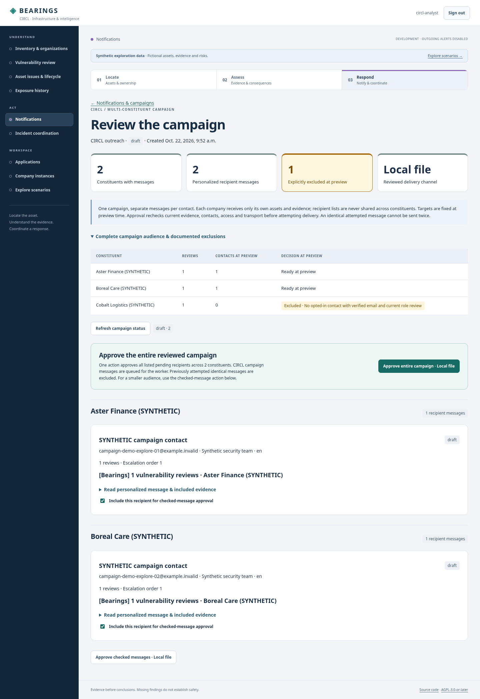

# Initial implementation validation

Date: 2026-10-16. All application data used here is synthetic. No production notifications, active scans, NetBox writes or public deployment occurred.

| Check | Actual outcome |
| --- | --- |
| `uv sync --frozen` | Passed, repeated without dependency/lockfile changes |
| Django migrations | Applied on SQLite and PostgreSQL 17; repeat application was a no-op |
| Django tests | **44 executed, 44 passed on SQLite; 44 executed, 44 passed on PostgreSQL**; no skips or expected failures |
| System check and migration drift | Passed; no pending model changes |
| Ruff lint and format | Passed |
| Static collection | Passed, 128 files collected |
| Real host HTTP workflow | Login, organization/CIRCL dashboards, inventory/software APIs, live CVE lookup and authorized evidence read passed with temporary synthetic accounts; accounts deleted afterward |
| Live Vulnerability-Lookup | Retrieved CVE-2021-44228 (PUBLISHED), persisted its real source record and finding; repeated retrieval reused the finding; applicability remained unknown |
| Docker | Built non-root development image with frozen dependencies and verified TLS using temporary cloud CA mount; repeat helper build passed. Container + PostgreSQL real HTTP login, organization page and software inventory API passed |
| Compose | Configuration syntax validated; image/runtime/database separately exercised. Full Compose lifecycle was not used in this session |
| PostgreSQL recovery | Custom-format dump restored into an isolated database; organization, operator policy, source/asset, installation and finding relationships verified, then isolated restore database removed |
| GitHub access | Native Git read and API metadata succeeded. `git push --dry-run origin HEAD:refs/heads/main` passed, confirming the push path without publishing a branch |
| Repository visibility and license | Owner confirmed public open-source publication and selected AGPL-3.0-or-later; no visibility change is needed |
| GitHub Actions | [Run 38872455361](https://github.com/rommelfs/bearings/actions/runs/38872455361) passed: 44 tests on SQLite and 44 on PostgreSQL, plus lint, formatting, migration drift, checks and static collection |

Tests cover cross-organization reads/writes and foreign-key injection; per-organization membership roles; operator default-deny/revocation and audit; policy ownership; restricted raw and derived finding visibility/counts; CSRF and HTML escaping; IPv4/IPv6/ranges/domains and DNS boundaries; historical/shared/private claims; separate contact review concepts, hashed/expiring/one-use tokens, update invalidation and reminder deduplication; pending/failed/confirmed inventory writes, backoff and recovery; partial NetBox responses and wrong tenant identities; product selection isolation; unknown versions; finding deduplication, analyst override/history; proxy destination restrictions; repeatable synthetic seeding; and the inventory-to-both-views slice.

Toolchain: host Python 3.12.14, Django 5.2.18, uv 0.12.23; image Python 3.12.15. Dependencies and hashes are in `uv.lock`. Cloud-specific DNS/proxy and Docker build namespace issues were diagnosed and corrected without disabling verification. Source fixtures validate contracts, not live compatibility.

Connections: Vulnerability-Lookup real public read tested; central NetBox adapter fixture-tested but no live instance/key supplied; development inventory adapter explicitly synthetic; MISP official OpenAPI researched but adapter pending; Plum Island official InfoIP semantics researched but adapter pending. Generalized applicability, continuous import, production scheduling/delivery/security controls and complete connector policy remain backlog work.

The environment install/start configuration was saved as a draft, including cloud proxy-DNS settings and required GitHub/Vulnerability-Lookup domains. Draft persistence is not publication or proof of fresh-task restoration. Public source publication and AGPL-3.0-or-later are owner-approved. A verified security reporting channel remains outstanding.

The implementation and AGPL-3.0-or-later license are published on public `main`. Four milestones and 15 issues were created; issue #1 is completed. Repeating backlog publication created zero duplicate issues. Source/license links are present in the application. Repository description editing remains unavailable through the integration (HTTP 403); an owner can set the description in GitHub settings. No deployment or operational-data publication occurred.

## Multi-instance NetBox increment

The instance/capability migrations applied successfully to existing SQLite and PostgreSQL databases; drift checks pass. The expanded suite executed **64 tests on SQLite and 64 on PostgreSQL, all passed**, including 20 new multi-instance query/capability tests. Ruff lint/format checks and Django checks pass. The actual CLI runs against the current unconfigured environment and reports zero live sources; this is not a live connection validation.

Contract fixtures cover two distinct instance keys and URLs, identical external IDs across instances, complete offset pagination, malicious/changed continuation scope, missing/duplicate/wrong-tenant pages, failure isolation across multiple bindings, independent read health with retained data, read-only portal/service denial, blocked queued writes after downgrade, cached capability revocation, instance-specific write defaults/authentication, dedicated whole-instance access, missing/invalid credential references, operator-only configuration/audit and legacy fail-closed upgrade behavior. No NetBox instance was contacted and no automatic projection import is claimed.

## Bundled NetBox development environment

The local lab uses official NetBox `v4.7.3-5.1.1`, PostgreSQL 17, Valkey 9.1 and a verified HTTPS gateway. Fresh initialization, repeated provisioning, retained credentials/data, read-only and read-write tenant queries, upstream read-only POST denial, both application logins, real device/VM writes through the durable worker, and recovery after a lost acknowledgement were exercised against the real bundled API. The expanded suite passed all 75 tests on SQLite and all 75 on PostgreSQL. Ruff lint/format, migration drift and whitespace checks passed. The final live smoke/query checks passed again after the retained-data app restart; HTTPS-only cookies and the disabled outbound SMTP destination were confirmed in actual NetBox settings. General inventory import remains unimplemented; only explicitly identified synthetic starter assets are projected locally.

External mode was exercised against a separately running copy of the pinned reference NetBox, with a supplied CA, private token and read-only tenant scope. It started only Bearings and its database/worker, remained usable while the reference was unavailable, then queried devices, virtual machines, IP addresses and prefixes successfully after connectivity was restored. Switching back retained the bundled data. This validates the external wiring, not compatibility with every independently deployed NetBox release. AMD64 was run; ARM64 image manifests were checked but ARM64 execution was not tested.

A final full restart in this cloud hit the shared host's inode limit: Docker uses the `vfs` storage driver and copies the large NetBox image per container. Unused build cache and unstarted lab containers were removed without deleting volumes. Final local checks used the retained running NetBox and sequential app startup, omitting the separate NetBox background worker/provision container. The committed integration workflow exercises the complete default stack, smoke checks, shutdown, retained-volume restart and queries on a standard GitHub Docker runner. This environment is for development; no production notifications, scans, external-server provisioning or operational data publication occurred.

The smoke target guard additionally checks the current database endpoint, token reference, authentication, capability, tenant and organization before any HTTP access; a regression test verifies refusal after an operator changes the stored endpoint. The guarded real smoke workflow passed again.

Public CI confirmed the complete default stack on the guarded implementation: [Development stack run 38883987302](https://github.com/rommelfs/bearings/actions/runs/38883987302) passed fresh startup, the real HTTPS/query/login/write/recovery smoke, shutdown without data deletion, retained-volume restart and queries. [Checks run 38883987223](https://github.com/rommelfs/bearings/actions/runs/38883987223) passed 75 tests on each database plus lint, formatting, system checks, migration drift and static collection. Issue #17 is complete; general import and broader deployed-version validation remain separate backlog work.

## Docker prerequisite diagnostics

Following a macOS report with no `docker` executable on PATH, the helper now fails before changing local lab state, identifies missing Docker/Compose or an unreachable engine, and preserves offline external configuration. Regression checks cover missing CLI without state creation, missing Compose, engine errors and engine timeout. The expanded SQLite suite passed all 77 tests; Ruff passed. macOS Desktop installation remains a user-side prerequisite and was not performed in the Linux cloud.

## General NetBox import and reconciliation

The bounded four-type importer now projects devices, VMs, IP addresses and prefixes for central and external sources, using GETs only. It validates the complete traversal before committing, preserves local assessments/software/findings, tracks separate import health/freshness, queues member-requested refreshes and runs periodically in the development worker. Missing identities remain retained with reasoned review/reappearance handling; no importer deletion is implemented.

Local validation: **95 tests passed on PostgreSQL**, including two real concurrent-transaction tests that observe the second transaction waiting on the source lock. SQLite executed the same 95-test suite with **93 passed and the two PostgreSQL-only lock tests explicitly skipped**. Migrations applied to existing SQLite and PostgreSQL databases; system checks, Ruff lint/format, frozen dependency sync and migration drift passed. No test-created database sessions remain after the concurrency checks.

The rebuilt complete local stack passed the extended live smoke against official NetBox v4.7.3 / netbox-docker 5.1.1: one synthetic device created directly in NetBox without a seed identity was imported, renamed upstream and refreshed while local criticality/team survived, then deleted only as that invocation's owned upstream probe. Bearings retained its missing projection. The real read-only import, four scoped query types, HTTPS/admin and portal logins, upstream/portal read-only denial, portal device/VM worker writes and lost-ack recovery passed too. Source data and credentials were retained across the image/migration upgrade. These tests used only the synthetic bundled lab, not operational inventory or production delivery.

Contract coverage adds repeated/multi-instance identity, complete pagination, last-endpoint failure rollback, malformed/wrong-tenant data, lost-ack adoption and conflicting marker rollback, foreign-marker isolation, pause/manual queue/interval/failure throttling, continued processing after another source fails, membership/CSRF restrictions, escaped allowlisted metadata, bounded UI/API pages and preservation of import health during stale operator form saves. Strong upstream snapshot consistency, interfaces/service topology/OS inference, broader NetBox versions and monitored production scheduling are not claimed.

A separate real HTTP workflow verified company-admin login, the read-only workspace's CSRF-protected Refresh inventory request, consumption by the running periodic worker, and the fresh paginated inventory API containing all four kinds and constructed source links. Repeating the real `sync_netbox --all` command imported two sources without new identities or deletion; the smoke probe remained a retained missing record.

The first import revision passed complete public CI: [Checks 38901475599](https://github.com/rommelfs/bearings/actions/runs/38901475599) and [Development stack 38901475661](https://github.com/rommelfs/bearings/actions/runs/38901475661), including fresh full-stack startup, extended real import/write smoke and retained-volume restart. A final browser-link correction adds an optional operator-owned HTTPS browser base distinct from the API destination, with a localhost/gateway-port default for the bundled lab. Credentials still target only the API base; the regression test also rejects credential-bearing browser URLs. The expanded suite passed 96 tests on PostgreSQL; SQLite passed 94 with the two PostgreSQL-only concurrency tests explicitly skipped.

The separate browser-address revision also passed the rebuilt complete local stack and extended real smoke. A host request to the constructed localhost HTTPS device URL verified the generated CA and returned the expected unauthenticated login redirect (302).

Final browser-address implementation 2f798f1 passed [Checks 38902455756](https://github.com/rommelfs/bearings/actions/runs/38902455756) (96/96 PostgreSQL; 94 passed + two explicit PostgreSQL-only skips on SQLite) and [Development stack 38902455791](https://github.com/rommelfs/bearings/actions/runs/38902455791) (fresh full startup, extended import/write/browser-link smoke, stop retaining data, restart and queries). Issues #3 and #14 are completed.

## MOSP / Vulnerability-Lookup / NetBox visibility

The suite now executes **114 tests on PostgreSQL, all passed**; SQLite passes **112 with two explicit PostgreSQL concurrency skips**. Eighteen new contract/authorization/evidence tests cover MOSP string-valued paging metadata, approved schemas/publisher/language/CC0 rights, incomplete pages and retained catalog state, source immutability, versioned CVE and complete scenario evidence, definition-only re-resolution, justified idempotent links and withdrawal, authorization before HTTP, visibility revocation for raw/derived endpoints, CSRF, foreign IDs, escaped content and joined API/catalog paging. CVE refresh preserves existing operator redistribution restrictions. Frozen dependency sync, system checks, migration drift, Ruff lint/format, static collection and whitespace checks pass.

The public MOSP service returned a complete 1,938-template MONARC CC0 catalog both natively and inside the rebuilt Docker lab using approved proxy DNS and verified public/local CA chains. The schema adapter verified all root identities and references; no remote schema URLs were followed. Some requests returned transient HTTP 503; failed attempts retained last-success data and mappings. Public API availability is independent of startup and deterministic fixture tests. Referenced definition-only changes are detected on bundle re-resolution; periodic catalog refresh currently traverses risk roots only.

The rebuilt complete bundled stack started with retained data/credentials and applied the new migrations. Its real smoke passed: general NetBox creation/import/update, local assessment preservation, retained missing projection, read-only import, four scoped query types, HTTPS and both logins, upstream/portal read-only denial, worker device/VM writes and lost-ack recovery. All data in this exercise is synthetic. No external NetBox provisioning, scans, production delivery or operational inventory publication occurred.

A complete live chain passed on the retained synthetic read-only NetBox workspace: an actual confirmed device with the explicitly recorded Log4j 2.14.1 installation → CVE-2021-44228 retrieved from Vulnerability-Lookup → verified MOSP risk UUID `7f9fc1a8-4f02-11e9-b3ea-0800277f0571` (Server / Malware infection / Update management is flawed). The saved justification explicitly describes a lab hypothesis and does not assert an organizational weakness or affectedness. Authenticated real HTTP reads verified the joined HTML view, paginated chain API and pinned CVE plus four-object catalog evidence. A transient MOSP 503 interrupted the first mapping attempt; retry succeeded without losing the complete catalog. The public-runtime validation temporarily supplied the approved proxy and public CA to that process only; it did not embed proxy settings in the image or configure ordinary Docker runtime egress automatically.

Updated cloud startup instructions were saved as an environment configuration draft. They preserve the existing install script, repository membership, network policy and runtime bindings. The draft requires review/save and publication in environment settings to activate; saved instructions do not prove fresh-task restoration.

The final app image retained the live scenario link after restart; a real authenticated HTTP read verified both snapshot timestamps, the original author, public source identity and unchanged review flags. Public implementation `ceabb90` passed [Checks 38910631336](https://github.com/rommelfs/bearings/actions/runs/38910631336) on SQLite/PostgreSQL and [Development stack 38910631286](https://github.com/rommelfs/bearings/actions/runs/38910631286): fresh complete startup, real NetBox smoke, shutdown without deleting data, retained-volume restart and scoped queries. Public issue #18 is complete; #5 remains open for aliases, broader source schemas, service version and freshness work.

## Exchange exercise and analyst review queue (2026-10-19)

Verified public CVE-2026-70571 in Vulnerability-Lookup and the CVE Program: published Microsoft Exchange RCE, source CVSS 3.1 8.1/High, including CU15 affected builds below 15.02.1748.055. The opt-in exercise assumes CU15 build 15.2.1748.54, explicitly records a manual affected assessment/history, retains automated unknown applicability and links a public CC0 MOSP scenario without asserting exploitation or scored business risk.

The expanded suite passes **124 tests on PostgreSQL**; SQLite passes **122 with the two PostgreSQL-only concurrency skips**. Ten new tests cover bounded/invalid source severity, synthetic identity/build/manual assessment, preservation of remediation/workflow/withdrawals/operator restrictions, development/external guards before HTTP, changed upstream edition/range, analyst visibility and scoped deep links, closed/accepted queue behavior, HTML escaping, pagination and explicit criticality ordering. Lint, format, system checks and migration drift pass; no new migration or dependency is needed.

The fresh cloud checkout had owner-only permissions on public bind-mounted NetBox Python config. Granting read/traverse permissions only to those public source paths restored non-root NetBox startup; private configuration and secret volumes were not broadened. The complete lab started with verified TLS and unchanged capability boundaries. The actual Exchange example was entered in synthetic writable tenant/workspace `netbox-lab-rw`, with a confirmed real NetBox device identity, live Vulnerability-Lookup CVE and a verified live four-object CC0 MOSP bundle. A real `circl-analyst` HTTP login verified the start-page RCE/8.1/build/affected cue, exact-finding detail view, joined API and pinned evidence. The example has one manual assessment history entry and one risk link; business risk remains unassessed. The complete existing real NetBox smoke passed after the upgrade, including read-only denial, general import/reconciliation and worker write/lost-ack recovery.

Public runtime validation securely forwarded the existing approved proxy and public CA to that process only, retained verified local/public TLS and kept internal NetBox DNS direct. This does not configure persistent Docker public egress automatically. An additional full MOSP catalog refresh failed while the pinned Exchange scenario evidence remained readable; source catalog health remains distinct from successful individual scenario resolution. No fabricated source data was substituted.

Updated cloud install/start instructions were saved as a draft, preserving other configuration. They include the narrow public-config permission correction and the opt-in Exchange workflow; activation still requires environment-settings review/save/publication.

A subsequent approved-proxy catalog refresh completed all 1,938 public CC0 templates and cleared catalog health; the intermediate failed traversal did not replace the pinned case evidence. Repeating the real bundled Exchange command reused the same confirmed NetBox identity and finding, left exactly one manual history entry and one scenario link, and passed the same real analyst HTTP/UI/API/evidence checks again. Static collection and whitespace validation pass. Public [Checks 39315216988](https://github.com/rommelfs/bearings/actions/runs/39315216988) passed SQLite/PostgreSQL for implementation `15ac294`.

Implementation `15ac294` also passed the complete public [Development stack run 39315217194](https://github.com/rommelfs/bearings/actions/runs/39315217194): fresh startup, real NetBox smoke, shutdown without deleting data, retained-volume restart and queries. Issue #19 completes this bounded example/in-app-cue increment; #11 retains broader triage/assignment/freshness work, #6 retains generalized applicability and #10 retains notification/escalation delivery. No production transport, scans, real-company inventory publication or automatic CVE discovery was enabled.

## Asset context and source-severity triage (2026-10-19)

The expanded suite passes **136 PostgreSQL tests**; SQLite passes **134 with two PostgreSQL-only concurrency skips**. Twelve new tests cover source-local primary IP/DNS/VRF joins, placement/reference projection, malformed input rollback and retained snapshots, safe generated URLs, whole-queue severity ordering/counters/search/filtering before pagination, current visibility on context/finding counts and deep links, scoped CSRF-protected local edits, frozen severity-cache backfill/policy preservation, escaped source labels, assessment return navigation and external/invalid-identity helper refusal. Migration 0009 applies to existing data without changing CVE snapshots or analyst assessments; frozen dependencies, lint/format, checks and migration drift pass.

The guarded fixture placed the already confirmed synthetic Exchange device in real bundled NetBox, then the GET-only importer populated DNS `exchange-01.mail.example.invalid`, IPv4 `192.0.2.25/24`, IPv6 `2001:db8::25/64`, synthetic Luxembourg DC / Messaging room M1 / rack EX-01 / U22 / front and platform. No service-token permissions were expanded. A real Chromium analyst login verified all machine facts in the overview, followed the scoped asset link and exact-finding evidence link, searched/filtered the case by IP, and read the same context in the asset/evidence views. Computed High/Unknown styles differ in background, ink and border; desktop and 390px-mobile screenshots were inspected. Mobile had no horizontal overflow and no browser JavaScript errors were observed. Further visual review tightened header spacing and made CVSS version and affected assessment explicit.

Source-severity ordering is technical, not a business-risk score. Inventory names are not inferred DNS names. Source URLs are constructed, not taken from responses; IP/DNS links open NetBox records, never the host itself. Missing source facts remain explicit. All data in this exercise is synthetic; no DNS probes, scans, external provisioning or outgoing alerts occurred. See [asset triage](user-guide/asset-triage.md) and [ADR 0006](decisions/0006-asset-context-and-source-severity.md).

The real smoke initially exposed a stale assertion for the previous dashboard title. Revision `fd92380` updates the authenticated-home assertion to the new dashboard and also exercises the new scoped asset page; it retains all existing import/write/recovery assertions. The rebuilt complete local smoke then passed. A repeat of the guarded placement/import produced zero new or updated projections, preserving the example identity and relationships. The final browser pass verified visible CVSS version, all severity contrast ratios (6.76:1–9.00:1), current links and zero horizontal overflow at 390px. Desktop/mobile screenshots of synthetic data are included in the triage guide. [Checks 39323407391](https://github.com/rommelfs/bearings/actions/runs/39323407391) passed SQLite/PostgreSQL for `fd92380`. The superseded initial integration run was cancelled when its obsolete-title assertion was identified.

The final behavioral revision `fd92380` passed [Development stack 39323407347](https://github.com/rommelfs/bearings/actions/runs/39323407347): fresh complete startup, authenticated dashboard/asset detail, full scoped import/write/recovery smoke, stop retaining volumes, restart and queries. Together with [Checks 39323407391](https://github.com/rommelfs/bearings/actions/runs/39323407391), this completes public issue #20. The final screenshots contain only the explicitly synthetic lab and demonstrate the published interface.

## Notification previews, company inbox and populated NetBox fixtures (2026-10-20)

The final suite executed **158 tests on PostgreSQL, all passed**. SQLite executed the same suite: **155 passed and three PostgreSQL-only concurrency tests skipped**. Twenty-two new notification tests cover company/CIRCL scope, redistribution restrictions including hidden pagination counts, individual consent/reachability/role-review expiry, grouped separate organization messages, strict text templates/header injection/HTML escaping, immutable preview revalidation, source/inventory/assessment/contact edits, access revocation before approval and immediately before I/O, selection/creator ownership, per-content duplicate attempts, uncertain local file failure, retained first acknowledgment, source severity ordering, whole-result limits, explicit fixture preservation and competing PostgreSQL receipt claims. Existing tests and frozen dependencies remain intact. Ruff lint/format, Django checks/migration drift, migrations 0010/0011 and static collection passed.

The actual pinned bundled NetBox provisioner populated both original RO/RW tenants with primary documentation IPv4/IPv6, `.example.invalid` DNS, platform and physical room/rack/U10/serial/asset-tag facts. The regular GET-only importer projected these facts; the updated real smoke explicitly asserts them for all four starters. The complete real smoke passed all existing general import/reconciliation, read-only API/portal denial, authenticated source-linked asset page, worker writes and lost-ack recovery assertions. Existing placement, primary IPs, policies, credentials and service-token write capabilities were preserved. The explicit notification seed was repeated without contact-policy resets or automatic message creation.

A real Chromium login as CIRCL selected Critical + Log4j, saw four reviews in two organizations, rendered two separate per-contact previews, verified actual IP/DNS/rack context and organization isolation, and approved two messages to the local file sink. A company-admin login saw both messages, acknowledged one, then prepared and approved one separate internal message. Actual database state confirmed three local filed messages, three receipts and one acknowledgment. No SMTP transport was used. A subsequent rebuilt startup retained all messages/acknowledgment, and a browser pass verified the new scoped home “Review & notify contacts” action, batch history, absent approval controls after completion and zero horizontal overflow at 390px. No browser JavaScript errors occurred in the complete first workflow. Screenshots contain only the synthetic lab.

The implemented cue uses previously recorded CVE reviews attached to registered installations. It does not automatically discover CVEs from inventory, infer confirmed affectedness from product names, calculate business risk, send production mail or implement timed escalation. The Log4j notification records and contact verification are explicitly synthetic fixtures; the separate Exchange exercise retains its live-source evidence. [Issue #21](https://github.com/rommelfs/bearings/issues/21) bounds this increment; #5/#6/#10/#11 retain ingestion/correlation/subscriptions, production transport and broader operations. No reusable environment setup changes were required.

Public [Checks 39375496679](https://github.com/rommelfs/bearings/actions/runs/39375496679) passed SQLite/PostgreSQL for implementation `c4435b6`, including all 158 tests (three expected PostgreSQL-specific skips on SQLite), formatting, migration drift and static collection.

## Exchange setup entry-point clarification (2026-10-20)

A user reproduced missing Exchange IP/DNS/location/rack fields after running the lower-level `manage seed_exchange_example --bundled` command from the setup guide. That command creates the case/evidence but does not execute the host's guarded NetBox placement helper. The guide now uses `scripts/dev.py example-exchange` for full setup and explicitly documents `example-exchange --inventory-only` for existing cases. The low-level seed prints this completion instruction before MOSP retrieval, so a catalog failure does not conceal the missing step. No provisioning permissions or assessment policies changed.

All 25 focused Exchange/starter tests passed on SQLite; Ruff lint/format and Django checks passed. The actual `python3 scripts/dev.py example-exchange --inventory-only` command completed against the existing bundled NetBox, validated the expected DNS/IP/Luxembourg DC/rack EX-01/U22 placement and immediately imported both sources. Existing enriched projections were unchanged, confirming repeatability; this was the cloud lab, not a remote repair of the user's database.

## Optional FlowIntel private case pilot (2026-10-20)

The final suite executed **186 PostgreSQL tests, all passed**; SQLite executed the same suite with **182 passes and four PostgreSQL-specific concurrency skips**. The 28 additional tests cover the optional starter/source-cache behavior, CIRCL/company/foreign/restricted export boundaries, cross-organization invalid relationships, exact local preview, creator/CSRF approval, current policy/asset/evidence revalidation before writes, immutable instance identity, private case/task payloads, repeat prevention, lost case/task acknowledgments, active write leases, remote ID collisions, bounded route/key contracts, UUID/private/service-organization verification, retained status/outage/HTML escaping, malformed status values, disabled-profile queuing and two concurrent PostgreSQL workers claiming one POST. Migration 0012/0013, frozen dependencies, Django checks/migration drift, Ruff lint/format, static collection and whitespace validation passed.

The optional profile runs a compact native-architecture build of public FlowIntel upstream `0fd54db3d3c7d17c4b26d8759cb6ac857d8d041f`, with a separate hash-locked dependency set, PostgreSQL/Valkey, runtime-data/secrets volumes, non-admin editor bridge and separate verified HTTPS gateway. Fresh initialization follows the pinned upstream create-schema/stamp path; retained databases use Alembic upgrade. The initial full official 4.0.0 image pull could not be unpacked within the cloud VFS storage budget; that distribution was not validated or shipped here. The smaller source build was built and exercised successfully. It excludes PDF/LaTeX/AI/external enrichment services and submodule catalog population. Only Linux amd64 has been executed; native architecture support on other hosts is not claimed as tested.

The real bundled smoke passed the existing NetBox primary-IP/DNS/rack projection, general create/update/missing import, read-only API/portal denial, authenticated pages, worker writes and lost-ack recovery. It additionally created private FlowIntel cases for both original synthetic NetBox RO/RW organizations, with four tasks each, then verified exact service-organization/remote UUID identity, unrelated FlowIntel organization access denial, stable repeated hand-off and GET-only workflow feedback. The final smoke deliberately cleared only its own synthetic local case acknowledgment and recovered the same real case/task identities through actual bounded read APIs; a wrapped API assertion allowed **GET only**, and no replacement case/task was posted. Findings remained unchanged. Fixture review records are explicitly `fixture://flowintel-smoke/SYNTHETIC`, not live retrieved CVE evidence.

An actual `up --no-flowintel --no-build` removed the optional services and left Bearings/NetBox healthy and GET-queryable; the managed connection was unavailable without resetting operator policy. Re-enabling with `up --flowintel --no-build` retained **four cases and 16 tasks with identical local/remote IDs/UUIDs**, as well as the existing databases, generated credentials and local notification history. The full smoke passed again after rebuilding the final application. CI now exercises both optional-profile settings and retained-volume restart, repeating the FlowIntel proof after restart.

A real Chromium session as CIRCL used the Exchange fixture's hostname, `192.0.2.25/24`, DNS and rack EX-01 in the exact preview, approved the private hand-off, followed its verified case link, authenticated separately to FlowIntel and read the four tasks/deadline/private CIRCL organization. A retained-volume repeat reused the same case. Bearings had no horizontal overflow at 390px; no JavaScript errors were observed. Native Chromium in this cloud did not trust the lab CA through its temporary NSS store, so FlowIntel browser requests were intercepted and fulfilled through **CA/hostname-verified httpx TLS**, with equivalent navigation for redirects; TLS verification was never disabled. This proves the browser workflow through that transport, not native browser trust-store configuration. Contributor browsers still need the documented public lab CA trust step. Upstream login validation rejected `.invalid` interactive email identities; the shipped interactive demo logins use reserved `example.com`, with SMTP empty/disabled. API-only service identities remain separate. Screenshots in the [guide](user-guide/flowintel.md) contain synthetic data only.

FlowIntel completion remains external workflow information; it never changes Bearings affectedness, remediation, NetBox or company notification approval. Assignment editing occurs in FlowIntel; assignment names are not synchronized. MISP alert ingestion/severity normalization, production transport, additional deployed-version compatibility, remote retention/revocation and production hardening remain separate work. No scans, real-company data exports, patches or operational messages were executed. Cloud install/start instructions were updated as a **saved draft**, preserving existing settings and adding the tested optional source build/start path; environment-settings review/save and publication are still required to activate that draft for future tasks.

Public implementation `0180fc0` passed [Checks 39385820815](https://github.com/rommelfs/bearings/actions/runs/39385820815) and the complete [Development stack 39385820816](https://github.com/rommelfs/bearings/actions/runs/39385820816), including fresh builds with/without FlowIntel, original smoke, retained-volume restart/queries and repeated FlowIntel case/task recovery proof after restart. An additional verified-TLS local read check confirmed **24 unrelated-organization denials** across unfinished/finished task lists and individual task details for the four synthetic cases. Issue #22 completes the bounded pilot; the documented production/external-version/alert-ingestion work remains separate.

## FlowIntel image-directory EXDEV startup correction (2026-10-20)

A contributor's Docker startup failed before application initialization: `Path.rename` raised EXDEV (`Invalid cross-device link`) when moving the image-layer `logs` directory to `logs.image-original`. The adapter now uses `shutil.move`, which falls back to preserving a directory tree by copy/removal when rename is unsupported. Existing backup collisions, unexpected files and links to a different destination stop explicitly instead of overwriting retained data. The original image directory stays in its backup; the runtime symlink points to the existing data volume.

All **189 PostgreSQL tests passed**; SQLite **185 passed with four PostgreSQL-specific skips**. Three regression tests force EXDEV and verify nested contents/symlinks, preserved runtime contents after repeat calls, existing-backup refusal and unexpected-link preservation. Ruff lint/format, Django checks/migration drift and whitespace validation passed. No dependencies or database migrations changed.

The real bundled lab was stopped without deleting volumes and started using existing images with the updated bind-mounted adapter, creating fresh container filesystems. Both FlowIntel initializer and web service succeeded; a second startup succeeded. All three image backups and persistent runtime links were checked inside the actual FlowIntel container. The full original NetBox smoke plus private FlowIntel cases/tasks, outsider denial and lost-ack read-only reconciliation passed with retained case identities. The cloud uses VFS; the contributor's failing image-layer rename is reproduced by explicit fault injection in regression tests, not claimed as a direct test of their Docker host. Recovery uses `git pull`, `dev.py down` and `dev.py up --flowintel --no-build`: recreating containers also refreshes single-file bind mounts after Git replaces the adapter file. Existing images, volumes, passwords and policies are retained; no cloud configuration change is required.

## Accepted roadmap and Plum Island source review (2026-10-20)

Recorded the accepted lifecycle/RT/notifications/federation roadmap and additional existing-data/scan-coordination Plum Island phases. Public upstream source `06972ba8d462a537aaeb6b58815d1c6165d084df` was inspected for InfoIP permissions/window selection, authenticated UI search/export owner checks, target bulk-import scheduling and scan-profile completion semantics. CIRCL's stated Luxembourg mandate and large existing corpus inform the plan; the operator's internal endpoint was not contacted, configured or published. No scan, customer-data import or operational notification was performed. These are planning/source-review artifacts, not new implemented application capabilities.

Validated canonical JSON, 27 unique issue titles and local links across the five changed/new roadmap/integration/index documents. The provided backlog publisher created five missing issues without duplicating existing items; #8 is updated for historical ingestion and #23–#27 track the additional scoped increments. No runtime dependencies, schema, installation/start instructions or application behavior changed, so application/integration suites were not rerun for this documentation change.

## Asset issues, RT, historical Plum, outreach and federation pilots (2026-10-20)

Implemented migrations 0014–0021 add common asset issues/evidence/history, installation software/firmware type, original-CVE backfill, RT connections/ticket mappings, Plum snapshots/exposure reviews, lifecycle delivery links, transport-pinned notification batches, draft subscriptions and bounded company snapshot federation. Existing Finding IDs/assessments, inventory authority, FlowIntel mappings and original evidence remain authoritative. No runtime dependencies changed.

The suite executes **237 tests**: **all pass on PostgreSQL**; SQLite **232 pass and five PostgreSQL-specific concurrency checks skip**. Added coverage exercises lifecycle/entitlement facts and dates, immutable evidence/risk pins and withdrawal, company/CIRCL/reader/source isolation including counts/evidence, original CVE workflow authority, request/CSRF/escaping, RT REST2 routes/keys/queue verification, single committed POST under concurrent PostgreSQL workers, uncertain-create read-only reconciliation, policy/content revalidation, Plum protocol/hostname/time/404/empty/closure distinctions, historical ownership revocation, deduplication/atomic exports, local and mocked TLS SMTP approval, transport-separated fingerprints, subscription draft deduplication, guarded seed preservation, and federation grants/TLS/client binding/expiry/sharing/complete snapshots/retained failures. Final focused notification and federation checks also pass after fingerprint and malformed-ID hardening. SMTP tests mock the transport; no real relay is contacted. Django checks/migration drift, Ruff lint/format, static collection and whitespace validation pass.

The actual rebuilt bundled lab applied the migrations and passed the full pre-existing NetBox/FlowIntel smoke: verified TLS/primary-IP/DNS/room/rack projection, all four inventory types, upstream RO denial, regular import/update/missing retention, worker writes, lost-ack recovery, private FlowIntel cases/four tasks, outsider denial and GET-only reconciliation/status. Optional lifecycle seeding added four explicitly invented contract/lifecycle issues and two synthetic historical Plum windows on the existing Exchange documentation IP. Repeated seeds preserve review decisions and create no messages/cases/scans. Cloud VFS disk pressure was addressed by stopping retained-volume containers and pruning unused image/build cache, without deleting volumes or source data.

A real Chromium CIRCL session viewed the scoped support queue and exact Exchange IP/DNS/rack, edited ownership/workflow with a reason, pinned a live public MOSP scenario, compared synthetic Plum windows (new 3389/tcp and missing 53/udp), created an exposure review, previewed/approved a lifecycle message to the local file sink and created a draft-only subscription. The issue queue, detail, exposure, notifications and company-instance views had no horizontal overflow at 390px and no JavaScript errors. Screenshots in the [issue guide](user-guide/asset-issues.md) contain synthetic data only. A second real company-admin browser session created the review specifically for newly observed 3389/tcp, followed the lifecycle inbox link and acknowledged the locally filed message. Unit/request tests additionally cover foreign-company and reader denial.

RT contract research used Best Practical RT 5.0.10 source commit `51f63bbd924b9277ec6d2db49a6d89e8f25da141`: REST2 token header, ticket creation/read/search, nullable search totals, owner expansion and merged-ticket identity. **No live RT/RTIR queue, scrip, custom-field or deployed-version acceptance was performed.** A configured queue can send mail through its own scrips; the adapter requires explicit operator attestation and reviewed hand-off.

Plum public source `06972ba8d462a537aaeb6b58815d1c6165d084df` defines the reviewed historical formats. A read-only attempt to obtain the operator-provided `/v1/swagger` timed out from this environment, yielding no deployed API/auth contract. No private endpoint, real national/customer corpus, Agent credentials, target registration or scan submission was used/published. Historical imports are bounded complete partitions; automatic source export jobs/checkpoints and corpus-scale refresh remain open. Missing observations never establish closure or malware.

Federation is validated by source/client contract tests, **not a live two-instance deployment**. It exports bounded complete snapshots, not deltas; reports cannot overwrite local inventory or enter outreach. Source grant revocation stops future reads but cannot erase prior exported copies. Partitioned/delta federation, retention/revocation governance and operational service acceptance remain open. Draft subscriptions cover recorded reviews; automatic CVE discovery, bounce/reminder/escalation management, full risk assessments, SSO and controlled scan coordination are separate increments. No operational email, real-company export or production deployment was performed.

The final withdrawal check distinguishes operator investigation from redistribution: withdrawing a Plum company read grant keeps authorized CIRCL investigation available but suppresses company-bound exports, bulk match counts, historical delivery access and prepared notification/RT approval. A regression verifies both transports remain uncalled and no receipt is claimed. PostgreSQL and SQLite full suites were rerun after this correction with the counts above.

## Explicit historical exposure seed feedback (2026-10-21)

The optional lifecycle seed now distinguishes skipped exposure data from retained/visible snapshots and prints the mapped asset/IP plus exact historical windows. Missing imported documentation IPs produce a completion instruction. Existing grants and historical scope revocations remain unchanged. The 17-test issue suite passes, including new cases for an empty inventory projection, creation of both synthetic windows, repeat ingestion and retained-but-hidden history after scope withdrawal. The full PostgreSQL suite at this working point also passed; the SSO increment under development is recorded separately when completed. No live Plum data or scans were used.

## Optional OIDC SSO for Bearings and NetBox (2026-10-21)

Implemented an opt-in pre-approved OIDC backend and optional Keycloak **26.8.1** lab. Bearings uses frozen `social-auth-app-django 5.9.0` / `social-auth-core 4.9.1`; the pinned bundled NetBox image was exercised with its installed **6.1.0 / 5.2.0** packages and Python **3.14**. The shared backend supports both tested contracts. No project model migration is added; normal `migrate` also applies the installed social_django identity/session-association tables. Existing accounts, passwords, memberships, operator visibility, inventory source identities, API keys, findings, local outboxes and FlowIntel case/task identities remain intact.

The final suite executes **254 tests, all pass on PostgreSQL**. SQLite executes the same suite with **249 passes and five PostgreSQL-specific concurrency skips**. Fourteen OIDC tests exercise actual signed RSA JWT validation with mocked HTTP transport: authorization code/PKCE, issuer/audience/authorized party/required expiry/iat/nonce/signature, state/replay and UserInfo subject checks, unknown identities with matching email, ignored privilege claims, local authorization preservation, account/binding revocation and old-session generations, local fallback, sanitized failures, fixed HTTPS endpoints/no redirects/bounded responses, POST/CSRF initiation, callback-log redaction and strict CA-chain compatibility. Two starter tests cover optional composition, external-mode refusal, distinct client credentials, repeat setup and refusal to repoint retained issuer/ports. Existing tests plus the exposure-feedback regression remain covered. Frozen dependencies, Ruff lint/format, Django checks/migration drift, static collection and whitespace checks pass.

The actual bundled **Bearings + NetBox + FlowIntel + Keycloak** stack starts successfully. The new standard-library `scripts/dev.py sso-smoke` performs normal CA/hostname-verified HTTPS requests and real confidential-client/code exchanges: one company password submission to Keycloak, Bearings login, NetBox's POST/CSRF SSO initiation, password-free IdP reuse, access to its own NetBox device, denial of the foreign tenant's device, and refusal of the valid but unapproved `unassigned-demo` identity. It uses no API key and creates no account/role during login. Distinct client secrets and locally approved issuer+subject bindings provide the separation; IdP email/group/admin claims do not confer application permissions.

A real Chromium run also completed the two-app workflow with exactly one password submission, verified company-only NetBox inventory, no JavaScript errors and no horizontal login overflow at 390px. As with the previous browser validation, HTTPS was fulfilled through a CA/hostname-verifying HTTPX transport with preserved browser cookies and equivalent redirect navigation, because this cloud Chromium does not trust the temporary private CA through its native store. No TLS verification was disabled. This proves browser behavior through that verified transport, not native browser trust-store installation. The screenshot in the [SSO guide](operations/sso.md) contains no operational data or credentials.

The legacy generated public lab CA certificate lacked keyUsage, rejected by Python 3.14's strict verification on NetBox's OIDC backchannel. The initializer now adds the necessary public certificate extension while retaining the existing CA private/public key and a backup of the old public certificate; it refuses to silently change an unknown custom CA identity. A real OpenSSL strict-chain test verifies a leaf issued before the upgrade, unchanged private-key bytes and repeat idempotence. Real NetBox OIDC/TLS and the full pre-existing NetBox/FlowIntel smoke pass with the updated trust. Public CA export/trust guidance is documented; private keys are never exported.

The live profile was removed using `up --no-sso --no-build`: Keycloak stopped, the local sign-in page no longer offered SSO, and the complete original NetBox/FlowIntel smoke passed using local authentication. Re-enabling with retained volumes restored the same realm/subjects and the real SSO smoke passed again. A synthetic CIRCL binding deliberately revoked before this toggle remained disabled after bootstrap; it was then explicitly relinked by the existing local platform administrator. Neither binding store contains provider tokens. The full original smoke passed after re-enable, including source-scoped RO/RW behavior, location projection, atomic imports, worker writes, private FlowIntel cases/tasks and read-only lost-ack recovery.

CI includes a third isolated bundled SSO profile, real one-password SSO/scope/denial proof and repetition after retained-volume restart. Production IdP/MFA/local-fallback policy, external NetBox version acceptance, FlowIntel/RT sign-in, global/backchannel logout and automatic account lifecycle remain separate work. The local Keycloak uses its own retained H2 development volume and is not a production IdP deployment. No production account, external IdP, operational notification or scan was changed.

## FlowIntel SSO and RT deployment bundle (2026-10-21)

The frozen application suite now executes **263 tests, all pass on PostgreSQL**; SQLite executes **258 passes and five PostgreSQL concurrency skips**. Nine new host-side tests cover the FlowIntel code/PKCE transaction, real RSA JWT verification with invalid issuer/audience/azp/signature/nonce/time/required claims/UserInfo subject, bounded verified HTTP/redirect refusal, privilege-claim independence, retained callback/secret policy, and RT generator private files, repeat setup, injection rejection and executable case-sensitive Perl mappings. A generator CLI check runs through `dev.py` without Docker, produces its own private client secret and proves repeat execution preserves it. Four additional tests run inside the pinned FlowIntel runtime against an isolated SQLite database and cache: POST/CSRF, no account/role/password changes, unknown identity denial, binding revocation/re-enable generations, expiry/deleted account and profile-off session invalidation. Ruff format/lint, Django checks, migration drift and whitespace checks pass. No portal migration is added; FlowIntel's separate binding table is created explicitly without changing upstream migration history.

Real retained Keycloak 26.8.1, official NetBox and pinned FlowIntel prove Bearings-to-NetBox sign-in with one company password prompt and tenant-isolated read-only access; the same provider session signs the CIRCL account into Bearings and FlowIntel without another prompt. The company IdP account is denied FlowIntel, and an unassigned valid IdP identity is denied Bearings. The adapter persists no provider token, maps only issuer+subject, and leaves local organization/role/password/API keys untouched. The combined starter added a separate FlowIntel client to the pre-existing realm through an isolated one-off service, without resetting users/passwords/client policies. Explicit CIRCL binding revocation followed by another `up` remained revoked and rejected the already signed-in browser; explicit re-enable rotated its generation. `up --no-sso` retained local login and passed the original complete NetBox/FlowIntel smoke; re-enable with retained volumes passed shared login again. The original real integration smoke also passes with SSO enabled: all four asset types, exact IP/DNS/rack context, scoped import/write/recovery and private FlowIntel cases/tasks/outsider denial/read-only reconciliation. No production notification, scan or remediation was executed. The CI matrix now includes FlowIntel and SSO together, before and after retained restart.

The generated RT include passed an actual **Apache 2.4.69 / mod_auth_openidc 2.4.17** configuration check. A separate temporary loopback Apache TLS service, real Keycloak authorization-code flow and CGI harness using the generated `WebCanonicalizeInfo` overlay proved the existing CIRCL IdP session reaches the exact mapped RT-compatible identity without another password prompt; an unmapped company identity and forged identity headers were denied. The Perl mapping separately rejects subject case changes. This validates the actual OIDC module and execution-boundary handoff, **not a complete RT/RTIR deployment**: RT queue ACLs, its API/session behavior, existing overlays and mail scrips were not exercised against a running customer RT instance. The generated REST2 exemption and Authorization propagation follow RT 5.x's separate REST2 middleware; target installation acceptance remains required. Generated credentials and all test-session/provider data remain outside Git and public artifacts.

Production/external deployment compatibility, enforced participant MFA/password policy, shared logout/backchannel account revocation and broader account lifecycle synchronization remain open. Native upstream FlowIntel Keycloak mode remains off; the pinned bundled adapter is the tested route. See [SSO operation](operations/sso.md) and [RT deployment](operations/rt-sso.md).

## Optional real RT 5 reference and shared SSO (2026-10-21)

The frozen application suite executes **270 tests, all pass on PostgreSQL**; SQLite executes **265 passes and five PostgreSQL-specific skips**. Six RT-lab regressions cover optional/retained starter selection, external-mode refusal, private endpoint/client retention and repoint refusal, the actual Perl credential reader's terminal newline handling, scoped default Bearings connections and preservation of disabled/queue-confirmation policies. A native RT response regression accepts typed `EffectiveId` ticket references and rejects merged/foreign effective identities while ignoring response URLs. Existing executable Perl overlay tests now resolve exact active local account names to verified numeric IDs, reject disabled accounts and preserve case-sensitive subject binding. Frozen sync, Ruff lint/format, Django system checks, no migration drift and whitespace checks pass. No portal schema migration is needed.

Both the initial and Debian-tag-pinned image builds succeeded. The running reference is **RT 5.0.7+dfsg-4+deb13u3** with Debian security patches, PostgreSQL 17, Apache 2.4.69, mod_fcgid and mod_auth_openidc 2.4.17. Real RT database initialization uses a private generated root-password file; users, queues and separate bridge tokens are provisioned only in this isolated lab. RT/DB stay on an internal Docker network without an Internet route. The existing edge gateway terminates browser HTTPS and verifies HTTPS to the RT backend. The public lab CA is reused; no TLS check is disabled. Native RT checks assert own-queue access, foreign-queue denial, no global human SuperUser grant, documented local-only `mbox` mail and no default Internet route.

The complete real NetBox/FlowIntel smoke continues to pass with RT enabled. Real RT API tests additionally create company/CIRCL tickets with different scoped tokens, verify queue/subject/effective identity, preserve the original Bearings issue state, expose separate status/owner/due feedback, deny foreign-ticket reads and unauthenticated access, and prove repeated previews retain their mapping. A simulated lost acknowledgment clears only the synthetic local acknowledgment and recovers the exact remote ID through real GET/search calls without another POST. Repeated startup/ingestion does not duplicate the retained tickets. The real API exposed the typed EffectiveId representation absent from the earlier scalar contract fixture; both representations are now supported without accepting merges or foreign reference types.

The guarded browser-flow smoke performs actual Keycloak code exchanges over verified TLS: company/CIRCL RT accounts use their existing provider sessions without another password prompt, read their own probe tickets and cannot read the other queue. A valid unassigned IdP account is denied. The local recovery root password login reaches RT administration, while that cookie cannot bypass the separate SSO entrance. An additional live proof disabled the synthetic CIRCL RT account and denied its already signed-in session; only that synthetic account was explicitly restored after the test. The exact-subject overlay checks current active local accounts and returns their verified numeric ID, avoiding RT's numeric username ambiguity. The generator updates only its known unmodified legacy overlay; conflicting operator mappings still fail closed rather than being reset.

A live retained-volume proof revoked a synthetic company queue ModifyTicket right, restarted with **SSO and FlowIntel off**, and confirmed that bootstrap did not restore that right and ticket count stayed unchanged. The original right was explicitly restored after inspection. The full NetBox/RT API/native smoke passed in local-password mode, and a separate standard-library TLS browser proof authenticated both local RT humans and verified permitted/foreign tickets. Re-enabling the full **Bearings + NetBox + FlowIntel + RT + Keycloak** profile retained its realm, accounts, secrets, ACLs and tickets and passed both the complete integration smoke and shared sign-in again. The lab is left with all these optional services healthy. CI now covers RT with shared SSO/all optional services and RT with local authentication, including retained restarts. Its hosted run is reported separately from these local results.

No operational mail, scans or remediation were executed. RTIR is not installed or certified by this reference; incident-type/custom-field semantics and customer-specific RT/RTIR versions, overlays, queue/mail policies and operational recovery still need acceptance. Production MFA/fallback policy, shared/global/backchannel logout and cross-application account lifecycle synchronization remain separate work. See [RT lab](operations/rt-lab.md), [external RT SSO](operations/rt-sso.md) and [RT connector](integrations/rt-rtir.md).

## Native RTIR coordination and retained deployment (2026-10-21)

Implemented optional RTIR **5.0.10** on the existing Debian **RT 5.0.7+dfsg-4+deb13u3** reference. The pinned upstream extension is installed in the image and activated/initialized only for the RTIR profile or an already installed retained database. Verified both a clean, isolated first installation and adding RTIR to the retained RT reference without replacing its existing accounts, queues, keys, tickets or SSO client.

- **280 tests pass on PostgreSQL**; SQLite passes 275 with five PostgreSQL-specific skips. Frozen dependency sync, Ruff lint/format, Django checks, migration drift and whitespace checks pass.
- New authorization/state tests cover one Incident with multiple company/asset Investigations, independent approval, immutable source/parent identity, company denial, aggregate hiding and queued-write blocking after company visibility withdrawal, failed native lifecycle preflight before any POST, last-known feedback retention and GET-only uncertain creation recovery.
- The live bundled example retains **one native Incident and three Investigations for three real bundled NetBox assets across two synthetic companies**. The native `incidents`/`investigations` lifecycles, exact queues/effective identities and parent IDs are verified. REST2 represents `MemberOf` as typed `_hyperlinks` with `ref=parent`; the implementation checks those IDs and never follows their URLs.
- Real company and ordinary CIRCL RT API tokens cannot read the separate RTIR tickets. Native permission checks deny company SeeQueue/ShowTicket/CreateTicket/ReplyToTicket on all four RTIR queues and verify CIRCL access. RT remains on an internal network without an Internet route; mail stays in local mbox files.
- Actual RTIR `open` → `resolved` was refreshed into Bearings while the linked asset issue's assessment/active state remained unchanged. The synthetic Investigation was explicitly restored to its original open status after the proof. No remediation or operational message was generated.
- Real verified-TLS OIDC browser flows passed for Bearings, NetBox, FlowIntel and RT/RTIR: CIRCL reads the native Incident/Investigations through the existing provider session; the company is denied in both RTIR and the Bearings aggregate. Ordinary private RT queues, foreign-ticket denial, unassigned identities and emergency recovery continue to work.
- After temporarily revoking a synthetic CIRCL RTIR native queue grant, retained initialization did not regrant it; the RTIR service key and all local/remote parent/child identities stayed unchanged. The original synthetic grant was explicitly restored. A further full retained `up` succeeded, followed by the complete NetBox/FlowIntel/RT/RTIR smoke and SSO checks.
- CI includes an additional full-stack RTIR profile and retained restart coverage. GitHub Actions results are separate from these local proofs.

Remaining boundaries: customer queue/ACL/scrip/custom-field acceptance, RTIR version upgrades or adoption of arbitrary pre-existing queues, import of externally created graph relationships/types, company-facing RTIR partitioning and production notification/retention acceptance. One Investigation binding per connection/asset issue is currently retained; distinct investigative questions require distinct issue records. RTIR workflow completion remains independent of Bearings applicability/remediation. See [RTIR lab and workflow](operations/rtir-lab.md).

## Extensive synthetic exploration and safe removal (2026-10-21)

The bundled lab now automatically creates the provenance-tracked `explore-v1` showcase: **10 fictional companies, 300 assets, 900 software/firmware installations, 300 vulnerability reviews, 600 lifecycle issues, 60 exposure reviews, 180 weekly observations, pinned synthetic risk mappings, 8 offline RTIR preview tickets, 4 FlowIntel previews/16 tasks and 20 rendered outreach previews**. The actual running lab reports **6,374 tracked objects** with its existing company account. No new accounts/passwords, remote cases, inventory writes, scans or messages are created by this seed. The additional assets/evidence are offline fixtures in Bearings, distinct from the separate live bundled integration examples.

- **293 PostgreSQL tests pass**; SQLite passes 287 with six PostgreSQL-specific skips. Frozen sync, migrations/checks, Ruff formatting/lint and whitespace validation pass.
- Tests exercise complete default-size creation and deletion in an isolated database, unchanged existing users/passwords/real assets, a durable removal tombstone and explicit restoration, stale-preview rejection, private-company visibility, non-DEBUG removal, real dependency/M2M grant protection, promoted connector/real recipient/address blockers, remote identity retention and platform-only web removal.
- A real PostgreSQL concurrency test holds the complete reviewed deletion graph while another connection tries to insert an unowned contact. The FK writer remains blocked and is rejected after the synthetic organization is removed; no real reference can slip into the purge. Thread connections close before test database teardown.
- The authenticated running application served `/explore/` with **300 visible assets / 960 visible issues** to its platform administrator and the unblocked **6,374-object** removal preview. The main lab dataset was retained; complete removal was tested against isolated test data.
- Repeating `seed_showcase` retained all 6,374 existing records and decisions. Startup uses the same retained-state logic; a removed dataset is not recreated without explicit `--restore`.
- The complete live NetBox/FlowIntel/RT/RTIR smoke passed with the large dataset present, followed by the existing real verified-TLS SSO/browser flow suite. Scope isolation, native case/ticket identity, GET-only lost-ack recovery, local mail and private queues remain intact.

Cleanup targets explicit recorded ownership rather than names, includes synthetic review histories, preserves audit events and users, and refuses unowned references or operational conversions. Older unregistered examples and fixtures in separate bundled backends are reported/reviewed separately; they are never remotely erased or silently adopted. The data readiness check is not production deployment certification. See [synthetic-data operations](operations/synthetic-data.md).

## FlowIntel SSO login visibility and update reload (2026-10-21)

The retained full lab had an enabled FlowIntel binding and working OIDC route, but its injected light-outline SSO button sat outside the upstream dark login card on a light background. SSO now appears first in its own dark card; the separate CSRF-protected local form remains under expandable administrator recovery. `dev.py up` restarts FlowIntel and waits for health so bind-mounted adapter updates reach retained Gunicorn processes. Startup reports shared versus local login mode. No bindings, passwords, roles or client policies are reset.

Validation: frozen dependency sync, Ruff lint/format, Django checks and migration drift passed. The actual pinned FlowIntel login template renders in the standalone runtime suite: **5 tests passed**, including independent, non-nested CSRF forms and primary SSO placement. **46 relevant Django tests passed on PostgreSQL and 46 on SQLite**. A real retained full-stack `up --no-build` restarted FlowIntel successfully. The verified-TLS browser smoke checks the updated primary login entry and confirms the shared Keycloak session signs CIRCL into FlowIntel without another password prompt, denies company access there, and continues to sign into Bearings, NetBox and RT/RTIR. The bundled integration smoke passed with real scoped NetBox import/write/reconciliation, FlowIntel private cases/tasks and RT queue isolation. All services remained healthy. Only synthetic lab data was used; no external notifications or operational scans occurred.

## Workspace navigation and visual review (2026-10-22)

Reviewed the running synthetic lab and delivered grouped active desktop navigation, an expandable mobile menu, a direct searchable `/inventory/` entry, organization breadcrumbs, Locate/Assess/Respond orientation, compact machine-first finding cards, inventory-first company pages, semantic severity/priority/deadline colors and audience/evidence notification fieldsets. Optional subscription and creation controls expand on demand. Native backend interfaces and access/approval/SSO semantics are retained. See [findings and screenshots](reviews/workspace-ux.md).

Frozen dependency sync, Ruff lint/format (**122 Python files**), Django system check, migration drift and whitespace checks passed. **298 Django tests passed on PostgreSQL; SQLite ran 298 with six PostgreSQL-specific skips and no failures**. Five new tests exercise scoped inventory search/counts, restricted evidence omission, distinct counts across memberships, operator audit/policy revocation, menu and endpoint role separation, anonymous access and missing-source/empty inventory rendering.

A read-only Chromium exercise covered nine main routes plus asset, intelligence and issue details; it followed real asset-to-evidence links, checked inventory-first ordering, organization search, notification filter submissions, expandable facts/subscriptions, active navigation and company/CIRCL/admin menus. Desktop **1440 px** and responsive **1280/1024/768/390/320 px** checks found no document-level horizontal overflow or JavaScript errors. The mobile menu navigated successfully. Computed visible-text contrast samples on review/inventory/issues/exposure/notifications initially identified weak workflow text; corrected samples meet 4.5:1 normal / 3:1 large text. This does not claim a complete WCAG audit or screen-reader certification.

Real verified-TLS SSO smoke passed again across Bearings, NetBox, FlowIntel and RT/RTIR, including company scope, unassigned/foreign denial and retained local RT recovery. Browser screenshots contain synthetic data only. This review created no operational notifications, cases, scans or remediation changes.

## Connected native application canvas (2026-10-22)

Implemented an authenticated, scoped browser application directory and explicit sandboxed frames inside Bearings. The optional SSO profile adds a loopback HTTPS Bearings gateway on port 9441; native NetBox, FlowIntel and RT/RTIR pages accept only their own origin and this configured Bearings ancestor. Authentication and local RT recovery retain framing denial. The native FlowIntel policy preserves non-framing directives and fails closed on unexpected framing directives. Same-origin child apps and unapproved/caller-supplied destinations are rejected; unknown external destinations remain separate-tab hand-offs. Browser URLs never fall back to internal API endpoints. See [boundaries and screenshots](user-guide/applications.md).

Validation: frozen dependency sync, Ruff lint/format (**125 Python files**), Django checks, migration drift, Compose configuration and whitespace checks passed. **306 Django tests passed on PostgreSQL; SQLite ran 306 with six PostgreSQL-specific skips and no failures**. Eight new tests cover scoped connection metadata, disabled/current sharing policy, foreign/unassigned access, canonical origin redirects, explicit activation, exact CSP, sandbox/referrer policy, same-origin/unapproved fallback, missing browser URLs, malformed/canonicalized origins (including default-port, IPv6 and noncanonical-IP isolation) and the loopback-only retained callback behavior. The actual pinned FlowIntel standalone suite ran **seven tests successfully**, including native directive preservation and fail-closed policy changes.

A real retained `up --no-build` brought up the HTTPS gateway and refreshed all native SSO processes while retaining realm/client/account/database policy. The dev profile now mounts Bearings config read-only alongside its existing portal mount. Real full-stack smoke passed scoped NetBox query/import/native placement, portal RO denial, device/VM write and lost-ack recovery, FlowIntel private cases/tasks/foreign-org denial, RT company/CIRCL queue/key isolation and native RTIR Incident/Investigation/lifecycle/link/reconciliation checks. Its homepage assertion was updated to the review page's current title. No production messages or scans were performed.

The extended `sso-smoke` passed existing identity/tenant/RTIR denial, separate RT recovery and the new HTTPS directory/frame/native CSP tests. The retained OIDC client needed no callback-policy reset: HTTPS Bearings uses the existing loopback callback only in the DEBUG lab; HTTP localhost/127.0.0.1 and external client behavior are covered.

Chromium at **1600×1100** and **390×844** rendered authenticated NetBox, FlowIntel and RTIR inside Bearings with **one total IdP password prompt**, an intact Bearings location/navigation and no outer document horizontal overflow. Negative browser checks confirmed that an HTTP Bearings parent cannot frame NetBox and that NetBox login is denied even within the approved canvas. Header reads over verified TLS confirmed exact native ancestry rules, DENY on NetBox login and retained DENY on local RT recovery. Browser test traffic used CA/hostname-verifying transport with redirects replayed through that transport; TLS checks were not disabled. The normal user browser must import the public lab CA. All screenshot data is synthetic. Native form/permission/version acceptance for independent deployments, unrelated-site cookie restrictions, cross-product logout, route/deep-link persistence and exhaustive native sandbox/assistive-technology testing remain separate work.

## CIRCL multi-constituent campaigns · 2026-10-22

CIRCL outreach now explicitly supports all matching constituents, a selected group or one organization in one reviewed campaign. Readiness aggregates the complete scoped match set beyond the first 100 displayed reviews. Default missing-contact blocking remains; the explicit exclusion option pins excluded constituents, reasons and review counts. Grouped private previews and one **Approve entire campaign** action replace organization-by-organization preparation. Company messages remain isolated; excluded evidence is also rechecked for current redistribution permission before historical reports or approval are exposed.

Explicit CIRCL campaigns default to bounded 10,000-review / 2,000-recipient previews; exceeding configured limits rolls back the entire preview. PostgreSQL row-locked background workers claim only approved queued deliveries, commit before I/O, and recheck current active creator, contact, scope, evidence and transport. Uncertain/interrupted attempts retain receipts without blind retry. The bundled worker processes five approved messages per loop; independent deployments must schedule `process_notifications`. This is one bulk approval, with separate per-recipient transport attempts, not simultaneous SMTP or confirmed recipient delivery.

Frozen dependency sync, Ruff lint and formatting (128 Python files), Django migration/system/drift and whitespace checks passed. **320 Django tests passed on PostgreSQL; SQLite ran 320 tests with six explicit PostgreSQL-only skips.** Suites cover multi-company selection, tenant-private bodies/inboxes, explicit exclusions, all-blocked rollback, readiness beyond 100 reviews, more than 100 recipients, bounded rejection, one-action HTTP queue approval, stale-recipient atomicity, policy revocation after queue, interrupted claims, excluded-count withdrawal, draft-only subscriptions, and creation-only synthetic provenance/idempotent opt-out preservation/removal. PostgreSQL additionally validates concurrent workers claiming each approved message only once.

The real retained bundled stack smoke passed NetBox placement/query/import/RO enforcement/writes/lost-ack reconciliation, FlowIntel private case/task isolation, RT scoped tickets and native RTIR incident/investigation/lifecycle access. Extended SSO smoke passed Keycloak, NetBox, FlowIntel, RT/RTIR and the application canvas with verified TLS. Chromium at 1440×1100 and 390×844 passed real CIRCL login, the three-constituent audience (two ready, one blocked), deliberate exclusion, grouped two-company preview, a visible whole-campaign approval action and no horizontal overflow. The unapproved browser proof draft was removed explicitly; tracked fictional example records remain available. Browser exercise did not approve/deliver messages. File dispatch and SMTP contract behavior were exercised in isolated tests; no production notification or scan was performed.

## Integrated named MONARC scenario picker · 2026-10-22

The CVE risk-link form now provides local scenario search, enabled-catalog filtering, twelve-card pagination and an inline selected scenario preview. Human-readable threat, catalog asset type and general weakness replace manual UUID entry; source identifiers and reviewed revision are hidden form data with a collapsible provenance reference. Explicit selection hydrates missing public catalog details, while ordinary searches remain local. Disabled/missing scenarios are rejected, outages retain existing evidence, and a changed upstream revision blocks mapping until the updated preview is explicitly confirmed with the analyst's justification retained. No recommendations, automatic impact scores or confirmed applicability are inferred.

Frozen dependency sync, migrations, Django checks/drift, Ruff lint/format (129 Python files), and whitespace checks passed. **328 tests passed on PostgreSQL; SQLite ran the same 328 with six PostgreSQL-only skips.** Eight new tests cover named search/preview, no mapping or network request during cached browsing, related threat search, empty results, justified confirmation, exact reviewed-revision matching, upstream-change re-confirmation, disabled/missing entries, foreign organization/reader denial, malformed parameters, escaping and missing-detail/outage handling. Existing programmatic mapping and evidence/history tests remain green.

Authenticated Chromium exercised the actual retained CIRCL UI against synthetic assets and 1,938 cached public catalog entries at **1440×1050** and **390×844**: empty search, selected human-readable preview, three context panels, hidden identifiers, explicit confirmation action and no outer horizontal overflow. The browser created no mapping and performed no notification delivery or scan. The screenshot includes the existing catalog refresh warning; a cached preview is last-known catalog information, and confirmation still requires successful source verification. Connector/deployment wiring was unchanged in this increment. See the [guide and screenshot](user-guide/risk-scenarios.md).

## Guided cases, interchangeable PHP example and inventory reference canvas · 2026-10-22

Implemented the first product-independent guided CVE workflow: global **Start here**, product/CVE/machine case search, five question-led steps, existing audited assessment service, named MOSP picker return context, same-host related CVEs, owner/contact readiness and explicit follow-up semantics. Moving through steps creates no completion assertion, risk mapping, incident or notification. Existing advanced workspaces remain available. Full organization provisioning, non-CVE guides, consolidated acknowledgment/remediation verification and first-user acceptance remain follow-ups.

The opt-in tracked `seed_php_example --bundled` added an assumed PHP 8.4.26 installation to an existing guarded NetBox lab device and two genuine public PHP CNA records: CVE-2026-109618 (OOM corruption) and CVE-2026-109619 (stale global state), both CVSS 4.0 9.2 at retrieval. The records list the 8.4 boundary below 8.4.27; runtime prerequisites, backports and actual deployment remain unconfirmed. Direct Docker public retrieval was unavailable in this cloud environment; the successful live command temporarily used the existing approved cloud proxy and CA in its process, with destination allowlisting and TLS verification retained. No runtime configuration, proxy credentials or CA private keys were committed or retained. Both live records were fetched through the normal connector; no fixture JSON was substituted for the live seed. New local records have creation-only provenance, existing state is preserved and removed datasets are not restored. No NetBox mutation, scan or notification was performed by this seed.

Known site/location/rack/primary IP/DNS/VRF references in fact panels and review cards now navigate to the exact stored identity in the authorized NetBox instance's canvas, with a validated return to the originating case or asset. Arbitrary destinations/paths, foreign assets, disabled instances and invalid case/asset combinations are rejected. UI-only reference URLs are excluded from stored notification/RT/federation facts, preserving content fingerprints. Source links do not grant native application permissions.

Frozen dependency sync, migrations/system/drift checks, Ruff lint/format (132 Python files) and whitespace checks passed. **334 Django tests passed on PostgreSQL; SQLite ran 334 with six PostgreSQL-only skips**, with targeted navigation/guide/picker/source-reference reruns after presentation refinements. New tests cover all five steps without writes, scoped selection, restricted evidence, assessment return/role denial, exact-origin object framing, ignored arbitrary URL injection, invalid/foreign case references, unchanged stored evidence facts, two-CVE seed provenance/idempotency/state preservation, atomic failure on incomplete live evidence and safe removal. Existing fingerprints, inbox privacy, connector and SSO tests remain green.

Real bundled stack smoke passed NetBox placement/query/import/RO enforcement and write/lost-ack checks, FlowIntel private cases/tasks, scoped RT/RTIR lifecycle and reconciliation, and native local-only mail. Extended SSO smoke passed existing IdP, native product isolation and canvas checks. Authenticated Chromium at **1440×1050** and **390×844** verified PHP search with both CVEs, all five steps, real source references and no horizontal overflow without recording an assessment or sending messages. A CA/hostname-verifying browser transport exercised the native HTTPS canvas with one IdP password prompt across NetBox/FlowIntel/RTIR, an exact native device page and return to the original PHP case. The exact rack target correctly returned native permission denial for the existing CIRCL SSO identity, whose retained grants do not include racks. No permissions were expanded to bypass that denial; it is explicitly documented and explained in the canvas. See [guided cases and screenshot](user-guide/guided-cases.md).
